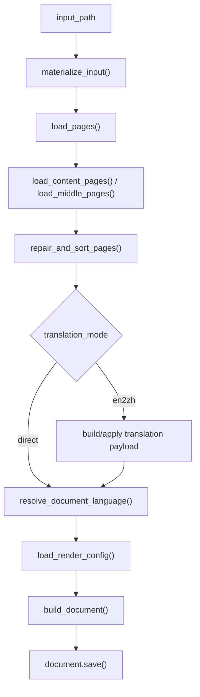
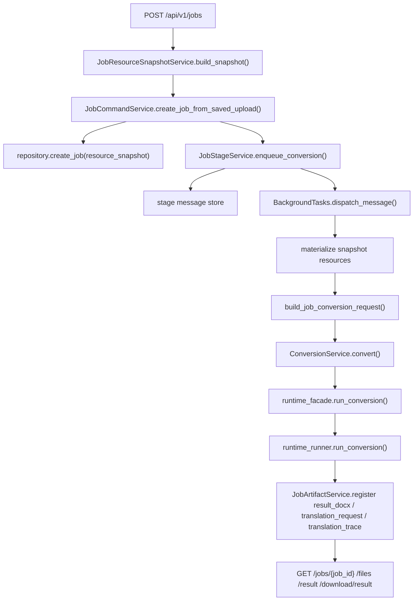
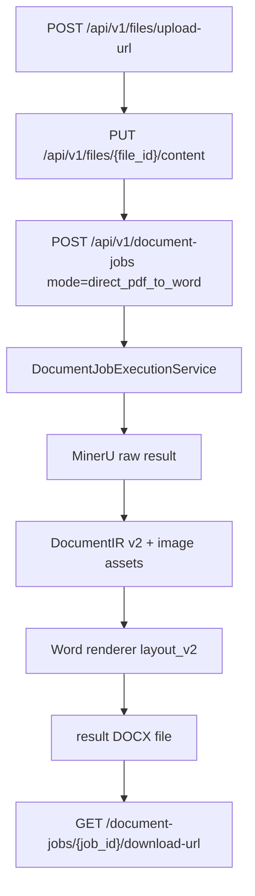

# MinerU 到 DOCX 架构总入口

## 1. 定位

当前仓库已经不是单一脚本工具，而是以后端为组合根的服务化结构：

- **FastAPI 后端**
  - 面向前端、脚本调用方和本地服务化联调
  - 当前提供 `files`、`document-jobs`、legacy `jobs`、`mineru-callbacks`、`templates`、`term-rule-sets`、`term-rules`、`term-rule-categories`、`translation-profiles`、`health` 等 HTTP 接口
- **app/conversion 转换核心**
  - 面向后端任务编排，接收 MinerU 输出目录或 zip，生成 DOCX、可选翻译请求 JSON 和可选 segment trace JSON

系统的业务核心仍然是：

```text
MinerU 结构化结果 -> 页面修补 -> 可选英文转中文翻译 -> 模板/YAML 配置 -> DOCX 生成
```

## 2. 核心术语

- **MinerU 包**
  - 转换核心消费的输入目录或 zip，核心文件是 `content_list_v2.json` / `*_content_list_v2.json`，可退回 `content_list.json` / `*_content_list.json`，可选带 `middle.json` 和图片资产。
- **Block / PageData / MiddlePage**
  - 底层转换核心共享的页面块模型。
- **RenderConfig**
  - 模板 section、YAML 页面设置、段落样式、术语替换规则的统一运行时配置。
- **TranslationItem / TranslationBatch**
  - 翻译链路里的最小文本单元和分批请求单元。
- **Job / JobFile / JobEvent**
  - FastAPI 后端的任务主记录、产物记录和事件记录；`JobFile.path` 只表示 job 内逻辑路径，不对外暴露本地绝对路径。新登记 `JobFile` 会记录 `size_bytes` 和 `sha256:<hex>` artifact fingerprint；旧记录允许这两个字段为空。
- **ActorContext / AuditEvent**
  - FastAPI 后端的最小操作者上下文和跨资源审计事件；`ActorContext` 只表达 `admin`、`jobs`、`anonymous` 三类来源，不保存 token 原文。`AuditEvent` 独立于 `JobEvent`，记录成功执行的高风险动作、目标、reason、trace_id 和创建时间。
- **Metadata store**
  - FastAPI jobs metadata 的持久化后端；当前默认 `file`，可显式切到 sqlite `database` 或 MySQL `mysql`，artifact 二进制存储不随 metadata store 自动迁移。
- **ResourceVersion / default pointer**
  - 模板、术语规则集、翻译配置共用的资源版本记录；MySQL metadata store 持久化 `resource_versions` 和 `resource_default_versions`，`ResourceVersionService` 负责 `draft/published/disabled/superseded` 状态机、默认指针和 published-only 解析。
- **Template Profile / Template Version**
  - 以 `template_id` 标识的模板资源；MySQL backend 下 `Template Version` 把 DOCX、`layout_config` 和 `render_policy` 写成 `template` 类型的 resource version payload，并由 `ResourceVersionService` 管理发布、默认指针和禁用。
- **Term Rule Set / Term Rule Version**
  - 以 `term_rule_set_id` 标识的术语规则集；当前默认集是 `electronics-default`。MySQL backend 下 `Term Rule Version` 把 v2 term-rules store 写成 `term_rule_set` 类型的 resource version payload，草稿更新不改 live runtime，发布 / 设默认 / 回滚会同步 `term_rules_store.json` 和 `runtime_subscripts_dictionary.yaml`。
- **Translation Profile / Translation Profile Version**
  - 以 `translation_profile_id` 标识的翻译配置资源；当前默认集是 `electronics-en2zh`。MySQL backend 下 `Translation Profile Version` 把目标语言、领域、prompt 版本、模型名和分批阈值写成 `translation_profile` 类型的 resource version payload，发布版本不可原地修改，默认指针只指向 published 版本。
- **Job Resource Snapshot**
  - 写入 `JobRecord.resource_snapshot` 的不可变任务资源摘要；MySQL resource mode 下 job 创建时绑定 Template Version、Term Rule Version、`en2zh` Translation Profile Version、非敏感 MinerU 请求配置和创建时 source artifact alias。后台 stage 只按 snapshot materialize 运行时资源，不重新读取当前默认指针；旧 job 和 file/sqlite legacy job 允许为空。
- **Operations readiness / Metrics JSON**
  - FastAPI 后端的单实例生产化观测基线；`/health/ready` 报告 metadata store、artifact storage、stage spool、artifact root 可写性、磁盘余量、默认资源版本和 MySQL schema bootstrap 状态，`/health/metrics` 返回 JSON counters，不接 Prometheus，也不暴露 secret、payload、客户文件名或新增本地绝对私密路径。
- **Segment Trace / translation_trace**
  - `en2zh` job 级 JSON artifact，记录 segment 原文、发送给模型的文本、AI 初译、最终渲染文本、模型、prompt 版本和可选默认 Translation Profile 快照。
- **parsed**
  - FastAPI 任务状态中的“已拿到 MinerU 终态结果 zip 地址，但尚未进入 DOCX 后处理”的中间态。
- **process_callback**
  - FastAPI 后台 stage，负责处理 MinerU callback、校验结果地址并更新在线解析任务状态。
- **Document Job / Document File**
  - P0 PDF -> Word 主链路的业务任务与文件记录；调用方先通过 `/api/v1/files/upload-url` 获取上传授权，再用 `/api/v1/document-jobs` 创建 `direct_pdf_to_word` 或实验性 `en2zh_pdf_to_word` 任务。任务失败会记录 `failed_stage`、`error_code`、`error_message` 和事件，成功后通过 `download-url` 获取临时 Word 下载链接。
- **DocumentIR v2 / layout_v2**
  - `document_jobs` Worker 在 MinerU raw result 后生成的中间结构和 renderer layout metadata，用于追踪标题、段落、表格、图片、双栏和质量风险。

## 3. 外部表面

### 3.1 FastAPI

- 入口：`app.main:create_app()`
- 路由：
  - `/api/v1/health`
  - `/api/v1/files`
  - `/api/v1/document-jobs`
  - `/api/v1/jobs`
  - `/api/v1/mineru-callbacks`
  - `/api/v1/templates`
  - `/api/v1/term-rule-sets`
  - `/api/v1/term-rule-categories`
  - `/api/v1/term-rules`
  - `/api/v1/translation-profiles`
- 当前支持：
  - 上传 MinerU 输出 zip
  - 通过 `/api/v1/files` 上传原始 PDF，并通过 `/api/v1/document-jobs` 创建 P0 PDF -> Word 任务
  - `document_jobs` Worker 调用 MinerU、保存 raw result、生成 DocumentIR v2、渲染 Word，并登记 `mineru_raw_result`、`document_ir`、`image_asset` 和 result DOCX 文件
  - `document_jobs` 查询、事件、retry、cancel、archive、download-url 和短期 token 下载；失败状态包含 `failed_stage` / `error_code` / `error_message`
  - 上传原始 PDF 并把任务送进 MinerU 进入 `parsing`
  - 接收 MinerU callback，并在成功后自动恢复结果 zip、继续后处理到 `completed` / `failed`
  - 查询任务状态、事件、产物
  - 下载 DOCX、原始 PDF、MinerU 远端结果 zip 本地副本等已登记 artifact
  - `direct` / `en2zh` 两条后处理路径
  - 多模板目录、模板详情、模板下载、默认模板切换、模板 CRUD / 文件替换，以及 MySQL resource service 下的 Template Version 创建、发布、设默认和禁用
  - Term Rule Set 草稿、发布、设默认、回滚和查询；term-rules legacy 分类 / 规则 CRUD、导入校验、导入、导出、模拟和 sync-files
  - Translation Profile 草稿、发布、设默认、回滚和查询；`en2zh` 执行时可读取默认 published profile 覆盖模型、prompt 和分批参数
  - `en2zh` job 同时登记 `translation_request` 与 `translation_trace`，trace 可通过 artifact 下载入口取得
  - MySQL resource mode 下 jobs 创建可接收 versioned resource selection 参数，创建响应、详情和 `job_created` 事件返回 `resource_snapshot`；后台 stage 使用 snapshot 指向的 exact payload 派生模板、job-local term-rule YAML 和 Translation Profile
  - 本地运维动作：`retry`、`cancel`、`cleanup-local-files`
  - 最小权限与审计基线：template / term-rule-set / translation-profile 发布、设默认、回滚、禁用，job retry / cancel / cleanup-local-files，以及 artifact download 成功返回前写入 audit event
  - Operations readiness 基线：`health/live`、`health/ready` 和 `health/metrics` 覆盖运行态依赖、JSON counters、默认资源版本、audit event 总数、artifact storage 状态和 MySQL schema bootstrap 标识

### 3.2 Conversion library

- 入口：`app/conversion/entrypoint.py`、`app/conversion/service.py`、`app/conversion/runtime_facade.py`
- 输入：
  - MinerU 输出目录
  - MinerU 输出 zip
- 输出：
  - 单个 `.docx`
  - 可选翻译请求 JSON
  - 可选翻译 segment trace JSON

## 4. 物理结构

- `app/main.py`
  - FastAPI app 组合根，挂载 middleware、异常映射和 API router。
- `app/conversion/`
  - 后端 conversion library。
  - `contracts.py`：后端转换请求 / 结果合同。
  - `entrypoint.py`：job -> conversion request 的组装入口。
  - `service.py`：后端 conversion 服务层。
  - `runtime_facade.py`：后端稳定导入面。
  - `runtime_runner.py`：转换总调度。
  - `runtime_helpers.py`：路径解析、语言判定、render config 组装等 helper。
  - `runtime_rendering_api.py`：Document / HTML table 渲染 wrapper。
  - `runtime_models.py`：共享 dataclass。
- `input_adapter_runtime.py`
  - MinerU 输入适配。
- `page_repair_runtime.py`
  - 页面修补。
- `render_config_runtime.py`
  - 模板 / YAML / 术语配置解析。
- `page_layout_runtime.py`
  - 页面编排与视觉块分发。
- `table_html_parser.py`、`table_render_runtime.py`、`table_long_renderer.py`
  - 表格解析与渲染。
- `text_rendering.py`
  - 文本与公式规范化。
- `translation_runtime.py`、`llm_client.py`、`app/conversion/runtime_config.py`
  - 翻译请求构造、segment trace 构建、响应回填、OpenAI 兼容调用。
- `app/`
  - FastAPI 后端表面，详见 [backend-fastapi-service.md](/Users/sc/PycharmProjects/md2word/.codestable/architecture/backend-fastapi-service.md)。
- `app/domains/`
  - 业务 domain 入口。`audit`、`resources`、`templates`、`term_rules`、`translation`、`document_jobs`、`jobs` 和 `files` 分别拥有自己的 models、schemas、routers、services 和 repository ports。
- `app/infrastructure/persistence/`
  - file / sqlite / mysql 三类 metadata backend 的具体 adapter 与 schema bootstrap，按 backend 和 domain responsibility 拆分。
- `app/domains/resources/service.py`
  - 资源版本内部 service，统一草稿更新、发布、默认指针、回滚、禁用、supersede 和 published-only 解析规则。
- `app/domains/audit/service.py`
  - `AuditService` 统一生成 `audit_id`、归一化 reason，并写入 metadata repository 的 audit event 端口。
- `app/services/health_service.py`
  - readiness 依赖探针和 metrics snapshot 生成，覆盖 repository backend、stage spool、artifact storage、默认资源版本、audit event 和运行时计数。
- `app/domains/templates/read_service.py`
  - 模板 manifest 读取、默认模板状态、API 管理模板文件、Template Version payload/hash 构建，以及 MySQL resource version service 对接。
- `app/domains/term_rules/versioning_service.py`
  - Term Rule Set draft payload、版本号生成、发布、设默认、回滚和 live runtime store / runtime YAML 同步。
- `app/domains/translation/profiles_service.py`
  - Translation Profile draft payload、版本号生成、发布、设默认、回滚和默认 published snapshot 解析。
- `app/domains/jobs/resource_snapshots.py`
  - job 创建期资源快照构造与 stage 物化；无 MySQL resource service 时守住 file/sqlite legacy 路径，显式 versioned resource selection 返回 503。
- `app/domains/jobs/paths.py`
  - job 本地目录布局；snapshot term-rule materialization 使用 `var/jobs/{job_id}/resources/runtime_subscripts_dictionary.yaml`。
- `app/domains/translation/router.py`、`app/domains/translation/schemas.py`
  - Translation Profile HTTP 管理入口与 v1 请求 / 响应模型。
- `resources/`
  - 默认模板、页面布局 YAML、术语上下标 YAML、模板 manifest seed、term-rule v2 seed 和翻译 prompt。
- `var/config/`
  - runtime term-rule store、兼容 runtime YAML、默认模板状态，以及 API 管理的模板版本文件目录 `config/templates/{template_id}/v{version}/`。
- `docs/`
  - 后端 API 与运行文档出口。
- `scripts/ops/check_release.py`、`scripts/ops/shadow_copy_metadata_to_mysql.py`
  - 发布前聚合检查与 file -> MySQL metadata 空目标 shadow copy / validate 基线。
- `tests/`
  - characterization tests + FastAPI 后端对象级测试。

## 5. 转换核心流程



这一层详细过程见：

- [conversion-flow.md](/Users/sc/PycharmProjects/md2word/.codestable/architecture/conversion-flow.md)
- [app-conversion-internal.md](/Users/sc/PycharmProjects/md2word/.codestable/architecture/app-conversion-internal.md)

## 6. FastAPI 后端流程



这一层详细过程见：

- [backend-fastapi-service.md](/Users/sc/PycharmProjects/md2word/.codestable/architecture/backend-fastapi-service.md)

## 6.1 Document Jobs P0 流程



P0 document_jobs 是当前 PDF -> Word 内部工作台和 Golden Sample 回归消费的主链路；legacy `/api/v1/jobs` 仍保留为 MinerU zip / PDF 在线历史入口。

## 7. 数据与状态

### 7.1 转换核心

- 输入目录和 zip 解包目录只读。
- 页面级可变状态集中在内存 `pages`。
- 翻译链路直接改写内存中的 `Block` 字段。
- 输出状态累积在 `python-docx` 的 `Document` 实例中，最后一次性写盘。

### 7.2 FastAPI 后端

- 运行态目录在 `var/`：
  - `config/`
  - `jobs/{job_id}/`
  - `stage_messages/`
  - `object_artifacts/`
  - `tmp/`
- 当前默认是 file backend；jobs metadata 可配置切换到 sqlite-backed 或 MySQL-backed infrastructure adapters，artifact 可配置切换到本地对象目录 `local_object` adapter。
- MySQL metadata store 保存 jobs、job events、job files、stage messages、`resource_versions`、`resource_default_versions` 和 `audit_events`；PDF、DOCX、MinerU zip 等 artifact 二进制仍由 artifact storage 保存。
- Operations readiness 当前通过 `/health/ready` 报告 metadata backend、worker mode、stage dispatcher、stage spool、artifact storage、artifact root 可写性、磁盘剩余空间、默认 Template / Term Rule / Translation Profile 版本标签和 MySQL schema bootstrap 可用性。
- `/health/metrics` 返回 JSON counters：job status counts、stage message status counts、resource version counts、audit event count、metadata store、artifact storage、worker mode 和 stage dispatcher；该 endpoint 不是 Prometheus 格式，不暴露 token、payload、客户文件名或新增本地绝对私密路径。
- file -> MySQL metadata migration baseline 由 `scripts/ops/shadow_copy_metadata_to_mysql.py` 提供，默认只写入空目标 MySQL metadata store，`--validate-only` 只做 source / target totals 与 payload 校验。
- `ResourceVersionService` 是内部 service，不暴露通用 HTTP router；资源子模块写入 payload / `snapshot_hash` 后通过它发布版本、切默认指针或解析 published 版本。默认指针只指向 `published` 版本，rollback 只改默认指针，不改历史版本内容。
- Template Profile 已接入资源版本底座：MySQL backend 下 `TemplateReadService` 为每个 Template Version 写入 `resource_type=template` 的 payload 和 `sha256:<hex>` snapshot hash；发布、设默认和禁用走 `ResourceVersionService`，file/sqlite backend 保持 manifest 兼容且发布状态接口返回不可用。
- Term Rule Set 已接入资源版本底座：MySQL backend 下 `TermRuleSetVersionService` 为 `electronics-default` 写入 `resource_type=term_rule_set` 的 draft / published payload 和 snapshot hash；draft 不同步 live runtime，发布设默认、set-default 和 rollback 会把目标 published payload 同步到 `term_rules_store.json` 与 `runtime_subscripts_dictionary.yaml`。file/sqlite backend 保持 legacy `/term-rules` 写路径，MySQL versioned mode 下 legacy 写入口拒绝直写。
- Translation Profile 已接入资源版本底座：MySQL backend 下 `TranslationProfileVersionService` 为 `electronics-en2zh` 写入 `resource_type=translation_profile` 的 draft / published payload 和 snapshot hash；payload 只保存模型、目标语言、领域、prompt 版本和分批阈值，不保存 API key、secret header 或完整 prompt 文本。MySQL resource mode 下 `en2zh` job 创建时绑定指定或默认 published Translation Profile；旧 job / file/sqlite legacy job 仍按 settings / `.env` 兼容路径执行。
- Job Resource Snapshot 已接入 jobs 主链：MySQL resource mode 下 job 创建时解析指定或默认 published Template Version、Term Rule Version，以及 `en2zh` Translation Profile Version；缺少默认 template 或 term-rule 返回 409，指定不存在返回 404，指定非 published 返回 400。stage replay 按 snapshot 的 `resource_type/resource_id/version` 读取 exact record 并校验 `snapshot_hash`，允许创建后版本被 disabled / superseded，但 payload 缺失或 hash 不匹配会让 stage 失败。file/sqlite backend 不传 versioned 参数时保持 legacy 成功路径，显式传 `template_version`、`term_rule_set_id/version` 或 `translation_profile_id/version` 时返回 503。
- Permission and Audit Baseline 已接入高风险动作：`require_admin_actor()`、`require_jobs_actor()`、`require_job_ops_actor()` 在保留旧 token 状态码语义的同时返回 `ActorContext`；`AuditService` 在业务动作成功后写 `AuditEvent`。审计覆盖 template publish / set-default / disable、term-rule-set publish / set-default / rollback、translation-profile publish / set-default / rollback、job retry / cancel / cleanup-local-files 和 artifact download。open 下载始终是 `actor_role=anonymous` 且 `actor_id=null`，不接受匿名请求用 `X-Actor-Id` 自报身份。
- 配置级运行态文件当前包括：
  - `config/term_rules_store.json`
  - `config/runtime_subscripts_dictionary.yaml`
  - `config/template_state.json`
  - `config/templates/{template_id}/v{version}/`
- 已登记产物当前包括：
  - `source_package`
  - `source_pdf`
  - `parsed_result_package`
  - `translation_request`
  - `translation_trace`
  - `result_docx`
- 已登记 artifact 对外暴露 logical path、download_url 和可为空的 fingerprint；本地下载时会校验 logical path / 文件存在性 / fingerprint，路径非法是 400，本地文件缺失是 404，fingerprint 不匹配是 409。
- document_jobs 文件记录覆盖 `source_pdf`、`mineru_raw_result`、`document_ir`、`image_asset` 和生成 Word；上传授权和下载授权都会写审计事件。
- 在线解析任务当前额外持久化：
  - `mineru_batch_id`
  - `mineru_data_id`
  - `mineru_callback_seed`
  - `mineru_status`
  - `mineru_result_zip_url`
- 对外只暴露逻辑路径和下载入口，不暴露本地绝对路径。

## 8. 已知边界

- 当前转换核心仍有部分 runtime 模块通过注入对象读取外部符号，属于已拆物理文件但尚未完全解耦的状态。
- `resources/prompts/translation_en2zh.md` 是运行时资源，不应迁进 `.codestable/`。
- 当前 FastAPI 后端已支持“上传原始 PDF -> 成功提交 MinerU -> 接收 callback -> 恢复 `parsed_result_package` -> DOCX 后处理 -> completed/failed”；`parsed` 保留为短暂可观察里程碑。
- 当前 FastAPI 后端默认仍使用 file backend，但已具备 sqlite database metadata adapter、MySQL metadata adapter、local object artifact adapter、metadata shadow copy 和 artifact shadow upload 的最小迁移边界。
- MySQL adapter 已完成 schema bootstrap、existing repository protocol / resource version protocol 适配、fake MySQL release smoke，以及 file -> MySQL metadata 空目标 shadow copy / validate baseline；真实外部 MySQL 服务 smoke 和 Alembic / SQLAlchemy 迁移体系仍未纳入当前能力。
- 资源版本底座当前仍不暴露通用 HTTP router；Template Profile、Term Rule Set 与 Translation Profile 已实现各自的管理 / 发布 API 和默认指针，jobs 在 MySQL resource mode 下通过 `JobResourceSnapshotService` 消费这些 published 版本。
- audit event 当前没有 HTTP 查询 API 或 UI；测试和运维脚本可通过 repository 端口读取 file/sqlite/MySQL audit events。
- artifact fingerprint 只对新登记产物强制写入；旧 `JobFile` 记录缺少 `size_bytes` / `sha256` 时保持兼容，不在当前能力内强制 backfill。
- artifact retention 当前只有 local + object dry-run 计划，不执行真实删除；cleanup-local-files 会写 audit event，但真实删除、删除审计和恢复策略仍留给后续运维 feature。
- legacy jobs 已有 callback 丢失后的主动 `recover-mineru-result` 查询恢复；当前仍没有独立 worker / queue、多实例 lease 或 heartbeat。
- templates 当前支持目录可见、详情、下载、默认模板切换、模板 CRUD / replace，以及 MySQL-backed Template Version draft/publish/set-default/disable；暂不做可视化模板编辑器。
- term-rules legacy API 当前支持分类 / 规则 CRUD、导入、导出、模拟和 sync-files；MySQL versioned mode 下 legacy 写入口不再直改 runtime，必须通过 Term Rule Set draft / publish 流程发布到 live runtime。
- characterization suites 现在大多通过 `tests/runtime_direct_loaders.py` 直接加载 runtime 模块，不再依赖旧根入口作为唯一 patch seam。
- `translation_request_output` 在底层帮助文案和实际行为之间仍有差异：文案说只导出请求并退出，但实际仍会继续调用 LLM。
- Job Resource Snapshot 不回填历史 job；`resource_snapshot=None` 的旧 job 继续走 legacy 默认模板 / 全局 runtime YAML / settings 翻译配置路径。snapshot 中 `artifact_ids` 只保存 source artifact alias（`source_package` 或 `source_pdf`），不引入独立 artifact id 体系，也不保存 API key、MinerU token、callback token 或完整 prompt 文本。
- Translation Profile 当前只支持 `electronics-en2zh`；jobs API 仍只支持 `direct` / `en2zh`，不新增 `zh2en` / `zh2ru` 或 `source_language` / `target_language` 创建参数。
- 测试覆盖虽然已包含对象级后端测试和真实链路验证，但仍不能代替完整的长期视觉版式验收。
- Golden Sample 当前有 4 个正式匹配 PDF，其中 1 个已跑通真实主链路；P0 正式质量验收仍 blocked，后续质量修复以 `document-ir-layout-risk-pass` 和 `word-renderer-editable-output-pass` 为主。

## 9. 相关文档

- [backend-fastapi-service.md](/Users/sc/PycharmProjects/md2word/.codestable/architecture/backend-fastapi-service.md)
- [conversion-flow.md](/Users/sc/PycharmProjects/md2word/.codestable/architecture/conversion-flow.md)
- [app-conversion-internal.md](/Users/sc/PycharmProjects/md2word/.codestable/architecture/app-conversion-internal.md)
- [fastapi-backend-roadmap.md](/Users/sc/PycharmProjects/md2word/.codestable/roadmap/fastapi-backend/fastapi-backend-roadmap.md)
- [fastapi-backend-acceptance.md](/Users/sc/PycharmProjects/md2word/.codestable/roadmap/fastapi-backend/fastapi-backend-acceptance.md)
- [pdf-to-word-delivery-hardening-roadmap.md](/Users/sc/PycharmProjects/md2word/.codestable/roadmap/pdf-to-word-delivery-hardening/pdf-to-word-delivery-hardening-roadmap.md)

## 10. 变更日志

- 2026-06-03：补入 P0 `document_jobs` PDF -> Word 主链路现状、DocumentIR v2 / renderer metadata、Golden Sample blocked 质量状态，并修正 legacy `recover-mineru-result` 主动恢复边界。
- 2026-05-31：补入项目目录重构 Phase 9 现状；`app/core/` 收窄为 config/logging/errors/runtime 等跨域基础设施，auth 用户上下文、Document IR 和 renderer 模板配置模型移入对应 services；集中 API schema 文件拆为 auth/health 路由私有 schema companion。
- 2026-05-31：补入项目目录重构 Phase 5 现状；业务后端代码迁入 `app/domains/`，persistence adapter 拆到 `app/infrastructure/persistence/`，运行时状态改为 `var/`，版本化资源改为 `resources/`，并移除长期 `app/schemas` / `app/repositories` 中央包。
- 2026-05-29：补入 Permission and Audit Baseline 现状；高风险资源动作、job ops 和 artifact download 写入独立 `AuditEvent`，actor 从现有 admin/jobs/open token 边界派生，不引入 SSO、多租户或审计查询 API。
- 2026-05-29：补入 Job Resource Snapshot Binding 现状；MySQL resource mode 下 job 创建绑定 Template / Term Rule / `en2zh` Translation Profile published versions 和非敏感 MinerU snapshot，stage 按 exact snapshot materialize 模板、job-local term-rule YAML 和 Translation Profile。
- 2026-05-29：补入 Translation Profile and Segment Trace 现状；MySQL-backed `/translation-profiles` 支持草稿、发布、设默认和回滚，`en2zh` job 生成 `translation_trace` artifact。
- 2026-05-29：补入 Template Profile versioning 现状；templates API 支持模板 CRUD / 文件替换和 MySQL-backed Template Version 创建、发布、设默认、禁用，版本 payload 覆盖 DOCX、`layout_config`、`render_policy` 和 snapshot hash。
- 2026-05-29：补入 Term Rule Set versioning 现状；MySQL-backed `/term-rule-sets` 支持草稿、发布、设默认和回滚，默认 published payload 同步到 live term-rules store 与 runtime YAML，legacy 写入口在 versioned mode 下受保护。
- 2026-05-29：补入 resource versioning foundation 现状；MySQL metadata store 新增 `resource_default_versions` 默认指针，`ResourceVersionService` 统一资源版本状态机、默认指针、回滚和 published-only 解析，当前不暴露通用 HTTP API。
- 2026-05-28：补入 local artifact 合同加固现状；新登记 `JobFile` 记录 `size_bytes` / `sha256` fingerprint，下载本地 artifact 按 400 / 404 / 409 诊断，retention 当前只输出 local + object dry-run 候选。
- 2026-05-28：补入 MySQL metadata store 现状；当前可通过 `JOBS_REPOSITORY_BACKEND=mysql` 使用 MySQL 保存 jobs metadata、stage messages 和 resource_versions 基础表，artifact 二进制仍走独立本地 / 对象 storage。
- 2026-05-28：补入 PDF 在线链路 `parsed -> completed` 当前合同，以及 jobs metadata / artifact storage 的可替换边界；默认仍保持单体单实例和 file/local 行为。
- 2026-05-28：阶段 0 入口收口，文档只保留 `app/main.py` 和 `app/conversion/` 作为后端 / 转换入口。
- 2026-05-19：补入 shared conversion library 现状，并同步 templates / term-rules 新边界。
- 2026-05-18：重新分析当前源码，更新为“主入口 + runtime 模块”的现状架构，补充翻译链路、模块结构和 onboard 扫描结论。
- 2026-05-18：补入 FastAPI 后端表面和相关文档出口。
- 2026-05-18：补入 MinerU callback ingress、`parsed/process_callback` 状态语义和在线解析安全边界的早期收口记录。
