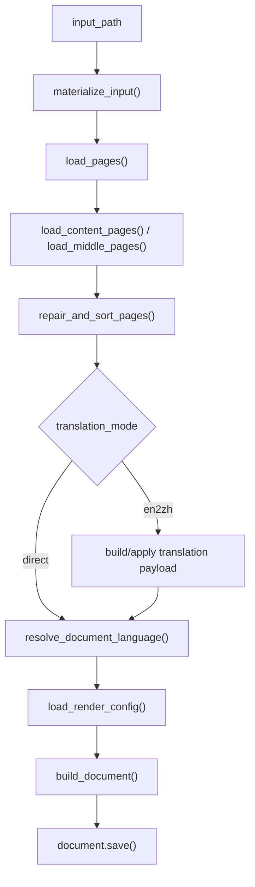
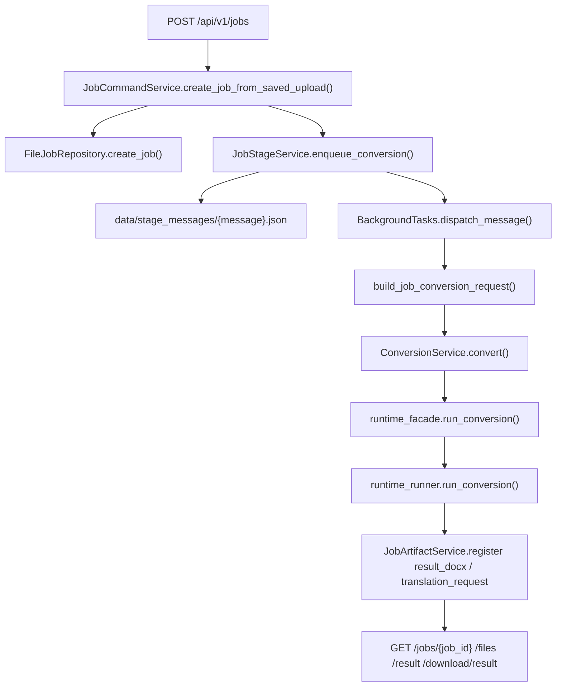

# MinerU 到 DOCX 架构总入口

## 1. 定位

当前仓库已经不是单一脚本工具，而是两层结构：

- **CLI / PyCharm 转换核心**
  - 面向本地开发、调试和直跑转换
  - 用户入口仍是 `mineru_to_docx.py`，但真实共享转换实现已经拆到 `app/conversion/`
- **FastAPI 后端壳层**
  - 面向前端、脚本调用方和本地服务化联调
  - 当前提供 `jobs`、`mineru-callbacks`、`templates`、`term-rules`、`term-rule-categories`、`health` 六组 HTTP 接口

系统的业务核心仍然是：

```text
MinerU 结构化结果 -> 页面修补 -> 可选英文转中文翻译 -> 模板/YAML 配置 -> DOCX 生成
```

## 2. 核心术语

- **MinerU 包**
  - 转换核心消费的输入目录或 zip，核心文件是 `content_list_v2.json` / `*_content_list_v2.json`，可退回 `content_list.json` / `*_content_list.json`，可选带 `middle.json` 和图片资产。
- **Block / PageData / MiddlePage**
  - 底层转换核心共享的页面块模型。
- **RenderConfig**
  - 模板 section、YAML 页面设置、段落样式、术语替换规则的统一运行时配置。
- **TranslationItem / TranslationBatch**
  - 翻译链路里的最小文本单元和分批请求单元。
- **Job / JobFile / JobEvent**
  - FastAPI 后端的任务主记录、产物记录和事件记录；`JobFile.path` 只表示 job 内逻辑路径，不对外暴露本地绝对路径。
- **parsed**
  - FastAPI 任务状态中的“已拿到 MinerU 终态结果 zip 地址，但尚未进入 DOCX 后处理”的中间态。
- **process_callback**
  - FastAPI 后台 stage，负责处理 MinerU callback、校验结果地址并更新在线解析任务状态。

## 3. 外部表面

### 3.1 CLI / PyCharm

- 入口：`mineru_to_docx.py`
- 输入：
  - MinerU 输出目录
  - MinerU 输出 zip
- 输出：
  - 单个 `.docx`
  - 可选翻译请求 JSON

### 3.2 FastAPI

- 入口：`app.main:create_app()`
- 路由：
  - `/api/v1/health`
  - `/api/v1/jobs`
  - `/api/v1/mineru-callbacks`
  - `/api/v1/templates`
  - `/api/v1/term-rule-categories`
  - `/api/v1/term-rules`
- 当前支持：
  - 上传 MinerU 输出 zip
  - 上传原始 PDF 并把任务送进 MinerU 进入 `parsing`
  - 接收 MinerU callback，并把任务推进到 `parsed` / `failed`
  - 查询任务状态、事件、产物
  - 下载 DOCX
  - `direct` / `en2zh` 两条后处理路径
  - 多模板目录、模板详情、模板下载、默认模板切换
  - term-rules 分类只读、规则查询、导入校验、导入、导出、模拟和 sync-files
  - 本地运维动作：`retry`、`cancel`、`cleanup-local-files`

## 4. 物理结构

- `mineru_to_docx.py`
  - CLI / PyCharm 入口、共享常量 / dataclass、runtime 绑定容器和兼容 façade。
- `input_adapter_runtime.py`
  - MinerU 输入适配。
- `page_repair_runtime.py`
  - 页面修补。
- `render_config_runtime.py`
  - 模板 / YAML / 术语配置解析。
- `page_layout_runtime.py`
  - 页面编排与视觉块分发。
- `table_html_parser.py`、`table_render_runtime.py`、`table_long_renderer.py`
  - 表格解析与渲染。
- `text_rendering.py`
  - 文本与公式规范化。
- `translation_runtime.py`、`llm_client.py`、`config.py`
  - 翻译请求构造、响应回填、OpenAI 兼容调用。
- `app/conversion/`
  - shared conversion library。
  - `runtime_facade.py`：FastAPI 侧稳定导入面。
  - `runtime_runner.py`：共享转换总调度。
  - `runtime_helpers.py`：路径解析、语言判定、render config 组装等共享 helper。
  - `runtime_rendering_api.py`：Document / HTML table 渲染 wrapper。
  - `runtime_models.py`：共享 dataclass。
- `app/`
  - FastAPI 后端表面，详见 [backend-fastapi-service.md](/Users/sc/PycharmProjects/md2word/.codestable/architecture/backend-fastapi-service.md)。
- `template/`、`template_configs/`
  - 默认模板、页面布局 YAML、术语上下标 YAML、模板 manifest 和 term-rule v2 seed。
- `data/config/`
  - runtime term-rule store、兼容 runtime YAML、默认模板状态。
- `docs/`
  - 后端 API 与运行文档出口。
- `tests/`
  - characterization tests + FastAPI 后端对象级测试。

## 5. 转换核心流程



这一层详细过程见：

- [conversion-flow.md](/Users/sc/PycharmProjects/md2word/.codestable/architecture/conversion-flow.md)
- [module-mineru-to-docx-internal.md](/Users/sc/PycharmProjects/md2word/.codestable/architecture/module-mineru-to-docx-internal.md)

## 6. FastAPI 后端流程



这一层详细过程见：

- [backend-fastapi-service.md](/Users/sc/PycharmProjects/md2word/.codestable/architecture/backend-fastapi-service.md)

## 7. 数据与状态

### 7.1 转换核心

- 输入目录和 zip 解包目录只读。
- 页面级可变状态集中在内存 `pages`。
- 翻译链路直接改写内存中的 `Block` 字段。
- 输出状态累积在 `python-docx` 的 `Document` 实例中，最后一次性写盘。

### 7.2 FastAPI 后端

- 运行态目录在 `data/`：
  - `config/`
  - `jobs/{job_id}/`
  - `stage_messages/`
  - `tmp/`
- 当前只有 file backend。
- 配置级运行态文件当前包括：
  - `config/term_rules_store.json`
  - `config/runtime_subscripts_dictionary.yaml`
  - `config/template_state.json`
- 已登记产物当前包括：
  - `source_package`
  - `source_pdf`
  - `translation_request`
  - `result_docx`
- 在线解析任务当前额外持久化：
  - `mineru_batch_id`
  - `mineru_data_id`
  - `mineru_callback_seed`
  - `mineru_status`
  - `mineru_result_zip_url`
- 对外只暴露逻辑路径和下载入口，不暴露本地绝对路径。

## 8. 已知边界

- 当前转换核心仍通过 `bind_runtime()` 反查主模块对象，属于已拆物理文件但尚未完全解耦的状态。
- `prompt/translation_en2zh.md` 是运行时资源，不应迁进 `.codestable/`。
- 当前 FastAPI 后端已支持“上传原始 PDF -> 成功提交 MinerU -> 接收 callback -> 进入 parsed/failed”，但还不支持下载结果 zip、callback 丢失后的主动恢复和 DOCX 后处理回流。
- 当前 FastAPI 后端只支持 file backend。
- templates 当前支持目录可见、详情、下载和默认模板切换，但还不支持模板文件 CRUD / replace / version 管理。
- term-rules 当前支持整库导入、导出、模拟和 sync-files，但还不支持 rule 级 CRUD 或 category 写接口。
- characterization suites 现在大多通过 `tests/runtime_direct_loaders.py` 直接加载 runtime 模块，不再把 `mineru_to_docx.py` 当成唯一 patch seam；但 root façade 仍保留给 CLI 和 `bind_runtime()` 使用。
- `translation_request_output` 在底层 CLI 文案和实际行为之间仍有差异：文案说只导出请求并退出，但实际仍会继续调用 LLM。
- 测试覆盖虽然已包含对象级后端测试和真实链路验证，但仍不能代替完整的长期视觉版式验收。

## 9. 相关文档

- [backend-fastapi-service.md](/Users/sc/PycharmProjects/md2word/.codestable/architecture/backend-fastapi-service.md)
- [conversion-flow.md](/Users/sc/PycharmProjects/md2word/.codestable/architecture/conversion-flow.md)
- [module-mineru-to-docx-internal.md](/Users/sc/PycharmProjects/md2word/.codestable/architecture/module-mineru-to-docx-internal.md)
- [fastapi-backend-roadmap.md](/Users/sc/PycharmProjects/md2word/.codestable/roadmap/fastapi-backend/fastapi-backend-roadmap.md)
- [fastapi-backend-acceptance.md](/Users/sc/PycharmProjects/md2word/.codestable/roadmap/fastapi-backend/fastapi-backend-acceptance.md)

## 10. 变更日志

- 2026-05-19：补入 shared conversion library 现状，明确 `mineru_to_docx.py` 已收口为入口 / 兼容 façade，并同步 templates / term-rules 新边界。
- 2026-05-18：重新分析当前源码，更新为“主入口 + runtime 模块”的现状架构，补充翻译链路、模块结构和 onboard 扫描结论。
- 2026-05-18：补入 FastAPI 后端表面和相关文档出口，当前仓库已从单一 CLI 工具演进为“CLI 转换核心 + FastAPI 后端壳层”的双表面结构。
- 2026-05-18：补入 MinerU callback ingress、`parsed/process_callback` 状态语义和在线解析安全边界，明确当前只完成 callback 收口，尚未回流 DOCX 后处理。
