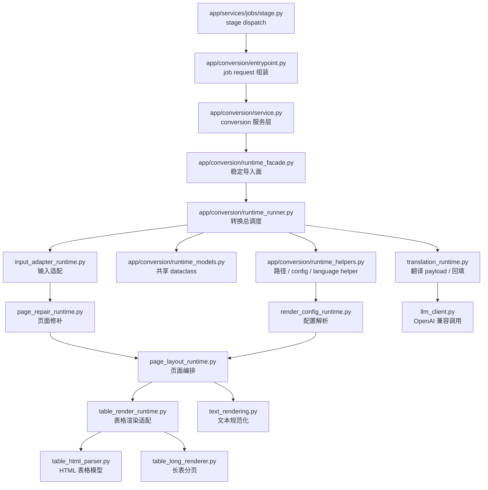

# app/conversion 运行时模块边界

## 1. 总体边界

当前转换核心已经收口到 `app/conversion/`。FastAPI jobs 负责上传、任务状态、artifact 和后台 stage；conversion 层负责把 MinerU 输出目录或 zip 转成 DOCX，并按 `translation_mode` 选择 direct 或 en2zh 路径。

## 2. 后端 conversion 入口

- 文件：`app/conversion/entrypoint.py`、`app/conversion/service.py`、`app/conversion/runtime_facade.py`
- 职责：把 job 上下文、artifact 路径、模板参数和翻译参数组装成稳定转换请求，再调用 runtime runner。
- 关键入口：
  - `build_job_conversion_request()`：从 job 和 repository 状态组装 conversion request。
  - `ConversionService.convert()`：服务层调用、结果归一化和异常边界。
  - `runtime_facade.run_conversion()`：后端稳定导入面。
- 边界说明：这一层不解释 MinerU JSON，也不直接操作 Word 文档。

## 3. runtime runner 与 helper

- 文件：`app/conversion/runtime_runner.py`、`runtime_helpers.py`、`runtime_rendering_api.py`、`runtime_models.py`
- 职责：统一转换总调度、路径解析、语言判定、render config 组装、Document / Table wrapper 和共享 dataclass。
- 关键入口：
  - `runtime_runner.run_conversion()`：转换总调度。
  - `runtime_helpers.load_render_config()` / `resolve_document_language()`：配置装配和语言判定。
  - `runtime_rendering_api.render_table_from_html()`：HTML 表格主入口。
  - `runtime_models.Block` / `RenderConfig`：共享模型定义位置。
- 边界说明：这一层是转换核心的稳定中心，不持有 job repository，也不暴露 HTTP 语义。

## 4. 输入适配

- 文件：`input_adapter_runtime.py`
- 职责：把 MinerU 输出目录或 zip 解析为统一 `PageData` / `Block` 列表。
- 关键入口：
  - `materialize_input()`：目录直读或 zip 解压到临时目录。
  - `load_pages()`：读取主内容和 middle，再调用页面修补。
  - `load_content_pages()`：优先 v2，退回 legacy。
  - `parse_v2_block()` / `parse_legacy_block()` / `parse_visual_block()`：块映射。
- 数据所有权：这一层拥有“原始 MinerU JSON 如何映射为内部块模型”的解释权，不负责 Word 版式。

## 5. 页面修补

- 文件：`page_repair_runtime.py`
- 职责：在输入适配之后、页面编排之前修补页面数据。
- 关键入口：
  - `repair_and_sort_pages()`：按 page 合并 middle 并排序。
  - `merge_page_with_middle()`：补页尺寸、页眉页脚、视觉块元数据。
  - `attach_table_continuations()`：把只含表格占位符的后续页高度挂到前一张真实长表。
- 边界说明：这层只修改内存模型，不写文件，也不直接调用 Word API。

## 6. 配置解析

- 文件：`render_config_runtime.py`
- 职责：把模板、YAML、术语上下标规则装配成 `RenderConfig`。
- 关键入口：
  - `load_render_config()`：总装配。
  - `load_section_layout()`：默认 A4、模板 section、YAML `page_setup` 的优先级合并。
  - `load_paragraph_styles()`：YAML 样式键到 Word 样式名映射。
  - `TerminologyReplacer`：文本和 HTML 上下标替换。
- 边界说明：配置层不主动驱动渲染，只向页面编排、表格渲染和文本规范化提供配置对象。

## 7. 页面编排

- 文件：`page_layout_runtime.py`
- 职责：把 `pages` 排进 Word 文档，决定 section、目录页、单双栏区域、块级分发。
- 关键入口：
  - `build_document()`：Document 构建总入口。
  - `render_document_page()` / `prepare_document_section()`：页级渲染与 section 管理。
  - `render_page_body()` / `render_toc_page()`：正文页和目录页分流。
  - `build_regions()` / `detect_two_col_bands()`：单双栏区域识别。
  - `render_block_into_container()` / `render_visual_block()`：块级渲染分发。
- 边界说明：页面编排是渲染总调度者，但具体表格、文本细节仍委托给下游模块。

## 8. 表格渲染

- 文件：`table_html_parser.py`、`table_render_runtime.py`、`table_long_renderer.py`，以及 `app/conversion/runtime_rendering_api.py` 中的 thin wrapper。
- 职责：把 HTML 表格或表格图片渲染为 Word 表格、续表、图片或降级表格。
- 关键入口：
  - `parse_html_table()`：HTML 到 `HtmlTable`。
  - `render_table_from_html()`：shared 主入口 wrapper。
  - `render_large_table_if_needed_impl()`：大表路径分流。
  - `render_standard_html_table_impl()`：标准 Word 表格生成。
  - `render_long_simple_table()`：长规则表渲染。
- 边界说明：表格渲染会调用文本规范化能力填充单元格，但文本规范化不反向依赖表格。

## 9. 文本规范化

- 文件：`text_rendering.py`
- 职责：规范化 TeX / 公式 / HTML inline markup，应用段落和 run 样式，输出标题、正文、列表和目录文本。
- 关键入口：
  - `normalize_formula_text()` / `convert_inline_tex_to_html()`：公式文本规范化。
  - `prepare_text()`：公式规范化和术语替换统一入口。
  - `render_inline_html_into_paragraph()`：内联 HTML 到 Word run。
  - `fill_title_paragraph()` / `fill_body_paragraph()` / `fill_list_paragraph()`：段落落盘出口。
- 边界说明：这层是页面编排和表格渲染共同依赖的低层文本能力。

## 10. 翻译与 LLM 客户端

- 文件：`translation_runtime.py`、`llm_client.py`、`config.py`、`prompt/translation_en2zh.md`
- 职责：抽取可翻译文本、构造最小 JSON payload、校验并回填译文、调用 OpenAI 兼容接口。
- 关键入口：
  - `extract_translation_items()`：从页面块抽取 text/items/captions/footnotes/html cell。
  - `build_translation_batches()`：按章节、页数和字符数分批。
  - `apply_translation_responses()`：校验后回填页面块。
  - `translate_payload()` / `translate_batch()`：实际 LLM 调用。
  - `load_app_config()`：从 `.env` / 环境变量读取模型、base URL、API key 和分批配置。
- 边界说明：翻译链路修改渲染前的内存页面模型，之后仍回到同一套 DOCX 渲染链。

## 11. 测试边界

- `tests/runtime_direct_loaders.py` 为 `render_config`、`text_render`、`page_layout`、`page_repair`、`render_table`、`input_adapter` 提供直接加载 seam。
- runtime direct loader 会为模块注入 `docx`、`bs4`、`yaml`、`loguru` stub 所需的同名符号。
- 当前测试更偏“行为刻画”，不是端到端视觉验收；真实 DOCX 版式仍需样例转换人工或渲染验证。

## 12. 后续维护原则

- 若继续拆模块，优先移除 runtime 反查耦合，而不是新增更深的 wrapper。
- 不要把 `prompt/translation_en2zh.md` 迁进 `.codestable/`；它是运行时资源。
- 表格和文本应保持单向依赖：表格可调用文本工具，文本层不应感知表格模型。
- 翻译链路应优先修正“只导出请求并退出”的文案/行为不一致，再继续扩展批处理能力。

## 变更日志

- 2026-05-28：阶段 0 入口收口，改为记录 `app/conversion/` 的后端转换边界。
