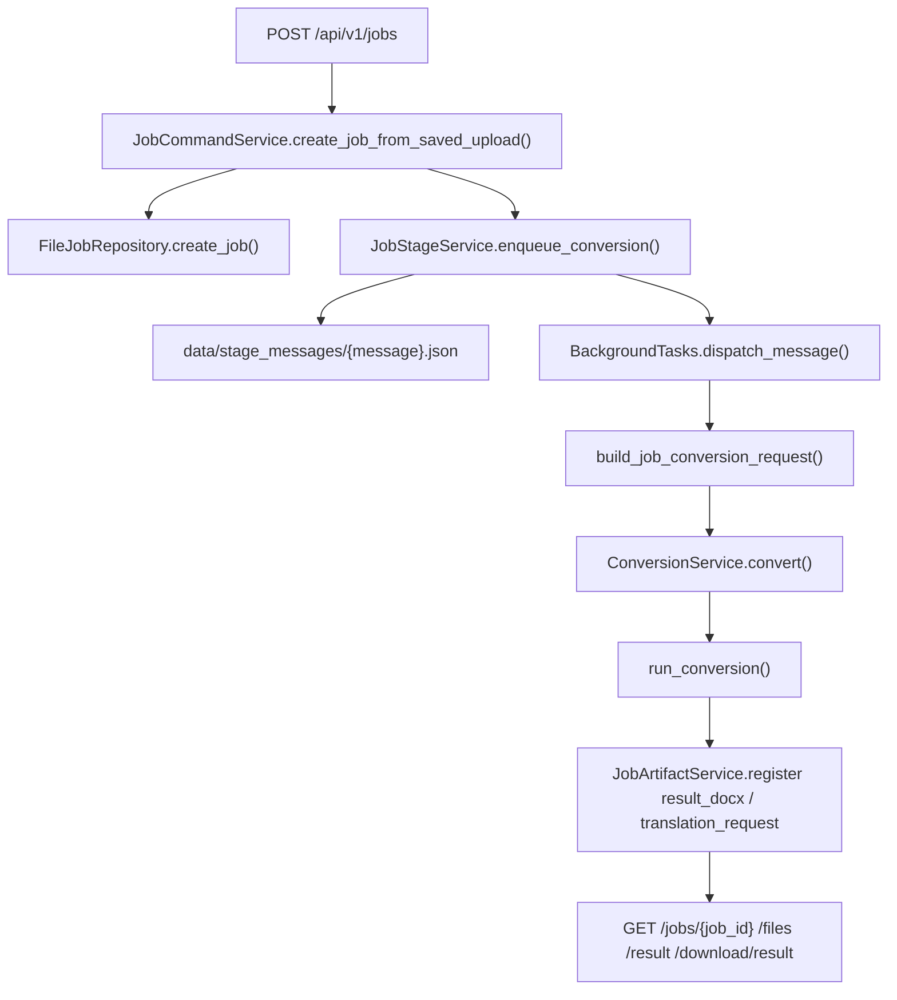
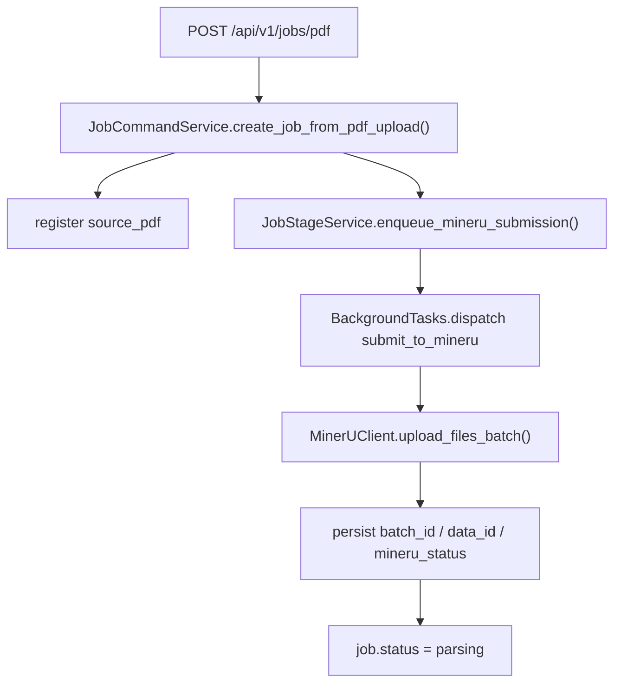

# FastAPI 后端服务

## 1. 定位

当前仓库除了原有 CLI / PyCharm 转换入口外，还新增了一条可部署的 FastAPI 后端表面。它不是第二套转换算法，而是对现有 `run_conversion()` 和 runtime 模块的服务化封装，负责：

- 接收 MinerU 输出 zip
- 接收原始 PDF 并提交 MinerU
- 通过后台 stage 推进转换
- 暴露任务状态、事件和产物下载
- 提供 `direct` / `en2zh` 两条后处理路径
- 暴露默认模板和绑定 YAML 配置的只读元数据

## 2. 物理结构

- `app/main.py`
  - 创建 FastAPI app，挂载 CORS、中间件、router 和 runtime。
- `app/api/v1/routers/health.py`
  - `health/live` 与 `health/ready`。
- `app/api/v1/routers/jobs.py`
  - MinerU zip 上传、原始 PDF 上传、查询、事件、结果下载、retry、cancel、cleanup-local-files。
- `app/api/v1/routers/templates.py`
  - 默认模板和绑定 YAML 配置的只读接口。
- `app/services/jobs/`
  - `command.py`、`query.py`、`stage.py`、`lifecycle.py`、`artifacts.py`。
- `app/clients/mineru_client.py`
  - 原始 PDF 在线提交到 MinerU 的客户端。
- `app/conversion/`
  - `contracts.py`、`entrypoint.py`、`service.py` 组成后端 conversion library 边界。
- `app/services/templates/read_service.py`
  - 模板和配置元数据读取。
- `app/services/health_service.py`
  - readiness 依赖探针。
- `data/`
  - 运行态 jobs、stage spool 和临时目录。

## 3. 主流程

### PDF 在线提交前半程

## 4. API 合同

### 4.1 jobs

- `POST /api/v1/jobs`
  - 当前只接受 MinerU 输出 zip，不接受原始 PDF。
- `POST /api/v1/jobs/pdf`
  - 当前接受原始 PDF，成功后只推进到 `parsing`。
- `GET /api/v1/jobs`
  - 分页查询任务列表。
- `GET /api/v1/jobs/{job_id}`
  - 查看任务状态、事件和已登记产物。
- `GET /api/v1/jobs/{job_id}/download/{artifact_alias}`
  - 下载 `source-package`、`translation-request`、`result`。
- `POST /api/v1/jobs/{job_id}/retry`
  - 对 `failed/canceled` 任务重新入队。
- `POST /api/v1/jobs/{job_id}/cancel`
  - 对 `uploaded/queued` 任务取消。
- `POST /api/v1/jobs/{job_id}/cleanup-local-files`
  - 清理未登记运行态目录，保留本地唯一副本。

### 4.2 templates

- `GET /api/v1/templates`
  - 列出默认模板及绑定配置元数据。
- `GET /api/v1/templates/{template_id}`
  - 查看默认模板详情。
- `GET /api/v1/templates/{template_id}/download`
  - 下载默认模板文件。

### 4.3 health

- `GET /api/v1/health/live`
  - 只确认进程可响应。
- `GET /api/v1/health/ready`
  - 返回运行目录、模板/YAML、翻译能力和 stage spool 状态。

## 5. 产物合同

对外产物只通过 `JobArtifactService` 暴露，当前内建 file type：

- `source_package`
- `source_pdf`
- `translation_request`
- `result_docx`

关键约束：

- `path` 是 job 内逻辑路径，不是本地绝对路径。
- `download_url` 是调用方真实消费入口。
- 本地绝对路径只在服务端通过 `build_job_paths()` 推导，不进入对外合同。

## 6. 翻译能力

- `translation_mode=direct`
  - 不走翻译，直接进入 DOCX 渲染。
- `translation_mode=en2zh`
  - 先通过 readiness 预检 `OPENAI_API_KEY`、OpenAI SDK、`translation_en2zh.md` prompt。
  - 事件流增加：
    - `translation_started`
    - `translation_completed`
    - `translation_failed`
  - 成功时登记 `translation_request` 产物，并把最终 `resolved_document_language` 固定为 `zh`。

## 7. 运行时与可观测性

- 日志分三层：
  - `access`
  - `business`
  - `system`
- `health/ready` 关键字段：
  - `mineru_api_token_configured`
  - `jobs_dir_writable`
  - `stage_spool_pending_messages`
  - `template_docx_exists`
  - `layout_config_exists`
  - `subscript_config_exists`
  - `translation_prompt_exists`
  - `translation_available`

## 8. 已知边界

- 当前后端已经支持“上传原始 PDF -> 成功提交 MinerU -> 任务进入 parsing”，但还不接 MinerU callback。
- 当前后端只支持 file backend。
- `retry/cancel/cleanup-local-files` 当前按普通 jobs 访问口径开放，不要求 `X-Admin-Token`。
- 模板接口当前只读，不支持多模板写操作。

## 9. 相关文档

- [ARCHITECTURE.md](/Users/sc/MinerU/md2word_file/.codestable/architecture/ARCHITECTURE.md)
- [conversion-flow.md](/Users/sc/MinerU/md2word_file/.codestable/architecture/conversion-flow.md)
- [fastapi-backend-roadmap.md](/Users/sc/MinerU/md2word_file/.codestable/roadmap/fastapi-backend/fastapi-backend-roadmap.md)
