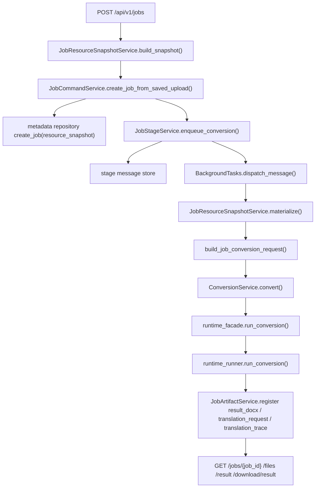
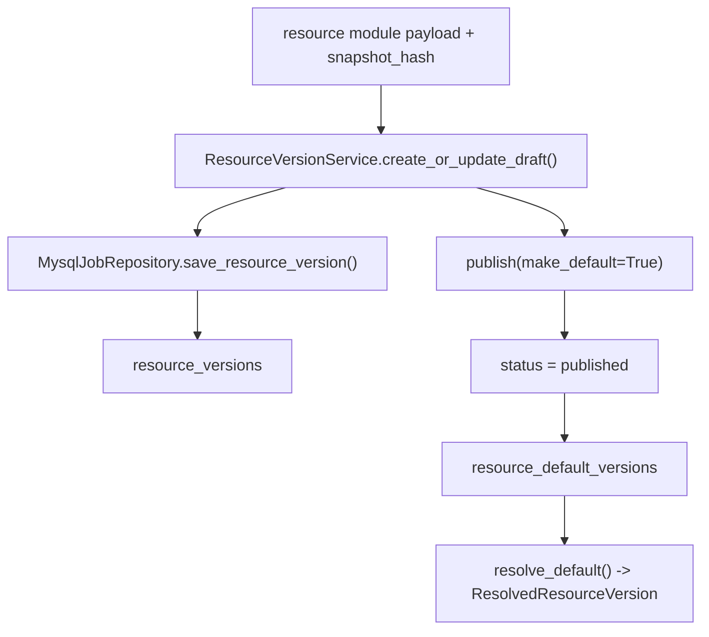
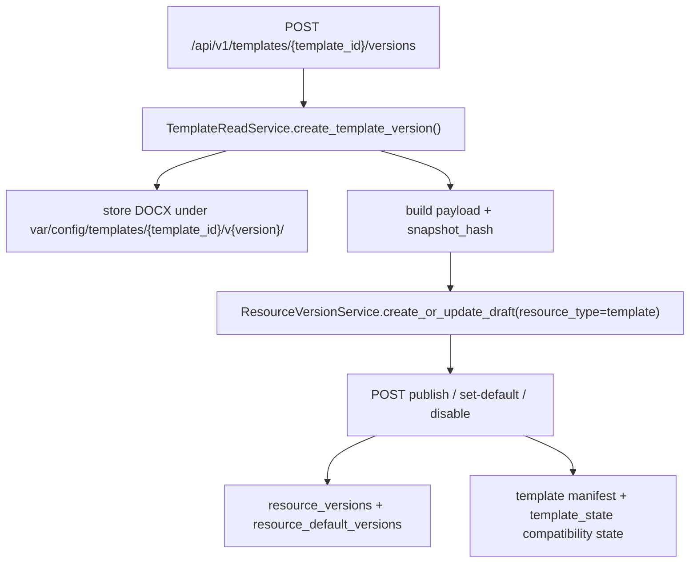
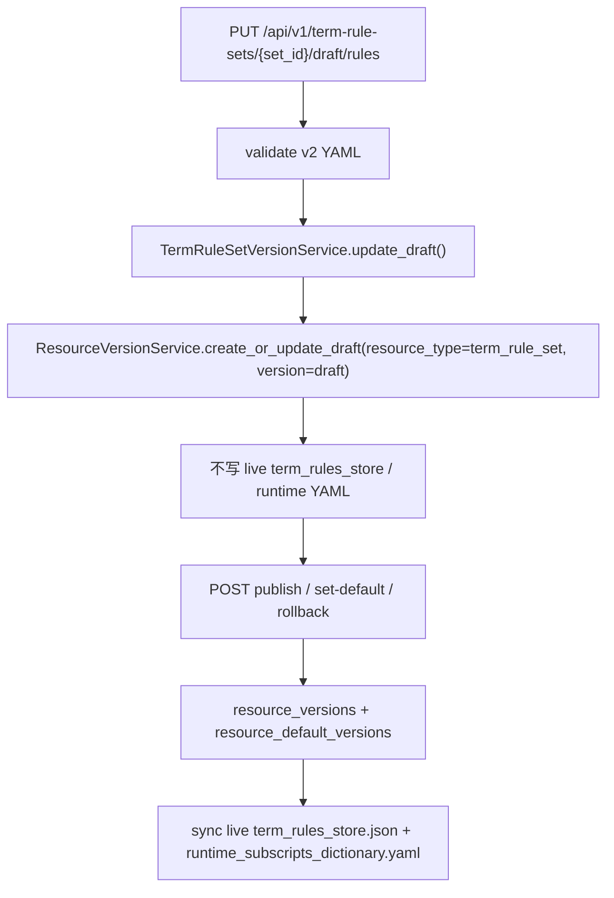
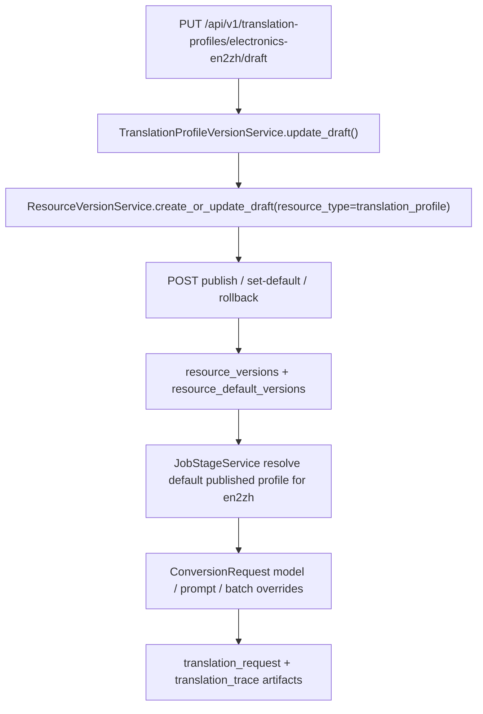
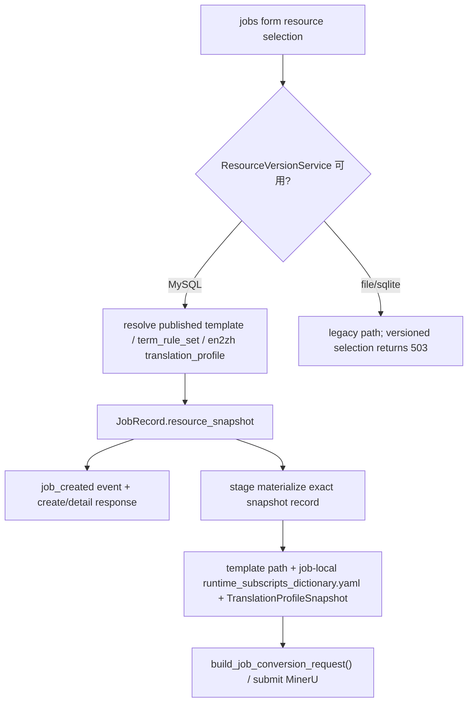
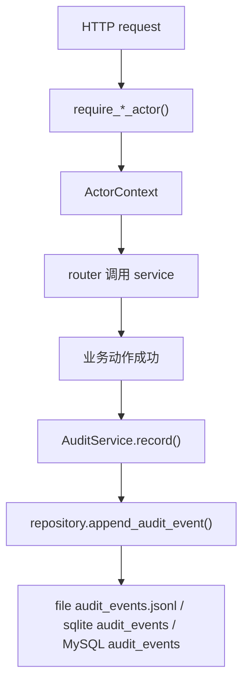
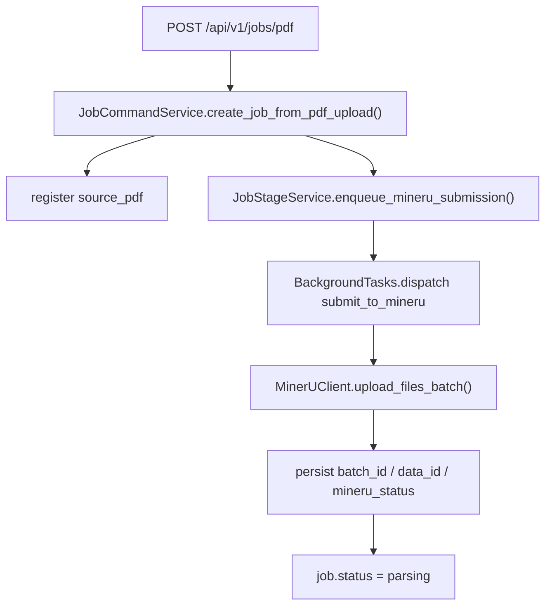
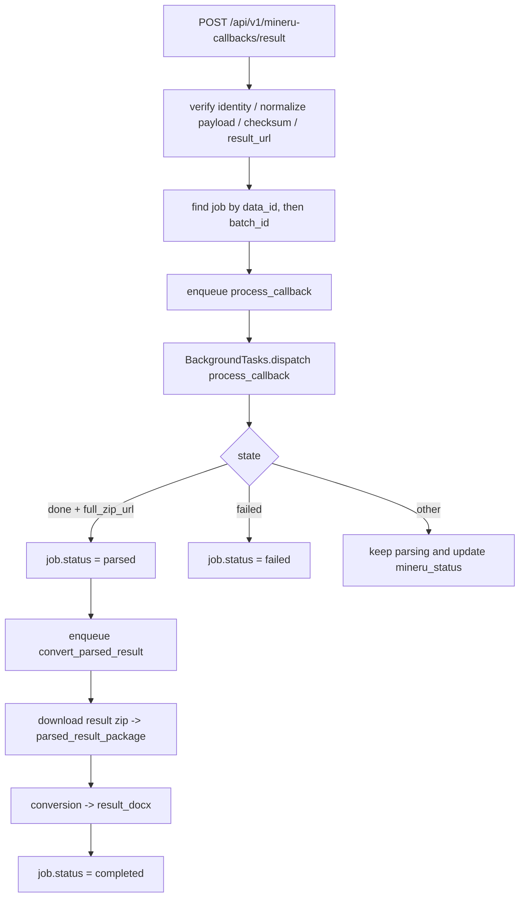

# FastAPI 后端服务

## 1. 定位

当前仓库的可部署后端入口是 `app/main.py`，转换能力由 `app/conversion/` 提供。FastAPI 不是第二套转换算法，而是对 conversion library 的服务化封装，负责：

- 接收 MinerU 输出 zip
- 通过 `/api/v1/files` 授权上传 PDF
- 通过 `/api/v1/document-jobs` 创建、查询、重试和下载 P0 PDF -> Word 任务
- 接收原始 PDF 并提交 MinerU
- 通过后台 stage 推进转换
- 暴露任务状态、事件和产物下载
- 在 MinerU callback 成功后恢复远端结果 zip，并继续后处理生成 DOCX
- 提供 `direct` / `en2zh` 两条后处理路径
- 暴露 templates 目录、默认模板切换、模板下载、模板 CRUD / 文件替换，以及 MySQL-backed Template Version 创建、发布、设默认和禁用
- 暴露 Term Rule Set 草稿、发布、设默认、回滚和查询；legacy term-rules API 继续提供分类 / 规则 CRUD、live runtime rules 查询、导入、导出、模拟和 sync-files
- 暴露 Translation Profile 草稿、发布、设默认、回滚和查询；`en2zh` job 可记录 `translation_trace` artifact
- 提供 resource versioning 内部 service；当前 Template Profile、Term Rule Set 与 Translation Profile 已复用发布状态机与默认指针
- 在 MySQL resource mode 下创建 job 时绑定不可变资源快照，后台 stage 只消费创建时的 Template Version、Term Rule Version、`en2zh` Translation Profile Version 和非敏感 MinerU 配置
- 通过 `ActorContext` 和 `AuditEvent` 记录高风险资源动作、job ops 和 artifact download 的成功审计，不引入 SSO、用户表或多租户模型
- 通过 `health/ready`、`health/metrics`、release check 和 MySQL metadata shadow copy / validate 脚本提供单实例生产化运维基线

## 2. 物理结构

- `app/main.py`
  - 创建 FastAPI app，挂载 CORS、中间件、router 和 runtime。
- `app/api/dependencies.py`
  - 提供 runtime、trace 和访问控制依赖；`require_admin_actor()`、`require_jobs_actor()`、`require_job_ops_actor()` 在保留旧 403 / 503 语义的同时返回 `ActorContext`。
- `app/api/v1/routers/health.py`
  - `health/live`、`health/ready` 与 `health/metrics`。
- `app/api/v1/routers/auth_schemas.py`、`app/api/v1/routers/health_schemas.py`
  - auth/health 路由私有的 v1 请求和响应模型；不再保留集中 API schema 文件。
- `app/domains/jobs/`
  - `command.py`、`query.py`、`stage.py`、`lifecycle.py`、`artifacts.py`。
  - `resource_snapshots.py`：创建期绑定 published resource versions，stage replay 时按 exact snapshot materialize 模板、job-local term-rule YAML 和 Translation Profile。
  - `artifact_storage.py`：本地 artifact logical path 解析、登记和下载定位。
  - `artifact_integrity.py`：计算并校验 `size_bytes` / `sha256` artifact fingerprint。
  - `object_artifact_storage.py`：本地对象目录 adapter 和本地 fallback 下载口径。
  - `artifact_retention.py`：local + object artifact retention dry-run 候选生成。
- `app/domains/templates/`
  - templates 目录、详情、下载、默认模板切换、模板 CRUD / 文件替换、Template Version payload/hash 和版本发布状态接口。
- `app/domains/term_rules/`
  - Term Rule Set draft/publish/default/rollback、term-rule 分类 / 规则 CRUD、导入校验、导入、导出、模拟、sync-files 和 YAML codec。
- `app/domains/translation/`
  - Translation Profile 查询、draft 更新、publish、set-default、rollback、执行时 snapshot、翻译 provider、Document IR translation 和 translation audit。
- `app/domains/document_jobs/`
  - document job models、schemas、service、execution queue、router 和 repository ports。
- `app/domains/files/`
  - 文件上传授权、PDF 校验、文件 metadata、retention planning、router 和 repository port。
- `app/domains/resources/`
  - `ResourceVersionService` 和 resource version models/ports。
- `app/domains/audit/`
  - `ActorContext`、`AuditEvent`、`AuditService` 和 audit repository port。
- `app/infrastructure/persistence/`
  - `file/`、`sqlite/`、`mysql/` 三类 backend adapter，按 domain responsibility 拆分，并由 `factory.py` 组装 `PersistenceAdapters`。
- `scripts/ops/check_release.py`
  - 发布前聚合 OpenAPI snapshot 与 targeted unittest smoke。
- `scripts/ops/shadow_copy_metadata_to_mysql.py`
  - 离线 file -> MySQL metadata 空目标 shadow copy 与 validate-only 校验入口。
- `app/clients/mineru_client.py`
  - 原始 PDF 在线提交到 MinerU 的客户端。
- `app/conversion/`
  - `contracts.py`、`entrypoint.py`、`service.py` 组成后端 conversion library 边界。
  - `runtime_facade.py` 是 FastAPI 侧稳定导入面，实际委托给 `runtime_runner.py`、`runtime_helpers.py` 和 runtime modules。
- `app/services/health_service.py`
  - readiness 依赖探针和 metrics JSON snapshot 生成。
- `app/services/auth/models.py`、`app/services/document_ir/models.py`、`app/services/renderer/template_config.py`
  - 分别承载 auth 用户上下文、Document IR 记录和 renderer 模板配置模型，`app/core/` 只保留配置、日志、错误和 runtime 容器等跨域基础设施。
- `var/`
  - 运行态 jobs、stage spool、term-rule store、template state 和临时目录。

## 3. 主流程

Metadata repository 当前有三种 runtime 选择：

- `file`：代码默认值，使用 `var/jobs/*/*.json`、`events.jsonl` 和 `var/stage_messages/*.json`。
- `database`：sqlite-backed infrastructure adapters，使用 `JOBS_METADATA_DATABASE_PATH`。
- `mysql`：MySQL-backed infrastructure adapters，使用 `JOBS_MYSQL_*` 连接参数，并创建 `resource_versions` 和 `resource_default_versions` 表。

三种 backend 都实现相同 repository / stage message store protocols；jobs services 不直接依赖具体数据库产品。

### 资源版本内部服务

资源版本 service 当前只在 `JOBS_REPOSITORY_BACKEND=mysql` 下由 runtime 挂载。通用层只校验 `snapshot_hash` 格式、版本状态和默认指针；Template Profile、Term Rule Set 与 Translation Profile 分别由各自 service 负责 payload 结构、hash 计算、HTTP API 和业务校验。

### Template Profile 版本管理

Template Profile 只表达 `docx + layout_config + render_policy`。发布、设默认和禁用依赖 MySQL resource version service；file/sqlite backend 仍可读写 manifest 和替换当前模板文件，但版本发布状态接口返回 503。

### Term Rule Set 版本管理

当前只支持默认术语规则集 `electronics-default`。Draft 更新保存完整 v2 term-rules store payload 和 `sha256:<hex>` snapshot hash，不影响任务使用的 runtime YAML；publish 生成 `YYYY.MM.DD-N` published 版本，可选设为默认；set-default / rollback 只切默认指针并同步目标 published payload 到兼容 live store。file/sqlite backend 不启用 `/term-rule-sets` 写接口，legacy `/term-rules` 兼容写路径保持可用；MySQL versioned mode 下 legacy term-rules 写入口返回明确错误，避免绕过 draft / publish。

### Translation Profile 版本管理

当前只支持默认翻译配置 `electronics-en2zh`。Draft payload 保存 `target_language`、`domain`、`prompt_version`、`model`、`max_pages_per_batch` 和 `max_chars_per_batch`，不保存 API key、secret header 或完整 prompt 文本；publish 生成 `YYYY.MM.DD-N` published 版本，可选设为默认；set-default / rollback 只切默认指针。file/sqlite backend 不启用 `/translation-profiles` 接口，`en2zh` 无默认 profile 时继续走 settings / `.env`。

### Job Resource Snapshot Binding

MySQL resource mode 下 job 创建成功的前置条件是默认或指定的 Template Version 与 Term Rule Version 均为 published；`en2zh` 任务还需要默认或指定的 published Translation Profile。stage materialization 不重新解析当前默认指针，而是读取 snapshot 指向的 exact record 并校验 `snapshot_hash`，因此创建后默认版本切换、禁用或 supersede 不会改变已创建 job；payload 缺失或 hash mismatch 会让 stage 明确失败。snapshot 不保存 API key、MinerU token、callback token、完整 prompt 文本或 term-rule payload；`artifact_ids` 只保存 source artifact alias。

### Permission and Audit Baseline

`ActorContext` 只从现有 token 边界派生：admin token 得到 `admin`，jobs token 得到 `jobs`，open 下载得到 `anonymous`。`X-Actor-Id` 只在已认证 token 场景作为操作者标签；open 下载始终写 `actor_id=null`。审计只记录已通过权限且业务动作成功的事件，失败路径继续通过 HTTP status、JobEvent 或 stage failure 表达。当前审计动作覆盖 Template Version publish / set-default / disable、Term Rule Set publish / set-default / rollback、Translation Profile publish / set-default / rollback、job retry / cancel / cleanup-local-files，以及 artifact download。

### PDF 在线提交前半程

### callback ingress 与在线后处理

## 4. API 合同

### 4.0 files / document-jobs P0 主链路

- `POST /api/v1/files/upload-url`
  - 登录用户获取 PDF 上传授权；请求包含 `filename`、`mime_type`、`size_bytes`、可选 `checksum_sha256`。
  - 返回 `file_id`、`upload_url`、`method=PUT`、`headers`、`expires_at`、`object_key` 和文件 metadata；成功写 `file.upload_authorize` audit event。
- `PUT /api/v1/files/{file_id}/content`
  - 本地代理上传 PDF 内容；会校验大小、内容类型、PDF 头和授权状态；成功写 `file.upload_content` audit event。
- `GET /api/v1/files/{file_id}`
  - 返回文件 metadata。
- `POST /api/v1/document-jobs`
  - 用 `source_file_id` 创建 `direct_pdf_to_word` 或实验性 `en2zh_pdf_to_word` 任务；默认 `document_language=auto`。
  - 成功返回 `job_id`、`status`、`stage`、`progress` 和完整 job snapshot；成功写 `document_job.create` audit event。
- `GET /api/v1/document-jobs` / `GET /api/v1/document-jobs/{job_id}` / `GET /api/v1/document-jobs/{job_id}/events`
  - 查询任务列表、详情和事件。失败任务必须可见 `failed_stage`、`error_code`、`error_message`。
- `POST /api/v1/document-jobs/{job_id}/retry`
  - 对失败任务有限重试；可选择是否使用最新术语资产，成功写 `document_job.retry` audit event。
- `POST /api/v1/document-jobs/{job_id}/cancel`
  - 取消可取消任务，成功写 `document_job.cancel` audit event。
- `DELETE /api/v1/document-jobs/{job_id}`
  - 归档任务，成功写 `document_job.archive` audit event。
- `GET /api/v1/document-jobs/{job_id}/download-url`
  - 对 succeeded 任务生成临时下载链接，成功写 `document_job.download_authorize` audit event。
- `GET /api/v1/document-jobs/{job_id}/download`
  - 使用短期 token 下载 Word；本地文件缺失返回 404，token 无效或过期返回 403。

### 4.1 jobs

- `POST /api/v1/jobs`
  - 接受 MinerU 输出 zip，不接受原始 PDF；form 支持 `template_id`、`template_version`、`term_rule_set_id`、`term_rule_set_version`、`translation_profile_id`、`translation_profile_version`、`translation_mode`、`document_language` 和 `use_mineru_header_footer`。
  - MySQL resource mode 下创建响应返回 `resource_snapshot`；file/sqlite backend 不传 versioned resource selection 时保持 legacy 路径。
- `POST /api/v1/jobs/pdf`
  - 接受原始 PDF，提交 MinerU 后进入 `parsing`；callback 成功后可自动继续到 `completed`。
  - 同样支持 versioned resource selection；resource snapshot 额外记录非敏感 MinerU 请求配置和 `source_pdf` alias。
- `GET /api/v1/jobs`
  - 分页查询任务列表。
- `GET /api/v1/jobs/{job_id}`
  - 查看任务状态、事件、已登记产物和可为空的 `resource_snapshot`。
- `GET /api/v1/jobs/{job_id}/download/{artifact_alias}`
  - 下载 `source-package`、`source-pdf`、`parsed-result-package`、`translation-request`、`translation-trace`、`result`；成功返回文件 / stream / redirect 前写 `artifact.download` audit event，`target_id` 使用 `{job_id}:{artifact_alias}`。
- `POST /api/v1/jobs/{job_id}/recover-mineru-result`
  - callback 丢失或长时间未到时主动查询 MinerU batch 结果，并复用 `process_callback` stage 完成后续恢复。
- `POST /api/v1/jobs/{job_id}/retry`
  - 对 `failed/canceled` 任务重新入队；成功后保留原 JobEvent，并写 `job.retry` audit event。
- `POST /api/v1/jobs/{job_id}/cancel`
  - 对 `uploaded/queued` 任务取消；成功后保留原 JobEvent，并写 `job.cancel` audit event。
- `POST /api/v1/jobs/{job_id}/cleanup-local-files`
  - 清理未登记运行态目录，保留本地唯一副本；成功后写 `job.cleanup_local_files` audit event。

### 4.2 mineru-callbacks

- `POST /api/v1/mineru-callbacks/result`
  - 接收 MinerU callback；只负责鉴权、归一化、任务匹配和入队 `process_callback`，不直接在 router 中改 job 状态。

### 4.3 templates

- `GET /api/v1/templates`
  - 列出 manifest 中可见模板及默认模板状态。
- `GET /api/v1/templates/{template_id}`
  - 查看模板详情和绑定配置元数据。
- `GET /api/v1/templates/{template_id}/download`
  - 下载模板文件。
- `PATCH /api/v1/templates/{template_id}/default`
  - admin-only，切换运行态默认模板。
- `POST /api/v1/templates`
  - admin-only，创建模板记录并保存初始 DOCX 文件。
- `PATCH /api/v1/templates/{template_id}`
  - admin-only，更新模板元数据、启用状态、`layout_config_path` 和 `render_policy`。
- `PUT /api/v1/templates/{template_id}/file`
  - admin-only，替换模板 DOCX 文件并递增 manifest 当前版本。
- `DELETE /api/v1/templates/{template_id}`
  - admin-only，删除非默认模板 manifest 记录，历史版本文件保留。
- `GET /api/v1/templates/{template_id}/versions`
  - 列出 API 管理目录和 resource version 记录中可见的模板版本状态。
- `POST /api/v1/templates/{template_id}/versions`
  - admin-only，MySQL resource service required；创建下一版 Template Version draft，payload 覆盖 DOCX、`layout_config`、`render_policy` 和 snapshot hash。
- `POST /api/v1/templates/{template_id}/versions/{version}/publish`
  - admin-only，发布 draft，可通过 `make_default` 同步设为默认；成功后写 `template.publish` audit event。
- `POST /api/v1/templates/{template_id}/versions/{version}/set-default`
  - admin-only，把默认指针切到指定已发布 Template Version，并同步兼容态；成功后写 `template.set_default` audit event。
- `POST /api/v1/templates/{template_id}/versions/{version}/disable`
  - admin-only，禁用非默认 Template Version，默认版本不能禁用；成功后写 `template.disable` audit event。

### 4.4 term-rules

- `GET /api/v1/term-rule-sets`
  - MySQL resource service required；列出当前支持的术语规则集和默认 published 版本摘要。
- `GET /api/v1/term-rule-sets/{set_id}`
  - 查看术语规则集 published versions 与默认指针。
- `GET /api/v1/term-rule-sets/{set_id}/draft`
  - 查看或初始化草稿；有默认 published 版本时从默认版本派生，否则从当前 live store 派生。
- `PUT /api/v1/term-rule-sets/{set_id}/draft/rules`
  - admin-only，校验 v2 YAML 后更新 draft payload，不同步 live runtime YAML。
- `POST /api/v1/term-rule-sets/{set_id}/publish`
  - admin-only，从 draft 发布 `YYYY.MM.DD-N` 版本，可选设为默认；成功后写 `term_rule_set.publish` audit event。
- `POST /api/v1/term-rule-sets/{set_id}/versions/{version}/set-default`
  - admin-only，把默认指针切到指定 published Term Rule Version，并同步 live runtime；成功后写 `term_rule_set.set_default` audit event。
- `POST /api/v1/term-rule-sets/{set_id}/rollback`
  - admin-only，只把默认指针切回指定 published Term Rule Version，不修改历史 payload；成功后写 `term_rule_set.rollback` audit event。
- `GET /api/v1/term-rule-categories`
  - 返回分类列表。
- `POST /api/v1/term-rule-categories`
  - admin-only，file/sqlite backend 下创建分类；MySQL versioned mode 下拒绝直写。
- `PATCH /api/v1/term-rule-categories/{category_id}`
  - admin-only，file/sqlite backend 下更新分类；MySQL versioned mode 下拒绝直写。
- `DELETE /api/v1/term-rule-categories/{category_id}`
  - admin-only，file/sqlite backend 下删除分类；MySQL versioned mode 下拒绝直写。
- `GET /api/v1/term-rules`
  - 分页查询当前 live runtime rules。
- `GET /api/v1/term-rules/{rule_id}`
  - 查看单条规则详情。
- `POST /api/v1/term-rules`
  - admin-only，file/sqlite backend 下创建规则；MySQL versioned mode 下拒绝直写。
- `PATCH /api/v1/term-rules/{rule_id}`
  - admin-only，file/sqlite backend 下更新规则；MySQL versioned mode 下拒绝直写。
- `DELETE /api/v1/term-rules/{rule_id}`
  - admin-only，file/sqlite backend 下删除规则；MySQL versioned mode 下拒绝直写。
- `GET /api/v1/term-rules/export`
  - 导出当前 live truth 的 v2 manifest 视图。
- `POST /api/v1/term-rules/simulate`
  - 对输入文本做规则替换模拟。
- `POST /api/v1/term-rules/import/validate`
  - 仅校验导入内容，不改 live truth。
- `POST /api/v1/term-rules/import`
  - admin-only，file/sqlite backend 下整库替换 live runtime store；MySQL versioned mode 下拒绝直写。
- `POST /api/v1/term-rules/sync-files`
  - admin-only，file/sqlite backend 下把当前 live truth 回写到 seed 与 runtime YAML；MySQL versioned mode 下拒绝直写。

### 4.5 translation-profiles

- `GET /api/v1/translation-profiles`
  - MySQL resource service required；列出当前支持的 Translation Profile 和默认 published 版本摘要。
- `GET /api/v1/translation-profiles/{profile_id}`
  - 查看 profile 的 published versions 与默认指针；当前支持 `electronics-en2zh`。
- `GET /api/v1/translation-profiles/{profile_id}/draft`
  - 查看或初始化草稿；有默认 published 版本时从默认版本派生，否则从 settings 默认值派生。
- `PUT /api/v1/translation-profiles/{profile_id}/draft`
  - admin-only，更新完整 draft payload，不保存 secret，不影响当前 jobs payload。
- `POST /api/v1/translation-profiles/{profile_id}/publish`
  - admin-only，从 draft 发布 `YYYY.MM.DD-N` 版本，可选设为默认；成功后写 `translation_profile.publish` audit event。
- `POST /api/v1/translation-profiles/{profile_id}/versions/{version}/set-default`
  - admin-only，把默认指针切到指定 published Translation Profile Version；成功后写 `translation_profile.set_default` audit event。
- `POST /api/v1/translation-profiles/{profile_id}/rollback`
  - admin-only，只把默认指针切回指定 published Translation Profile Version，不修改历史 payload；成功后写 `translation_profile.rollback` audit event。

### 4.6 health

- `GET /api/v1/health/live`
  - 只确认进程可响应。
- `GET /api/v1/health/ready`
  - 返回运行目录、模板/YAML、翻译能力、stage spool、artifact storage、artifact root 可写性、磁盘余量、默认资源版本标签和 MySQL schema bootstrap 状态。
- `GET /api/v1/health/metrics`
  - 返回 JSON 运维计数，包括 metadata store、artifact storage、worker mode、stage dispatcher、job status counts、stage message status counts、resource version counts 和 audit event count；不是 Prometheus 格式，不暴露 secret、payload、客户文件名或新增本地绝对私密路径。

## 5. 产物合同

对外产物只通过 `JobArtifactService` 暴露，当前内建 file type：

- `source_package`
- `source_pdf`
- `parsed_result_package`
- `translation_request`
- `translation_trace`
- `result_docx`
- callback 终态附加字段：
  - `mineru_batch_id`
  - `mineru_data_id`
  - `mineru_callback_seed`
  - `mineru_status`
  - `mineru_result_zip_url`

关键约束：

- `path` 是 job 内逻辑路径，不是本地绝对路径。
- 新登记 `JobFile` 会记录 `size_bytes` 和 `sha256`，其中 `sha256` 使用 `sha256:<hex>` 格式；旧记录缺少这两个字段时按兼容路径读取和下载。
- `download_url` 是调用方真实消费入口。
- 本地绝对路径只在服务端通过 `build_job_paths()` 推导，不进入对外合同。
- `storage_backend=object` 时，`object_key` 只作为服务端内部定位字段，不替代 `download_url`。
- 本地文件下载会在返回文件前校验 logical path、存在性和已有 fingerprint：logical path 越界或不匹配返回 400，本地文件缺失返回 404，fingerprint 不匹配返回 409。
- object adapter 的本地 fallback 下载同样校验 fingerprint；redirect 模式只保证登记 fingerprint 和服务端本地 fallback 口径，不在 redirect 前读取远端对象内容。
- retention 当前只提供 dry-run 候选，输出 `storage_backend`、logical `path`、`object_key`、`size_bytes` 和 `sha256`，不删除 artifact。
- `parsed_result_package` 是受支持的中间 artifact，默认交付物仍是 `result_docx`。

## 6. 翻译能力

- `translation_mode=direct`
  - 不走翻译，直接进入 DOCX 渲染。
- `translation_mode=en2zh`
  - 先通过 readiness 预检 `OPENAI_API_KEY`、OpenAI SDK、`translation_en2zh.md` prompt。
  - MySQL resource mode 下，job 创建时绑定默认或指定 published Translation Profile；stage 执行时按 `JobRecord.resource_snapshot` materialize profile，并覆盖模型、目标语言、领域、prompt 版本和分批阈值。
  - 旧 job 或 file/sqlite legacy job 无 snapshot 时，仍回退 settings / `.env`。
  - 事件流增加：
    - `translation_started`
    - `translation_completed`
    - `translation_failed`
  - 成功时登记 `translation_request` 与 `translation_trace` 产物，并把最终 `resolved_document_language` 固定为 `zh`。

## 7. 运行时与可观测性

- 日志分三层：
  - `access`
  - `business`
  - `system`
- callback 事件：
  - `mineru_callback_received`
  - `mineru_callback_processed`
  - `mineru_callback_failed`
- `health/ready` 关键字段：
  - `configured_repository_backend`
  - `effective_repository_backend`
  - `worker_mode`
  - `stage_dispatcher`
  - `stage_message_store`
  - `artifact_storage`
  - `mineru_api_token_configured`
  - `jobs_dir_writable`
  - `stage_spool_pending_messages`
  - `stage_spool_running_messages`
  - `stage_spool_failed_messages`
  - `artifact_root_writable`
  - `artifact_disk_free_bytes`
  - `default_template_version`
  - `default_term_rule_version`
  - `default_translation_profile_version`
  - `mysql_schema_bootstrap_available`
  - `template_docx_exists`
  - `layout_config_exists`
  - `subscript_config_exists`
  - `translation_prompt_exists`
  - `translation_available`
- `configured_repository_backend/effective_repository_backend/stage_message_store` 可为 `file`、`database` 或 `mysql`；`mysql` 时 stage spool 位于 MySQL 表，不要求 `var/stage_messages` 目录存在。
- `health/metrics` 返回 JSON counters：job status counts、stage message status counts、resource version counts 和 audit event count；调用方需要自行接入外部监控或告警系统。
- 发布前本地基线入口是 `scripts/ops/check_release.py`，当前聚合 OpenAPI snapshot check、health/metrics smoke、metadata migration smoke、job workflow、MySQL fake smoke 和 logging tests。
- audit events 独立于 JobEvent：file backend 写 `var/audit_events.jsonl`，sqlite / MySQL backend 写 `audit_events` 表；当前不暴露审计查询 HTTP API。
- callback 安全边界：
  - `PUBLIC_DEPLOYMENT_MODE=internal` 时不要求 callback token
  - `PUBLIC_DEPLOYMENT_MODE=single_tenant_public` 时要求 `X-MinerU-Callback-Token` 或 query token
  - payload 带 `checksum` 时，按 `uid + mineru_callback_seed + content` 校验
  - `full_zip_url` 必须满足 `https + MINERU_RESULT_HOST_ALLOWLIST`

## 8. 已知边界

- 当前后端已经支持“上传原始 PDF -> 成功提交 MinerU -> 接收 callback -> 恢复 `parsed_result_package` -> DOCX 后处理 -> completed/failed”；`parsed` 是短暂可观察里程碑。
- 当前默认仍是 file metadata + local file artifact；可配置切换到 sqlite database metadata store、MySQL metadata store 和本地对象目录 `local_object` artifact adapter。
- MySQL metadata store 保存 jobs metadata、stage messages、`resource_versions`、`resource_default_versions` 和 `audit_events`；artifact 二进制仍由 artifact storage adapter 管理。
- resource versioning 当前是内部 service，不新增通用 HTTP router；Template Profile、Term Rule Set 与 Translation Profile 已接入各自的管理和版本发布 API，jobs 通过 `JobResourceSnapshotService` 在 MySQL resource mode 下消费 published 版本。
- file -> MySQL 历史 metadata 空目标 shadow copy / validate baseline 已由运维脚本覆盖，release check 使用 fake MySQL smoke；真实外部 MySQL 服务 smoke 和 Alembic / SQLAlchemy 迁移体系仍未完成。
- artifact fingerprint 不强制 backfill 旧记录；旧记录缺少 `size_bytes` / `sha256` 时仍允许读取和按旧存在性规则下载。
- artifact retention 仍停在 dry-run，不执行真实删除；`cleanup-local-files` 成功会写 audit event，但真实删除、删除审计和恢复策略仍未完成。
- 当前没有独立 worker / queue、多实例 heartbeat、lease 或抢占锁。
- `retry/cancel/cleanup-local-files` 默认要求 `X-Admin-Token`；`JOBS_OPS_ACCESS_MODE=jobs` 时可复用 jobs token，并在 audit event 中记录 `actor_role=jobs`。
- 当前权限基线只表达 `admin`、`jobs`、`anonymous` 三类 actor，不做 SSO、用户表、多租户、资源所有者校验或审计查询 UI。
- templates 当前支持默认模板切换、模板 CRUD / replace 和 MySQL-backed version 管理；file/sqlite backend 保持 manifest 兼容，版本发布状态接口需要 MySQL resource service。
- term-rules 当前支持分类 / 规则 CRUD、整库替换导入、导出、模拟和 sync-files；MySQL versioned mode 下写入口必须通过 Term Rule Set draft / publish 流程。
- job resource snapshot 不回填历史 job；file/sqlite backend 仍保持 legacy 默认模板 / runtime YAML / settings 翻译配置路径，显式传 versioned resource selection 时返回 503。
- translation-profiles 当前只支持 `electronics-en2zh`；jobs API 仍只支持 `direct` / `en2zh`，不新增 `zh2en` / `zh2ru` 或 `source_language` / `target_language`。

## 9. 相关文档

- [ARCHITECTURE.md](/Users/sc/PycharmProjects/md2word/.codestable/architecture/ARCHITECTURE.md)
- [conversion-flow.md](/Users/sc/PycharmProjects/md2word/.codestable/architecture/conversion-flow.md)
- [fastapi-backend-roadmap.md](/Users/sc/PycharmProjects/md2word/.codestable/roadmap/fastapi-backend/fastapi-backend-roadmap.md)

## 10. 变更日志

- 2026-06-03：补入 P0 `/api/v1/files`、`/api/v1/document-jobs` 主链路合同、DocumentIR v2 / renderer metadata 交付现状，并补齐 legacy `recover-mineru-result` API 边界。
- 2026-05-29：补入 Operations Readiness and Test Baseline；`health/ready` 扩展 artifact / resource / MySQL schema 字段，新增 `health/metrics` JSON counters，补入 file -> MySQL metadata shadow copy / validate、`.env.example`、release check 和运维文档基线。
- 2026-05-29：补入 Permission and Audit Baseline；`require_*_actor()` 派生最小 actor，上述高风险资源动作、job ops 和 artifact download 成功路径写入独立 audit event，open 下载保持 anonymous 且不接受自报 actor。
- 2026-05-29：补入 Job Resource Snapshot Binding；MySQL resource mode 下 job 创建绑定 published Template / Term Rule / `en2zh` Translation Profile versions，stage 按 exact snapshot materialize runtime resources，file/sqlite 维持 legacy 路径。
- 2026-05-29：补入 Translation Profile and Segment Trace；`/api/v1/translation-profiles` 在 MySQL resource service 下支持 draft、publish、set-default 和 rollback，`en2zh` job 登记 `translation_trace` artifact。
- 2026-05-29：补入 Template Profile versioning；templates API 支持模板 CRUD / 文件替换和 MySQL-backed Template Version 创建、发布、设默认、禁用，版本 payload 覆盖 DOCX、`layout_config`、`render_policy` 和 snapshot hash。
- 2026-05-29：补入 Term Rule Set versioning；`/api/v1/term-rule-sets` 在 MySQL resource service 下支持 draft、publish、set-default 和 rollback，默认 published 版本同步到 live term-rules store / runtime YAML，legacy 写入口在 versioned mode 下拒绝直写。
- 2026-05-29：补入 resource versioning foundation；MySQL metadata store 新增 `resource_default_versions`，runtime 在 MySQL backend 下挂载 `ResourceVersionService`，通用层负责发布状态机、默认指针和 published-only 解析。
- 2026-05-28：补入 local artifact contract hardening；`JobFile` 新增 `size_bytes` / `sha256` fingerprint，对外 response 透出字段，本地下载按 400 / 404 / 409 诊断，retention dry-run 覆盖 local + object artifact。
- 2026-05-28：补入 MySQL metadata backend；jobs 主链可通过 `JOBS_REPOSITORY_BACKEND=mysql` 使用 MySQL 保存 metadata，readiness 报告 `mysql` backend，artifact 二进制仍保持独立 storage。
