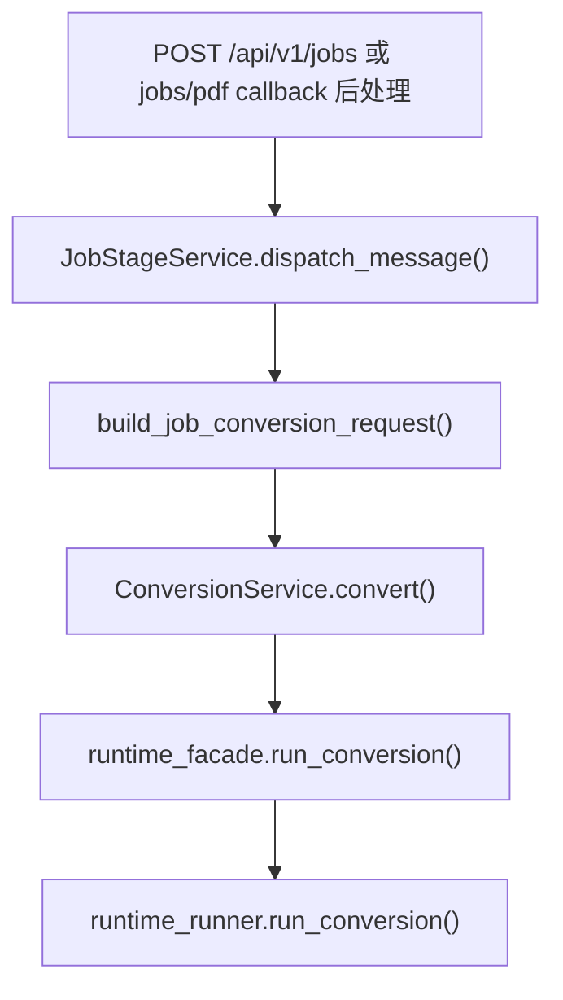
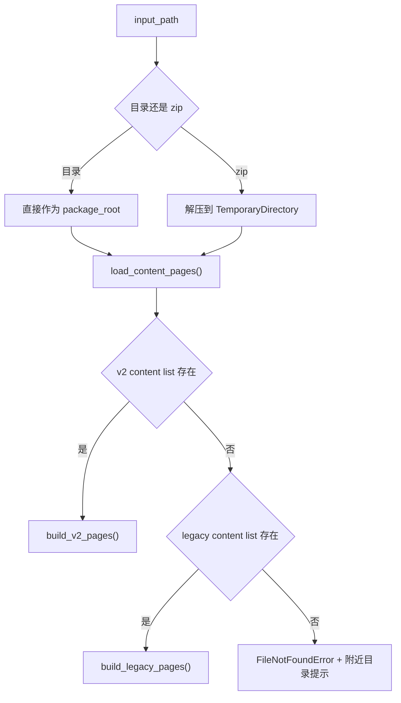
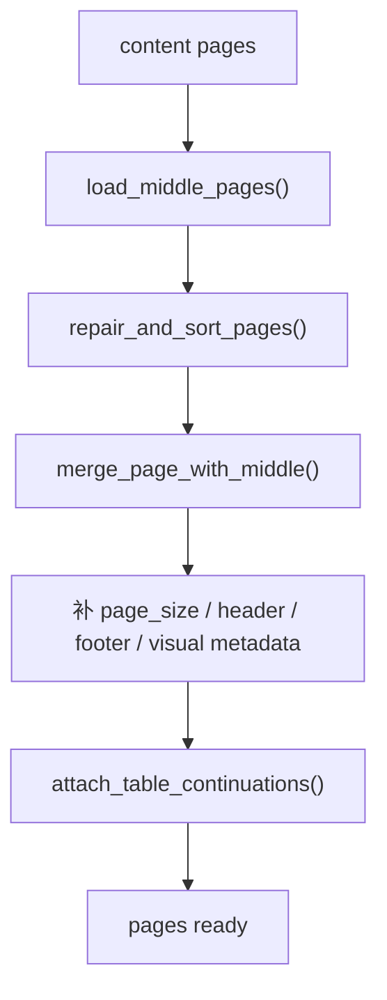
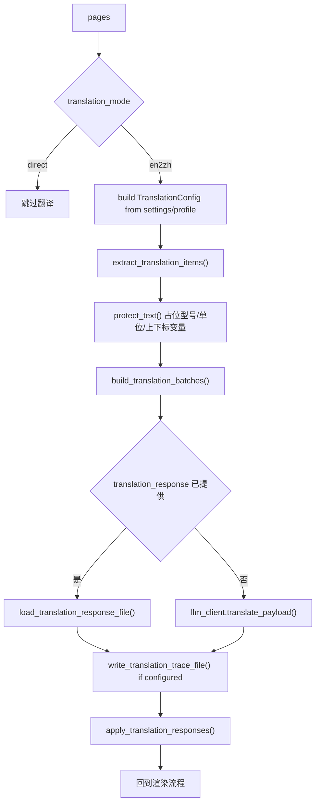
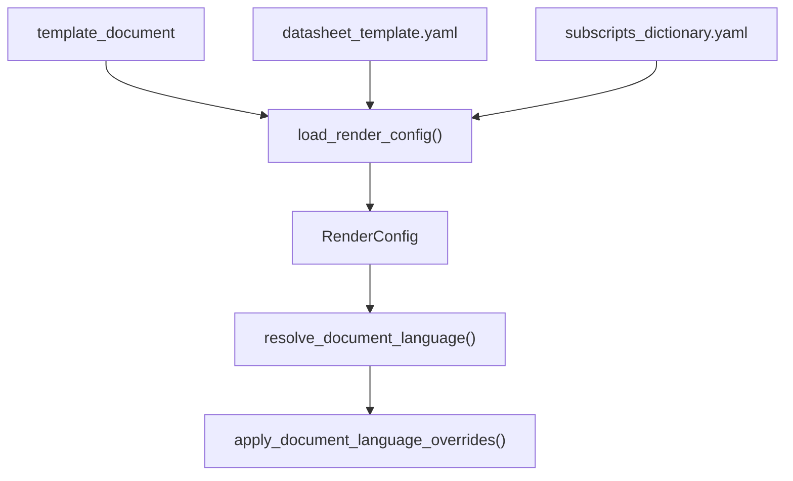
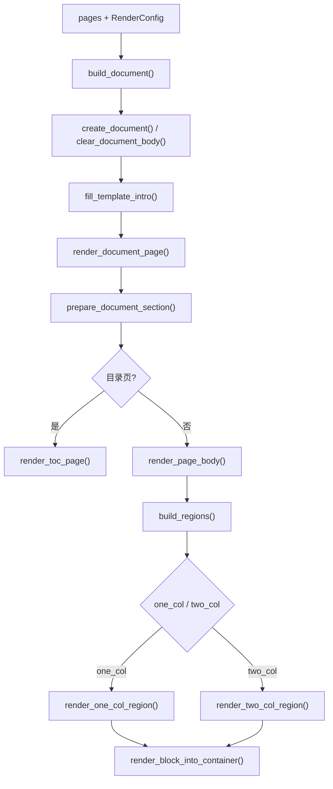
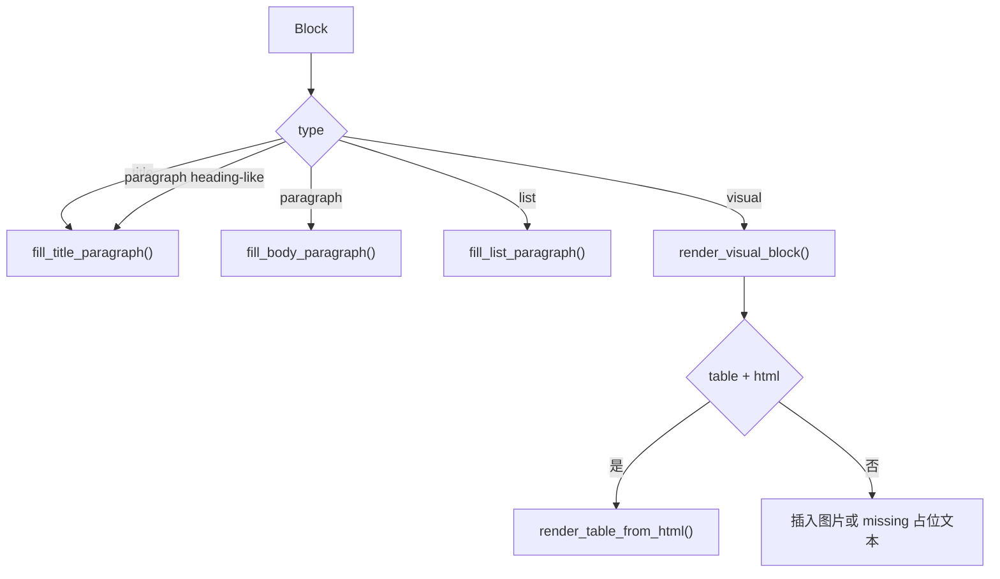

# 转换流程梳理

## 1. 启动流程

- `JobStageService` 是后端任务推进入口，按 stage message 分派到 conversion。锚点：`app/domains/jobs/stage.py`
- `build_job_conversion_request()` 把 job、artifact、模板和翻译参数组装成 conversion request。锚点：`app/conversion/entrypoint.py`
- `ConversionService.convert()` 负责服务层调用和错误边界。锚点：`app/conversion/service.py`
- 真实转换总调度在 `app/conversion/runtime_runner.py`。锚点：`app/conversion/runtime_runner.py:33`

## 2. 输入加载流程

- 支持目录和 `.zip`；zip 只在临时目录中解包，不回写原包。锚点：`input_adapter_runtime.py:82`
- v2 识别 `content_list_v2.json` 和 `*_content_list_v2.json`；legacy 识别 `content_list.json` 和 `*_content_list.json`。锚点：`input_adapter_runtime.py:114`
- 块类型先映射为统一 `Block`，视觉块会解析图片路径、caption、footnote、HTML。锚点：`input_adapter_runtime.py:213`、`input_adapter_runtime.py:379`

## 3. 页面修补流程

- `middle.json` 是补丁数据，不是主内容数据。锚点：`input_adapter_runtime.py:175`
- 被 MinerU 丢弃的页眉、页脚、页码会在主内容缺失对应类型时补回。锚点：`page_repair_runtime.py:120`
- 对缺图片的视觉块，会按 bbox 距离从 middle 视觉块中找同类型最近匹配。锚点：`page_repair_runtime.py:132`
- 长表续页占位会从后续只含 `table_placeholder` 的页面收集高度，挂到前一张真实 HTML 表格块上。锚点：`page_repair_runtime.py:49`

## 4. 翻译流程

- `JobStageService` 在 `translation_mode=en2zh` 时可解析默认 published Translation Profile，并由 `build_job_conversion_request()` 覆盖模型、目标语言、领域、prompt 版本和分批阈值；没有默认 profile 时使用 settings / `.env`。锚点：`app/domains/jobs/stage.py`、`app/conversion/entrypoint.py`
- 翻译抽取跳过页眉、页脚、页码和表格占位符。锚点：`translation_runtime.py:15`
- ID 形式稳定，例如 `p0001.b0003.html.c0001`，用于回填原块。锚点：`translation_runtime.py:230`
- HTML 表格单元格会被逐格抽取和重写，回填时保留表格标签结构。锚点：`translation_runtime.py:498`、`translation_runtime.py:542`
- `llm_client.py` 使用 `resources/prompts/translation_en2zh.md` 作为 system prompt。锚点：`llm_client.py`、`app/conversion/runtime_config.py`
- `write_translation_trace_file()` 在应用翻译前记录 segment 原文、模型输入、AI 初译和最终渲染文本；trace 由 jobs artifact 合同登记为 `translation_trace`。锚点：`translation_runtime.py:154`、`app/domains/jobs/stage.py`

## 5. 渲染配置流程

- 模板路径默认候选由 `runtime_runner.DEFAULT_TEMPLATE_CANDIDATES` 提供。锚点：`app/conversion/runtime_runner.py:25`
- 样式 YAML 默认从 `resources/template_configs/datasheet_template.yaml` 查找，并由 `runtime_helpers.load_render_config()` 继续委托给 `render_config_runtime`。锚点：`app/conversion/runtime_helpers.py`
- 上下标词典默认从 `resources/term_rules/subscripts_dictionary.yaml` 查找，并由 render config runtime 统一加载。锚点：`render_config_runtime.py`
- 语言判定会抽取前若干页正文片段，按拉丁字母和 CJK 字符比例判断 `en` / `zh`。锚点：`app/conversion/runtime_helpers.py:144`

## 6. 文档构建流程

- 每个渲染页先拆页眉、页脚、页码和正文块。锚点：`page_layout_runtime.py:291`
- section 切换发生在目录起止、附录开始、横竖版变化、启用 MinerU 页眉页脚且有页眉页脚块等场景。锚点：`page_layout_runtime.py:210`
- 目录页通过标题匹配和目录项比例识别，目录连续页有单独判断。锚点：`page_layout_runtime.py:479`、`page_layout_runtime.py:504`
- 双栏识别按 y 区间扫描活动块，若同一横向区间同时存在左右块且没有 wide 块，则标记为双栏 band。锚点：`page_layout_runtime.py:594`

## 7. 块渲染流程

- 标题识别结合原始 `title` 类型和正文文本形态判断。锚点：`page_layout_runtime.py:709`、`text_rendering.py:744`
- 视觉块优先表格 HTML 渲染；非 HTML 表格或图片块走图片插入，缺图时输出占位文本并记录 warning。锚点：`page_layout_runtime.py:744`
- 表格标准路径生成 Word table 并处理 colspan/rowspan；复杂大表会降级为图片或展开表格；规则长表有专门路径。锚点：`table_render_runtime.py:84`、`table_render_runtime.py:175`、`table_long_renderer.py:28`
- 文本渲染统一经过 `prepare_text()`，再处理 ``、``、` `、粗斜体等 inline markup。锚点：`text_rendering.py:277`、`text_rendering.py:379`

## 8. 输出流程

- `build_document()` 返回 `Document` 实例后，`runtime_runner.run_conversion()` 会设置 `document.core_properties.title = source_path.stem`。锚点：`app/conversion/runtime_runner.py:132`
- 输出路径显式提供时使用该路径；zip 输入默认写同名 `.docx`；目录输入默认写到目录内 `mineru_output.docx`。锚点：`app/conversion/runtime_helpers.py:75`
- 最终通过 `document.save(resolved_output_path)` 一次性写盘。锚点：`app/conversion/runtime_runner.py:134`

## 9. 当前行为注意点

- `translation_request_output` 的实际行为和帮助文案不完全一致：当前代码会写请求文件，但没有在缺少 `translation_response` 时退出，而是继续调用 LLM。
- `full.md` 不参与转换流程，仓库名里的 `md2word` 容易造成误解。
- 测试覆盖以函数级 characterization 为主，不能证明真实 Word 视觉版式完全符合预期。

## 10. 变更日志

- 2026-05-29：补入 Translation Profile 与 segment trace 的转换链路现状；`en2zh` 可由默认 published profile 覆盖翻译配置，并输出 `translation_trace` artifact。
- 2026-05-28：阶段 0 入口收口，启动流程只保留 FastAPI jobs 到 `app/conversion/` 的后端路径。
- 2026-05-19：同步 shared runtime runner 的现状，回写 config / output 流程的真实实现位置。
