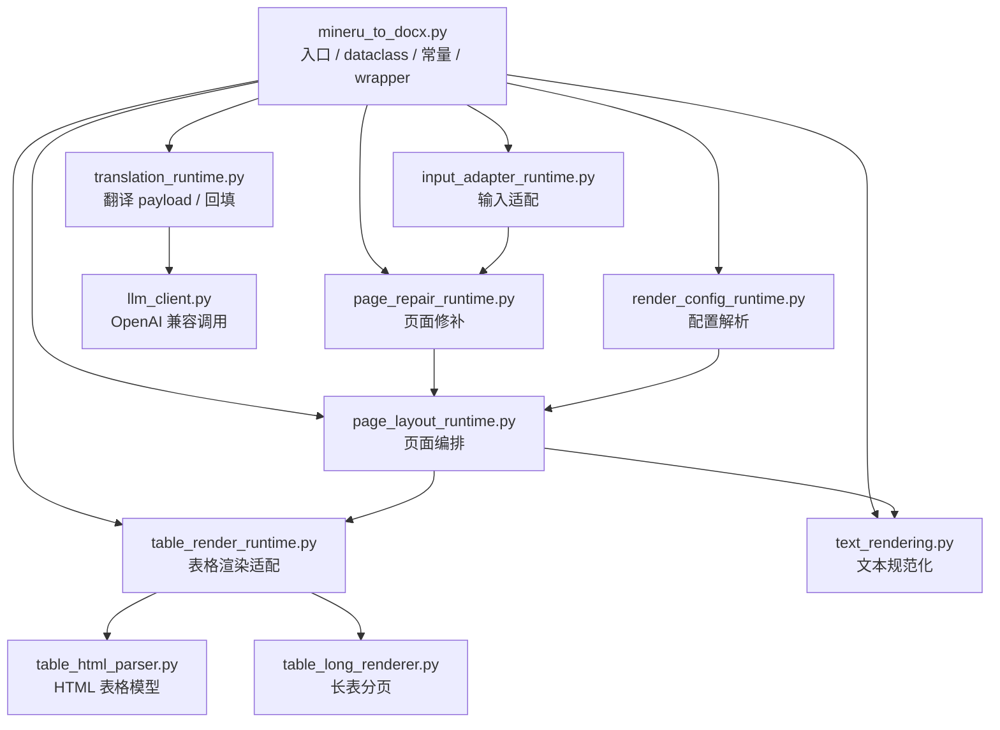

# 运行时模块边界

## 1. 总体边界

当前代码已经从早期单文件实现拆成多个物理模块，但仍保留一个重要兼容机制：各 runtime 模块通过 `bind_runtime()` 持有 `mineru_to_docx.py` 主模块引用，并用 `_runtime_value()` 读取 dataclass、常量、logger 和可替换函数。这个设计让 characterization tests 可以替换依赖，也让拆分过程保持行为稳定，但它不是完全解耦的包结构。

## 2. A. 主入口与共享类型

- 文件：`mineru_to_docx.py`
- 职责：CLI / PyCharm 入口、路径和模式解析、共享 dataclass、常量、runtime 绑定、总转换流程、少量 Word API 包装函数。
- 关键入口：
  - `parse_args()` / `resolve_cli_run_options()`：命令行参数和 PyCharm fallback。锚点：`mineru_to_docx.py:387`、`mineru_to_docx.py:514`
  - `main()` / `run_with_pycharm_config()`：两种启动路径。锚点：`mineru_to_docx.py:476`、`mineru_to_docx.py:486`
  - `run_conversion()`：唯一转换总控制器。锚点：`mineru_to_docx.py:613`
  - `Block` / `PageData` / `MiddlePage` / `RenderConfig`：跨模块共享模型。锚点：`mineru_to_docx.py:285`
- 边界说明：主入口不再直接实现大部分解析和排版细节，但仍作为 runtime 模块的依赖注入容器。

## 3. B. 输入适配

- 文件：`input_adapter_runtime.py`
- 职责：把 MinerU 输出目录或 zip 解析为统一 `PageData` / `Block` 列表。
- 关键入口：
  - `materialize_input()`：目录直读或 zip 解压到临时目录。锚点：`input_adapter_runtime.py:82`
  - `load_pages()`：读取主内容和 middle，再调用页面修补。锚点：`input_adapter_runtime.py:97`
  - `load_content_pages()`：优先 v2，退回 legacy。锚点：`input_adapter_runtime.py:114`
  - `parse_v2_block()` / `parse_legacy_block()` / `parse_visual_block()`：块映射。锚点：`input_adapter_runtime.py:213`、`input_adapter_runtime.py:318`、`input_adapter_runtime.py:379`
- 数据所有权：这一层拥有“原始 MinerU JSON 如何映射为内部块模型”的解释权，不负责 Word 版式。

## 4. C. 页面修补

- 文件：`page_repair_runtime.py`
- 职责：在输入适配之后、页面编排之前修补页面数据。
- 关键入口：
  - `repair_and_sort_pages()`：按 page 合并 middle 并排序。锚点：`page_repair_runtime.py:33`
  - `merge_page_with_middle()`：补页尺寸、页眉页脚、视觉块元数据。锚点：`page_repair_runtime.py:106`
  - `attach_table_continuations()`：把只含表格占位符的后续页高度挂到前一张真实长表。锚点：`page_repair_runtime.py:49`
- 边界说明：这层只修改内存模型，不写文件，也不直接调用 Word API。

## 5. D. 配置解析

- 文件：`render_config_runtime.py`
- 职责：把模板、YAML、术语上下标规则装配成 `RenderConfig`。
- 关键入口：
  - `load_render_config()`：总装配。锚点：`render_config_runtime.py:158`
  - `load_section_layout()`：默认 A4 / 模板 section / YAML `page_setup` 的优先级合并。锚点：`render_config_runtime.py:181`
  - `load_paragraph_styles()`：YAML 样式键到 Word 样式名映射。锚点：`render_config_runtime.py:233`
  - `TerminologyReplacer`：文本和 HTML 上下标替换。锚点：`render_config_runtime.py:35`
- 边界说明：配置层不主动驱动渲染，只向页面编排、表格渲染和文本规范化提供配置对象。

## 6. E. 页面编排

- 文件：`page_layout_runtime.py`
- 职责：把 `pages` 排进 Word 文档，决定 section、目录页、单双栏区域、块级分发。
- 关键入口：
  - `build_document()`：Document 构建总入口。锚点：`page_layout_runtime.py:66`
  - `render_document_page()` / `prepare_document_section()`：页级渲染与 section 管理。锚点：`page_layout_runtime.py:122`、`page_layout_runtime.py:160`
  - `render_page_body()` / `render_toc_page()`：正文页和目录页分流。锚点：`page_layout_runtime.py:421`、`page_layout_runtime.py:536`
  - `build_regions()` / `detect_two_col_bands()`：单双栏区域识别。锚点：`page_layout_runtime.py:578`、`page_layout_runtime.py:594`
  - `render_block_into_container()` / `render_visual_block()`：块级渲染分发。锚点：`page_layout_runtime.py:709`、`page_layout_runtime.py:744`
- 边界说明：页面编排是渲染总调度者，但具体表格、文本细节仍委托给下游模块。

## 7. F. 表格渲染

- 文件：`table_html_parser.py`、`table_render_runtime.py`、`table_long_renderer.py`，以及 `mineru_to_docx.py` 中的薄 wrapper。
- 职责：把 HTML 表格或表格图片渲染为 Word 表格、续表、图片或降级表格。
- 关键入口：
  - `parse_html_table()`：HTML 到 `HtmlTable`。锚点：`table_html_parser.py:74`
  - `render_table_from_html()`：主入口 wrapper。锚点：`mineru_to_docx.py:920`
  - `render_large_table_if_needed_impl()`：大表路径分流。锚点：`table_render_runtime.py:40`
  - `render_standard_html_table_impl()`：标准 Word 表格生成。锚点：`table_render_runtime.py:84`
  - `render_long_simple_table()`：长规则表渲染。锚点：`table_long_renderer.py:28`
- 边界说明：表格渲染会调用文本规范化能力填充单元格，但文本规范化不反向依赖表格。

## 8. G. 文本规范化

- 文件：`text_rendering.py`
- 职责：规范化 TeX / 公式 / HTML inline markup，应用段落和 run 样式，输出标题、正文、列表和目录文本。
- 关键入口：
  - `normalize_formula_text()` / `convert_inline_tex_to_html()`：公式文本规范化。锚点：`text_rendering.py:158`、`text_rendering.py:199`
  - `prepare_text()`：公式规范化和术语替换统一入口。锚点：`text_rendering.py:277`
  - `render_inline_html_into_paragraph()`：内联 HTML 到 Word run。锚点：`text_rendering.py:379`
  - `fill_title_paragraph()` / `fill_body_paragraph()` / `fill_list_paragraph()`：段落落盘出口。锚点：`text_rendering.py:641`、`text_rendering.py:691`、`text_rendering.py:705`
- 边界说明：这层是页面编排和表格渲染共同依赖的低层文本能力。

## 9. H. 翻译与 LLM 客户端

- 文件：`translation_runtime.py`、`llm_client.py`、`config.py`、`prompt/translation_en2zh.md`
- 职责：抽取可翻译文本、构造最小 JSON payload、校验并回填译文、调用 OpenAI 兼容接口。
- 关键入口：
  - `extract_translation_items()`：从页面块抽取 text/items/captions/footnotes/html cell。锚点：`translation_runtime.py:110`
  - `build_translation_batches()`：按章节、页数和字符数分批。锚点：`translation_runtime.py:283`
  - `apply_translation_responses()`：校验后回填页面块。锚点：`translation_runtime.py:474`
  - `translate_payload()` / `translate_batch()`：实际 LLM 调用。锚点：`llm_client.py:36`、`llm_client.py:69`
  - `load_app_config()`：从 `.env` / 环境变量读取模型、base URL、API key 和分批配置。锚点：`config.py:48`
- 边界说明：翻译链路修改渲染前的内存页面模型，之后仍回到同一套 DOCX 渲染链。

## 10. 测试边界

- `tests/test_*_characterization.py` 通过 `_load_module()` 安装依赖 stub 后加载 `mineru_to_docx.py`，再访问 runtime 模块行为。
- 测试设计和 `bind_runtime()` 强相关：它允许测试替换 `docx`、`bs4`、`yaml`、`loguru` 等外部依赖，覆盖局部逻辑而不用真实生成 DOCX。
- 当前测试更偏“行为刻画”，不是端到端视觉验收；真实 DOCX 版式仍需样例转换人工或渲染验证。

## 11. 后续维护原则

- 若继续拆模块，优先移除 runtime 反查耦合，而不是新增更深的 wrapper。
- 不要把 `prompt/translation_en2zh.md` 迁进 `.codestable/`；它是运行时资源。
- 表格和文本应保持单向依赖：表格可调用文本工具，文本层不应感知表格模型。
- 翻译链路应优先修正“只导出请求并退出”的文案/行为不一致，再继续扩展批处理能力。

## 变更日志

- 2026-05-18：基于当前多文件源码重写模块边界，替换早期“单文件内部模块”描述。
