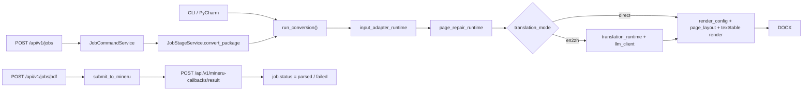

## 问题与范围

问题：这个项目现在到底是什么系统，核心流程怎么跑，CLI 和 FastAPI 各自负责什么。

范围：只基于当前仓库代码与现有测试做静态梳理，不做真实 MinerU 在线联调和 Word 视觉验收。

## 速答

这个项目名叫 `md2word`，但当前主能力已经不是“Markdown 转 Word”。它的真实内核是“读取 MinerU 解析结果目录或 zip，整理成统一页面块模型，可选做英文到中文翻译，再按模板和 YAML 配置渲染成 DOCX”；在这个 CLI 内核之上，又包了一层 FastAPI jobs 服务。

可以把它理解成“双表面、单内核”：

- 表面 1：本地 CLI / PyCharm 运行，直接调用 `run_conversion()` 完成转换。
- 表面 2：FastAPI 后端，把上传、任务状态、产物下载、后台 stage 和 callback 管起来，但真正转 DOCX 时仍然回到同一个 `run_conversion()`。
- 单内核：输入适配 -> 页面修补 -> 可选翻译 -> 渲染配置 -> 页面编排 -> 文本/表格/图片落盘。

当前最重要的边界是：FastAPI 的“上传 PDF -> 提交 MinerU -> callback”链路还没有自动回流到 DOCX 生成；callback 成功后，任务只会进入 `parsed`，不会继续自动触发 `convert_package`。

## 关键证据

1. 项目同时维护 CLI 和 FastAPI 两个运行表面，但都围绕同一个转换内核组织。
   证据：[mineru_to_docx.py](/Users/sc/PycharmProjects/md2word/mineru_to_docx.py:476)、[app/main.py](/Users/sc/PycharmProjects/md2word/app/main.py:27)
   支撑：CLI 入口走 `main() -> run_conversion()`；FastAPI 启动时在 runtime 中装配 conversion entrypoint、jobs service 和 repository。

2. `run_conversion()` 是转换总控制器，负责把输入加载、翻译、语言判定、渲染和保存串起来。
   证据：[mineru_to_docx.py](/Users/sc/PycharmProjects/md2word/mineru_to_docx.py:613)、[mineru_to_docx.py](/Users/sc/PycharmProjects/md2word/mineru_to_docx.py:663)、[mineru_to_docx.py](/Users/sc/PycharmProjects/md2word/mineru_to_docx.py:669)、[mineru_to_docx.py](/Users/sc/PycharmProjects/md2word/mineru_to_docx.py:705)、[mineru_to_docx.py](/Users/sc/PycharmProjects/md2word/mineru_to_docx.py:715)
   支撑：这说明 CLI、服务端异步转换、后续任何新表面都必须复用这条主链。

3. 输入层不是直接渲染原始 MinerU JSON，而是先统一成页面/块模型，再用 `middle.json` 修补。
   证据：[input_adapter_runtime.py](/Users/sc/PycharmProjects/md2word/input_adapter_runtime.py:106)、[input_adapter_runtime.py](/Users/sc/PycharmProjects/md2word/input_adapter_runtime.py:122)、[input_adapter_runtime.py](/Users/sc/PycharmProjects/md2word/input_adapter_runtime.py:139)、[page_repair_runtime.py](/Users/sc/PycharmProjects/md2word/page_repair_runtime.py:33)、[page_repair_runtime.py](/Users/sc/PycharmProjects/md2word/page_repair_runtime.py:106)
   支撑：zip 输入会先安全解包；主内容支持 v2/legacy；页眉页脚、缺图元数据、长表续页高度都在这一层补齐。

4. 渲染层是分层的：配置装配、页面编排、块级分发、文本落盘和视觉块落盘分别由不同模块负责。
   证据：[render_config_runtime.py](/Users/sc/PycharmProjects/md2word/render_config_runtime.py:158)、[page_layout_runtime.py](/Users/sc/PycharmProjects/md2word/page_layout_runtime.py:66)、[page_layout_runtime.py](/Users/sc/PycharmProjects/md2word/page_layout_runtime.py:160)、[page_layout_runtime.py](/Users/sc/PycharmProjects/md2word/page_layout_runtime.py:421)、[page_layout_runtime.py](/Users/sc/PycharmProjects/md2word/page_layout_runtime.py:709)、[text_rendering.py](/Users/sc/PycharmProjects/md2word/text_rendering.py:277)、[text_rendering.py](/Users/sc/PycharmProjects/md2word/text_rendering.py:641)
   支撑：项目不是“大函数直接写 Word”，而是先决定 section / TOC / 单双栏，再按块类型分别写标题、正文、列表、表格和图片。

5. 翻译链路发生在“渲染前的页面模型”上，而不是渲染后再改 DOCX。
   证据：[translation_runtime.py](/Users/sc/PycharmProjects/md2word/translation_runtime.py:80)、[translation_runtime.py](/Users/sc/PycharmProjects/md2word/translation_runtime.py:110)、[translation_runtime.py](/Users/sc/PycharmProjects/md2word/translation_runtime.py:251)、[llm_client.py](/Users/sc/PycharmProjects/md2word/llm_client.py:29)、[llm_client.py](/Users/sc/PycharmProjects/md2word/llm_client.py:62)
   支撑：先抽取稳定 ID 和最小 payload，保护型号/单位/上下标，再回填到 `pages`，最后仍走同一套 DOCX 渲染。

6. FastAPI 后端把 jobs、stage spool 和本地文件仓库封在服务层里，但最终转换仍委托给 `ConversionService -> run_conversion()`。
   证据：[app/api/v1/routers/jobs.py](/Users/sc/PycharmProjects/md2word/app/api/v1/routers/jobs.py:242)、[app/services/jobs/command.py](/Users/sc/PycharmProjects/md2word/app/services/jobs/command.py:27)、[app/services/jobs/stage.py](/Users/sc/PycharmProjects/md2word/app/services/jobs/stage.py:35)、[app/services/jobs/stage.py](/Users/sc/PycharmProjects/md2word/app/services/jobs/stage.py:98)、[app/conversion/service.py](/Users/sc/PycharmProjects/md2word/app/conversion/service.py:14)、[app/core/job_paths.py](/Users/sc/PycharmProjects/md2word/app/core/job_paths.py:18)、[app/repositories/file_job_repository.py](/Users/sc/PycharmProjects/md2word/app/repositories/file_job_repository.py:10)
   支撑：job 元数据、事件、文件和待处理 stage 都是落本地 `data/`；服务化主要解决任务生命周期，不是重写转换算法。

7. PDF 在线链路当前只覆盖“提交 MinerU + 记录 callback 结果”，还没形成“PDF -> callback -> DOCX”的自动闭环。
   证据：[app/api/v1/routers/jobs.py](/Users/sc/PycharmProjects/md2word/app/api/v1/routers/jobs.py:290)、[app/services/jobs/stage.py](/Users/sc/PycharmProjects/md2word/app/services/jobs/stage.py:280)、[app/api/v1/routers/mineru_callbacks.py](/Users/sc/PycharmProjects/md2word/app/api/v1/routers/mineru_callbacks.py:18)、[app/services/jobs/stage.py](/Users/sc/PycharmProjects/md2word/app/services/jobs/stage.py:444)、[tests/test_fastapi_jobs_backend.py](/Users/sc/PycharmProjects/md2word/tests/test_fastapi_jobs_backend.py:433)
   支撑：callback 成功时只把状态改成 `parsed` 并保存 `mineru_result_zip_url`；测试也只断言到这里，没有继续断言 `completed` 和 `result_docx`。

## 细节展开

### 1. 项目定位

从运行时看，这个仓库现在有两个明确方向：

- 一个是历史核心：`mineru_to_docx.py` 驱动的本地转换工具。
- 一个是新增外壳：`app/` 下的 FastAPI 后端，把核心能力包装成异步任务服务。

所以判断代码时，不要被仓库名误导成“Markdown 工具”；真正的主数据输入是 MinerU 输出包或待提交 MinerU 的 PDF。

### 2. CLI 转换主链

CLI / PyCharm 都会收敛到 `run_conversion()`。这条链可以按 6 步理解：

1. 解析输入和运行参数。
2. 把目录或 zip 物化为 package root。
3. 读取 `content_list` 与 `middle.json`，构造成 `PageData + Block`。
4. 如果 `translation_mode=en2zh`，先做抽取、分批、翻译和回填。
5. 结合模板 DOCX、布局 YAML、上下标词典生成 `RenderConfig`。
6. 进入页面编排和块渲染，最终一次性 `document.save(...)`。

这里最值得记住的是内部统一数据模型：后续的大多数模块都不是直接面对 MinerU 原始 JSON，而是面对 `Block / PageData / RenderConfig`。

### 3. 页面与块的渲染思路

页面编排模块做的是“版面决策”：

- 什么时候开新 section。
- 当前页是不是目录页。
- 当前页正文应该按单栏还是双栏切。
- 某个块应该进标题、正文、列表，还是视觉块渲染。

真正的内容落盘又往下分：

- `text_rendering.py` 负责文本规范化、术语替换、inline HTML、上下标、段落样式。
- `table_render_runtime.py` / `table_long_renderer.py` 负责 HTML 表格、长表和降级路径。
- 图片/表格等视觉块最终由 `render_visual_block()` 统一分发。

这意味着后续改问题时，通常要先判断问题属于“识别/编排”还是“具体落盘/样式”。

### 4. FastAPI jobs 链

服务层不是直接把上传文件丢给转换函数，而是先建 job，再把后台步骤写进 stage spool：

- `POST /api/v1/jobs`
  - 保存 zip 到 `data/jobs/<job_id>/input/source.zip`
  - 写 `job.json`、`files.json`、`events.jsonl`
  - 生成 `convert_package` stage message
  - 后台执行后产出 `result.docx`

- `POST /api/v1/jobs/pdf`
  - 保存 PDF 到 `data/jobs/<job_id>/input/source.pdf`
  - 生成 `submit_to_mineru` stage message
  - 成功后任务进入 `parsing`
  - 等待 `/api/v1/mineru-callbacks/result`

- callback
  - 做身份、checksum、结果地址校验
  - 入队 `process_callback`
  - 目前只把任务推进到 `parsed` 或 `failed`

所以目前服务层更像“任务管理壳 + 核心转换复用”，不是完整的外部解析闭环平台。

### 5. 配置与运行约束

项目配置分成两套但语义接近：

- CLI 侧 `config.py`
  - 主要给翻译客户端读 `.env`
- FastAPI 侧 `app/core/config.py`
  - 用 `BaseSettings` 读 `.env`
  - 管理数据目录、访问控制、MinerU token、OpenAI 配置、默认模板和 allowlist

默认模板、布局 YAML、上下标 YAML 都从仓库内固定候选路径解析，所以当前产品化能力仍然是“单默认模板”模型，不是多模板平台。

## 未决问题

- 没有看到“PDF callback 成功后自动下载结果 zip 并继续转 DOCX”的实现，当前服务闭环停在 `parsed`。
- `translation_request_output` 的帮助文案写的是“只导出并退出”，但当前 `run_conversion()` 在没有 `translation_response` 时仍会继续调 LLM。
- 测试以 characterization 和服务对象级测试为主，能证明调用链和合同，但不能证明真实 Word 视觉版式完全正确。

## 后续建议

如果你要继续深入，下一步最值得做的是把“CLI 主链”和“FastAPI jobs 主链”分别画成更细的时序图，再按这个图逐模块读实现。

## 相关文档

- [conversion-flow.md](/Users/sc/PycharmProjects/md2word/.codestable/architecture/conversion-flow.md)
- [module-mineru-to-docx-internal.md](/Users/sc/PycharmProjects/md2word/.codestable/architecture/module-mineru-to-docx-internal.md)
- [backend-fastapi-service.md](/Users/sc/PycharmProjects/md2word/.codestable/architecture/backend-fastapi-service.md)
