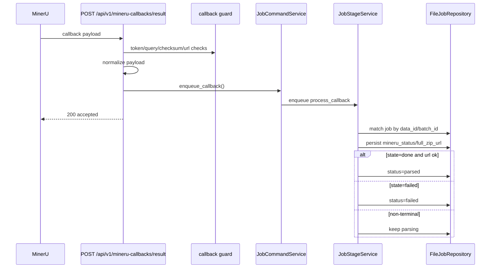

# MinerU callback ingress 与安全校验设计

## 0. 术语约定

- **process_callback**
  - 指后台处理 MinerU callback payload 的 stage。
  - 防冲突：当前后端没有同名 stage；参考 `create_pdf` 保持同名可降低迁移成本。
- **NormalizedMinerUCallback**
  - 指把 callback 原始 payload 归一化后的统一字典，至少包含 `batch_id/data_id/state/full_zip_url/data`。
  - 防冲突：当前仓库没有 callback 归一化模型。
- **parsed**
  - 指“已拿到 MinerU 终态结果 zip 地址，但尚未进入 DOCX 后处理”的中间状态。
  - 防冲突：当前状态机没有 `parsed`，新增后用于区分 `parsing` 与 `converting`。
- **public deployment guard**
  - 指 `single_tenant_public` 模式下 callback token、query token、checksum 和结果 URL allowlist 的组合安全边界。

## 1. 决策与约束

### 需求摘要

本 feature 只解决 MinerU callback 的接入和安全收口：**接收 callback -> 鉴权/验签 -> 匹配 job -> 持久化结果状态**。

成功标准：

1. 新增 `POST /api/v1/mineru-callbacks/result`
2. 支持 internal / single_tenant_public 两种部署模式
3. callback 命中 `done + full_zip_url` 时，任务进入 `parsed`
4. callback 命中 `failed` 时，任务进入 `failed`
5. `full_zip_url` 必须通过 `https + host allowlist` 校验

明确不做：

- 不下载结果 zip
- 不生成 DOCX
- 不实现 `recover-mineru-result`
- 不把 callback 结果直接塞进现有 `convert_package` 主链

### 复杂度档位

- 安全边界 = 偏离默认
  - 原因：引入 external callback 身份校验与 checksum 规则
- 状态机复杂度 = 偏离默认
  - 原因：需要新增 `parsed` 并区分 `parsing/parsed/failed`
- 其余走当前后端默认档位

### 关键决策

1. **callback 入口单独建 router**
   - 新增 `POST /api/v1/mineru-callbacks/result`
   - 不把 callback 混进 `jobs` router

2. **`internal` 与 `single_tenant_public` 两模式直接在服务端分支**
   - `internal`：不要求 callback token
   - `single_tenant_public`：要求 header 或 query token

3. **checksum 校验只在 payload 带 `checksum` 时启用**
   - 算法：`uid + job.mineru_callback_seed + content`
   - payload 缺 `uid` 时回退 `.env` 中的 `MINERU_UID`

4. **callback 终态只更新到 `parsed` / `failed`**
   - `done + full_zip_url`：进入 `parsed`
   - `failed`：进入 `failed`
   - 不在本 feature 内继续下载 zip 或生成 DOCX

5. **任务匹配优先级**
   - 先按 `data_id`
   - 再按 `batch_id`

### 前置依赖

- 需要 `pdf-upload-and-mineru-submission` 已完成，因为它负责写 `mineru_batch_id/data_id/callback_seed`
- 需要 `MINERU_RESULT_HOST_ALLOWLIST`、`PUBLIC_DEPLOYMENT_MODE`、`MINERU_CALLBACK_TOKEN` 等配置项

## 2. 名词与编排

### 2.1 名词层

#### 现状

- `JobRecord`
  - 当前已有 `mineru_batch_id/data_id/callback_seed/status`，但没有 `mineru_result_zip_url`，状态机也没有 `parsed`。
- `JobStageMessage`
  - 当前 stage 只有 `convert_package` 与 `submit_to_mineru`，没有 callback 处理。
- `JobCommandService`
  - 当前无法从 callback payload 找 job，也没有 callback 入队入口。
- `api/dependencies.py`
  - 当前只有 jobs/token/admin 访问依赖，没有 MinerU callback 专用校验。

#### 变化

1. `JobRecord` 新增：
   - `mineru_result_zip_url: str | None`

2. `JobStatus` 扩展：
   - 新增 `parsed`

3. `JobStageMessage.stage` 扩展：
   - 新增 `process_callback`

4. 新增 callback 归一化协议：

```python
NormalizedMinerUCallback = {
    "batch_id": str | None,
    "data_id": str | None,
    "state": str | None,
    "full_zip_url": str | None,
    "data": dict | None,
}
```

5. `JobCommandService` 新增：

```python
def enqueue_callback(normalized_payload: dict[str, Any], trace_id: str) -> tuple[JobRecord, JobStageMessage]
```

### 2.2 编排层



#### 现状

- 当前原始 PDF 提交成功后只能停在 `parsing`。
- 没有 callback ingress、没有 token/checksum 校验、没有结果 URL 白名单，也没有 `parsed` 状态。

#### 变化

1. 新增 callback router
2. 新增 `process_callback` stage
3. `JobStageService` 负责：
   - 校验 `full_zip_url`
   - 更新 `mineru_status`
   - `done + url` -> `parsed`
   - `failed` -> `failed`
4. router 只负责 guard + normalize + enqueue，不直接改 job

#### 流程级约束

- **错误语义**
  - 公开模式缺 callback token：`503`
  - callback token 错误：`403`
  - checksum 错误：`403`
  - payload 缺 `batch_id/data_id`：`400`
  - 任务缺 callback seed 却要验 checksum：`409`
  - 结果 URL 非 https 或 host 不在 allowlist：`400`
- **幂等性**
  - 同一条 callback 可以重复入站；stage 处理必须以最新 `mineru_status/full_zip_url` 幂等覆盖
- **并发 / 顺序**
  - `process_callback` 只允许作用于 `parsing/parsed/failed` 等在线链路相关状态
- **扩展点**
  - 后续 `mineru-callback-postprocess` 只在 `parsed` 基础上继续推进
- **可观测点**
  - 事件至少包含：
    - `mineru_callback_received`
    - `mineru_callback_processed`
    - `mineru_callback_failed`

### 2.3 挂载点清单

- `POST /api/v1/mineru-callbacks/result`：新增 `app/api/v1/routers/mineru_callbacks.py`
- `process_callback`：`JobStageMessage.stage`
- `parsed`：`JobStatus`
- `PUBLIC_DEPLOYMENT_MODE` / `MINERU_CALLBACK_TOKEN` / `MINERU_CALLBACK_TOKEN_QUERY_NAME` / `MINERU_UID` / `MINERU_RESULT_HOST_ALLOWLIST`：`app/core/config.py`
- `mineru_result_zip_url`：`JobRecord`

### 2.4 推进策略

1. **扩展 callback 合同**
   - 增加 `parsed`、`process_callback`、`mineru_result_zip_url`
   - 退出信号：模型与 repository 兼容，旧 jobs 测试继续通过

2. **落地 guard 与 payload 归一化**
   - 在 `api/dependencies.py` 增加 identity / normalize / checksum 逻辑
   - 退出信号：对象级测试能覆盖 internal/public 两种模式

3. **新增 callback router 与 stage 入队**
   - `POST /api/v1/mineru-callbacks/result` 可命中任务并成功入队
   - 退出信号：返回 `200` 且生成 `process_callback` stage

4. **接通 process_callback 状态推进**
   - `done + full_zip_url` -> `parsed`
   - `failed` -> `failed`
   - 退出信号：对象级测试能看到状态和 `mineru_result_zip_url`

5. **补齐测试与文档**
   - 退出信号：全量测试通过，API/health/runbook 文档同步

### 2.5 结构健康度与微重构

#### 评估

- 文件级 — `app/api/v1/routers/jobs.py`
  - 当前已接近 500 行，本 feature 不应继续往里塞 callback 入口。
- 文件级 — `app/api/dependencies.py`
  - 体量不大，但会新增与 callback 专属相关的 guard 逻辑，职责仍然一致。
- 文件级 — `app/services/jobs/stage.py`
  - 会继续增长，但 `process_callback` 仍属 stage 分发职责。
- 目录级 — `app/api/v1/routers/`
  - 目前 4 个 router 文件，新建 `mineru_callbacks.py` 后仍未摊平。

#### 结论：不做

本次不做微重构。理由：

- callback 入口天然属于新 router，已经规避了继续膨胀 `jobs.py`
- `stage.py` 虽然继续增长，但新增分支仍属于同一 stage 调度职责域

#### 超出范围的观察

- 如果后续 `mineru-callback-postprocess` 把下载 zip、提取 markdown、状态更新全部继续塞进 `stage.py`，该文件很可能需要沿 `submit/process/recover` 三类动作拆分；这属于下一条 feature 之后再评估的观察项。

## 3. 验收契约

- **S1**：`internal` 模式下 callback 不需要 token
- **S2**：`single_tenant_public` 模式下缺 token 或 token 错误时拒绝
- **S3**：payload 可从 `content` JSON 字符串归一化出 `batch_id/data_id/state/full_zip_url`
- **S4**：checksum 正确时允许通过；错误时返回 `403`
- **S5**：callback 命中 `done + full_zip_url` 时任务进入 `parsed` 并持久化 `mineru_result_zip_url`
- **S6**：callback 命中 `failed` 时任务进入 `failed`，`error_code=mineru_failed`
- **S7**：不改动现有 `/api/v1/jobs` 与 `/api/v1/jobs/pdf` 入口语义

### 反向核对项

- 不应出现结果 zip 下载和 DOCX 生成逻辑
- 不应在 router 里直接改 job 状态，必须走 stage

## 4. 与项目级架构文档的关系

- 需要在 `backend-fastapi-service.md` 中补入：
  - `process_callback`
  - `parsed`
  - callback 安全边界
- 需要在 `ARCHITECTURE.md` 中把“当前不接 callback”改成“callback ingress 已接入，但后处理主链仍未回流”
