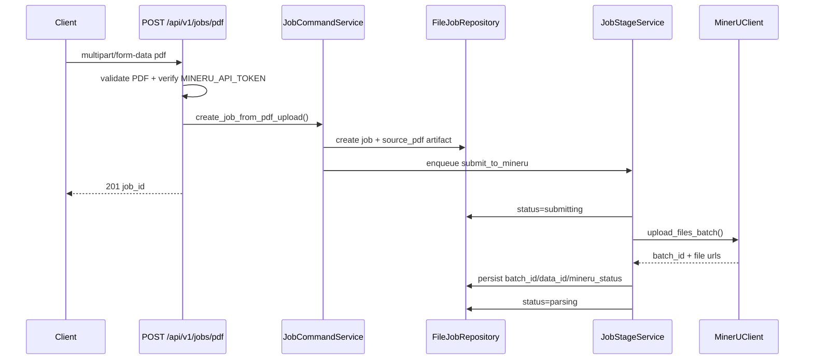

# PDF 原始上传与 MinerU 提交设计

## 0. 术语约定

- **source_pdf**
  - 指用户上传的原始 PDF 文件，对应新的 `JobFile.file_type`。
  - 防冲突：当前仓库没有同名持久化产物类型，允许直接引入。
- **source_kind**
  - 指任务输入类型，区分 `mineru_package` 与 `source_pdf`。
  - 防冲突：当前 `JobRecord` 还没有输入来源字段，新增后不会和现有 `source_filename` 语义重叠。
- **submit_to_mineru**
  - 指把本地 PDF 提交给 MinerU 的后台 stage。
  - 防冲突：当前后端只有 `convert_package` stage，没有同名 stage。
- **mineru_batch_id / mineru_data_id / mineru_callback_seed / mineru_status**
  - 指在线解析链路里需要持久化的 MinerU 标识和状态。
  - 防冲突：当前仓库没有这些字段；参考项目 `create_pdf` 已验证这些术语是稳定的。

## 1. 决策与约束

### 需求摘要

本 feature 只解决 PDF 在线解析链路的前半段：**上传原始 PDF -> 提交 MinerU -> 记录外部任务标识 -> 本地任务进入 parsing**。

成功标准：

1. 新增 `POST /api/v1/jobs/pdf`
2. 上传合法 PDF 后，返回 `job_id`
3. 后台成功调用 MinerU，持久化 `batch_id/data_id` 等字段
4. `GET /api/v1/jobs/{job_id}` 能看到任务已进入 `parsing`

明确不做：

- 不接 callback router
- 不下载 MinerU 结果 zip
- 不生成 DOCX
- 不实现 `recover-mineru-result`

### 复杂度档位

- 外部依赖 = 偏离默认
  - 原因：从“纯本地转换”变成“后端协调外部异步服务”
- 状态机复杂度 = 偏离默认
  - 原因：需要从现有 `uploaded/queued/converting` 扩展出 `submitting/parsing`
- 其余走当前后端默认档位

### 关键决策

1. **不复用现有 `POST /api/v1/jobs`**
   - 原始 PDF 上传单独走 `POST /api/v1/jobs/pdf`
   - 理由：避免把“上传已完成的 MinerU 结果包”和“上传原始 PDF 等待外部异步回调”混成一个合同

2. **MinerU token 缺失时直接拒绝创建 PDF 任务**
   - `POST /api/v1/jobs/pdf` 在请求入口前置校验 `MINERU_API_TOKEN`
   - 理由：当前 feature 只做到提交成功并进入 `parsing`，如果 token 缺失，任务连最小闭环都走不到；让任务静默卡在 `uploaded` 会让行为变得不可解释

3. **本 feature 只提交，不带 callback**
   - 当前不引入 `MINERU_CALLBACK_URL`、`MINERU_CALLBACK_TOKEN`、checksum 合同
   - 理由：这是下一条 feature `mineru-callback-ingress-and-guards` 的范围；本 feature 必须保持边界清晰

4. **沿用现有 BackgroundTasks + file spool**
   - 不引入 Redis/Celery
   - 理由：当前项目已经有 `JobStageMessage`、`stage_messages/` 和 replay 机制，足以支撑提交 MinerU 这一步

### 前置依赖

- 运行时需要可用的 `MINERU_API_TOKEN`
- `md2word` conda 环境里已有 `requests`、`loguru` 等库；如后续发现缺库，再在实现阶段补

## 2. 名词与编排

### 2.1 名词层

#### 现状

- `JobRecord`
  - 当前只有 `source_filename`、`status`、`translation_mode` 等后处理语义字段，没有输入来源和 MinerU 外部标识。
  - 来源：`app/core/job_models.py JobRecord`
- `JobFile`
  - 当前只支持 `source_package`、`translation_request`、`result_docx`。
  - 来源：`app/core/job_models.py JobFile`
- `JobStageMessage`
  - 当前 stage 只有 `convert_package`。
  - 来源：`app/core/job_models.py JobStageMessage`
- `JobCommandService`
  - 当前只有 `create_job_from_saved_upload()`，输入假设是 MinerU zip。
  - 来源：`app/services/jobs/command.py`
- `jobs` router
  - 当前只有 `/api/v1/jobs`，输入假设是 zip。
  - 来源：`app/api/v1/routers/jobs.py`

#### 变化

1. `JobRecord` 新增：
   - `source_kind: "mineru_package" | "source_pdf"`
   - `mineru_batch_id: str | None`
   - `mineru_data_id: str | None`
   - `mineru_callback_seed: str | None`
   - `mineru_status: str | None`

2. `JobStatus` 扩展：
   - 新增 `submitting`
   - 新增 `parsing`

3. `JobFile.file_type` 扩展：
   - 新增 `source_pdf`

4. `JobStageMessage.stage` 扩展：
   - 新增 `submit_to_mineru`

5. 新增 MinerU 提交结果契约：

```python
class MinerUSubmissionResult:
    batch_id: str
    data_id: str
    callback_seed: str | None
    mineru_status: str
```

来源：
- `app/clients/mineru_client.py MinerUClient.upload_files_batch()`
- `create_pdf` 的 `conversion_operations.py submit_to_mineru()`

#### 接口示例

```text
POST /api/v1/jobs/pdf
Form:
  pdf=@/path/to/source.pdf
  translation_mode=direct

201 Response:
{
  "job_id": "job_123",
  "trace_id": "trace_123",
  "status": "uploaded",
  "translation_mode": "direct"
}
```

来源：`app/api/v1/routers/jobs.py` 新增 `/pdf` route

```python
job = JobRecord(
    source_kind="source_pdf",
    status="uploaded",
    mineru_batch_id=None,
    mineru_data_id=None,
    mineru_callback_seed=None,
    mineru_status=None,
)
```

来源：`app/services/jobs/command.py` 新增 `create_job_from_pdf_upload()`

### 2.2 编排层



#### 现状

- 当前主链路是：
  - 上传 MinerU zip
  - `enqueue_conversion()`
  - `convert_package`
  - 直接进入 DOCX 后处理
- 当前不存在外部异步服务提交、外部 batch 标识和 `parsing` 状态。
- 来源：`app/services/jobs/command.py`、`app/services/jobs/stage.py`

#### 变化

1. 在 `jobs` router 中新增一条并行入口：
   - `/api/v1/jobs/pdf`
   - 不影响现有 `/api/v1/jobs`

2. 在 `JobStageService` 中新增 `submit_to_mineru` 分支：
   - 启动时把 job 从 `queued` 推到 `submitting`
   - 提交成功后推到 `parsing`
   - 记录 `mineru_batch_id/data_id/mineru_status`

3. 提交动作只处理在线前半程：
   - 不触发 callback
   - 不触发 DOCX 渲染
   - 成功后停在 `parsing`

#### 流程级约束

- **错误语义**
  - PDF 校验失败：`400`
  - `MINERU_API_TOKEN` 缺失：`503`
  - 提交 MinerU 失败：job 进入 `failed`，`error_code=mineru_submit_failed`
- **幂等性**
  - `submit_to_mineru` 只允许从 `uploaded` 或特定失败态重入
- **并发 / 顺序**
  - 一个 `source_pdf` job 同一时刻只允许有一个 `submit_to_mineru` stage
- **扩展点**
  - 后续 callback feature 在 `parsing` 之后接入
  - 后续 recover feature 复用同一组 MinerU 标识字段
- **可观测点**
  - 事件至少包含：
    - `job_created`
    - `stage_enqueued`
    - `mineru_submit_started`
    - `mineru_submit_succeeded`
    - `job_failed`

### 2.3 挂载点清单

- `POST /api/v1/jobs/pdf`：`app/api/v1/routers/jobs.py` — 新增
- `source_pdf`：`JobFile.file_type` — 新增
- `submit_to_mineru`：`JobStageMessage.stage` — 新增
- `MINERU_API_TOKEN` 及相关上传参数：`app/core/config.py` — 新增
- `source_kind/mineru_*`：`JobRecord` — 新增

### 2.4 推进策略

1. **任务合同扩展**
   - 给 `JobRecord` / `JobFile` / `JobStageMessage` 增加 `source_pdf`、`source_kind`、`mineru_*` 和新状态
   - 退出信号：模型与 file repository 读写兼容，现有 jobs 测试继续通过

2. **MinerU 客户端与提交服务骨架**
   - 新增 `app/clients/mineru_client.py` 和 `submit_to_mineru()` 入口
   - 退出信号：在 fake client 下能得到稳定的 `batch_id/data_id`

3. **PDF 上传 API**
   - 新增 `/api/v1/jobs/pdf`，完成 PDF 校验、token 预检、`source_pdf` 落盘和 stage 入队
   - 退出信号：API 返回 `201`，任务详情里可见 `source_pdf`

4. **后台 stage 接通**
   - `submit_to_mineru` 成功后把任务推进到 `parsing`
   - 退出信号：对象级测试能看到 `mineru_batch_id/data_id` 和 `parsing`

5. **测试与文档补齐**
   - 补 jobs/health/runbook/api 文档和对象级测试
   - 退出信号：新测试通过，文档 frontmatter/YAML 校验通过

### 2.5 结构健康度与微重构

#### 评估

- 文件级 — `app/api/v1/routers/jobs.py`
  - 当前约 `419` 行，已承载两条上传入口（zip 与未来 PDF）、列表、详情、下载和运维动作，但本 feature 只新增一条与 jobs 入口同域的路由，尚未超过“再拆一次才更清晰”的阈值。
- 文件级 — `app/services/jobs/stage.py`
  - 当前约 `225` 行，职责仍集中在 stage 分发和状态推进；新增一个 `submit_to_mineru` 分支后仍是同一职责域。
- 文件级 — `app/core/config.py`
  - 当前约 `98` 行，新加 MinerU 提交配置仍属同类配置项扩展。
- 目录级 — `app/api/v1/routers/`
  - 当前 4 个 router 文件；本 feature 不新增新 router 文件，目录未摊平。
- 目录级 — `app/services/jobs/`
  - 当前 5 个文件；新增 `app/clients/mineru_client.py` 会落新目录，不会压挤 `jobs/` 目录。

#### 结论：不做

本次不做微重构。原因：

- `jobs.py` 虽然偏大，但新增 `/jobs/pdf` 仍属于同一资源家族入口，原地扩展可读性尚可
- `stage.py` 继续承担 stage 分发职责，没有出现第二职责域
- 目录级没有出现新增文件摊平问题

#### 超出范围的观察

- 如果后续 `mineru-callback-ingress-and-guards` 继续把更多入口和 PDF 上传逻辑塞进 `jobs.py`，该文件很可能超过 500 行，届时应考虑把 “上传入口 / 查询下载 / 运维动作” 分成独立 router 文件；这属于后续 `cs-refactor` 或下一轮 feature 设计的观察项，不阻塞本 feature。

## 3. 验收契约

- **S1**：上传合法 PDF，创建 job 成功
  - 输入：`POST /api/v1/jobs/pdf` + 合法 PDF
  - 期望：返回 `201`，`status=uploaded`

- **S2**：后台成功提交 MinerU
  - 输入：fake / stub MinerU client 成功返回 `batch_id/data_id`
  - 期望：job 进入 `parsing`，持久化 `mineru_batch_id/mineru_data_id/mineru_status`

- **S3**：缺 `MINERU_API_TOKEN`
  - 输入：`POST /api/v1/jobs/pdf`
  - 期望：直接返回 `503`，不创建 job

- **S4**：非法 PDF
  - 输入：扩展名、content-type 或 `%PDF-` 校验失败
  - 期望：返回 `400`

- **S5**：MinerU 提交失败
  - 输入：client 抛异常
  - 期望：job 进入 `failed`，记录 `error_code=mineru_submit_failed`

- **S6**：现有 zip 上传入口不受影响
  - 输入：`POST /api/v1/jobs`
  - 期望：仍走 `convert_package` 主链，不要求 MinerU token

### 反向核对项

- 不应出现 callback router 或 `process_callback` 相关实现
- 不应出现结果 zip 下载、markdown 提取或 DOCX 生成逻辑被接到 `submit_to_mineru` 分支里
- 不应修改现有 `/api/v1/jobs` 的 zip 上传语义

## 4. 与项目级架构文档的关系

- 需要在 `backend-fastapi-service.md` 中补入：
  - `source_pdf`
  - `submit_to_mineru`
  - `parsing`
  - `mineru_batch_id/data_id`
- 需要在 `ARCHITECTURE.md` 总入口中补一条：
  - FastAPI 后端表面已开始从“后处理入口”向“在线解析入口”扩展，但当前只完成前半程
- 当前不需要改 `conversion-flow.md`
  - 因为本 feature 不改变底层 DOCX 后处理链
