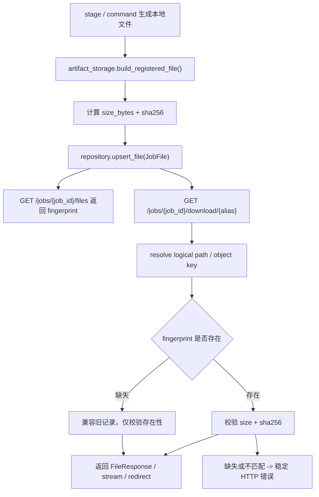

# Local Artifact Contract Hardening 设计

## 0. 术语约定

- **artifact**：jobs 流程登记的产物记录，当前类型包括 `source_package`、`source_pdf`、`parsed_result_package`、`translation_request`、`result_docx`。
- **logical path**：`JobFile.path`，job 内相对路径，例如 `input/source.pdf` 或 `output/result.docx`；它不是本地绝对路径，也不是 object key。
- **local artifact file**：由 `logical path` 和 `JobPaths.root` 解析出的服务端本地文件。
- **artifact fingerprint**：artifact 登记时记录的 `size_bytes` 与 `sha256`；`sha256` 统一写作 `sha256:<64 hex>`。
- **download diagnostic**：下载失败时给调用方和运维看的稳定诊断，不暴露服务端绝对私密路径。
- **retention dry-run**：只生成可清理候选报告，不删除 artifact。

## 1. 决策与约束

### 需求摘要

本 feature 从 `backend-productization-implementation` roadmap 的 `local-artifact-contract-hardening` 条目起头，目标是在继续使用本地文件系统保存 PDF / DOCX / zip 等大文件的前提下，把 artifact 合同从“登记 logical path”加固为“登记 logical path + 大小 + hash + 可诊断下载错误 + retention 计划”。

成功标准：

- 新登记 artifact 持久化 `size_bytes` 和 `sha256`，API 文件列表能返回这两个字段。
- 旧 `JobFile` 记录仍可读取和下载；缺失 fingerprint 时不要求一次性 backfill。
- 下载时能区分“不支持 alias / 未登记 artifact / 本地文件缺失 / 路径越界 / fingerprint 不匹配”。
- 本地完整性检查脚本能报告缺失文件、大小不匹配和 sha256 不匹配，且保持只读。
- retention 仍先做 dry-run，覆盖本地 artifact 候选，不直接删除生产文件。

明确不做：

- 不引入新的 S3、OSS、MinIO 或外部对象存储能力。
- 不改变 `JobFile.path` 的 logical path 语义。
- 不把本地绝对路径放进 API 响应或错误详情。
- 不做旧数据强制迁移；旧记录缺少 `size_bytes` / `sha256` 时保持兼容。
- 不执行真实删除；retention 本轮只产出 dry-run 计划。
- 不改变 DOCX 渲染、MinerU callback、模板或术语规则业务语义。

### 复杂度档位

本 feature 偏离默认档位：它改变持久化 `JobFile` 的数据合同和下载错误语义，必须同时覆盖 Pydantic 模型、file / sqlite / MySQL payload 持久化、API response、下载 router、运维脚本和测试。数据库表本身仍保存 JSON payload，因此不需要新增 MySQL schema 字段。

### 关键决策

1. **fingerprint 是 JobFile 合同的一部分，不是下载时临时计算字段**
   - 登记时写入，后续下载和运维检查才有可比对的真值。
   - 旧记录允许为空，避免把本 feature 变成数据迁移任务。

2. **hash 使用 `sha256:<hex>` 格式**
   - 与 roadmap 中资源版本的 `snapshot_hash` 口径一致。
   - 直接裸 hex 容易在后续扩算法时丢上下文。

3. **下载错误保持现有 `{"detail": ...}` 外形**
   - 当前 API 没有统一错误 envelope，强行换成结构化对象会扩大兼容风险。
   - detail 文本需要稳定包含 `file_type`、`path`、诊断原因；不得包含私密绝对路径。

4. **retention 先扩 dry-run，不执行 delete**
   - `cleanup-local-files` 当前只清 `work/` 并保留已登记 artifact。
   - 真正删除本地 artifact 涉及审计、权限和恢复策略，应留给后续权限审计 / operations feature。

5. **现有 object / S3 adapter 只跟随共享 JobFile 字段，不扩能力**
   - 本 roadmap 明确不引入对象存储；若现有 adapter 因 `JobFile` 新字段需要同步，只补 fingerprint，不能借机扩展对象存储行为。

## 2. 名词与编排

### 2.1 名词层

#### 现状

- `JobFile`
  - 字段：`file_type`、`path`、`storage_backend`、`object_key`、`public_url`、`download_url`、`created_at`。
  - 来源：`app/core/job_models.py`
- `JobFileResponse`
  - 当前透出 `file_type`、`path`、`storage_backend`、`object_key`、`public_url`、`download_url`、`created_at`。
  - 来源：`app/schemas/jobs.py`、`app/api/v1/routers/jobs_presenters.py`
- `ArtifactStorageProtocol`
  - `build_registered_file()` 返回 `JobFile`；`resolve_download()` 返回 `DownloadArtifact`。
  - 来源：`app/services/jobs/artifact_storage.py`
- `LocalArtifactStorageAdapter`
  - 当前只校验 `JobFile.path` 是否等于对应 `file_type` 的 logical path，再解析本地路径。
  - 来源：`app/services/jobs/artifact_storage.py`
- `check_local_file_storage_integrity()`
  - 当前能报告缺失 artifact 和不可迁移 metadata，但没有 size / hash 校验。
  - 来源：`scripts/ops/check_local_file_storage_integrity.py`
- `ArtifactRetentionPlanner`
  - 当前只筛选 `storage_backend=object` 且有 `object_key` 的对象 artifact。
  - 来源：`app/services/jobs/artifact_retention.py`

#### 变化

`JobFile` 增加两个兼容字段：

```python
class JobFile(BaseModel):
    size_bytes: int | None = None
    sha256: str | None = None
```

示例：

```json
{
  "file_type": "result_docx",
  "path": "output/result.docx",
  "storage_backend": "local",
  "size_bytes": 12345,
  "sha256": "sha256:9f86d081884c7d659a2feaa0c55ad015a3bf4f1b2b0b822cd15d6c15b0f00a08"
}
```

fingerprint 规则：

- 新登记 artifact 必须从实际本地文件计算 `size_bytes` 和 `sha256`。
- 旧记录字段为空时：下载只做路径和存在性校验，不做 hash 比对。
- 字段存在时：下载本地文件前必须比对大小与 sha256；不匹配时拒绝下载。
- `storage_backend=object` 的记录仍保留 `path` 作为 logical path，`size_bytes` / `sha256` 表示登记时本地源文件内容。

download diagnostic 规则：

- 不支持 alias：`404 不支持的产物类型。`
- job 未登记对应 artifact：`404 产物不存在。`
- logical path 越界或不匹配：`400`。
- 本地文件缺失：`404`。
- fingerprint 不匹配：`409`。
- 错误 detail 可以包含 `file_type`、`path`、`expected`、`actual`，但不包含本地绝对路径。

retention dry-run 候选增加 local artifact 表达：

```json
{
  "job_id": "job_x",
  "job_status": "completed",
  "file_type": "result_docx",
  "storage_backend": "local",
  "path": "output/result.docx",
  "object_key": null,
  "size_bytes": 12345,
  "sha256": "sha256:...",
  "age_days": 31,
  "retention_days": 30
}
```

### 2.2 编排层



#### 现状

- `JobStageService`、`JobCommandService` 通过 `artifact_storage.build_registered_file()` 登记 artifact。
- `FileJobRepository`、`DatabaseJobRepository`、`MysqlJobRepository` 都把 `JobFile` 作为 JSON payload 持久化。
- 下载 router 通过 alias 找到 file type，再从 repository 取 `JobFile`，最后让 artifact storage 解析为 `DownloadArtifact`。
- local adapter 当前可以发现路径越界 / logical path 不匹配；文件是否存在由 router 对 `download.path.exists()` 做最后检查。

#### 变化

1. **artifact 登记**
   - local adapter 在返回 `JobFile` 前读取目标本地文件，写入 `size_bytes` 与 `sha256`。
   - object / S3 现有 adapter 若复用本地源文件上传，同步继承同一 fingerprint。
   - 源文件缺失时，登记阶段直接抛 `FileNotFoundError`，由现有 stage 失败路径记录事件。

2. **API 响应**
   - `JobFileResponse` 透出 `size_bytes` / `sha256`。
   - 旧记录缺字段时响应为 `null`，不影响 `download_url`。

3. **下载校验**
   - local path 下载在生成 `FileResponse` 前完成存在性、大小和 sha256 校验。
   - object adapter 的本地 fallback 同样走 local 校验；redirect 模式无法在后端下载前校验远端对象内容，本轮只保证登记 fingerprint 和本地 fallback 口径。
   - router 只做 HTTP 映射，不重复计算 hash。

4. **运维检查**
   - `check_local_file_storage_integrity.py` 保持只读，新增 size / sha256 mismatch issue。
   - 缺少 fingerprint 的旧记录只发 warning，不作为 blocker。

5. **retention**
   - dry-run 可列出 local 和 object artifact 候选。
   - 输出包含 storage backend、logical path、object key、size 和 hash，便于人工审核。
   - 不新增删除命令，不改 `cleanup-local-files` 的保护语义。

#### 流程级约束

- **错误语义**：缺失文件是 404，路径非法是 400，fingerprint 不匹配是 409。
- **幂等性**：同一 artifact 重新登记时按当前文件内容重算 fingerprint；shadow upload 重跑仍覆盖同一 object key。
- **兼容性**：旧 JSON / sqlite / MySQL payload 不含新字段也必须通过 Pydantic 默认值读取。
- **安全性**：错误详情和 API 响应不暴露服务端绝对路径、secret、bucket credential。
- **可观测性**：完整性检查和 retention dry-run 输出可被 runbook 直接引用。

### 2.3 挂载点清单

- `JobFile` / `JobFileResponse`：删掉这两个字段，fingerprint 在 API 和持久化合同中消失。
- `ArtifactStorageProtocol.build_registered_file()`：artifact 登记时生成 fingerprint 的主入口。
- `download_artifact` HTTP 映射：下载诊断和错误状态码的对外入口。
- `check_local_file_storage_integrity.py`：生产切换和排障前的只读完整性检查入口。
- `ArtifactRetentionPlanner`：retention dry-run 的候选生成入口。
- `docs/api/jobs.md` / `docs/runbook.md`：调用方和运维理解新合同的外部文档入口。

### 2.4 推进策略

1. **名词合同先落地**
   - 给 `JobFile` 和 `JobFileResponse` 增加 `size_bytes` / `sha256`，同步 presenter。
   - 退出信号：旧记录可读取，新 response keys 稳定，artifact contract 单测覆盖字段默认值和新值。

2. **登记时生成 fingerprint**
   - 在 local artifact 登记路径补齐大小和 sha256；现有对象 adapter 只继承共享字段。
   - 退出信号：zip / pdf 在线主链登记的 artifact 都带 fingerprint，旧下载行为不变。

3. **下载诊断加固**
   - 将本地文件缺失、路径非法、fingerprint mismatch 映射为稳定 HTTP 状态和 detail。
   - 退出信号：FastAPI 下载测试覆盖 404 / 400 / 409，detail 不含绝对路径。

4. **完整性检查加固**
   - 扩展只读检查脚本，报告缺失、大小不匹配、sha256 不匹配和旧记录无 fingerprint。
   - 退出信号：脚本测试覆盖 mismatch，空目录仍不写文件。

5. **retention dry-run 覆盖 local artifact**
   - dry-run 候选从 object-only 扩展为 local + object，继续不删除。
   - 退出信号：retention 单测覆盖 local 候选、object 候选和未到期过滤。

6. **文档与最小验证**
   - 更新 jobs API 和 runbook 的 artifact 合同说明。
   - 退出信号：相关 unittest 通过，必要时刷新 OpenAPI snapshot。

### 2.5 结构健康度与微重构

#### 文件级

- `app/core/job_models.py` 已有 256 行，新增字段属于 `JobFile` 自然职责，不需要拆文件。
- `app/services/jobs/artifact_storage.py` 约 75 行，若直接塞入 hash 计算、mismatch 类型和诊断文本会开始混合“adapter 协议”和“完整性计算”两件事；实现时优先把 fingerprint 计算和校验放到新的 jobs 服务内聚模块，再由 adapter 调用。
- `app/api/v1/routers/jobs_query.py` 约 168 行，router 只做 HTTP 映射，不承接 hash 计算。
- `scripts/ops/check_local_file_storage_integrity.py` 已 367 行，但职责仍是单一只读检查；本次只扩展同一检查报告，不做重组。
- `app/services/jobs/artifact_retention.py` 约 146 行，扩展 local candidate 仍在现有职责内。

#### 目录级

`app/services/jobs/` 已按 command/query/stage/lifecycle/artifacts/storage/retention 拆分，继续在该目录内新增小模块符合现有 backend directory spec，不需要重组目录。

#### 结论

本次不做独立微重构。只在实现 feature 时新增必要的 fingerprint / integrity 小模块，避免把完整性计算堆进 router 或通用 `utils.py`。

## 3. 验收契约

1. **新登记 local artifact 带 fingerprint**
   - 触发：上传 zip 或 PDF 并完成主链。
   - 期望：`GET /api/v1/jobs/{job_id}/files` 返回每个新登记 artifact 的 `size_bytes > 0` 和 `sha256`，且 `sha256` 以 `sha256:` 开头。

2. **旧 JobFile 记录兼容**
   - 触发：手工构造不含 `size_bytes` / `sha256` 的旧 `JobFile` payload。
   - 期望：repository 可读取，`/files` 返回 `null`，下载仍按旧存在性规则工作。

3. **缺失本地文件错误稳定**
   - 触发：`files.json` / repository 中有 artifact 记录，但对应本地文件不存在。
   - 期望：下载返回 404；detail 能定位 `file_type` 和 logical path，不包含绝对路径。

4. **路径非法仍是 bad request**
   - 触发：`JobFile.path` 越界或与 `file_type` 预期 logical path 不匹配。
   - 期望：下载返回 400；不尝试读取越界文件。

5. **fingerprint mismatch 拒绝下载**
   - 触发：登记后篡改本地 artifact 内容或大小。
   - 期望：下载返回 409；detail 说明 size 或 sha256 mismatch，不返回文件内容。

6. **完整性检查只读并报告 mismatch**
   - 触发：运行 `check_local_file_storage_integrity.py` 扫描含缺失、size mismatch、sha256 mismatch 的 data 目录。
   - 期望：报告包含对应 issue；扫描前后文件树不变。

7. **retention dry-run 覆盖 local artifact**
   - 触发：completed / failed / canceled job 超过保留期，且登记了 local artifact。
   - 期望：dry-run candidate 包含 local artifact 的 logical path、size、sha256；不删除任何文件。

8. **明确不做反向核对**
   - 触发：完成实现后检查 diff。
   - 期望：没有新增对象存储后端、没有真实删除命令、没有改变 `JobFile.path` 语义、没有把绝对路径加入 API 响应。

## 4. 与项目级架构文档的关系

- 更新 `.codestable/architecture/ARCHITECTURE.md`：
  - 在核心术语中明确 `JobFile` 新登记时包含 `size_bytes` / `sha256` artifact fingerprint，旧记录允许为空。
  - 在 FastAPI 数据与状态中补入已登记 artifact 对外只暴露 logical path / download_url / fingerprint，下载本地文件时按 400 / 404 / 409 口径诊断。
  - 在已知边界中保留“retention 仍是 dry-run，不执行真实删除”和“旧记录缺少 fingerprint 不强制迁移”。
- 更新 `.codestable/architecture/backend-fastapi-service.md`：
  - 在物理结构中补入 `artifact_storage.py`、`artifact_integrity.py`、`artifact_retention.py`、`object_artifact_storage.py` 的职责。
  - 在产物合同中写明 `JobFile` 的 `size_bytes` / `sha256` 规则、错误状态码、local/object fallback 和 retention dry-run 输出。
- 更新 `.codestable/requirements/fastapi-backend-productization.md`：
  - 补入维护者 / 集成方需要 artifact 大小、hash 和下载诊断的用户故事。
  - 刷新边界：本轮完成 artifact 合同加固和 dry-run 计划，但不做旧数据强制 backfill、不做真实删除、不新增外部对象存储。
- 更新 `.codestable/roadmap/backend-productization-implementation/`：
  - `local-artifact-contract-hardening` 从 `in-progress` 改为 `done`。
  - 主 roadmap 的实施状态同步标记，并保留后续权限审计 feature 再决定真实删除的衔接。

## 5. 回滚与后续衔接

- 回滚本 feature 时，删除新字段写入和校验逻辑即可；旧 `JobFile` payload 中多出的 `size_bytes` / `sha256` 对旧 Pydantic 读写不会成为必需字段。
- 如果 409 fingerprint mismatch 在真实环境频繁出现，应另起 issue 分析是文件被篡改、并发写入还是登记时机错误。
- 后续 `template-profile-versioning` 可以复用 `size_bytes` / `sha256` 作为模板 docx artifact 的基础检查，但不能把模板发布状态塞进 artifact 合同。
- 后续权限审计 feature 再决定 retention 是否从 dry-run 进入真实删除，并补审计事件。
