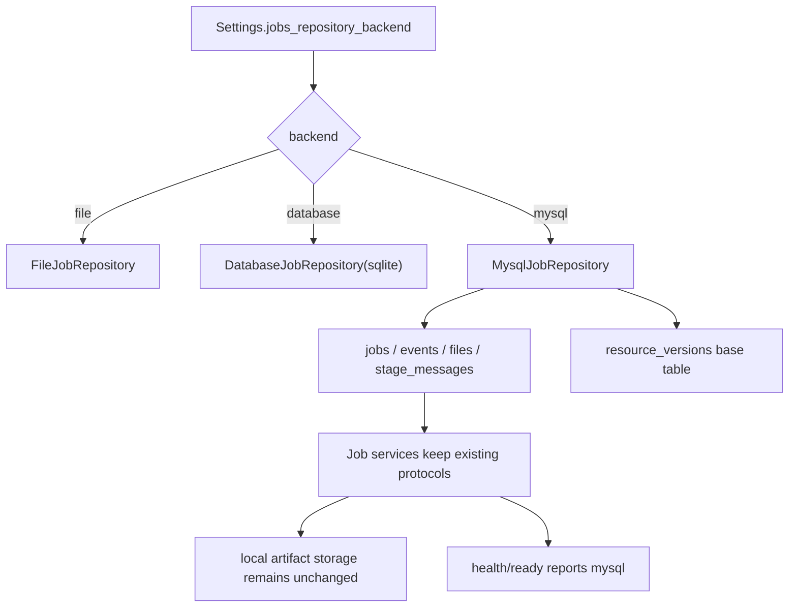

# MySQL Metadata Foundation 设计

## 0. 术语约定

- **MySQL metadata store**：保存 `JobRecord`、`JobEvent`、`JobFile`、`JobStageMessage` 和资源版本基础记录的 MySQL 后端。
- **sqlite database adapter**：现有 `JOBS_REPOSITORY_BACKEND=database` 的 sqlite adapter，对应 `DatabaseJobRepository`。
- **metadata payload**：repository 持久化的 Pydantic JSON payload；MySQL 只把它作为权威快照保存，不把字段拆成业务查询模型。
- **resource version base table**：给后续 template / term-rule / translation resource versioning 使用的基础表；本 feature 只建表，不提供编辑 / 发布流程。
- **local artifact storage**：PDF、DOCX、MinerU zip 等二进制仍由现有 artifact adapter 保存，不进 MySQL。

## 1. 决策与约束

### 需求摘要

从 roadmap 条目 `mysql-metadata-foundation` 启动最小闭环：现有 jobs 主链在 `JOBS_REPOSITORY_BACKEND=mysql` 下能创建任务、写事件、登记 artifact metadata、消费 stage message，并通过 readiness 明确报告当前 metadata store 为 MySQL。

成功标准：

- MySQL adapter 实现现有 job snapshot、events、files 和 stage message store protocols。
- `file` 默认值不变，`database` 继续表示 sqlite，新增 `mysql` 为显式生产化 metadata backend。
- MySQL schema bootstrap 覆盖 jobs、job_events、job_files、stage_messages 和 resource_versions 基础表。
- `/health/ready` 能报告 `configured_repository_backend=mysql`、`effective_repository_backend=mysql`、`stage_message_store=mysql`。
- 现有 PDF / MinerU / DOCX 主链测试能在 fake MySQL adapter 或 repository contract 下证明端到端合同不变。

明确不做：

- 不把 PDF / DOCX / MinerU zip 二进制存入 MySQL。
- 不迁移真实生产历史数据；file -> MySQL 数据迁移 runbook 可后续单独补。
- 不引入 Redis、Celery、RQ、跨进程 lease 或多 worker 抢占锁。
- 不实现 template / term-rule / translation 的资源版本编辑、发布、回滚业务流。
- 不引入 Alembic / SQLAlchemy 迁移系统；本轮按现有 repository 风格用轻量 schema bootstrap。
- 不改变 HTTP API path、status 枚举或 artifact 下载合同。

### 复杂度档位

- 外部数据库 = 偏离默认：需要可选依赖、连接配置、schema bootstrap 和无 MySQL server 的单测路径。
- 跨层配置 = 偏离默认：`Settings`、runtime builder、health readiness、tests 需要同时更新。
- 当前仍保持单实例：MySQL 只替换 metadata store，不改变 worker 拓扑和 artifact storage。

### 关键决策

1. **新增 `mysql` backend，不复用 `database` 名称**
   - `database` 已经在代码和文档中指向 sqlite。
   - MySQL 是显式生产化 backend，避免把 sqlite 与 MySQL 运行语义混在一个配置值里。

2. **MySQL adapter 复用现有 repository protocols**
   - 服务层已经依赖 `JobSnapshotRepositoryProtocol`、`JobEventRepositoryProtocol`、`JobFileRepositoryProtocol` 和 `StageMessageStoreProtocol`。
   - 新 adapter 不改变 `JobCommandService`、`JobQueryService`、`JobLifecycleService`、`JobStageService` 的合同。

3. **继续持久化完整 Pydantic JSON payload**
   - 当前服务查询主要按 job_id / file_type / stage status 读写，不需要把所有字段拆列。
   - 拆列会扩大 schema 迁移面，后续 resource version 业务表再按需要设计结构化字段。

4. **MySQL 驱动作为可选运行依赖**
   - 仓库没有现成 MySQL 依赖；新增 `PyMySQL` 到 requirements。
   - 未安装驱动却配置 `mysql` 时，在 runtime 构建阶段给出明确错误。

5. **resource_versions 只建基础表**
   - roadmap 要求 metadata foundation 覆盖资源版本基础表。
   - 业务状态机、默认指针和不可变发布语义由后续 `resource-versioning-foundation` 消费和完善。

## 2. 名词与编排

### 2.1 名词层

#### 现状

- `Settings.jobs_repository_backend`
  - 当前 `Literal["file", "database"]`，默认 `file`。
  - 来源：`app/core/config.py`
- `DatabaseJobRepository`
  - 当前 sqlite adapter，创建 jobs、job_events、job_files、stage_messages 四类表。
  - 来源：`app/repositories/database_job_repository.py`
- repository protocols
  - 服务层依赖 snapshot / event / file / stage message 四个协议。
  - 来源：`app/repositories/protocols.py`
- `HealthService`
  - readiness 暴露 configured/effective repository backend、stage message store 和 artifact storage。
  - 来源：`app/services/health_service.py`

#### 变化

新增 MySQL adapter 与配置：

```python
class MysqlJobRepository(
    JobSnapshotRepositoryProtocol,
    JobEventRepositoryProtocol,
    JobFileRepositoryProtocol,
    StageMessageStoreProtocol,
):
    ...
```

新增运行配置示例：

```env
JOBS_REPOSITORY_BACKEND=mysql
JOBS_MYSQL_HOST=127.0.0.1
JOBS_MYSQL_PORT=3306
JOBS_MYSQL_USER=md2word
JOBS_MYSQL_PASSWORD=...
JOBS_MYSQL_DATABASE=md2word
```

新增 MySQL 基础表：

```text
jobs(job_id, payload, created_at, updated_at)
job_events(id, job_id, payload, created_at)
job_files(job_id, file_type, payload, created_at)
stage_messages(message_id, job_id, status, payload, created_at, updated_at)
resource_versions(resource_type, resource_id, version, status, snapshot_hash, payload_ref, payload, created_at, updated_at)
```

### 2.2 编排层



#### 现状

- `build_runtime()` 根据 `file/database` 选择 metadata repository。
- `JobStageService`、`JobCommandService`、`JobLifecycleService` 和 `JobQueryService` 已从 runtime 接收 repository / stage store。
- `HealthService` 用 backend 字符串报告实际 repository 和 stage message store。

#### 变化

1. 配置层增加 `mysql` backend 和 MySQL 连接参数。
2. runtime builder 在 `mysql` 下创建 `MysqlJobRepository`，并继续创建本地 jobs/tmp 目录供 artifact 和 upload 使用。
3. MySQL adapter 初始化 schema，之后所有 job metadata 读写通过 existing protocols 进入 MySQL。
4. readiness 把 MySQL stage spool 视为数据库内 spool，不要求 `data/stage_messages` 目录存在。
5. tests 用 fake MySQL connection 跑 repository contract，用 build_runtime monkeypatch 证明 runtime/health 接入。

#### 流程级约束

- **错误语义**：缺少 `PyMySQL` 或连接失败应在 `mysql` backend 启动时明确失败，不回退到 file。
- **幂等性**：`create_job()` / `upsert_file()` / `put_stage_message()` 对同一主键重复写入保持稳定。
- **并发 / 顺序**：本轮不做跨进程排他锁；`pending/running` replay 语义保持现状。
- **可观测性**：readiness 必须区分 configured 和 effective backend，不能只显示 generic `database`。
- **扩展点**：resource version 业务流只能后续在 `resource_versions` 基础表上扩展，不能把模板 / 术语状态塞进 jobs payload。

### 2.3 挂载点清单

- Metadata backend 配置：`Settings.jobs_repository_backend`。
- Runtime repository 选择：`app/main.py::_build_job_metadata_repository()`。
- Repository adapter：新增 `app/repositories/mysql_job_repository.py`。
- Readiness metadata store 观测：`HealthService` 的 backend 字段和 stage spool 可用性判断。
- 测试运行时：`tests/test_fastapi_jobs_backend.py::build_test_runtime()` 支持 `mysql` 的测试替身。

### 2.4 推进策略

1. **落 MySQL schema 与 adapter**
   - 新增 MySQL repository，实现 existing protocols 和 resource_versions 基础表 bootstrap。
   - 退出信号：同一 repository contract 可在 fake MySQL connection 下通过。

2. **接入配置与 runtime**
   - `Settings` 增加 `mysql` backend 和连接参数；`build_runtime()` 能构建 MySQL runtime。
   - 退出信号：readiness 显示 configured/effective/stage store 均为 `mysql`。

3. **保持主链服务合同不变**
   - jobs 服务继续只依赖 protocols，不引入 MySQL 专属分支。
   - 退出信号：PDF callback / retry / replay 等既有 database-contract 测试可复用或新增 mysql-targeted 覆盖。

4. **补最小文档和依赖**
   - requirements 增加 MySQL 驱动，开发文档说明 `mysql` 与 sqlite 的区别。
   - 退出信号：配置示例和 readiness 预期可被 grep 到。

5. **验证与回写 checklist**
   - 跑针对性单测、yaml 校验和 diff 检查。
   - 退出信号：checklist steps 全部标记 done，roadmap item 保持 in-progress 等待 acceptance。

### 2.5 结构健康度与微重构

#### 文件级

- `app/repositories/database_job_repository.py` 当前是 sqlite 专用实现；直接把 MySQL 分支塞进去会让 sqlite / MySQL SQL 方言混杂。
- `app/main.py` 已有小型 backend builder；新增一条 `mysql` 分支仍属于组合根职责，没有必要先拆 factory。
- `app/services/health_service.py` 只需要把数据库型 stage spool 判断从 `database` 扩展到 `database/mysql`，不应新增 MySQL 专属 health service。

结论：本次不做大规模微重构；新增 `app/repositories/mysql_job_repository.py` 作为平行 adapter，保持现有目录结构。

#### 目录级

- `app/repositories/` 已是 persistence adapter 目录，适合承载 MySQL adapter。
- `scripts/ops/` 的 file -> sqlite shadow copy 暂不扩展为 MySQL 迁移脚本，避免把真实迁移 runbook 混入最小运行闭环。

结论：目录不重组；后续如果新增 Alembic 或多数据库 migration，再另起 refactor / operations feature。

## 3. 验收契约

- 输入：`JOBS_REPOSITORY_BACKEND=mysql` 且 MySQL 连接可用；触发：`build_runtime()`；期望：runtime.repository 为 MySQL adapter，readiness 显示 configured/effective/stage store 均为 `mysql`。
- 输入：source PDF job；触发：create/update/list events/files/stage messages；期望：MySQL adapter 与 file/sqlite repository contract 行为一致。
- 输入：pending/running/failed stage messages；触发：`replay_pending()`；期望：只 replay pending/running，不自动 replay failed。
- 输入：已登记 `JobFile(path="input/source.pdf")`；触发：MySQL 持久化和查询；期望：`path` 仍是逻辑路径，artifact 二进制仍在本地 storage。
- 输入：缺少 PyMySQL 依赖；触发：配置 `mysql` backend；期望：启动明确失败，不悄悄回退 file。
- 反向核对：不改 HTTP API、job status 枚举、events 审计语义。
- 反向核对：不把 resource version 的发布 / 默认 / 回滚业务流放进本 feature。
- 反向核对：不改 `JOBS_REPOSITORY_BACKEND=file` 默认值。

## 4. 与项目级架构文档的关系

本 feature 完成后需要回写两份架构文档：

- `.codestable/architecture/ARCHITECTURE.md`
  - 在 FastAPI 数据与状态里补入 `mysql` metadata store 现状。
  - 明确 MySQL 只保存 jobs metadata、stage messages 和 resource_versions 基础表，不保存 artifact 二进制。
  - 在已知边界里说明真实 MySQL smoke / file -> MySQL 迁移 runbook 仍归后续 operations feature。
- `.codestable/architecture/backend-fastapi-service.md`
  - 在物理结构里补入 `app/repositories/mysql_job_repository.py`。
  - 在主流程图 / 数据与状态 / readiness 里说明 `file`、`database(sqlite)`、`mysql` 三种 metadata backend。
  - 在已知边界里保留单实例、无多 worker 抢占锁和 artifact storage 独立配置的约束。

requirement 回写目标是 `.codestable/requirements/fastapi-backend-productization.md`：把“仍不包含 MySQL”改为“当前支持显式 MySQL metadata store”，同时保留默认 file backend 和 artifact 本地存储边界。

后续 `resource-versioning-foundation` 应复用 `resource_versions` 基础表，补齐默认指针、不可变发布版本、回滚和 service 查询协议。

后续 `operations-readiness-and-test-baseline` 应补真实 MySQL migration/runbook、部署环境变量示例和真实服务 smoke；本 feature 只保证代码边界与可测试最小闭环。
