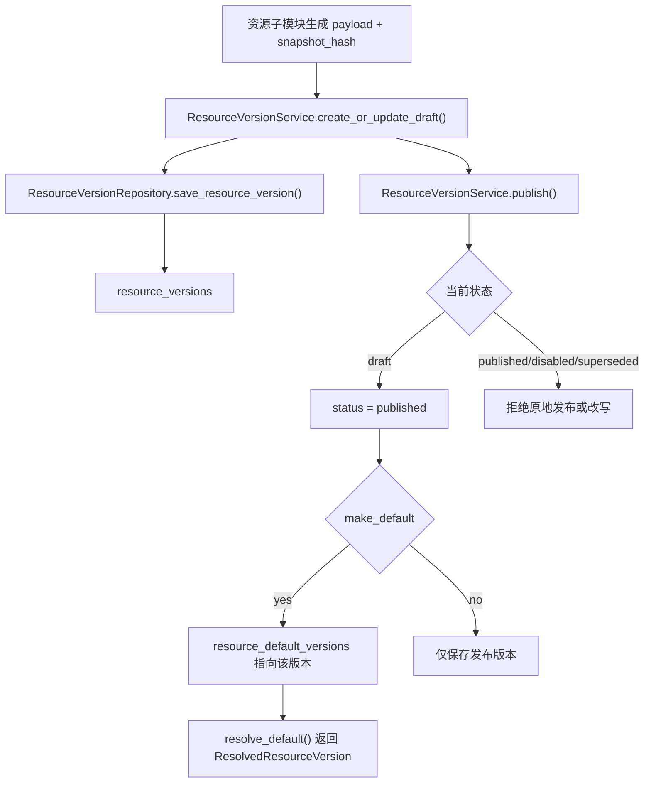

# Resource Versioning Foundation 设计

## 0. 术语约定

- **resource version**：模板、术语规则集、翻译配置这三类资源的某个版本记录；当前代码只有 MySQL `resource_versions` 基础表，没有业务 service。
- **resource type**：资源类型标识，首批固定为 `template`、`term_rule_set`、`translation_profile`，不承载资源内部字段。
- **published version**：可被 job 绑定的不可变版本；发布后不能原地修改 payload / hash。
- **default pointer**：某个 `resource_type + resource_id` 当前默认使用的已发布版本；回滚就是把指针切回旧的 published 版本。
- **snapshot_hash**：资源版本快照 hash，格式沿用 artifact fingerprint 的 `sha256:<hex>` 口径，用于后续 job 快照可复现判断。

## 1. 决策与约束

### 需求摘要

从 roadmap 条目 `resource-versioning-foundation` 启动，目标是给后续 Template Profile、Term Rule Set、Translation Profile 统一资源版本底座：

- 定义通用资源版本模型和 `draft/published/disabled/superseded` 状态。
- 复用 MySQL metadata store 中的 `resource_versions` 表，并补齐默认指针持久化。
- 提供 service 层状态机：草稿可更新，发布版本不可变，默认指针只能指向 published，回滚只切默认指针。
- 提供解析合同 `ResolvedResourceVersion`，后续 job 创建资源快照只消费 published 版本。

明确不做：

- 不实现 template / term-rule / translation 的具体 CRUD、上传、发布 API。
- 不规定每类资源内部 payload 字段；payload 只作为资源子模块写入的快照。
- 不把资源版本塞进 jobs payload 或 artifact 合同。
- 不改变现有 `/api/v1/templates`、`/api/v1/term-rules` 接口。
- 不引入 Alembic / SQLAlchemy / 多数据库迁移体系。
- 不实现多租户、权限审计或 job 创建时资源绑定。

### 复杂度档位

- 持久化合同 = 偏离默认：需要在已有 MySQL 基础表上补默认指针表，但仍保持无 Alembic 的轻量 bootstrap。
- 跨模块基础能力 = 偏离默认：本 feature 本身不暴露 API，却要被后续 templates / term-rules / translation / job snapshot 共用，名词边界必须收窄。
- 单实例生产化 = 当前默认：不做分布式锁、跨进程事务或强一致发布队列。

### 关键决策

1. **resource versioning 先做内部 service，不新增 HTTP API**
   - 后续资源子模块各自暴露管理 API；通用层只负责版本状态、默认指针和解析规则。
   - 如果现在暴露通用 CRUD API，会把三类资源的业务校验提前混在一起。

2. **默认指针独立成 `resource_default_versions` 表**
   - 既有 `resource_versions` 表已经由上一 feature 创建，直接加 `is_default` 列会引入已有表迁移问题。
   - 独立表能把“版本快照不可变”和“默认指针可变”分开。

3. **不可变发布语义放在 service 层**
   - repository 只做 typed 持久化；状态机、发布校验和默认指针校验由 `ResourceVersionService` 统一定义。
   - 后续模板、术语、翻译模块不得绕开 service 直接改 published 记录。

4. **`snapshot_hash` 在通用层只校验格式，不计算内容**
   - 每类资源的快照组成不同，hash 计算属于资源子模块。
   - 通用层只保证 hash 随版本一起持久化和解析。

## 2. 名词与编排

### 2.1 名词层

#### 现状

- `resource_versions` MySQL 基础表
  - 字段：`resource_type`、`resource_id`、`version`、`status`、`snapshot_hash`、`payload_ref`、`payload`、`created_at`、`updated_at`。
  - 来源：`app/repositories/mysql_job_repository.py::MYSQL_SCHEMA_STATEMENTS`
- repository protocols
  - 当前只有 jobs、events、files、stage messages 和 term-rules store 协议。
  - 来源：`app/repositories/protocols.py`
- runtime
  - `build_runtime()` 把 jobs metadata repository 同时注入 job services 和 stage store。
  - 来源：`app/main.py::build_runtime`

#### 变化

新增通用模型：

```python
class ResourceVersionStatus(str, Enum):
    draft = "draft"
    published = "published"
    disabled = "disabled"
    superseded = "superseded"

class ResourceVersionRecord(BaseModel):
    resource_type: str
    resource_id: str
    version: str
    status: ResourceVersionStatus
    snapshot_hash: str
    payload_ref: str | None = None
    payload: dict[str, Any] | None = None
    created_at: datetime
    updated_at: datetime

class ResolvedResourceVersion(BaseModel):
    resource_type: str
    resource_id: str
    version: str
    status: Literal["published"]
    snapshot_hash: str
    payload_ref: str | None = None
```

新增 repository 协议：

```python
class ResourceVersionRepositoryProtocol(Protocol):
    def save_resource_version(self, record: ResourceVersionRecord) -> ResourceVersionRecord: ...
    def get_resource_version(self, resource_type: str, resource_id: str, version: str) -> ResourceVersionRecord | None: ...
    def list_resource_versions(self, resource_type: str, resource_id: str) -> list[ResourceVersionRecord]: ...
    def set_default_resource_version(self, resource_type: str, resource_id: str, version: str) -> None: ...
    def get_default_resource_version(self, resource_type: str, resource_id: str) -> ResourceVersionRecord | None: ...
```

新增 MySQL 默认指针表：

```text
resource_default_versions(resource_type, resource_id, version, updated_at)
```

接口示例：

```python
service.create_or_update_draft(
    resource_type="template",
    resource_id="datasheet-default",
    version="1.0.0",
    snapshot_hash="sha256:...",
    payload_ref="artifact:template-docx-id",
)
service.publish("template", "datasheet-default", "1.0.0", make_default=True)
service.resolve_default("template", "datasheet-default")
```

### 2.2 编排层



#### 现状

- MySQL adapter 只创建 `resource_versions` 表，没有读写方法。
- 模板默认态仍由 `TemplateReadService` 读取 `template_state.json`；术语运行态仍由 `FileTermRuleRepository` 管理 runtime JSON。
- job 创建还不绑定模板 / 术语 / 翻译配置版本。

#### 变化

1. 资源子模块先调用 `create_or_update_draft()` 写草稿版本。
2. 发布时 service 校验目标版本必须是 draft，写为 published；如果 `make_default=True`，同时切默认指针。
3. 设置默认或回滚时 service 校验目标版本必须是 published，只更新 `resource_default_versions`。
4. disable / supersede 只能作用于非默认版本；默认版本必须先切走默认指针。
5. `resolve_default()` 和 `resolve_version()` 只返回 published 版本，作为后续 job snapshot 的唯一入口。

#### 流程级约束

- **错误语义**：不存在的版本抛 `FileNotFoundError`；状态不允许的操作抛 `ValueError`，由未来 HTTP 边界翻译成 404 / 409。
- **幂等性**：重复写同一个 draft 允许覆盖；重复设置同一个默认指针无副作用。
- **不可变性**：published / disabled / superseded 版本不能通过 draft 写入路径改 payload、hash 或 payload_ref。
- **顺序约束**：默认指针只能指向 published；disable / supersede 默认版本前必须先设置其它默认版本。
- **扩展点**：资源子模块负责 payload 结构和 hash 计算；通用层不解析 payload 内部字段。

### 2.3 挂载点清单

- MySQL schema bootstrap：`resource_default_versions` 表新增为默认指针挂载点。
- Repository protocol：`ResourceVersionRepositoryProtocol` 成为资源版本持久化挂载点。
- Service 边界：`ResourceVersionService` 成为发布、默认、回滚状态机挂载点。
- Runtime 组合根：`AppRuntime.resource_version_service` 在 MySQL metadata backend 下暴露资源版本 service。

### 2.4 推进策略

1. **名词合同先落地**
   - 新增资源版本状态、记录和解析模型。
   - 退出信号：模型能表达 draft / published / disabled / superseded 和 published-only 解析结果。

2. **持久化协议接通**
   - 新增 repository protocol 和 MySQL 默认指针表 / 读写方法。
   - 退出信号：fake MySQL 下可保存、读取、列出版本，并切换默认指针。

3. **状态机服务落地**
   - 实现草稿更新、发布、设默认、回滚、禁用、supersede 和解析规则。
   - 退出信号：单测覆盖 published 不可变、默认只能指向 published、默认版本不能禁用。

4. **runtime 最小接入**
   - MySQL backend 下构建 `ResourceVersionService`，file / sqlite 默认路径保持不变。
   - 退出信号：`build_runtime()` 在 fake MySQL 下可拿到 resource version service。

5. **验证与回写**
   - 跑资源版本与数据库 adapter 针对性测试，校验 checklist。
   - 退出信号：测试通过，steps 标记 done。

### 2.5 结构健康度与微重构

##### 评估

- 文件级 — `app/repositories/mysql_job_repository.py`：约 362 行，已承担 MySQL jobs / events / files / stage message adapter 和 schema bootstrap；新增资源版本方法仍属于同一个 metadata store，但继续增长后应关注命名与职责。
- 文件级 — `app/repositories/protocols.py`：约 86 行，是现有 repository 协议集中入口；新增一个 protocol 符合当前风格。
- 文件级 — `app/main.py`：约 254 行，是组合根；新增 service wiring 属于组合根职责，不写业务规则。
- 目录级 — `app/core/`：已有多个 domain model 文件，本次新增 `resource_models.py` 与现有 `job_models.py`、`rule_models.py` 平行。
- 目录级 — `app/services/`：已有 jobs/templates/term_rules 子包，本次新增 `resource_versions/` 子包，避免把通用状态机塞进单个资源模块。
- compound convention 检索：未命中目录组织 / 命名 / 归属类长期约束。

##### 结论：不做微重构

本次新增独立模型文件和 service 子包；只在 MySQL adapter 上补同库持久化方法。`MysqlJobRepository` 命名偏窄是既有结构问题，但改名会影响已有 runtime 和测试 import，超出“只搬不改行为”边界。

##### 超出范围的观察

- `app/repositories/mysql_job_repository.py` 未来可能需要改名或拆成 `mysql_metadata_repository.py` + domain mixins；这会触及公开 import 与测试，建议后续走 `cs-refactor`，不阻塞本 feature。

## 3. 验收契约

- 输入：draft resource version；触发：`create_or_update_draft()`；期望：记录可保存并再次更新 payload / hash。
- 输入：draft version；触发：`publish(..., make_default=True)`；期望：版本状态变为 published，默认指针指向该版本。
- 输入：published version；触发：再次 `create_or_update_draft()` 写同 key；期望：拒绝修改，published payload / hash 保持不变。
- 输入：draft / disabled / superseded version；触发：`set_default()`；期望：拒绝，默认指针不变。
- 输入：默认 published version；触发：`disable()` 或 `mark_superseded()`；期望：拒绝，必须先切默认指针。
- 输入：两个 published 版本；触发：`rollback_default()` 指向旧版本；期望：只切默认指针，不修改旧版本内容。
- 输入：`resolve_default()`；期望：返回 `ResolvedResourceVersion(status="published")`，不返回 draft。
- 反向核对：不新增资源版本 HTTP router。
- 反向核对：不改变现有 templates / term-rules API 行为。
- 反向核对：不把 resource payload 写入 jobs payload 或 artifact 文件记录。

## 4. 与项目级架构文档的关系

本 feature 完成后 acceptance 阶段需要回写：

- `.codestable/architecture/ARCHITECTURE.md`
  - 在 FastAPI 数据与状态中补入 resource versioning 当前是 MySQL metadata 内部 service。
  - 明确默认指针与不可变发布版本的边界。
- `.codestable/architecture/backend-fastapi-service.md`
  - 在物理结构中补入 `app/core/resource_models.py`、`app/services/resource_versions/` 和 repository protocol。
  - 在已知边界中说明本轮不暴露 HTTP API，后续模板 / 术语 / 翻译功能复用此 service。

requirement 回写目标是 `.codestable/requirements/fastapi-backend-productization.md`：补充资源版本底座已经具备，具体模板 / 术语 / 翻译管理仍是后续 roadmap 条目。
