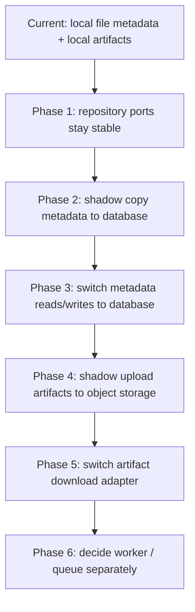

# Storage Backend Migration Plan 设计

## 0. 术语约定

- **metadata store**：保存 `JobRecord`、`JobEvent`、`JobFile` 和 `JobStageMessage` 的后端；默认是 `FileJobRepository`，可配置切到 `DatabaseJobRepository`。
- **artifact storage**：保存 source/result 等二进制产物的后端；默认是 `LocalArtifactStorageAdapter` + 本地 `JobPaths`，可配置切到本地对象目录 adapter。
- **logical path**：`JobFile.path` 中的 job 内相对路径，例如 `input/source.pdf`；它不是本地绝对路径，也不应变成对象存储 URL。
- **object key**：对象存储里的物理 key，未来优先由 `job_id + logical path` 推导，例如 `jobs/{job_id}/input/source.pdf`。
- **shadow migration**：先复制和校验新后端数据，但读写仍使用旧后端；切换前不删除旧数据。

## 1. 决策与约束

### 需求摘要

本 feature 已从迁移计划推进到最小实现，目标是让后续从 local file 迁到数据库 / 对象存储时有明确顺序、兼容字段、离线 shadow 能力和回滚策略。

成功标准：

- 明确 metadata store 与 artifact storage 的迁移顺序。
- 明确 `JobFile`、job snapshot、events、stage messages 的兼容字段。
- 明确每个迁移阶段的回滚策略和 readiness 观测点。
- 不修改当前 HTTP API、默认存储格式或默认运行行为。

明确不做：

- 不选择具体数据库产品或对象存储厂商。
- 不实现具体 DB/S3/OSS 厂商 SDK。
- 不引入 Redis / Celery / 独立 worker。
- 不删除或改写当前 file backend 数据。
- 不把 `events` 改成 event sourcing。

### 复杂度档位

- 存储迁移 = 偏离默认：涉及数据一致性、回滚和长期兼容字段。
- 外部对象存储 = 偏离默认：涉及下载响应、object key 和本地副本保留策略。
- 当前实现仍限定为单体、单实例、离线 shadow copy/upload 与可配置 adapter 切换。

### 关键决策

1. **先迁 metadata，再迁 artifact 二进制**
   - repository ports 已经拆出，metadata store 的替换边界比 artifact 下载边界更窄。
   - artifact 涉及 `FileResponse`、下载流、对象 key、保留策略，应后置。

2. **第一轮 metadata 迁移优先离线切换，不做默认双写**
   - 单体单实例下，维护窗口 + 备份 + 校验 + 切换的风险低于长期双写。
   - 双写只作为后续高可用迁移选项，不是第一版默认方案。

3. **`JobFile.path` 永远保留为逻辑路径**
   - 对外响应、测试和历史记录都依赖逻辑路径语义。
   - 对象存储只填充 `storage_backend/object_key/public_url` 等兼容字段。

4. **events 继续是审计轨迹**
   - 迁移时只复制 events，不用 events 反推 job 当前状态。
   - 回滚也以 snapshot 为准，不做 event replay。

5. **readiness 是切换观测面，不是修复器**
   - `effective_repository_backend`、`stage_message_store`、`artifact_storage` 必须准确显示当前 adapter。
   - failed stage message 仍只诊断，不自动恢复。

## 2. 名词与编排

### 2.1 名词层

#### 现状

- `JobSnapshotRepositoryProtocol`、`JobEventRepositoryProtocol`、`JobFileRepositoryProtocol`、`StageMessageStoreProtocol`
  - 已拆出窄协议；当前都由 `FileJobRepository` 实现。
  - 来源：`app/repositories/protocols.py`
- `JobFile`
  - 已有 `storage_backend="local|object"`、`object_key=None`、`public_url=None`。
  - 来源：`app/core/job_models.py`
- `ArtifactStorageProtocol`
  - 当前定义 `build_registered_file()` 和 `resolve_download()`，下载结果可表达本地路径、流式内容或重定向。
  - 来源：`app/services/jobs/artifact_storage.py`
- `HealthService`
  - 已暴露当前 worker/storage 模式和 stage spool 状态计数。
  - 来源：`app/services/health_service.py`

#### 变化

本 feature 已落地三个最小合同，但不绑定具体外部数据库或对象存储厂商：

1. Metadata store adapter：

```python
class DatabaseJobRepository(
    JobSnapshotRepositoryProtocol,
    JobEventRepositoryProtocol,
    JobFileRepositoryProtocol,
    StageMessageStoreProtocol,
):
    ...
```

2. Artifact storage adapter：

```python
class ObjectArtifactStorageAdapter:
    def build_registered_file(self, file_type, paths) -> JobFile: ...
    def resolve_download(self, paths, file) -> DownloadArtifact: ...
```

3. 兼容字段口径：

```text
JobFile.path            = 稳定逻辑路径，继续对外展示
JobFile.storage_backend = local | object
JobFile.object_key      = 对象存储物理 key；local 时为空
JobFile.public_url      = 可选优化字段，不是权威下载入口
```

### 2.2 编排层



#### 现状

- `FileJobRepository` 同时保存 job snapshot、events、files 和 stage messages。
- artifact 二进制文件都在 `data/jobs/{job_id}/...`，下载时由 local adapter 解析为本地路径。
- startup replay 只处理 pending/running stage messages。
- readiness 已能报告当前 adapter 模式，metadata 可为 file/database，artifact 可为 local_file/local_object。

#### 变化

推荐迁移顺序：

1. **Phase 0：冻结基线**
   - 保留当前 local file 行为。
   - 先补一轮导出/校验脚本设计：job 数、event 数、file 数、stage message 状态计数和 artifact 文件存在性。

2. **Phase 1：metadata shadow copy**
   - 从 `data/jobs/*/job.json`、`files.json`、`events.jsonl`、`stage_messages/*.json` 复制到数据库。
   - 读写仍走 file backend。
   - 校验通过后才允许切换。

3. **Phase 2：metadata backend switch**
   - `build_runtime()` 按配置选择 database adapter。
   - 切换后 readiness 显示 `effective_repository_backend=database`、`stage_message_store=database`。
   - 本地 JSON 保留一个回滚窗口。

4. **Phase 3：artifact shadow upload**
   - 保持 metadata 已在数据库。
   - 按 `JobFile.path` 上传对象，回填 `storage_backend=object` 和 `object_key`。
   - 下载仍可从 local fallback 读取，直到抽样和全量校验通过。

5. **Phase 4：artifact adapter switch**
   - 下载入口改走 object storage adapter。
   - `download_url` 仍由 API 生成，不把 object URL 直接作为主合同。
   - `public_url` 只作为可选字段，不能替代服务端下载鉴权边界。

6. **Phase 5：worker / queue 单独决策**
   - 本轮独立评估结论：继续保持单体、单实例、in-process worker，不引入 Redis/Celery/RQ、heartbeat、抢占锁或队列。
   - 如果未来要独立 worker，再另起 roadmap 设计 heartbeat、抢占锁和队列。
   - 不把 DB / object storage 迁移与 worker 化混成一次变更。

#### 流程级约束

- **错误语义**：迁移校验失败时不切换；切换后下载失败必须能区分 metadata 缺失、object 缺失和权限/网络错误。
- **幂等性**：shadow copy 和 shadow upload 必须可重复执行，同一 job/file 重跑不产生重复记录。
- **并发 / 顺序**：第一版使用维护窗口或只读窗口，不默认做双写一致性协议。
- **可观测性**：每阶段都需要 readiness 显示当前 backend，并输出迁移校验摘要。
- **回滚**：切换前不删除旧数据；切换后保留旧数据到一个明确的保留期。

### 2.3 挂载点清单

- Metadata adapter 选择：`build_runtime()` / runtime 组装层。
- Repository ports：`JobSnapshotRepositoryProtocol`、`JobEventRepositoryProtocol`、`JobFileRepositoryProtocol`、`StageMessageStoreProtocol`。
- Artifact storage adapter：`ArtifactStorageProtocol` 和 jobs 下载 router。
- Readiness 字段：`configured_repository_backend`、`effective_repository_backend`、`stage_message_store`、`artifact_storage`。
- 迁移脚本入口：未来应放在 `scripts/ops/`，只读校验脚本和实际切换脚本分开。

### 2.4 推进策略

1. **固化迁移前校验**
   - 定义 local file 数据完整性检查：job snapshot、events、files、stage messages、artifact 文件存在性。
   - 退出信号：只读检查能报告总数、缺失项和不可迁移项。

2. **实现 database metadata adapter**
   - 数据库 adapter 实现现有 repository/store protocols。
   - 退出信号：同一组 jobs service 测试可在 file/database 两种 adapter 下通过。

3. **实现 metadata shadow copy 和切换**
   - 离线复制、校验、配置切换、readiness 观测。
   - 退出信号：切换到 database 后 jobs 查询、retry、callback、replay 行为不变。

4. **扩展 artifact storage 下载合同**
   - 把 local-only `resolve_download_path()` 演进为可表达 local path 或 stream/redirect 的下载结果合同。
   - 退出信号：local adapter 行为不变，对象存储 adapter 可插入。

5. **实现 artifact shadow upload 和切换**
   - 上传对象、回填 `object_key`、保留 local fallback、切换下载 adapter。
   - 退出信号：`source_pdf`、`parsed_result_package`、`result_docx` 都能通过统一下载入口取回。

6. **独立评估 worker / queue**
   - 只在 DB/object storage 稳定后考虑。
   - 退出信号：有单独 worker roadmap 或明确决定继续单实例。

### 2.5 结构健康度与微重构

#### 文件级

- `app/repositories/file_job_repository.py` 当前仍承担 file backend 组合实现，database metadata store 已新建在 `app/repositories/database_job_repository.py`。
- `app/services/jobs/artifact_storage.py` 当前承载 artifact storage port、下载结果合同和 local adapter；local object adapter 已新建在 `app/services/jobs/object_artifact_storage.py`，没有继续塞入 `JobArtifactService`。
- `app/main.py` 当前 runtime 组装已经集中，并通过小型 builder 选择 metadata / artifact adapter；后续如果 adapter 数量继续增加，再拆 factory。

结论：本 feature 已做必要的轻量文件分离，但不做大规模目录重组；生产级对象存储或更多 adapter 出现后再考虑拆 `artifact_storage` 子包。

#### 目录级

- `app/repositories/` 适合承载 database metadata adapter。
- `app/services/jobs/` 已经放置 jobs application service 和 artifact 合同；如果 artifact adapter 多于 local/object 两类，应再拆子目录。
- `scripts/ops/` 适合放迁移校验与迁移执行脚本，且校验脚本必须能单独运行。

结论：当前目录不需要立即重组；本地对象 adapter 已保持平行模块，真正接入外部对象存储时再根据文件数量决定是否拆 `artifact_storage` 子包。

## 3. 验收契约

- 输入：现有 local file 数据目录；触发：迁移前校验；期望：报告 job/files/events/stage message 数量和缺失 artifact 清单，不写数据。
- 输入：metadata shadow copy；触发：重复执行；期望：目标数据库记录稳定，不产生重复事件或重复文件记录。
- 输入：配置切换到 database metadata backend；触发：`GET /health/ready`；期望：`effective_repository_backend=database`、`stage_message_store=database`。
- 输入：已登记 `JobFile.path=input/source.pdf`；触发：artifact shadow upload；期望：`path` 不变，新增或更新 `storage_backend=object`、`object_key=jobs/{job_id}/input/source.pdf`。
- 输入：对象存储下载失败；触发：`download/{artifact_alias}`；期望：返回可诊断错误，不把 object URL 暴露为唯一恢复手段。
- 反向核对：不改变当前 HTTP API path、status 枚举和 events 审计语义。
- 反向核对：不通过 events 重建 job snapshot，不在迁移中引入 event sourcing。
- 反向核对：不把 DB/object storage 迁移和独立 worker/queue 化混在同一发布。

## 4. 后续实现切片

本轮已完成只读校验脚本、database metadata adapter、metadata shadow copy / switch、artifact 下载合同、local object shadow upload / switch 和 worker / queue 独立评估。

后续如果需要迁移真实生产数据，应另起实施 runbook 或新的迁移 feature，明确维护窗口、备份、回滚保留期和抽样校验策略；不在本 feature 里继续追加生产迁移动作。

后续如果需要独立 worker / queue，应另起 worker roadmap，单独设计 heartbeat、lease / lock、visibility timeout、幂等和多实例拓扑；不把它混入 storage backend migration。
