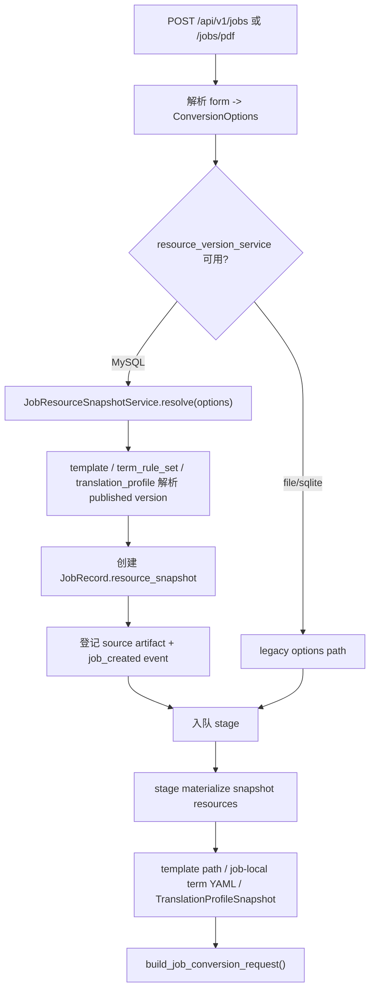

# Job Resource Snapshot Binding 设计

## 0. 术语约定

- **Job Resource Snapshot**：写入 `JobRecord` 的不可变资源快照，记录 job 创建时实际绑定的 Template Version、Term Rule Version、可选 Translation Profile Version、非敏感 MinerU 请求配置和创建时已知 source artifact 引用。
- **resource selection**：job 创建请求里的可选资源选择参数；当前 multipart form 已有 `template_id`，本 feature 增加 `template_version`、`term_rule_set_id`、`term_rule_set_version`、`translation_profile_id`、`translation_profile_version`。
- **ResolvedResourceVersion**：`app/core/resource_models.py` 中已有的 published-only 解析结果，只包含 `resource_type/resource_id/version/snapshot_hash/payload_ref`，不包含 payload。
- **materialized job resources**：conversion stage 从 Job Resource Snapshot 指向的 published payload 派生出的运行时输入，例如模板 DOCX 路径、job-local term-rule YAML 和 `TranslationProfileSnapshot`。
- **artifact ids**：当前 jobs artifact 合同没有独立 artifact id；本 feature 里的 `artifact_ids` 只保留 roadmap 字段名，值明确是创建时已登记的 source artifact alias，例如 `{"source": "source_package"}` 或 `{"source": "source_pdf"}`。后续生成的 `parsed_result_package`、`translation_trace`、`result_docx` 继续由 `JobFile` 列表表达，不回写不可变快照。

## 1. 决策与约束

### 需求摘要

从 roadmap 条目 `job-resource-snapshot-binding` 启动，目标是在 jobs 创建链路中锁定实际使用的发布资源版本：

- 创建 `mineru_package` 或 `source_pdf` job 时，解析 Template Profile、Term Rule Set 和可选 Translation Profile 的 published version。
- 快照写入 `JobRecord`，job 详情和创建事件可观察到绑定版本与 snapshot hash。
- 后台 conversion stage 使用快照里的资源，不再在执行时读取“当前默认”模板、术语或翻译配置。
- PDF 在线提交 stage 使用创建时记录的非敏感 MinerU 配置，避免任务排队期间 settings 变化影响同一 job。
- file/sqlite backend 保持本地兼容路径；严格资源版本快照只在 MySQL resource service 可用时启用。

明确不做：

- 不新增 Template Profile、Term Rule Set 或 Translation Profile 的编辑 / 发布 API。
- 不新增 `zh2en` / `zh2ru` 真实翻译路径，不把 roadmap 中的 `source_language/target_language` 扩展到当前 jobs API。
- 不把 API key、MinerU token、callback token、完整 prompt 文本或其他 secret 写入 snapshot。
- 不把每个 translation segment 展开成数据库 metadata 表。
- 不给历史 job 回填资源快照；旧 job 按兼容路径读取。
- 不新增独立 artifact id 体系；只记录当前已有 source artifact alias。

### 复杂度档位

- 跨层 job contract + stage 编排 + resource version 持久化 = 偏离默认：需要同时改创建请求、`JobRecord`、详情响应、stage 执行输入和测试。
- 兼容性 = 偏离默认：file/sqlite 默认开发路径不能被 MySQL-only resource version 约束破坏。
- 可复现性 = 偏离默认：只保存版本号不够，conversion 必须使用 snapshot 指向的 payload 派生 runtime 输入。
- 单实例生产化 = 当前默认：不做跨实例锁、多租户隔离或外部 queue。

### 关键决策

1. **严格 snapshot 只在 MySQL resource service 可用时启用**
   - Template / term-rule / translation 的 published version 都存在于 `ResourceVersionService`。
   - file/sqlite backend 没有 resource version 表，继续沿用 manifest / runtime YAML / settings 兼容路径。
   - 如果调用方在 file/sqlite backend 显式传入 versioned resource 参数，返回 503，避免假装已绑定。
   - MySQL mode 下创建 job 的前置条件是默认 Template Version 和默认 Term Rule Version 已发布；否则返回 409，不隐式从 manifest / live store 兜底生成发布版本。

2. **job 创建时解析 published version，stage 执行时只按 snapshot materialize**
   - 现状 `JobStageService` 会在执行时调用 `resolve_job_template_path()` 和 `resolve_default_snapshot()`。
   - 本 feature 后 MySQL snapshot job 不再受默认指针变化影响；stage 通过 snapshot 指向的 payload 构造模板路径、term-rule YAML 和 Translation Profile。
   - stage materialize 不再调用 `resolve_version()` 做“当前仍是 published”的二次判断；它按 snapshot 的 `resource_type/resource_id/version` 读取精确记录并校验 `snapshot_hash`，允许该版本在 job 创建后被标记为 disabled / superseded，但不允许 payload 缺失或 hash 不匹配。

3. **term-rule snapshot 需要 materialize 成 job-local YAML**
   - 当前 conversion request 只接受 `subscript_config_path`。
   - 默认 Term Rule Set 切换会同步全局 `runtime_subscripts_dictionary.yaml`，但历史 job 不能继续读全局最新文件。
   - 因此 stage 从 snapshot 版本 payload 的 `store` 派生 job-local YAML，再把该路径传给 conversion。
   - job-local YAML 走 `app/core/job_paths.py` 增加的稳定路径，例如 `data/jobs/{job_id}/resources/runtime_subscripts_dictionary.yaml`，生成使用现有 `TermRuleYamlCodec.dump_legacy_runtime_yaml()`，保证和 live runtime YAML 格式一致。

4. **Translation Profile 仍只在 `en2zh` job 绑定**
   - `direct` job 的 `translation_profile` 为 null。
   - `en2zh` job 在 MySQL resource mode 下必须绑定 published Translation Profile；无默认或指定版本不存在时创建失败。

5. **MinerU snapshot 只记录非敏感请求配置**
   - 记录 `model_version`、`language`、`enable_formula`、`enable_table`、`callback_enabled` 和 `data_id`。
   - token、uid、callback token 和 callback seed 不进入 Job Resource Snapshot；现有 `source_pdf_context` 仍负责 batch/data/callback 兼容投影。

## 2. 名词与编排

### 2.1 名词层

#### 现状

- `ConversionOptions`
  - 来源：`app/core/job_models.py`
  - 当前只表达 `template_id`、`translation_mode`、`document_language` 和 `use_mineru_header_footer`。
- `JobRecord`
  - 来源：`app/core/job_models.py`
  - 当前保存 `template_id`、`translation_mode` 和 PDF/MinerU 兼容字段，但没有资源版本快照。
- `ResolvedResourceVersion`
  - 来源：`app/core/resource_models.py`
  - 当前已是 published-only 解析结果，供后续 job snapshot 消费。
- `JobCommandService`
  - 来源：`app/services/jobs/command.py`
  - 当前创建 job、登记 source artifact、写创建事件并入队 stage。
- `JobStageService`
  - 来源：`app/services/jobs/stage.py`
  - 当前执行 conversion 时按 job 的 `template_id` 解析当前模板路径，`en2zh` 时按执行时默认 Translation Profile 构造请求。
- `build_job_conversion_request()`
  - 来源：`app/conversion/entrypoint.py`
  - 当前接收 template path、subscript config path 和可选 `TranslationProfileSnapshot`。

#### 变化

新增 core model：

```python
class JobMineruSnapshot(BaseModel):
    model_version: str | None = None
    language: str | None = None
    enable_formula: bool | None = None
    enable_table: bool | None = None
    callback_enabled: bool = False
    data_id: str | None = None

class JobResourceSnapshot(BaseModel):
    template: ResolvedResourceVersion | None = None
    term_rule_set: ResolvedResourceVersion | None = None
    translation_profile: ResolvedResourceVersion | None = None
    mineru: JobMineruSnapshot = Field(default_factory=JobMineruSnapshot)
    artifact_ids: dict[str, str] = Field(default_factory=dict)
```

扩展 job 创建选项：

```python
class ConversionOptions(BaseModel):
    template_id: str | None = None
    template_version: str | None = None
    term_rule_set_id: str | None = None
    term_rule_set_version: str | None = None
    translation_profile_id: str | None = None
    translation_profile_version: str | None = None
    translation_mode: Literal["direct", "en2zh"] = "direct"
    document_language: Literal["auto", "zh", "en"] = "auto"
    use_mineru_header_footer: bool = False
```

新增 response schema：

```python
class JobResourceSnapshotResponse(BaseModel):
    template: ResolvedResourceVersionResponse | None = None
    term_rule_set: ResolvedResourceVersionResponse | None = None
    translation_profile: ResolvedResourceVersionResponse | None = None
    mineru: dict[str, Any]
    artifact_ids: dict[str, str]
```

### 2.2 编排层



#### 现状

- jobs router 在 `_build_conversion_options()` 里把 `template_id=None` 解析成当前默认 template id。
- `JobCommandService` 创建 `JobRecord` 时只保存 `template_id`，创建事件 details 只含 `ConversionOptions`。
- `JobStageService._run_conversion_pipeline()` 在执行时解析模板和 Translation Profile；term rules 直接使用全局 `settings.subscript_config_path`。
- PDF `submit_to_mineru` stage 使用执行时 settings 里的 `mineru_model_version/language/enable_formula/enable_table`。

#### 变化

1. jobs ingest router 增加 versioned resource form 参数，并把“是否允许 versioned 参数”交给 service 层判断。
2. 新增 `JobResourceSnapshotService`，负责：
   - 未指定 `template_id/version` 时解析默认 published Template Version。
   - 未指定 `term_rule_set_id/version` 时解析默认 published Term Rule Set。
   - `translation_mode=en2zh` 时解析指定或默认 published Translation Profile；`direct` 时保持 null。
   - 构造非敏感 MinerU snapshot 和创建时 source artifact alias。
3. `JobRecord` 新增 `resource_snapshot`，old records 允许为 null。
4. `JobStageService` 新增 snapshot materialization 入口：
   - snapshot job：从版本 payload 解析 template docx path、生成 job-local term-rule YAML、构造 `TranslationProfileSnapshot`。
   - legacy job：保留当前 `resolve_job_template_path()` / `settings.subscript_config_path` / settings translation fallback。
5. job 详情响应和创建事件 details 输出 resource snapshot summary，便于排障和验收。
6. file/sqlite backend 下 `template_id` 仍是 legacy 模板选择参数；只有 `template_version`、`term_rule_set_id`、`term_rule_set_version`、`translation_profile_id`、`translation_profile_version` 这类 versioned resource 参数触发 503。

#### 流程级约束

- **错误语义**：versioned 参数在无 resource service 时返回 503；指定资源不存在返回 404；指定 draft/disabled/superseded 返回 400；MySQL mode 缺少默认 template 或 term-rule published version 返回 409。
- **不可变性**：snapshot 一旦写入 `JobRecord`，retry、callback recovery 和 stage replay 均复用同一 snapshot。
- **历史可执行性**：创建时必须绑定 published version；创建后该 version 被禁用或 superseded 不应让已创建 job 改用新默认，也不应阻止 retry/replay 读取原 payload。
- **兼容性**：旧 job `resource_snapshot=None` 时继续按当前默认兼容路径执行，不阻塞历史 metadata。
- **幂等性**：stage replay 重复 materialize 同一 snapshot 应输出同一 job-local YAML 内容；不改 resource version payload；若精确版本 payload 的 `snapshot_hash` 与 job snapshot 不一致，stage 失败并记录资源快照损坏错误。
- **安全性**：snapshot 和 event details 不包含 API key、MinerU token、callback token、完整 prompt 文本或 term-rule payload。
- **可观测性**：job detail 可看到每类资源的 `resource_id/version/snapshot_hash`；conversion 失败时仍按现有 stage failure 事件落盘。

### 2.3 挂载点清单

- jobs create form contract：`POST /api/v1/jobs` 与 `POST /api/v1/jobs/pdf` — 新增 versioned resource 选择参数。
- persisted job contract：`JobRecord.resource_snapshot` — 新增不可变资源快照字段。
- jobs API response contract：`JobAcceptedResponse` / `JobDetailResponse` — 新增 `resource_snapshot` 摘要字段。
- stage execution contract：`JobStageService` conversion path — 修改为 snapshot job 只消费创建时 materialized resources。
- job-created event details：`job_created` event — 新增 resource snapshot summary，供审计和排障检索。

### 2.4 推进策略

1. **名词合同先落地**
   - 增加 `JobResourceSnapshot` / response schema / options 字段。
   - 退出信号：旧 job 可无 snapshot 反序列化，新 job 响应能表达资源版本摘要。

2. **创建期解析骨架**
   - 增加 snapshot service，在 MySQL resource mode 下解析默认或指定 published resources。
   - 退出信号：创建 job 时能得到 template / term-rule / en2zh profile 的 `ResolvedResourceVersion`。

3. **source artifact 与 MinerU snapshot 接入**
   - 创建时写入 source artifact alias 和非敏感 MinerU 配置。
   - 退出信号：zip job 与 PDF job 的 snapshot 可区分 source artifact 与 MinerU 请求参数。

4. **stage materialization 接通**
   - 用 snapshot payload 派生模板路径、job-local term-rule YAML 和 Translation Profile 快照。
   - 退出信号：默认指针在 job 创建后切换，已创建 job 的 conversion request 仍使用旧版本。

5. **错误路径与兼容路径守住**
   - 无 resource service、缺默认、指定非 published、旧 job retry/replay 都有明确行为。
   - 退出信号：file/sqlite legacy 创建测试保持通过，MySQL mode 的资源缺失失败可观察。

6. **验证与回写**
   - 补充 targeted unittest，覆盖 zip/PDF、direct/en2zh、default 切换和错误路径。
   - 退出信号：相关后端测试通过，后续 acceptance 可回写架构与 roadmap 状态。

### 2.5 结构健康度与微重构

##### 评估

- 文件级 — `app/services/jobs/stage.py`：793 行，职责已包含 stage dispatch、workflow、MinerU provider、conversion 执行和 artifact 登记；本 feature 若直接塞资源 payload 解析会继续膨胀。
- 文件级 — `app/services/jobs/command.py`：158 行，职责集中在 job 创建和入队；接入 snapshot 构造属于自然扩展，但不应承担资源 payload materialization。
- 文件级 — `app/api/v1/routers/jobs_ingest.py`：239 行，已有表单解析和上传校验；新增少量 form 参数可接受。
- 文件级 — `app/core/job_models.py`：258 行，集中 job 持久化模型；新增 snapshot 值对象符合归属。
- 文件级 — `app/schemas/jobs.py`：124 行，集中 jobs API 合同；新增 response model 符合归属。
- 目录级 — `app/services/jobs/`：已有 9 个同层文件，文件按 job 子职责命名；新增 `resource_snapshots.py` 会延续现有职责拆分，但目录已接近摊平。
- 目录级 — `app/core/`、`app/schemas/`：均已有多个领域模型文件，本次不新增文件，只扩展 jobs 相关现有文件。
- compound convention 检索：未命中目录组织、命名或归属类长期 convention。

##### 结论：本次不做独立微重构

本 feature 新增 `app/services/jobs/resource_snapshots.py` 承载解析和 materialization，避免继续扩大 `stage.py`；但不搬迁既有 stage 代码。`app/services/jobs/` 虽然同层文件已多，但当前命名模式清晰，单纯为一个 service 新建子目录收益不抵改 import 的风险。

##### 超出范围的观察

- `app/services/jobs/stage.py` 已明显偏胖，后续如果继续加入 worker lease、audit 或更复杂 provider recovery，建议单独走 `cs-refactor` 拆分 provider 执行与 conversion 执行；本 feature 只通过新 service 降低新增逻辑压力。

## 3. 验收契约

- 输入：MySQL resource mode，默认 Template / Term Rule Set 已发布；触发：`POST /api/v1/jobs` direct；期望：job detail 返回 template 与 term_rule_set snapshot，`translation_profile` 为 null。
- 输入：MySQL resource mode，默认 Translation Profile 已发布；触发：`POST /api/v1/jobs` en2zh；期望：job detail 返回三类资源 snapshot，conversion request 使用 snapshot profile 字段。
- 输入：创建 job 后切换默认 Template Version；触发：后台 conversion 或 retry；期望：已创建 job 仍使用创建时 template version 的 DOCX path。
- 输入：创建 job 后切换默认 Term Rule Set；触发：后台 conversion 或 retry；期望：已创建 job 使用 job-local YAML 派生自创建时 term-rule version。
- 输入：创建 job 后切换默认 Translation Profile；触发：后台 conversion 或 retry；期望：已创建 en2zh job 仍使用创建时 profile version。
- 输入：创建 job 后对应 resource version 被 disabled 或 superseded；触发：retry/replay；期望：已创建 job 仍按 snapshot_hash 匹配的原 payload materialize，不改用新默认。
- 输入：创建 job 后 resource version payload 被破坏或 hash 不匹配；触发：retry/replay；期望：stage 失败并记录资源快照损坏错误。
- 输入：`POST /api/v1/jobs/pdf`；触发：提交 MinerU stage；期望：非敏感 MinerU 请求参数来自 job snapshot，source artifact alias 为 `source_pdf`。
- 输入：file/sqlite backend 且不传 versioned resource 参数；触发：创建 direct job；期望：保持 legacy 成功路径，`resource_snapshot` 可以为空。
- 输入：file/sqlite backend 显式传 `template_id` 但不传 versioned resource 参数；触发：创建 job；期望：保持现有模板选择行为，不返回 resource-service 503。
- 输入：file/sqlite backend 且传 `template_version` 或 `term_rule_set_version`；触发：创建 job；期望：返回 503，不创建 job。
- 输入：MySQL resource mode 缺少默认 published Template 或 Term Rule Set；触发：创建 job；期望：返回 409，不创建 job。
- 输入：指定 draft / disabled / superseded resource version；触发：创建 job；期望：返回 400，不创建 job。
- 反向核对：snapshot / event / response 不包含 `OPENAI_API_KEY`、MinerU token、callback token 或完整 prompt 文本。
- 反向核对：不新增资源编辑 API，不新增 term-rule / translation segment metadata 表。
- 反向核对：不新增独立 artifact id 体系，不回填历史 job。

## 4. 与项目级架构文档的关系

本 feature 完成后 acceptance 阶段需要回写：

- `.codestable/architecture/ARCHITECTURE.md`
  - 补入 Job Resource Snapshot 术语，说明 jobs 在 MySQL resource mode 下创建时绑定 published resources，stage 执行不再读取当前默认指针。
- `.codestable/architecture/backend-fastapi-service.md`
  - 更新 jobs API 合同、stage 主流程、resource version 与 conversion request 的衔接方式。
- `.codestable/requirements/fastapi-backend-productization.md`
  - 更新模板、术语和翻译配置已从“可发布资源”进入“job 创建时可复现绑定”的状态。
