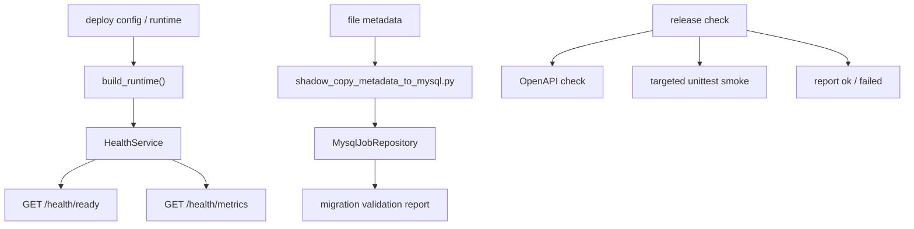

# Operations Readiness and Test Baseline 设计

## 0. 术语约定

- **operations readiness**：运维视角的一组可观测状态，回答当前实例能否承载单实例生产化链路，以及哪里需要人工处理。
- **metrics JSON**：先用 JSON HTTP endpoint 暴露计数和版本标签，不接 Prometheus 或外部监控平台。
- **MySQL migration baseline**：从 file metadata 到 MySQL metadata store 的离线迁移/校验能力，以及 MySQL schema bootstrap 的发布前检查；不是 Alembic 迁移系统。
- **release check**：发布前本地聚合检查入口，当前是 `scripts/ops/check_release.py`，后续应覆盖 OpenAPI、readiness/metrics 和关键状态机 smoke。
- **真实链路 smoke**：自动化层默认使用本仓库 FakeMinerUClient / FakeConversionService 跑 jobs API 主链；真实 MinerU / LLM 外部联调作为 runbook 手工步骤，不进默认 CI。

## 1. 决策与约束

### 需求摘要

从 roadmap 条目 `operations-readiness-and-test-baseline` 启动，目标是把已落地的 MySQL metadata、resource snapshot、permission/audit 能力收进单实例生产化运维基线：

- 补齐 `.env.example` 和 runbook，使部署者能明确配置 MySQL metadata、本地 artifact、callback URL、worker、token、日志和翻译/MinerU 可选能力。
- 扩展 readiness，覆盖 roadmap 约定的 metadata store、artifact storage、worker mode、stage spool、artifact root 可写/磁盘空间、默认模板/术语/翻译资源版本。
- 增加 JSON metrics endpoint，暴露 jobs / stage messages / resource versions / audit events 的最小计数和实例标签。
- 补齐 MySQL migration baseline：离线复制/校验 file metadata 到 MySQL，发布前确认 schema bootstrap 和基础读写能力。
- 强化结构化日志和 release check，保证 `LOG_FORMAT=json`、trace_id、access/business/system 日志契约有测试保护。
- 增加状态机和 API smoke 测试，覆盖 MySQL resource mode 下 PDF -> callback -> DOCX、retry/cancel/cleanup、readiness/metrics。

明确不做：

- 不接 Prometheus、Grafana、OpenTelemetry、ELK 或外部告警平台。
- 不引入 Alembic / SQLAlchemy migration 体系，不把当前 repository adapter 重写成 ORM。
- 不做多实例 worker 抢锁、分布式调度、Redis/Celery/RQ 或跨进程 leader election。
- 不执行真实 artifact 删除，不做对象存储迁移，不把 artifact 二进制写入 MySQL。
- 不新增审计查询 HTTP API 或运维 UI。
- 不在 health / metrics / logs 中暴露 token、secret、完整 payload、客户文件内容或新增本地绝对私密路径。

### 复杂度档位

- 跨 API schema、health service、repository、ops scripts、docs 和 tests，偏离默认小改档位；先锁定公开观测契约，再实现。
- MySQL migration baseline 涉及持久化写入，偏离默认档位；必须默认 dry-run / validate 优先，避免误把重复事件写进非空目标库。
- 外部联调不作为自动测试前置，保持本地可跑、可重复、无网络依赖。

### 关键决策

1. **health router 继续承载 readiness / metrics**
   - `/api/v1/health/live` 和 `/api/v1/health/ready` 不改语义。
   - 新增 `/api/v1/health/metrics`，返回 JSON metrics；不另起 `ops` router。
   - `/ready` 继续返回兼容的 `dependency_checks` 字典，只增字段，不删除旧字段。

2. **metrics 是内部运维 JSON，不是 Prometheus**
   - 返回 counters 和 label：metadata store、artifact storage、worker mode、stage message status counts、job status counts、audit event count、resource version counts。
   - 不暴露 secret、原始 payload、完整本地路径或客户文件名。

3. **MySQL migration baseline 走离线脚本，不放在服务启动路径**
   - 服务启动仍由 `MysqlJobRepository` 做幂等 schema bootstrap。
   - file -> MySQL 迁移脚本先收集源 metadata，再写入目标 MySQL，再做 totals / payload 校验。
   - 为避免 append-only event 重复，默认要求目标 MySQL metadata 为空；非空时只能 `--validate-only` 或明确失败。

4. **release check 聚合最小生产化检查**
   - 保留 OpenAPI snapshot check。
   - 增加可本地自动跑的 targeted unittest：health/metrics、metadata migration、job workflow、MySQL fake smoke、logging。
   - 外部 MinerU / LLM 真实联调只写入 runbook，不能让 release check 依赖网络或真实凭证。

5. **运维文档以“单实例生产化”为边界**
   - `.env.example` 给出安全默认和占位，不填真实 secret。
   - runbook 写清 MySQL metadata 只存业务 metadata，artifact 仍由 local file / local object / S3 adapter 管。
   - 明确 `JOBS_ACCESS_MODE=open` 只用于本地开发。

## 2. 名词与编排

### 2.1 名词层

#### 现状

- `HealthService`
  - 来源：`app/services/health_service.py`
  - 当前已返回 repository backend、worker mode、stage spool counts、运行目录、模板/YAML、MinerU token、translation availability 和 readiness blockers/warnings。
- `HealthReadyResponse`
  - 来源：`app/schemas/health.py`
  - 当前形状为 `status/app_name/jobs_dir/dependency_checks`，`dependency_checks` 是字典。
- `MysqlJobRepository`
  - 来源：`app/repositories/mysql_job_repository.py`
  - 当前启动时 `CREATE TABLE IF NOT EXISTS`，覆盖 jobs/events/files/stage/resource/audit 表。
- `scripts/ops/check_release.py`
  - 当前只聚合 OpenAPI snapshot check。
- `scripts/ops/shadow_copy_metadata_to_database.py`
  - 当前只支持 file -> sqlite database shadow copy，不支持 MySQL 目标。
- `LOG_FORMAT=json`
  - 来源：`app/core/logging.py`
  - 当前已有 JSON formatter 和最小测试，access log 的业务字段仍主要在 message 中。

#### 变化

扩展 health schema：

```python
class HealthMetricsResponse(BaseModel):
    status: str
    app_name: str
    generated_at: datetime
    metadata_store: str
    artifact_storage: str
    worker_mode: str
    stage_dispatcher: str
    jobs: dict[str, int]
    stage_messages: dict[str, int]
    resources: dict[str, int | str | None]
    audit_events: dict[str, int]
```

扩展 readiness `dependency_checks` 字段：

```json
{
  "artifact_root_writable": true,
  "artifact_disk_free_bytes": 0,
  "default_template_version": "default@1",
  "default_term_rule_version": "electronics-default@1",
  "default_translation_profile_version": "electronics-en2zh@1",
  "mysql_schema_bootstrap_available": true
}
```

新增 MySQL migration report：

```python
class MysqlMetadataMigrationReport:
    source_totals: dict[str, int]
    target_totals: dict[str, int]
    target_empty_before_copy: bool
    ok: bool
    mismatches: list[...]
```

脚本边界：

- `scripts/ops/shadow_copy_metadata_to_mysql.py`
  - 读取 `Settings` 的 `JOBS_MYSQL_*` 或显式参数。
  - 默认先检查目标为空；非空返回 blocker。
  - 支持 `--validate-only` 只比对 source / target。
- `scripts/ops/check_release.py`
  - 输出分项报告，不只打印 OpenAPI。

### 2.2 编排层



#### 现状

- readiness 已能说明 file/sqlite/MySQL backend、stage spool 和翻译/MinerU 配置，但缺少 artifact root writable、disk free、默认 resource version 标签和 metrics endpoint。
- MySQL schema bootstrap 已在 repository 初始化时执行；缺少离线迁移脚本和发布前 schema/smoke 聚合。
- API smoke 测试已经覆盖大量 jobs flow，但 release check 没有把它们编排成运维基线。
- runbook 已写本地运行、health、worker、sqlite 和 MySQL 配置，但缺 `.env.example`，也缺 final operations checklist。

#### 变化

1. `HealthService` 增加 metrics 构造方法，并在 readiness 里补齐 artifact / resource version / MySQL schema 相关字段。
2. `health.py` router 新增 `/metrics`，response model 放在 `app/schemas/health.py`，兼容 facade 如有需要再从 `api_v1.py` re-export。
3. MySQL migration 脚本复用 repository 方法收集 / 写入 / 校验 metadata，不直接拼 SQL。
4. `check_release.py` 增加分项报告，执行 OpenAPI check 和 targeted unittest 命令；失败时返回非 0。
5. `.env.example`、`docs/runbook.md`、`docs/dev/runtime-observability-and-health.md`、`docs/api/health.md` 同步说明新字段和操作步骤。

#### 流程级约束

- **兼容性**：`/health/ready` 只增字段，不删除旧字段；旧调用方继续读取 `dependency_checks`。
- **隐私**：metrics 和新增 readiness 字段不得输出 token、password、callback seed、客户文件名、完整 payload 或新增本地绝对私密路径。
- **迁移安全**：file -> MySQL migration 默认拒绝写入非空目标，避免 append-only events / audit events 重复。
- **可重复验证**：release check 默认不访问网络，不需要真实 MinerU / OpenAI 凭证。
- **失败语义**：readiness 报告 blocker/warning，不自动修复 failed stage message，不自动迁移数据。

### 2.3 挂载点清单

- `app/services/health_service.py`：补 readiness 字段和 metrics snapshot 计算。
- `app/schemas/health.py`：新增 metrics response schema，保留 ready response 兼容形状。
- `app/api/v1/routers/health.py`：新增 `/metrics` endpoint。
- `scripts/ops/shadow_copy_metadata_to_mysql.py`：新增 file -> MySQL metadata 迁移/校验脚本。
- `scripts/ops/check_release.py`：聚合 OpenAPI + targeted unittest + smoke 报告。
- `.env.example`、`docs/runbook.md`、`docs/dev/runtime-observability-and-health.md`、`docs/dev/backend-local-minimal-env-and-commands.md`、`docs/api/health.md`：补部署、readiness/metrics、MySQL migration、release check 和真实联调说明。
- `docs/api/openapi.json`、`docs/api/manifest.yaml`、`docs/dev/backend-dev-docs-index.md`：同步新增 metrics endpoint 和运维脚本索引。
- `tests/test_fastapi_jobs_backend.py`、`tests/test_database_job_repository.py`、`tests/test_metadata_shadow_copy.py`、`tests/test_backend_logging.py`、`tests/test_openapi_export.py`：补 targeted coverage。

### 2.4 推进策略

1. **readiness / metrics 契约先落地**
   - 扩展 health schema/service/router，补齐 artifact / resource / metrics 字段。
   - 退出信号：`/health/ready` 旧字段仍在，`/health/metrics` 返回 JSON counters 且不含 secret/path payload。

2. **MySQL migration baseline**
   - 新增 file -> MySQL metadata migration/validation 脚本，明确空目标守护和报告格式。
   - 退出信号：fake MySQL 测试能验证 schema bootstrap、copy、validate 和非空目标拒绝。

3. **release check 与自动 smoke**
   - `check_release.py` 聚合 OpenAPI check、health/metrics、workflow、MySQL fake smoke、logging tests。
   - 退出信号：项目 conda interpreter 下 targeted release check 通过；失败报告能定位具体分项。

4. **docs / env baseline**
   - 新增 `.env.example`，更新 runbook、health API 和 runtime observability 文档。
   - 退出信号：文档能从空环境指引到 MySQL metadata + local artifact 单实例部署；真实外部联调步骤单独列明。

### 2.5 结构健康度与微重构

##### 评估

- 文件级 — `app/services/health_service.py`：当前约 200 行，职责就是 readiness 和运行时依赖检查。新增 metrics 构造仍是同一职责，但如果实现时出现大段 repository 遍历 helper，应拆为私有小函数，不另起 service。
- 文件级 — `app/schemas/health.py`：当前很薄，新增 `HealthMetricsResponse` 属于自然扩展。
- 文件级 — `scripts/ops/check_release.py`：当前极小，扩展聚合报告后仍可控；若命令运行/报告格式变复杂，应在同文件内先用小 dataclass，不新建框架。
- 目录级 — `scripts/ops/` 已有 shadow copy、OpenAPI export、release check 等运维脚本；新增 MySQL migration 脚本放这里，不新建 `migrations/` 目录。
- 目录级 — `tests/` 仍采用 `unittest.TestCase`，本 feature 继续增量扩展现有测试文件，不引入 pytest fixture 风格。
- compound convention 搜索：未命中 operations/readiness/metrics/logging/test/migration 相关的既有归档约定。

##### 结论

本次不做微重构，原因：新增内容是运维质量基线，主要落在现有 health / ops scripts / docs / tests 边界内。MySQL repository 已偏大，但拆分 adapter 会改变持久化边界，超出本 feature。

超出范围的观察：

- 如果后续继续增加 MySQL schema migration 能力，建议另走 `cs-roadmap` 或 `cs-refactor` 评估正式 migration 体系；本 feature 只做当前 repository adapter 口径下的 baseline。

## 3. 验收契约

- **S1 readiness 兼容扩展**
  - 输入：调用 `GET /api/v1/health/ready`。
  - 期望：旧字段 `configured_repository_backend`、`stage_spool_*`、`deployment_init_ready` 仍存在；新增 artifact writable / disk free / default resource version 字段；不新增 token、secret、payload 或客户文件名。

- **S2 JSON metrics endpoint**
  - 输入：调用 `GET /api/v1/health/metrics`。
  - 期望：返回 metadata store、artifact storage、worker mode、job status counts、stage message counts、resource version counts、audit event count；响应不含本地 artifact 绝对路径或 secret。

- **S3 MySQL migration baseline**
  - 输入：file backend 下有 jobs/files/events/stage metadata，目标 MySQL 为空。
  - 期望：迁移脚本写入 MySQL 后 validate 通过，source/target totals 一致；目标非空时默认拒绝写入并给出 blocker。

- **S4 release check 聚合**
  - 输入：运行 `/Users/sc/miniconda3/envs/md2word/bin/python scripts/ops/check_release.py`。
  - 期望：报告 OpenAPI、health/metrics、metadata migration、job workflow、MySQL fake smoke、logging 分项；任一失败返回非 0。

- **S5 状态机与 smoke 覆盖**
  - 输入：targeted unittest。
  - 期望：MySQL resource mode 下 PDF -> callback -> completed smoke 仍通过；retry/cancel/cleanup 状态机测试通过；failed/running/pending stage readiness 语义不倒退。

- **S6 文档与环境基线**
  - 输入：阅读 `.env.example` 与 `docs/runbook.md`。
  - 期望：能找到 MySQL metadata、artifact storage、worker mode、access token、callback URL、LOG_FORMAT、release check 和真实外部联调步骤；没有真实 secret。

- **反向核对**
  - 不新增 Prometheus / external monitoring dependency。
  - 不引入 Alembic / ORM migration。
  - 不让 release check 依赖真实 MinerU、OpenAI 或公网。
  - 不改变 artifact 二进制仍在 artifact storage 的边界。
  - 不新增审计查询 API、运维 UI、多实例 worker 锁或真实 artifact 删除。

## 4. 与项目级架构文档的关系

本 feature 验收通过后需要回写以下现状文档：

- `.codestable/architecture/ARCHITECTURE.md`
  - 在整体后端能力中补入 operations readiness、`/health/metrics`、release check 和 file -> MySQL metadata migration baseline。
  - 在数据与状态边界中明确 MySQL 仍只保存业务 metadata，artifact 二进制仍由 artifact storage 管。
- `.codestable/architecture/backend-fastapi-service.md`
  - 在 health API、运行时可观测性、运维脚本和已知边界中补齐 `/health/ready` 扩展字段、`/health/metrics` JSON counters、`scripts/ops/check_release.py` 与 `scripts/ops/shadow_copy_metadata_to_mysql.py`。
- `.codestable/requirements/fastapi-backend-productization.md`
  - 更新生产部署维护者故事、解决方案和边界：MySQL schema bootstrap、file -> MySQL 空目标 shadow copy / validate、release check 和外部真实联调 runbook 已进入基线；Prometheus、Alembic / ORM migration、多实例 worker 仍不在当前范围。
- `.codestable/roadmap/backend-productization-implementation/`
  - `backend-productization-implementation-items.yaml` 中本条 feature 由 `in-progress` 改为 `done`。
  - 主 roadmap 的子 feature 状态、观察项和变更日志同步为已落地。

## 5. 回滚与卸载

- 删除 `/health/metrics` route 和 `HealthMetricsResponse` 后，metrics 能力消失，原 `/health/live` / `/health/ready` 保持。
- 删除新增 readiness 字段后，旧 health 兼容字段仍可继续服务本地排障。
- 删除 MySQL migration 脚本和 release check 扩展后，不影响运行时 jobs API；只失去部署前验证能力。
- `.env.example` 和 runbook 可保留为文档；如果契约回滚，需要同步删掉相关步骤，避免误导部署。
