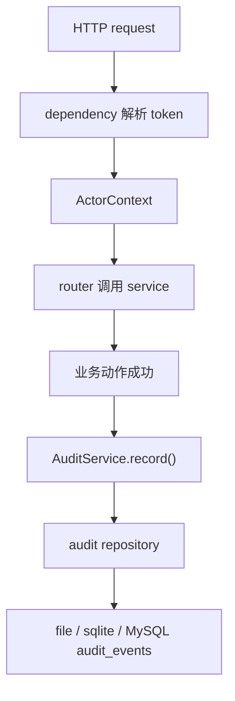

# Permission and Audit Baseline 设计

## 0. 术语约定

- **ActorContext**：一次 HTTP 请求里解析出的操作者上下文，只表达 `actor_id`、`actor_role` 和来源，不保存 token 原文。
- **ActorRole**：最小角色集合，当前只需要 `admin`、`jobs`、`anonymous`。`admin` 来自 `X-Admin-Token`，`jobs` 来自 `X-Jobs-Token`，开放下载场景是 `anonymous`。
- **AuditEvent**：独立于 `JobEvent` 的审计事件，记录谁在什么时候对什么目标做了什么动作，以及可选 reason 和 trace_id。
- **高风险动作**：资源发布 / 设默认 / 回滚 / 禁用、job retry / cancel / cleanup-local-files，以及 artifact download。
- **audit repository**：和 jobs metadata 同级的审计事件持久化端口；file / sqlite / MySQL backend 都应能写入，MySQL 是生产真源。

## 1. 决策与约束

### 需求摘要

从 roadmap 条目 `permission-and-audit-baseline` 启动，目标是给已有后端管理动作补上最小权限和审计基线：

- 现有 admin-only 资源动作继续用 `X-Admin-Token` 保护，但 service / audit 层要拿到稳定 ActorContext。
- `retry`、`cancel`、`cleanup-local-files` 继续遵守 `JOBS_OPS_ACCESS_MODE`，并记录 actor / reason / trace_id。
- artifact download 在 `JOBS_ACCESS_MODE=open/token/admin` 三种模式下都记录审计；open 模式 actor 为空、role 为 `anonymous`。
- 审计事件持久化为独立 `AuditEvent`，不混入 job event，不记录 token、secret、绝对私密路径或 payload 正文。

明确不做：

- 不做多租户、公司隔离、SSO、session、用户表或密码登录。
- 不引入细粒度 ACL、资源所有者校验、行级权限或前端权限菜单。
- 不新增审计查询 HTTP API 或审计 UI；本 feature 只落持久化和测试可验证接口。
- 不改变既有 token 配置语义；缺少 `ADMIN_TOKEN` / `JOBS_ACCESS_TOKEN` 时仍按现有 503 行为。
- 不把 API key、admin token、jobs token、MinerU token、callback seed、完整 prompt、term-rule payload 或本地绝对私密路径写入 audit event。
- 不执行真实 artifact 删除；retention 的真实删除仍留给后续 operations / cleanup feature。

### 复杂度档位

- 跨 API dependency、router、service、repository 和测试，偏离默认档位；需要先定义一次 actor / audit 名词，避免各 router 自己拼字典。
- 持久化形状新增，偏离默认档位；file / sqlite / MySQL repository 都要同步，旧 metadata 允许没有 audit 事件。
- 权限模型仍走单实例默认档位；不引入外部身份系统。

### 关键决策

1. **actor 从现有 token 边界派生，不引入身份系统**
   - `require_admin_actor()` 校验 admin token 后返回 `ActorContext(actor_role="admin")`。
   - `require_jobs_actor()` 按 `JOBS_ACCESS_MODE` 返回 `jobs` / `admin` / `anonymous`。
   - `require_job_ops_actor()` 按 `JOBS_OPS_ACCESS_MODE` 返回 `admin` 或复用 jobs access。
   - 可选 `X-Actor-Id` 只作为已认证 token 场景下的操作者标签；权限仍只由 token 决定。没有该 header 时 `admin` 默认 `actor_id="admin"`，`jobs` 默认 `actor_id="jobs-client"`；open 下载始终为 `None`，不接受匿名请求自报 actor。

2. **audit 是独立业务审计，不复用 JobEvent**
   - `JobEvent` 仍服务 job 状态流和用户排障。
   - `AuditEvent` 统一覆盖跨资源动作，例如 template publish、term-rule rollback、translation-profile set-default、artifact download。
   - repository 协议增加 `append_audit_event()` 和 `list_audit_events()`，测试和后续运维脚本可直接读取。

3. **router 负责拿 actor，service 负责记录动作语义**
   - 权限校验发生在 `app/api/dependencies.py`。
   - 资源类 service 增加 `actor` / `reason` 可选参数，用于写 audit；不让 router 直接拼审计字段。
   - 对于下载这种纯查询路径，router 可以在解析出 job/file 后调用 `AuditService.record()`，因为它的目标就是 HTTP 下载动作本身。

4. **先覆盖 roadmap 指定动作，不扩大到所有 CRUD**
   - 本 feature 必须覆盖 template publish / set-default / disable，term-rule publish / set-default / rollback，translation-profile publish / set-default / rollback，job retry / cancel / cleanup-local-files，artifact download。
   - template create / update / replace / delete、term-rules legacy CRUD 当前仍受 admin token 保护，但不作为本 feature 的审计必达范围；如果后续需要全量管理操作审计，另起 feature 扩展。

## 2. 名词与编排

### 2.1 名词层

#### 现状

- `require_admin_access()` / `require_jobs_access()` / `require_job_ops_access()`
  - 来源：`app/api/dependencies.py`
  - 当前只校验 token 并返回 `None`，下游不知道 actor。
- `JobEvent`
  - 来源：`app/core/job_models.py`
  - 当前记录 job workflow / stage 事件，不能表达 template、term-rule、translation-profile 或 download 审计。
- Repository protocols
  - 来源：`app/repositories/protocols.py`
  - 当前有 jobs、files、events、stage messages、resource versions，没有 audit event 端口。
- MySQL metadata store
  - 来源：`app/repositories/mysql_job_repository.py`
  - 当前表覆盖 jobs、job_events、job_files、stage_messages、resource_versions、resource_default_versions。

#### 变化

新增 core model：

```python
ActorRole = Literal["admin", "jobs", "anonymous"]

class ActorContext(BaseModel):
    actor_id: str | None = None
    actor_role: ActorRole
    source: Literal["admin_token", "jobs_token", "open"]

class AuditEvent(BaseModel):
    audit_id: str
    actor_id: str | None = None
    actor_role: ActorRole
    action: str
    target_type: str
    target_id: str
    reason: str | None = None
    trace_id: str
    created_at: datetime = Field(default_factory=utc_now)
```

新增持久化端口：

```python
class AuditEventRepositoryProtocol(Protocol):
    def append_audit_event(self, event: AuditEvent) -> None: ...
    def list_audit_events(self) -> list[AuditEvent]: ...
```

新增 service：

```python
class AuditService:
    def record(
        self,
        *,
        actor: ActorContext,
        action: str,
        target_type: str,
        target_id: str,
        trace_id: str,
        reason: str | None = None,
    ) -> AuditEvent: ...
```

动作命名用稳定字符串：

- `template.publish` / `template.set_default` / `template.disable`
- `term_rule_set.publish` / `term_rule_set.set_default` / `term_rule_set.rollback`
- `translation_profile.publish` / `translation_profile.set_default` / `translation_profile.rollback`
- `job.retry` / `job.cancel` / `job.cleanup_local_files`
- `artifact.download`

### 2.2 编排层



#### 现状

- admin-only router 通过 `dependencies=[Depends(require_admin_access)]` 保护，但 handler 内拿不到 actor。
- jobs ops router 通过 `require_job_ops_access` 保护，service 只收到 `reason` 和 `trace_id`。
- download router 只依赖 `require_jobs_access`，下载成功或 redirect 前没有审计记录。
- resource version service 的 `publish()` / `set_default()` / `rollback_default()` 不知道调用者。

#### 变化

1. `app/api/dependencies.py` 保留旧 `require_*_access()` 兼容函数，同时新增返回 ActorContext 的 `require_*_actor()`。
2. 高风险 router 从 `dependencies=[Depends(...)]` 改为显式参数 `actor: ActorContext = Depends(require_*_actor)`，再把 actor 传入 service。
3. `AuditService` 统一生成 `audit_id`、过滤空白 reason、写 repository。
4. file backend 写 `data/audit_events.jsonl`；sqlite / MySQL 新增 `audit_events` 表，payload 仍用 Pydantic JSON，保持现有 repository 风格。
5. 资源 service 在业务动作成功后记录 audit；业务失败不写成功审计。
6. `download_artifact()` 在已经定位 job/file 并准备返回文件 / stream / redirect 前记录 `artifact.download`，`target_id` 用 `{job_id}:{artifact_alias}`。

#### 流程级约束

- **权限语义**：新增 actor dependency 不改变现有 status code；token 缺配置仍是 503，token 错误仍是 403。
- **审计时机**：只记录已通过权限且业务动作成功的事件；失败路径继续通过 HTTP status、JobEvent 或 stage failure 表达。
- **幂等性**：用户重复点击或 retry 重复请求会产生多条 audit event；审计是事实流水，不做去重。
- **隐私**：audit event 不记录 token、上传文件名以外的本地路径、payload 正文或 secret。
- **兼容性**：旧数据没有 audit event 不影响 job / resource 读取；file / sqlite 本地开发仍能跑。
- **可观测性**：每条 audit event 带 `trace_id`，能和 access log / job event 串联。

### 2.3 挂载点清单

- `app/api/dependencies.py`：新增 ActorContext 解析和返回 actor 的 access dependency。
- `app/core/audit_models.py`：新增 actor / audit 值对象。
- `app/services/audit.py`：新增 audit 写入 service。
- `app/repositories/*_job_repository.py` 与 `app/repositories/protocols.py`：新增 audit event 持久化端口和 backend 表 / 文件实现。
- 高风险 routers / services：template、term-rule-set、translation-profile、jobs ops、jobs download 接入 actor 和 audit。

### 2.4 推进策略

1. **名词合同先落地**
   - 新增 ActorContext、AuditEvent、AuditService 和 repository protocol。
   - 退出信号：file / sqlite / MySQL repository 都能 append / list audit event。

2. **权限 dependency 返回 actor**
   - 新增 `require_admin_actor()`、`require_jobs_actor()`、`require_job_ops_actor()`，保留旧 access 函数。
   - 退出信号：现有 403 / 503 行为不变，handler 可拿到 actor。

3. **资源动作审计接入**
   - template publish / set-default / disable，term-rule-set publish / set-default / rollback，translation-profile publish / set-default / rollback 写 audit。
   - 退出信号：每个成功动作生成 action / target / actor / trace_id 正确的 AuditEvent。

4. **job ops 和 download 审计接入**
   - retry / cancel / cleanup-local-files / artifact download 写 audit，并保留现有 JobEvent。
   - 退出信号：job ops reason 同时进入 audit；download 不暴露本地路径。

5. **验证与回写**
   - 增加 targeted unittest，覆盖 admin token、jobs token、open download、审计持久化和无 token 失败路径。
   - 退出信号：相关后端测试通过，后续 acceptance 可回写 architecture / roadmap。

### 2.5 结构健康度与微重构

##### 评估

- 文件级 — `app/api/dependencies.py`：当前约 60 行，职责就是运行时和访问控制依赖；新增 actor dependency 属于自然扩展，不需要拆文件。
- 文件级 — `app/core/job_models.py`：已经承载 job 领域模型；audit 跨资源，不应继续塞入 job model，新增 `app/core/audit_models.py` 更清楚。
- 文件级 — `app/repositories/mysql_job_repository.py`：已承载 jobs、stage、resource version 多类 metadata；新增 audit 表会继续增大，但当前变更是同一 metadata adapter 的自然扩展。更大的 repository 拆分应后续走 refactor，不阻塞本 feature。
- 文件级 — resource routers：template / term-rule-set / translation-profile 文件仍在可控范围，新增 actor 参数和 service 调用不会改变路由分层。
- 目录级 — `app/services/` 已有 `health_service.py` 和多个领域包；单文件 `audit.py` 足够，暂不需要新建 `audits/` 包。
- compound convention 搜索：未命中“目录组织 / 文件归属 / 命名约定”的既有 decision。

##### 结论

本次不做微重构，原因：新增 audit model / service 是独立小文件；既有 repository 增量属于当前 backend metadata adapter 责任。`MysqlJobRepository` 职责继续变多是结构观察，但拆 adapter 会改变多个协议和测试边界，超出本 feature。

超出范围的观察：

- `MysqlJobRepository` 已同时承担 jobs、stage、resource versions 和后续 audit events；后续如果继续扩展 metadata 域，建议单独走 `cs-refactor` 评估按 domain mixin 或独立 metadata repository 拆分。

## 3. 验收契约

- **S1 admin 资源发布审计**
  - 输入：带正确 `X-Admin-Token` 调用 template publish。
  - 期望：业务响应 200；audit event 为 `template.publish`，actor_role 为 `admin`，target_id 为 `{template_id}@{version}`，trace_id 非空。

- **S2 term-rule / translation 回滚审计**
  - 输入：带正确 `X-Admin-Token` 调用 term-rule-set rollback 或 translation-profile rollback。
  - 期望：业务响应 200；audit event action 分别为 `term_rule_set.rollback` / `translation_profile.rollback`，不记录 token 或 payload。

- **S3 job ops 审计**
  - 输入：带正确 admin token 调用 retry / cancel / cleanup-local-files，并提供 reason。
  - 期望：原有 JobEvent 仍存在；audit event action 分别为 `job.retry` / `job.cancel` / `job.cleanup_local_files`，reason 与请求一致。

- **S4 jobs token 模式下 ops 审计**
  - 输入：`JOBS_OPS_ACCESS_MODE=jobs` 且 `JOBS_ACCESS_MODE=token`，带正确 `X-Jobs-Token` 调用 cleanup。
  - 期望：业务响应保持现有成功语义；audit actor_role 为 `jobs`。

- **S5 open 下载审计**
  - 输入：`JOBS_ACCESS_MODE=open` 下载已登记 artifact。
  - 期望：下载仍成功；audit event action 为 `artifact.download`，actor_id 为 null，actor_role 为 `anonymous`，target_id 不含本地绝对路径。

- **S6 权限失败不写成功审计**
  - 输入：缺少或错误 admin token 调用资源发布。
  - 期望：响应仍为现有 503 / 403；不会新增对应成功 audit event。

- **反向核对**
  - 不新增 SSO / 用户表 / 多租户字段。
  - 不新增审计查询 HTTP API。
  - 不把 token、secret、完整 payload 或本地绝对私密路径写入 audit event。
  - 不改变旧的 jobs / resource version API 响应字段，除非为传 actor 的内部调用参数。

## 4. 回滚与卸载

- 删除 `AuditService` 挂载和高风险 router/service 的 audit 调用后，权限仍可回到现有 token 校验行为。
- 删除 `app/core/audit_models.py`、repository audit methods 和 `audit_events` 持久化实现后，feature 在系统视角消失。
- 已写入的 file / sqlite / MySQL audit events 可作为历史日志保留；旧业务读路径不依赖它们。
- 如需临时关闭审计，不新增配置开关；回滚代码比静默 no-op 更符合审计基线目标。
