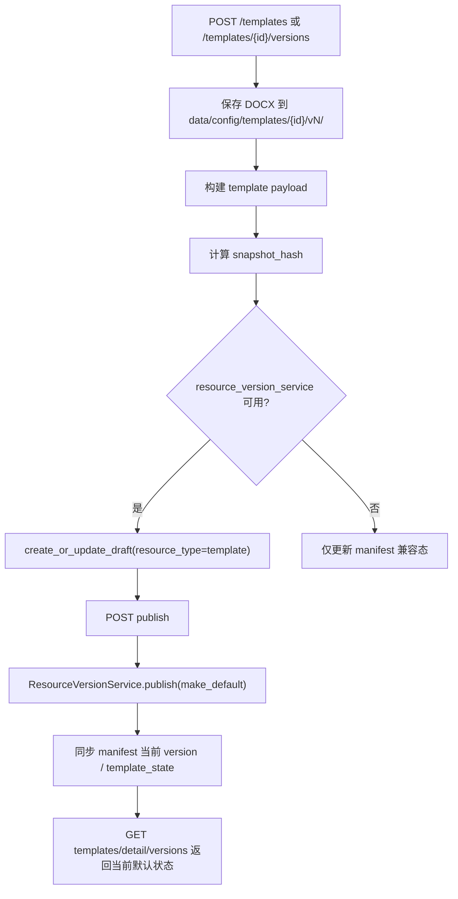

# Template Profile Versioning 设计

## 0. 术语约定

- **Template Profile**：面向调用方选择的模板资源，标识为 `template_id`，只包含 DOCX 模板、layout 配置和 render policy。
- **Template Version**：某个 Template Profile 的不可变版本，版本号沿用当前整数 `1 / 2 / ...` 字符串化后写入 `ResourceVersionService`。
- **template payload**：资源版本 payload，包含 `template_id`、`version`、`docx_path`、`layout_config_path`、`render_policy`、`name` 和 `description`。
- **default template version**：`resource_default_versions` 中 `resource_type="template"` 的默认指针；file backend 兼容路径仍保留 `template_state.json`。

## 1. 决策与约束

### 需求摘要

从 roadmap 条目 `template-profile-versioning` 启动，目标是在当前 templates API 已支持 manifest 读取、上传、替换和默认模板切换的基础上，接入资源版本底座：

- 新建 Template Profile 时保存 `docx + layout + render_policy` 为第一个 draft version，并可发布为默认版本。
- 增加显式创建版本、发布、设默认、禁用接口。
- 已发布版本不可通过草稿路径改写；默认指针只能指向 published 版本。
- 现有 manifest/file backend 行为保持兼容，供本地开发和旧接口继续使用。

明确不做：

- 不把术语规则或翻译配置塞进 Template Profile。
- 不做可视化模板编辑器。
- 不在 job 创建时绑定 template version 快照；该能力留给 `job-resource-snapshot-binding`。
- 不引入 Alembic / SQLAlchemy 迁移体系。
- 不删除历史 DOCX 文件；禁用只关闭资源版本。
- 不强制旧 manifest 模板一次性迁移进 MySQL resource version 表。

### 复杂度档位

- 跨层 API + service + resource version 持久化 = 偏离默认：需要同时约束 HTTP 合同、模板文件落盘、payload hash 和 resource version 状态机。
- 兼容性 = 偏离默认：当前 file backend 与 manifest API 已存在，不能因 MySQL 资源版本化破坏本地默认路径。
- 单实例生产化 = 当前默认：不做分布式发布锁或多租户隔离。

### 关键决策

1. **Template Profile 复用 `ResourceVersionService`，不新建模板专用版本状态机**
   - resource version 底座已经定义 draft / published / disabled / default pointer。
   - 模板模块只负责 payload、hash、DOCX 文件和 HTTP API。

2. **资源版本化能力只在 `resource_version_service` 可用时启用**
   - 当前 runtime 只在 MySQL backend 下挂载 resource service。
   - file / sqlite backend 保留 manifest 模板管理能力；调用 publish / set-default / disable 等版本状态接口时返回 503。

3. **当前整数 version 继续作为 Template Version 编号**
   - 现有 manifest 和 API 已使用整数 version。
   - 写入 resource version 时转成字符串，避免一次改动把 API 字段全部改成 semver。

4. **snapshot hash 由模板 payload 计算，不只 hash DOCX**
   - Template Version 的快照由 docx path、docx sha256、layout path、layout sha256、render_policy 和元数据共同决定。
   - 这样 layout 或 render_policy 变化会生成不同 `snapshot_hash`。

## 2. 名词与编排

### 2.1 名词层

#### 现状

- `TemplateManifestItem`
  - 来源：`app/core/template_models.py`
  - 当前字段包括 `id`、`name`、`description`、`enabled`、`is_default_seed`、`version`、`template_path`、`layout_config_path`。
- `TemplateReadService`
  - 来源：`app/services/templates/read_service.py`
  - 当前负责 manifest 读取、模板上传、替换、删除、版本文件列表和 `template_state.json` 默认模板状态。
- templates router / schema
  - 来源：`app/api/v1/routers/templates.py`、`app/schemas/templates.py`
  - 当前已有 list/detail/download/create/update/replace/default/delete 和 versions list。
- `ResourceVersionService`
  - 来源：`app/services/resource_versions/service.py`
  - 当前提供 draft、publish、set_default、disable 和 published-only resolve。

#### 变化

`TemplateManifestItem` 增加兼容字段：

```python
render_policy: dict[str, Any] = Field(default_factory=dict)
disabled_versions: list[int] = Field(default_factory=list)
```

新增模板版本响应字段：

```python
class TemplateVersionResponse(BaseModel):
    version: int
    status: str = "published"
    is_current: bool
    is_default: bool
    snapshot_hash: str | None = None
    render_policy: dict[str, Any] = {}
    template: TemplateAssetResponse
    layout_config: TemplateAssetResponse | None = None
```

新增写请求：

```python
class TemplateVersionPublishRequest(BaseModel):
    make_default: bool = False

class TemplateVersionDefaultRequest(BaseModel):
    reason: str | None = None
```

Template version payload 示例：

```json
{
  "template_id": "datasheet-default",
  "version": 1,
  "docx_path": "data/config/templates/datasheet-default/v1/default.docx",
  "docx_sha256": "sha256:...",
  "layout_config_path": "template_configs/datasheet_template.yaml",
  "layout_config_sha256": "sha256:...",
  "render_policy": {},
  "name": "Default",
  "description": "..."
}
```

### 2.2 编排层



#### 现状

- 新建模板会直接把 manifest 当前 version 设为 1。
- 替换模板文件会直接递增 manifest version，缺少 draft / publish 边界。
- 默认模板只按 `template_state.json` 切换 profile，不表达默认 version。
- 当前 job 只保存 `template_id`，不保存 template version。

#### 变化

1. 创建 Template Profile 时仍写 manifest 和第一个文件版本；MySQL backend 下同步创建 resource draft，发布时可设为默认。
2. `POST /templates/{template_id}/versions` 只创建下一版 draft，并可带新的 layout/render_policy。
3. `POST /templates/{template_id}/versions/{version}/publish` 通过 `ResourceVersionService.publish()` 发布，可选 `make_default`。
4. `POST /templates/{template_id}/versions/{version}/set-default` 只切默认指针；同时更新 manifest 当前 version 和 `template_state.json`，让现有 conversion path 使用该版本 DOCX。
5. `POST /templates/{template_id}/versions/{version}/disable` 通过 `ResourceVersionService.disable()` 关闭非默认版本；file backend 兼容路径记录到 manifest `disabled_versions`。

#### 流程级约束

- **错误语义**：模板不存在是 404；版本状态冲突、非法版本或无 resource service 是 400 / 503；默认版本不能禁用。
- **兼容性**：现有 list/detail/download、`PATCH /templates/{id}/default` 和 `PUT /templates/{id}/file` 保持可用。
- **不可变性**：published 版本不得通过 `POST /versions` 覆盖；新上传必须进入下一版。
- **扩展点**：job 创建绑定 template version 留在后续 feature，不在本轮改 jobs payload。
- **安全性**：API 不返回服务端绝对私密路径，路径只在 service 内部解析。

### 2.3 挂载点清单

- `TemplateReadService`：模板文件落盘、payload/hash 构建和 manifest 兼容状态的唯一挂载点。
- `ResourceVersionService`：模板版本发布、默认指针和禁用状态机挂载点。
- templates router：显式版本创建、发布、设默认、禁用 HTTP 入口。
- `app/schemas/templates.py`：Template Profile / Version 的 API 合同挂载点。
- `template_state.json`：file backend 和当前 conversion path 的默认模板兼容挂载点。

### 2.4 推进策略

1. **名词合同先落地**
   - 扩展 template model / schema 表达 render policy、version status、default 和 snapshot hash。
   - 退出信号：旧模板响应兼容，新版本响应能表达 draft/published/disabled/default。

2. **模板 payload 与 hash 计算落地**
   - 在 service 层集中构建 payload 和 `sha256:<hex>` snapshot hash。
   - 退出信号：同一版本 payload 可稳定写入 `ResourceVersionService`。

3. **版本状态 API 接通**
   - 增加 create version、publish、set-default、disable 路由，复用通用 HTTP 错误映射。
   - 退出信号：MySQL/fake resource service 下能完成 draft -> published -> default -> disabled。

4. **兼容路径守住**
   - 旧 create/replace/default 接口继续可用，file backend 下明确不启用发布状态接口。
   - 退出信号：现有 templates API 测试保持通过。

5. **验证与回写**
   - 补充 targeted unittest，校验 checklist。
   - 退出信号：相关测试通过，steps 标记 done。

### 2.5 结构健康度与微重构

#### 评估

- 文件级 — `app/services/templates/read_service.py`：已超过 300 行，承担读取、写入、版本文件和默认态；本轮继续扩展会偏胖，但这些行为仍属于模板 service 的自然职责。
- 文件级 — `app/api/v1/routers/templates.py`：当前较薄，只做 upload 和异常映射；新增版本路由仍可接受。
- 文件级 — `app/schemas/templates.py`：响应模型集中入口，扩展字段符合现有风格。
- 目录级 — `app/services/templates/`：已有子包但只有 `read_service.py`，后续若再加审计 / 大量发布策略可拆 `version_service.py`。
- compound convention 检索：未命中模板目录组织或命名长期约束。

#### 结论：本次不做独立微重构

本轮以最小改动接通资源版本底座。若实现中发现 `TemplateReadService` 需要继续承载大量发布策略，再另起 refactor；当前不做函数签名大改或目录重组。

#### 超出范围的观察

- `TemplateReadService` 命名已经从只读服务漂移为读写服务，后续可在 template/term-rule 版本化全部完成后统一拆分命名。

## 3. 验收契约

- 输入：上传新 Template Profile；触发：`POST /api/v1/templates`；期望：manifest 有新模板，第一个版本文件存在，MySQL resource service 可保存 draft。
- 输入：已有 Template Profile；触发：`POST /api/v1/templates/{template_id}/versions`；期望：创建下一版 draft，不覆盖旧版本文件。
- 输入：draft version；触发：publish；期望：状态变为 published，可选设为默认。
- 输入：published version；触发：set-default；期望：resource 默认指针切换，manifest 当前 version 与 `template_state.json` 同步。
- 输入：默认 published version；触发：disable；期望：拒绝禁用。
- 输入：非默认 published version；触发：disable；期望：状态变为 disabled，版本列表可观察。
- 反向核对：不把术语规则或翻译配置放入 Template Profile。
- 反向核对：不改 jobs payload，不在 job 创建时绑定 template version。
- 反向核对：不破坏现有 file backend templates API。

## 4. 与项目级架构文档的关系

本 feature 完成后 acceptance 阶段需要回写：

- `.codestable/architecture/ARCHITECTURE.md`
  - 补入 Template Profile 已有版本化资源管理 API，仍不承担术语 / 翻译配置。
- `.codestable/architecture/backend-fastapi-service.md`
  - 更新 templates API 现状和 resource version service 复用关系。
- `.codestable/requirements/fastapi-backend-productization.md`
  - 更新模板管理从只读/manifest 管理进入可发布版本管理状态。
