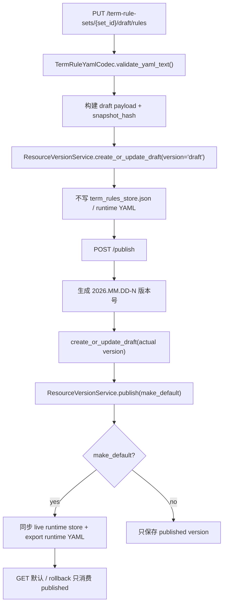

# Term Rule Set Versioning 设计

## 0. 术语约定

- **Term Rule Set**：一组可整体发布的术语规则资源，标识为 `term_rule_set_id`；当前单实例产品化默认集为 `electronics-default`。
- **Term Rule Draft**：某个 Term Rule Set 的可变草稿；草稿更新不改当前 conversion runtime YAML，也不会被任务读取。
- **Term Rule Version**：某个 Term Rule Set 的不可变发布版本，写入 `ResourceVersionService` 的 `resource_type="term_rule_set"`。
- **default term rule version**：`resource_default_versions` 中 `resource_type="term_rule_set"` 的默认指针；回滚只把指针切回旧 published 版本。
- **live runtime store**：当前 `TermRuleService` 读写的 `data/config/term_rules_store.json` 和导出的 `runtime_subscripts_dictionary.yaml`；本 feature 后由默认 published 版本同步生成。
- **legacy term-rules API**：现有 `/api/v1/term-rules` 与 `/api/v1/term-rule-categories`；读接口继续服务当前 live truth，写接口在版本化模式下不能绕过发布流程直接改 runtime。

## 1. 决策与约束

### 需求摘要

从 roadmap 条目 `term-rule-set-versioning` 启动，目标是在现有术语分类、规则 CRUD、导入、导出、模拟和 sync-files 能力之上，增加 Term Rule Set 的草稿、发布、默认版本和回滚 API：

- 草稿可通过 versioned API 更新，但不影响当前任务使用的 runtime YAML。
- 发布版本写入 resource version 底座，发布后不可原地修改。
- 默认指针只能指向 published 版本；设默认和回滚会把对应版本同步到现有 live runtime store，并导出 runtime YAML。
- 查询默认 Term Rule Set 时只返回 published 版本；后续 `job-resource-snapshot-binding` 只能绑定 published 版本。
- 保留现有 `/term-rules` 读接口和 file/sqlite 本地兼容路径。

明确不做：

- 不在本轮修改 jobs payload，也不在 job 创建时写入 `term_rule_set_id/version` 快照。
- 不实现 Translation Profile 或 Template Profile 的任何字段。
- 不做权限角色、actor 审计事件或完整发布审批；`published_by` / `publish_reason` 只作为 payload 元数据预留。
- 不引入 Alembic / SQLAlchemy 迁移体系。
- 不做多租户或公司隔离；公司差异仍由不同资源 id 表达。
- 不做人工翻译校对 UI，也不改变 LLM 翻译模型选择。

### 复杂度档位

- 跨层 API + service + resource version 持久化 = 偏离默认：需要同时约束 HTTP 合同、草稿隔离、默认指针、runtime YAML 同步和 legacy 写入口。
- 兼容性 = 偏离默认：现有 file/sqlite + legacy `/term-rules` 本地工作流不能被直接删除。
- 安全性 = 偏离默认：版本化模式下必须防止草稿或 legacy 写路径绕过发布流程影响任务 runtime。
- 单实例生产化 = 当前默认：不做分布式发布锁、多租户隔离或跨进程审批流。

### 关键决策

1. **Term Rule Version 复用 `ResourceVersionService`，不新建术语专用状态机**
   - 资源版本底座已经定义 draft / published / disabled / superseded、默认指针和 rollback 语义。
   - 术语模块只负责 payload 结构、rule_count、hash、HTTP API 和 runtime YAML 同步。

2. **草稿更新不写 live runtime store**
   - 当前 `TermRuleService.create_rule()` / `update_rule()` 会立即导出 runtime YAML；这不满足“任务只读取发布版本”。
   - Versioned API 的 `PUT /draft/rules` 只更新草稿 payload；只有 publish + set-default / rollback 才同步 live store。

3. **版本化能力只在 `resource_version_service` 可用时启用**
   - 与 Template Profile 版本化保持一致：MySQL backend 下启用资源发布状态；file/sqlite backend 保留当前 `/term-rules` 兼容能力。
   - 新 `/term-rule-sets` 写接口在无 resource service 时返回 503。

4. **现有 legacy 写接口在版本化模式下不得直改 runtime**
   - MySQL resource service 启用后，legacy `/term-rules` 和 `/term-rule-categories` 的写接口需要拒绝或转向 draft API；本设计选择拒绝直接写，提示使用 `/term-rule-sets/{set_id}/draft/rules`。
   - file/sqlite backend 下 legacy 写接口保持现有行为，减少本地开发破坏面。

5. **初始草稿从当前 live store 或默认 published 版本派生**
   - 已有部署的术语数据在 `term_rules_store.json` / seed YAML 中。
   - 第一次读取 draft 时：若已有默认 published 版本，复制默认版本；否则复制当前 live store，保证可以无损发布第一版。

## 2. 名词与编排

### 2.1 名词层

#### 现状

- `TermRulesStore`
  - 来源：`app/core/rule_models.py`
  - 当前包含 `categories` 和 `rules`，是术语规则 live truth 的核心结构。
- `TermRuleService`
  - 来源：`app/services/term_rules/service.py`
  - 当前负责 category / rule CRUD、import、export、simulate、bootstrap 和 runtime YAML 导出；写操作会立即更新 live store。
- `TermRuleYamlCodec`
  - 来源：`app/services/term_rules/yaml_codec.py`
  - 当前负责 v2 YAML 校验、解析、导出和 legacy runtime YAML 渲染。
- term-rules routers / schemas
  - 来源：`app/api/v1/routers/term_rules.py`、`app/api/v1/routers/term_rule_categories.py`、`app/schemas/term_rules.py`
  - 当前已有 list/get/create/update/delete、import、export、simulate 和 sync-files。
- `ResourceVersionService`
  - 来源：`app/services/resource_versions/service.py`
  - 当前提供 draft 写入、publish、set_default、rollback、disable 和 published-only resolve。

#### 变化

新增 Term Rule Set 响应合同：

```python
class TermRuleSetVersionResponse(BaseModel):
    term_rule_set_id: str
    version: str
    status: str
    rule_count: int
    enabled_rule_count: int
    snapshot_hash: str | None = None
    is_default: bool = False
    published_by: str | None = None
    publish_reason: str | None = None
    published_at: datetime | None = None

class TermRuleSetDraftResponse(BaseModel):
    term_rule_set_id: str
    base_version: str | None = None
    rule_count: int
    enabled_rule_count: int
    yaml_text: str
    snapshot_hash: str | None = None

class TermRuleSetDraftUpdateRequest(BaseModel):
    yaml_text: str

class TermRuleSetPublishRequest(BaseModel):
    make_default: bool = True
    published_by: str | None = None
    publish_reason: str | None = None

class TermRuleSetRollbackRequest(BaseModel):
    version: str
```

Term rule version payload 示例：

```json
{
  "term_rule_set_id": "electronics-default",
  "version": "2026.05.29-1",
  "schema_version": 2,
  "rule_count": 1200,
  "enabled_rule_count": 1188,
  "published_by": "actor-id",
  "publish_reason": "补充电容/电阻参数术语",
  "published_at": "2026-05-29T00:00:00+08:00",
  "store": {
    "categories": [],
    "rules": []
  }
}
```

接口示例：

```text
PUT  /api/v1/term-rule-sets/electronics-default/draft/rules
POST /api/v1/term-rule-sets/electronics-default/publish
POST /api/v1/term-rule-sets/electronics-default/versions/2026.05.29-1/set-default
POST /api/v1/term-rule-sets/electronics-default/rollback
```

### 2.2 编排层



#### 现状

- 当前 `/term-rules` 写操作直接修改 `TermRuleRepository`，随后 `export_runtime_yaml()`。
- 当前 conversion path 通过 `runtime_subscripts_dictionary.yaml` 间接消费术语规则。
- 当前没有 `term_rule_set_id`、发布版本号、默认指针或回滚入口。
- 当前 resource version 底座已能保存 `term_rule_set` 类型记录，但术语模块还未写入 payload。

#### 变化

1. 新增 `TermRuleSetVersionService`，负责 draft payload、版本号生成、publish、set-default、rollback 和 runtime 同步。
2. 新增 `/api/v1/term-rule-sets` router，暴露 roadmap 约定的查询、draft 更新、发布、设默认和回滚接口。
3. Draft 更新只校验并保存完整 v2 YAML 视图，不导出 runtime YAML。
4. Publish 从 draft 复制出不可变版本，计算 `snapshot_hash`，写入 resource version 并可选设默认。
5. Set-default / rollback 只切默认指针，然后把目标 published payload 写回 `TermRuleRepository` 并导出 runtime YAML。
6. Versioned mode 下 legacy 写接口禁止直接改 live store；legacy 读、export、simulate 继续读取当前默认 published 同步出的 live truth。

#### 流程级约束

- **错误语义**：set 不存在或版本不存在返回 404；无 resource service 返回 503；YAML 无效返回 400 并带校验报告；状态冲突返回 400。
- **不可变性**：published 版本不得通过 draft 写入路径覆盖；draft 改动必须发布成新版本。
- **幂等性**：重复设置同一个默认版本无副作用；rollback 只切默认指针，不修改历史 payload。
- **顺序约束**：默认指针只能指向 published；runtime YAML 只能由默认 published payload 导出。
- **扩展点**：`job-resource-snapshot-binding` 后续只调用 `ResourceVersionService.resolve_default("term_rule_set", set_id)`，不读取 draft。
- **兼容性**：file/sqlite backend 下当前 `/term-rules` 行为保持；MySQL versioned mode 下 direct write 必须走 draft/publish。

### 2.3 挂载点清单

- `ResourceVersionService`：Term Rule Version 的 draft、published、default pointer 和 rollback 状态机挂载点。
- `/api/v1/term-rule-sets` router：术语规则集版本管理 HTTP 入口。
- `app/schemas/term_rules.py`：Term Rule Set / Draft / Version 的 API 合同挂载点。
- `TermRuleRepository` + `runtime_subscripts_dictionary.yaml`：默认 published 版本同步到现有 conversion runtime 的兼容挂载点。
- legacy term-rules 写接口：MySQL versioned mode 下的直接写防绕过挂载点。

### 2.4 推进策略

1. **名词合同先落地**
   - 增加 Term Rule Set draft/version/list/detail 请求响应模型。
   - 退出信号：API schema 能表达 draft、published、default、rule_count、snapshot_hash 和发布元数据。

2. **草稿隔离编排落地**
   - 接入 v2 YAML 校验，把 draft payload 写入 resource version draft slot，不导出 runtime YAML。
   - 退出信号：更新 draft 后现有 live store 和 runtime YAML 内容不变。

3. **发布与默认指针接通**
   - 实现版本号生成、publish、set-default、rollback，并同步默认 published payload 到 live store。
   - 退出信号：published 版本不可变，默认切换后 export/simulate 观察到新规则。

4. **legacy 写入口守住**
   - MySQL versioned mode 下阻止 `/term-rules`、`/term-rule-categories` 直接写 live store；file/sqlite 保持兼容。
   - 退出信号：versioned mode 下 direct write 返回明确错误，file backend 旧测试仍通过。

5. **查询与验证收口**
   - 补齐 list/detail/draft 查询和 targeted unittest。
   - 退出信号：新 term-rule-sets 主路径、错误路径和兼容路径都有测试证据。

### 2.5 结构健康度与微重构

##### 评估

- 文件级 — `app/services/term_rules/service.py`：391 行，已经承担 live store CRUD、import/export、simulate 和 runtime YAML 导出；继续塞版本发布状态机会混合“live runtime 管理”和“资源版本编排”两类职责。
- 文件级 — `app/api/v1/routers/term_rules.py`：248 行，当前是 legacy rule 资源接口；新增 set-level 版本 API 会扩大 router 语义。
- 文件级 — `app/api/v1/routers/term_rule_categories.py`：109 行，只处理 category CRUD，后续只需要加 versioned mode 写保护。
- 文件级 — `app/schemas/term_rules.py`：151 行，集中 term-rules schema，新增少量 set/version 模型符合当前风格。
- 文件级 — `app/main.py` / `app/core/runtime.py` / `app/api/v1/router.py`：组合根和 router 注册，新增 service wiring 属于现有职责。
- 目录级 — `app/services/term_rules/`：已有 `service.py`、`yaml_codec.py`、`import_validation.py`、`sync_files.py`、`bootstrap.py`，新增 `versioning_service.py` 不触发目录摊平阈值。
- 目录级 — `app/api/v1/routers/`：已有多个资源 router，新增 `term_rule_sets.py` 符合资源 router 平铺风格。
- compound convention 检索：未命中目录组织 / 命名 / 归属类长期约束。

##### 结论：不做独立微重构

本 feature 不搬迁既有文件；版本编排落新 service / 新 router，避免继续膨胀 `TermRuleService` 和 `term_rules.py`。现有 live service 命名与职责保持不变。

##### 超出范围的观察

- `TermRuleService` 同时承担 CRUD、import/export、simulate 和 runtime YAML 导出，后续如果继续扩展 rule-level draft 编辑，建议走 `cs-refactor` 把 live-store 操作、codec/export 和 API 编排进一步拆开。

## 3. 验收契约

- 输入：有效 v2 YAML；触发：`PUT /api/v1/term-rule-sets/electronics-default/draft/rules`；期望：draft 保存成功，rule_count 可见，live runtime YAML 不变化。
- 输入：无效 YAML；触发：更新 draft；期望：返回 400，包含 import validation report，draft 不变化。
- 输入：已有 draft；触发：publish `make_default=true`；期望：生成 `YYYY.MM.DD-N` published version，默认指针指向该版本，live store 和 runtime YAML 同步。
- 输入：已有 draft；触发：publish `make_default=false`；期望：生成 published version，但默认指针和 runtime YAML 不变化。
- 输入：两个 published 版本；触发：set-default 到旧版本；期望：只切默认指针，并把旧版本 payload 同步到 live store。
- 输入：两个 published 版本；触发：rollback；期望：只切默认指针，不修改任何历史 version payload。
- 输入：draft version；触发：set-default；期望：拒绝，默认指针不变。
- 输入：file/sqlite backend；触发：versioned term-rule-sets 写接口；期望：返回 503，legacy `/term-rules` 兼容接口仍可用。
- 输入：MySQL versioned mode；触发：legacy `/term-rules` 或 `/term-rule-categories` 写接口；期望：拒绝直接写 live runtime，提示使用 term-rule-sets draft API。
- 反向核对：不修改 jobs payload，不写 `term_rule_set_id/version` 到 job snapshot。
- 反向核对：不把 Template Profile 或 Translation Profile 字段塞进 Term Rule Set payload。
- 反向核对：不新增审计事件表或权限角色系统。

## 4. 与项目级架构文档的关系

本 feature 完成后 acceptance 阶段需要回写：

- `.codestable/architecture/ARCHITECTURE.md`
  - 增加 Term Rule Set / Term Rule Version 术语，说明默认 published 版本同步到 live runtime store。
- `.codestable/architecture/backend-fastapi-service.md`
  - 更新 term-rules API 现状：现有 legacy API 已有 CRUD，新 `/term-rule-sets` 负责草稿、发布、设默认和回滚。
  - 修正旧文档中“term-rules 不支持 rule/category 写接口”的过期描述。
- `.codestable/requirements/fastapi-backend-productization.md`
  - 更新术语管理从 live store/seed 管理进入可发布版本管理状态；job 资源快照仍留给后续 feature。
