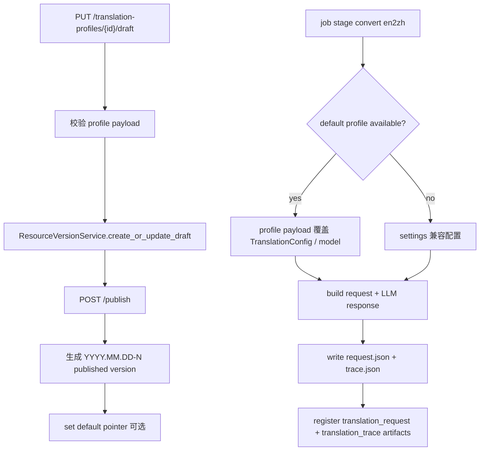

# Translation Profile and Segment Trace 设计

## 0. 术语约定

- **Translation Profile**：面向翻译链路的版本化配置资源，标识为 `translation_profile_id`；MVP 默认集为 `electronics-en2zh`。
- **Translation Profile Draft**：某个 Translation Profile 的可变草稿，保存目标语言、领域、prompt 版本、模型名和分批阈值，不保存 API key。
- **Translation Profile Version**：某个 Translation Profile 的不可变发布版本，写入 `ResourceVersionService` 的 `resource_type="translation_profile"`。
- **default translation profile**：`resource_default_versions` 中 `resource_type="translation_profile"` 的默认指针；后续 job snapshot 只能绑定 published 版本。
- **Translation Segment**：翻译 runtime 抽出的最小文本单元，当前由 `TranslationItem.id` 标识。
- **Segment Trace**：job 级 JSON artifact，记录每个 segment 的原文、发送给模型的文本、AI 初译和最终渲染文本。

## 1. 决策与约束

### 需求摘要

从 roadmap 条目 `translation-profile-and-segment-trace` 启动，目标是在当前 `en2zh` 翻译链路已有 request payload 和 LLM 调用的基础上，补齐两个产品化边界：

- 增加 Translation Profile 的 draft、publish、set-default 和查询 API，复用资源版本底座。
- 翻译任务生成 `translation_trace` artifact，保存 segment 原文、模型输入、AI 初译、最终渲染文本、模型和 prompt 版本。
- MySQL resource service 可用时，转换执行时优先读取默认 published Translation Profile；不可用时保持现有 `.env` / settings 兼容路径。
- 保持当前 `translation_request` artifact，新增 trace 不替代已有调试产物。

明确不做：

- 不做人工校对 UI，也不引入人工审核状态。
- 不在本轮修改 jobs 创建 payload，也不写 `translation_profile_id/version` 到 job snapshot；该能力留给 `job-resource-snapshot-binding`。
- 不保存 OpenAI API key、secret header 或完整 prompt 文本到 resource payload / trace artifact。
- 不新增支持 `zh2en` / `zh2ru` 的真实翻译路径；当前后端仍只接受 `direct` / `en2zh`。
- 不改 MinerU 解析、Word 渲染、术语规则或模板 Profile 合同。

### 复杂度档位

- 跨层 API + service + resource version = 偏离默认：需要同时约束 profile payload、默认指针、HTTP 合同和 runtime settings 兼容。
- 翻译 runtime trace = 偏离默认：要在不破坏现有 `translation_request` 的前提下记录 segment 级证据。
- 单实例生产化 = 当前默认：不做分布式 profile 发布锁、多租户隔离或外部审计表。

### 关键决策

1. **Translation Profile 复用 `ResourceVersionService`，不新建翻译专用状态机**
   - resource version 底座已经支持 `translation_profile` 类型。
   - 翻译模块只负责 payload 结构、hash、HTTP API 和转换执行时的默认 profile 解析。

2. **默认 Translation Profile 只影响 en2zh 执行时配置，不替代 job snapshot**
   - 当前 job 创建只保存 `translation_mode`，不保存 profile 版本。
   - 本轮允许 stage 执行时解析默认 published profile，并把实际 profile/version 写入 trace；真正“创建时绑定不可变快照”留给后续 feature。

3. **Profile payload 不存 secret**
   - `api_key` 仍来自 `.env` / runtime settings。
   - payload 可以保存 `model`、`target_language`、`domain`、`prompt_version`、`max_pages_per_batch`、`max_chars_per_batch`。

4. **Segment trace 是 job artifact，不是 metadata 表**
   - trace 与 `translation_request` 一样是 job 产物，走现有 artifact 合同、fingerprint 和下载入口。
   - MySQL metadata 只登记 artifact 记录，不把每个 segment 展开成数据库行；人工校对工作台需要时再另起设计。

## 2. 名词与编排

### 2.1 名词层

#### 现状

- `TranslationConfig`
  - 来源：`app/conversion/runtime/translation_runtime.py`
  - 当前包含 `target_language`、`domain`、`max_pages_per_batch`、`max_chars_per_batch`、`prompt_version`。
- `TranslationItem`
  - 来源：`app/conversion/runtime/translation_runtime.py`
  - 当前包含 stable `id`、页面 / block / field 定位、`source_text`、保护占位符后的 `text` 和 placeholders。
- `LLMClientConfig`
  - 来源：`app/conversion/runtime/llm_client.py`
  - 当前包含 `model`、`api_key`、`base_url`、timeout 和输出 token 上限。
- `ConversionRequest`
  - 来源：`app/conversion/contracts.py`
  - 当前只带 settings 派生的翻译模型、key、base_url、分批参数和 `translation_request_output`。
- `ResourceVersionService`
  - 来源：`app/services/resource_versions/service.py`
  - 当前已支持 `translation_profile` resource type，但没有翻译 profile 专属 service / API。

#### 变化

新增 Translation Profile API 合同：

```python
class TranslationProfileDraftUpdateRequest(BaseModel):
    target_language: str = "zh-CN"
    domain: str = "electronics engineering technical document"
    prompt_version: str = "translation-minimal-v1"
    model: str | None = None
    max_pages_per_batch: int = 20
    max_chars_per_batch: int = 60000

class TranslationProfileVersionResponse(BaseModel):
    translation_profile_id: str
    version: str
    status: str
    snapshot_hash: str | None = None
    is_default: bool = False
    target_language: str
    domain: str
    prompt_version: str
    model: str | None = None
    max_pages_per_batch: int
    max_chars_per_batch: int
```

Translation profile payload 示例：

```json
{
  "translation_profile_id": "electronics-en2zh",
  "version": "2026.05.29-1",
  "target_language": "zh-CN",
  "domain": "electronics engineering technical document",
  "prompt_version": "translation-minimal-v1",
  "model": "deepseek-v4-flash",
  "max_pages_per_batch": 20,
  "max_chars_per_batch": 60000
}
```

Segment trace artifact 示例：

```json
{
  "schema_version": 1,
  "job_id": "job_xxx",
  "translation_profile": {
    "translation_profile_id": "electronics-en2zh",
    "version": "2026.05.29-1",
    "snapshot_hash": "sha256:..."
  },
  "model": "deepseek-v4-flash",
  "prompt_version": "translation-minimal-v1",
  "segments": [
    {
      "id": "p0001.b0001.text",
      "page_number": 1,
      "block_idx": 1,
      "field": "text",
      "source_text": "Input voltage 5 mV",
      "model_input_text": "Input voltage {{PH_001}}",
      "ai_translation_text": "输入电压 {{PH_001}}",
      "final_text": "输入电压 5 mV"
    }
  ]
}
```

### 2.2 编排层



#### 现状

- `build_translation_request_payload()` 只输出给 LLM 的最小 item 列表，不保留每个 item 的来源定位。
- `apply_translation_responses()` 会校验并改写 pages，但不返回 segment 级审计数据。
- `translation_request_output` 当前只登记 request JSON artifact。
- jobs API 只接受 `translation_mode`，没有 profile 参数。

#### 变化

1. 新增 `TranslationProfileVersionService`，负责默认 profile、draft 更新、版本号生成、publish、set-default 和 rollback。
2. 新增 `/api/v1/translation-profiles` router，暴露 list/detail/draft/update/publish/set-default/rollback。
3. 扩展 `ConversionRequest`，增加可选 `translation_profile` 快照、可选 `translation_trace_output` 和 profile 派生的翻译配置字段。
4. `JobStageService` 在 `en2zh` 执行前解析默认 Translation Profile；无 resource service 或无默认 published profile 时继续使用 settings。
5. `translation_runtime` 新增 trace payload 构建 / 写文件函数，保留 `apply_translation_responses()` 现有调用语义。
6. artifact 合同新增 `translation_trace`，下载 alias 为 `translation-trace`。

#### 流程级约束

- **错误语义**：profile 不存在或版本不存在返回 404；无 resource service 返回 503；非法 payload 返回 400。
- **不可变性**：published profile 不可通过 draft 路径覆盖；修改必须发布新版本。
- **兼容性**：file/sqlite backend 或无默认 profile 时，现有 `en2zh` settings 路径保持可用。
- **安全性**：profile payload 和 trace 不写 API key、secret header 或完整 prompt 文本。
- **扩展点**：job 创建时 profile_id/version 参数和不可变快照留给 `job-resource-snapshot-binding`。

### 2.3 挂载点清单

- `TranslationProfileVersionService`：Translation Profile draft、published、default pointer 和 rollback 状态机挂载点。
- `/api/v1/translation-profiles` router：翻译配置版本管理 HTTP 入口。
- `app/schemas/translation_profiles.py`：Translation Profile API 合同挂载点。
- `JobStageService`：en2zh 执行时解析默认 profile 并传入 conversion request 的挂载点。
- `translation_runtime.py`：segment trace payload 生成和最终渲染文本记录挂载点。
- jobs artifact 合同：`translation_trace` 文件登记、排序和下载 alias 挂载点。

### 2.4 推进策略

1. **名词合同先落地**
   - 增加 Translation Profile draft/version/list/detail 请求响应模型和 service payload/hash。
   - 退出信号：schema 和 service 能表达 draft、published、default、snapshot_hash 和翻译配置字段。

2. **Profile API 接通**
   - 增加 router、runtime wiring 和 API v1 注册。
   - 退出信号：MySQL resource mode 下可完成 draft -> publish -> default -> rollback。

3. **转换执行接入默认 profile**
   - 在 stage 层解析默认 profile，传入 conversion request；无默认 profile 时回退 settings。
   - 退出信号：en2zh request 的模型 / prompt / 分批参数可由默认 profile 覆盖，direct 模式不读取 profile。

4. **segment trace artifact 落地**
   - 在 translation runtime 写 `trace.json`，artifact 合同新增 `translation_trace`。
   - 退出信号：en2zh job 同时登记 `translation_request`、`translation_trace` 和 `result_docx`。

5. **验证与回写**
   - 补充 targeted unittest，更新 checklist。
   - 退出信号：profile API、fallback path 和 trace artifact 均有测试证据。

### 2.5 结构健康度与微重构

#### 评估

- 文件级 — `app/conversion/runtime/translation_runtime.py`：已承担抽取、分批、请求构建、响应校验和应用；新增 trace 构建属于同一翻译 runtime 的自然职责，但要避免改动现有 apply 函数语义。
- 文件级 — `app/services/jobs/stage.py`：已超过一屏且承担 stage 编排；新增默认 profile 解析如果直接塞大量逻辑会继续膨胀，因此只放一层 resolver 调用，profile 细节落 service。
- 文件级 — `app/services/resource_versions/service.py`：保持通用，不加入翻译字段。
- 目录级 — `app/services/`：已有 `templates/`、`term_rules/`、`resource_versions/`，新增 `translation_profiles/` 符合当前资源 service 分组。
- 目录级 — `app/api/v1/routers/`：已有多个资源 router，新增 `translation_profiles.py` 符合当前平铺资源 router 风格。
- compound convention 检索：未命中翻译 profile 目录组织或命名长期约束。

#### 结论：不做独立微重构

本 feature 新增独立 translation profile service / schema / router；对现有 stage 和 runtime 只做挂载式扩展，不搬迁既有文件，不改函数签名语义。

#### 超出范围的观察

- `translation_request_output` 的旧帮助文案与实际行为仍有差异：当前即使写 request 也会继续调用 LLM。这个现存差异不在本轮修复，后续可走 issue 或 refactor。

## 3. 验收契约

- 输入：MySQL resource mode；触发：`PUT /api/v1/translation-profiles/electronics-en2zh/draft`；期望：draft 保存成功，snapshot_hash 可见，不含 API key。
- 输入：已有 draft；触发：publish `make_default=true`；期望：生成 `YYYY.MM.DD-N` published version，默认指针指向该版本。
- 输入：两个 published profile；触发：set-default / rollback；期望：只切默认指针，不修改历史 payload。
- 输入：file backend；触发：profile 写接口；期望：返回 503，现有 en2zh settings 路径仍可执行。
- 输入：默认 published profile + `translation_mode=en2zh` job；触发：转换；期望：conversion request 使用 profile 中的 model / prompt / batch 参数。
- 输入：`translation_mode=en2zh` job；触发：转换完成；期望：files 列表包含 `translation_request`、`translation_trace`、`result_docx`，trace 记录 source、AI 初译和 final text。
- 反向核对：direct job 不生成 translation trace，也不解析默认 Translation Profile。
- 反向核对：不修改 jobs 创建 payload，不写 `translation_profile_id/version` 到 JobRecord。
- 反向核对：profile payload 和 trace 不保存 API key 或 secret header。

## 4. 与项目级架构文档的关系

本 feature 完成后 acceptance 阶段需要回写：

- `.codestable/architecture/ARCHITECTURE.md`
  - 补入 Translation Profile 已有版本化资源管理 API 和 `translation_trace` artifact。
- `.codestable/architecture/backend-fastapi-service.md`
  - 更新 API 列表、resource version service 复用关系和 jobs artifact 合同。
- `.codestable/architecture/conversion-flow.md`
  - 更新 en2zh 翻译链路的 segment trace 产物。
- `.codestable/requirements/fastapi-backend-productization.md`
  - 更新翻译配置从 settings-only 进入可发布版本管理状态。
