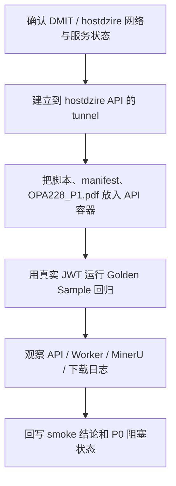

# document-job-smoke-stability design

## 0. 术语与成功标准

术语：

- document job 主链路：上传 PDF、登记文件、创建 `direct_pdf_to_word` 任务、Worker 执行、MinerU 解析回调、DocumentIR 转换、Word 渲染、下载结果。
- 真实 smoke：使用已部署 API、Worker、Redis/MySQL、MinerU 配置和真实 PDF，而不是 dummy token 或离线 inventory 检查。
- runnable sample：当前 manifest enabled 且 PDF 文件存在的 Golden Sample 样本；本轮只使用 `gs-003 / OPA228_P1.pdf`。

目标：定位真实部署链路是否卡在上传、建任务、Worker、MinerU、渲染或下载任一 stage；本轮不修排版，不扩后台功能。

成功标准：

- hostdzire 部署中的 API、Worker、MySQL、Redis 处于可用状态。
- DMIT 与 hostdzire 的 WireGuard、nginx 转发和防火墙状态被只读确认，不做配置变更。
- Golden Sample 回归脚本能在真实 API + worker + MinerU 配置下执行 `gs-003 / OPA228_P1.pdf`。
- 结果能明确到 stage：成功则记录 job、结果文件和下载证据；失败则记录失败 stage、错误码和日志位置。
- 结论只用于主链路 smoke，不把 1/1 成功伪装成 10-20 份 P0 正式质量验收。

## 1. 决策与约束

现状：

- `golden-sample-quality-baseline` 已把 `OPA228_P1.pdf` 映射到 `manifest.yaml` 的 `gs-003`，当前 runnable sample 为 1。
- 本地 inventory smoke 已证明报告字段可用，但 dummy bearer token 未启动真实后端/Worker/MinerU，不算正式链路验证。
- hostdzire 是项目主部署机，DMIT 是前置机；部署环境已经有 Docker Compose API/worker/mysql/redis。
- 现场发现部署文档中的 `md2word-api.962850.xyz` 与 hostdzire nginx 实际 `server_name` 存在差异，本轮优先通过 SSH tunnel 验证主链路，不改线上 nginx。

变化：

- 在 hostdzire 当前部署容器内运行 Golden Sample 回归脚本，使用真实 JWT、真实 API、worker 和 MinerU 配置。
- 记录真实 smoke 的执行证据：run dir、job_id、结果 docx、Worker/MinerU 日志结论。
- 更新 Golden Sample 验收报告，把 1 个 runnable sample 的真实 smoke 结果和 P0 样本规模阻塞分开表达。

明确不做：

- 不修 DocumentIR / renderer 排版问题。
- 不调整 nginx、WireGuard、防火墙或 DNS。
- 不改 MinerU 账号、token、回调配置或线上 `.env`。
- 不新增后台 API、前端页面、后台管理功能。
- 不把容器内临时拷贝的 smoke 运行方式视为长期部署方案。

复杂度档位：默认档位。该 feature 属于部署 smoke 和验收证据落档，不改变业务 API 合同。

## 2. 名词层与编排层

### 2.1 名词层

现状：

- `run_golden_sample_regression.py` 已能登录或读取 bearer token，批量提交 Golden Sample，轮询 job，下载 Word 并检查 DOCX 可打开性。
- `manifest.yaml` 当前只有 `gs-003` 有真实 PDF。
- 部署环境的 API/worker 镜像不包含完整 `tests/fixtures/golden_samples/`，因此本轮需要把脚本、manifest 和 PDF 临时拷入容器执行 smoke。

变化：

- 不新增代码名词；只新增本 feature 的 smoke 证据和文档状态。
- Golden Sample acceptance report 增加“真实链路 smoke”结果字段。
- Roadmap item `document-job-smoke-stability` 从 planned 推进到 done。

接口示例：

```text
gs-003 / OPA228_P1.pdf
  -> upload-url
  -> file content upload
  -> POST /api/v1/document-jobs mode=direct_pdf_to_word
  -> worker document_jobs.run
  -> MinerU raw result download
  -> DocumentIR
  -> Word renderer
  -> download-url / download
```

### 2.2 编排层



流程级约束：

- 凭证只用于执行，不写入仓库、不贴入文档。
- 只读检查 wg/nginx/firewall；除运行 smoke 所需的容器内临时文件外，不改线上配置。
- 失败时优先保留 stage 证据，不顺手修 renderer/layout。
- 成功率分母只代表当前 1 个 runnable sample；正式 P0 仍需 10-20 份样本。

### 2.3 挂载点

删掉本 feature 后应消失或回退的挂载点：

- `.codestable/features/2026-06-02-document-job-smoke-stability/`
- `.codestable/roadmap/pdf-to-word-delivery-hardening/` 中该 roadmap item 的状态更新。
- `docs/testing/pdf-to-word-golden-sample-acceptance-report.md` 中真实 smoke 结果段落。

线上容器内为了 smoke 临时拷贝的脚本、manifest 和 PDF 不视为仓库长期挂载点；后续若要长期复跑，应另起部署/测试运行方式设计。

### 2.4 推进策略

1. 环境只读对账：确认 hostdzire/DMIT SSH、WireGuard、nginx、firewall、Docker Compose 和 API readiness。
2. Smoke 运行准备：通过 tunnel 访问 hostdzire API，临时补齐容器内 Golden Sample 脚本、manifest 和 PDF。
3. 真实回归：运行 `gs-003 / OPA228_P1.pdf`，记录 report、job、日志和下载证据。
4. 结果落档：更新 feature acceptance、roadmap 和 Golden Sample 验收报告。
5. 下一步决策：若主链路成功，进入质量 triage 或样本扩充；若失败，按失败 stage 起 issue/feature，不先修 layout。

### 2.5 结构健康度与微重构

本轮不做代码结构变更。现场发现的长期问题是“部署镜像/容器默认不包含 Golden Sample fixtures，host Python 环境也缺少 `PyYAML`”，这会影响未来复跑，但不阻塞本次 smoke 结论。

结论：本次只落 smoke 证据；后续如需可重复线上回归，再设计持久化运行方式。

## 3. 验收契约

- 触发：检查 hostdzire Docker Compose 服务  
  期望：API healthy，worker/mysql/redis up，readiness 无 blocker。
- 触发：检查 DMIT/hostdzire 网络边界  
  期望：WireGuard 双向 handshake 正常，nginx/firewall 状态可解释，未做线上配置变更。
- 触发：运行 `gs-003 / OPA228_P1.pdf` Golden Sample 回归  
  期望：能得到明确 `succeeded` 或带 `failed_stage/error_code` 的失败；本轮实际目标是找 stage。
- 触发：成功任务下载 Word  
  期望：`download-url` 和 `download` 返回成功，DOCX 可打开。
- 反向核对：不修排版、不改 renderer/layout、不扩 API、不泄露凭证、不把 1 个样本成功算成 P0 正式达标。

## 4. 与项目级架构文档的关系

本 feature 不改变 FastAPI 后端、Worker、MinerU callback、DocumentIR 或 Word renderer 架构。它只验证既有架构在部署环境中的可运行性，因此无需更新 `.codestable/architecture/`。

需要更新的长期事实位于：

- `docs/testing/pdf-to-word-golden-sample-acceptance-report.md`
- `.codestable/roadmap/pdf-to-word-delivery-hardening/`

后续衔接：

- 主链路成功后，下一步不应继续排查上传/Worker/MinerU，而应进入结果质量 triage 或扩充 10-20 份正式样本。
- 如果要让线上 Golden Sample 回归可重复，需要单独处理部署镜像/host 环境里的 fixtures 和依赖持久化问题。
