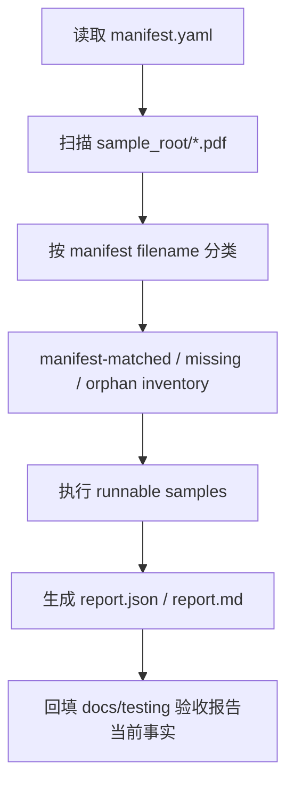

# golden-sample-quality-baseline design

## 0. 术语与成功标准

术语：

- Golden Sample：`tests/fixtures/golden_samples/manifest.yaml` 中声明的 P0 PDF -> Word 样本集合。
- manifest-matched PDF：文件名与 enabled manifest sample 匹配且真实存在的 PDF。
- orphan PDF：位于 `tests/fixtures/golden_samples/pdfs/`，但没有 manifest sample 引用的 PDF。
- runnable sample：manifest enabled 且 PDF 文件存在的样本。
- quality baseline：一次可复现的样本事实和回归结果快照，不等同于 P0 正式通过。

目标：让 Golden Sample 当前状态可被脚本和文档一致表达，明确“能跑多少、缺什么、失败在哪、是否达到 P0 目标”。

后续变更：本 design 确认的是 baseline 阶段的 orphan 报告策略；之后用户已确认将 `OPA228_P1.pdf` 映射为 `gs-003`，当前它不再是 manifest 外 PDF。

成功标准：

- 当前 manifest 样本数、manifest-matched PDF 数、orphan PDF 数和 runnable sample 数可明确报告。
- `OPA228_P1.pdf` 这类 manifest 外 PDF 不被计入正式通过率，但会被列为 orphan PDF。
- 回归报告能区分 `missing_pdf`、API/鉴权/Worker/MinerU/渲染失败、DOCX 不可打开和人工验收未完成。
- `docs/testing/pdf-to-word-golden-sample-acceptance-report.md` 不再声称仓库内真实 PDF 数为 0，而是反映当前事实和阻塞原因。
- 不修改 backend/frontend 业务代码，不扩新后台功能。

## 1. 决策与约束

现状：

- `manifest.yaml` 有 12 个样本，文件名均为 `gs-001...gs-012...pdf`。
- `tests/fixtures/golden_samples/pdfs/` 当前有 `OPA228_P1.pdf`，但它不在 manifest 中。
- `run_golden_sample_regression.py` 已能统计 configured / runnable / missing，并能生成 `report.json` / `report.md`。
- 当前脚本不会报告 orphan PDF，因此“样本目录里有真实 PDF，但 runnable 为 0”的状态不够显式。
- `docs/testing/pdf-to-word-golden-sample-acceptance-report.md` 仍写“实际 PDF 数 0”，已滞后于当前目录事实。

变化：

- 保留 manifest 作为正式样本真源，不自动把 orphan PDF 纳入正式样本。
- 为 Golden Sample 回归结果补足 inventory 维度：manifest 样本、manifest-matched PDF、missing PDF、orphan PDF、runnable sample。
- 刷新验收报告，让它记录当前事实：正式 runnable sample 仍为 0，orphan PDF 为 1，P0 正式验收仍 blocked。
- 明确下一步样本决策入口：如果要使用 `OPA228_P1.pdf`，必须由用户确认它映射到哪个 sample id / acceptance focus，或新增 manifest sample。

明确不做：

- 不把 `OPA228_P1.pdf` 自动改名或强行映射到 `gs-*`。
- 不降低 P0 目标：正式目标仍是 10-20 份样本核心链路成功率 `>= 90%`。
- 不要求本 feature 跑通真实 MinerU / Worker / 后端联调。
- 不修 DocumentIR / renderer 排版质量问题。
- 不新增后端 API、前端页面、后台管理能力。

复杂度档位：默认档位。此 feature 属于测试基线和文档对账，运行时业务合同不变。

## 2. 名词层与编排层

### 2.1 名词层

现状：

- `RegressionConfig` 定义 Golden Sample 回归运行参数。
- `SampleResult` 表达单样本执行结果，已有 `status`、`failure_stage`、`error_code`、`docx_openable` 等字段。
- `build_report()` 输出 summary 和 results，但 summary 只表达 configured/runnable/missing/succeeded/failed/pass_rate/met_target。
- `manifest.yaml` 中 sample 没有 orphan 概念；orphan 只应由扫描样本目录得出。

变化：

- 新增或补充报告层字段，不改变 document job API：
  - `manifest_samples`：enabled manifest 样本数。
  - `manifest_matched_pdfs`：enabled manifest 中真实存在 PDF 的数量。
  - `missing_pdf_samples`：enabled manifest 中缺失 PDF 的数量。
  - `orphan_pdf_files`：样本目录下未被 manifest 引用的 PDF 文件名列表。
  - `runnable_samples`：等同于 manifest-matched PDF 数。
- `SampleResult.status` 继续使用现有 `missing_pdf` / `succeeded` / `failed`，不引入业务 job 新状态。
- 文档报告中的“实际 PDF 数”改成两个概念：正式匹配 PDF 数、manifest 外 PDF 数。

接口示例：

```yaml
summary:
  manifest_samples: 12
  manifest_matched_pdfs: 0
  missing_pdf_samples: 12
  orphan_pdf_files:
    - OPA228_P1.pdf
  runnable_samples: 0
  met_target: false
```

### 2.2 编排层



流程级约束：

- manifest 是正式样本真源；orphan PDF 只报告，不计入 pass rate。
- runnable 为 0 时也要能生成事实报告，并明确 blocked 原因。
- 成功率分母只能是 runnable sample；正式 P0 目标还要求样本数量达到 10-20。
- 人工验收状态不能由脚本自动推断，只能记录为未执行或引用人工记录。
- 任何需要业务判断的样本映射必须停下来让用户确认。

### 2.3 挂载点

删掉本 feature 后应消失或回退的挂载点：

- `scripts/ops/run_golden_sample_regression.py` 的 inventory/report 字段扩展。
- `docs/testing/pdf-to-word-golden-sample-acceptance-report.md` 的当前事实更新。
- `tests/fixtures/golden_samples/README.md` 中关于当前真实 PDF / orphan PDF 的说明更新。
- 针对 manifest/orphan/report 字段的测试。
- `.codestable/features/2026-06-02-golden-sample-quality-baseline/`。

### 2.4 推进策略

1. Inventory 基线：读取 manifest 和 sample_root，分类 manifest-matched、missing、orphan。
2. Report 扩展：把 inventory 写入 `report.json`、`report.md` 和 console summary。
3. 文档对账：刷新 Golden Sample acceptance report 和 README 的当前事实。
4. 测试覆盖：补 manifest/orphan/report 字段测试，验证当前 `OPA228_P1.pdf` 不计入正式通过率。
5. 最小验证：运行 Golden Sample manifest/report 相关测试；必要时以 `GOLDEN_SAMPLE_FAIL_ON_MISSING_SAMPLES=0` 生成离线事实报告。

### 2.5 结构健康度与微重构

文件级：

- `scripts/ops/run_golden_sample_regression.py` 已承担配置、manifest、HTTP 执行、报告生成多项职责，但本 feature 只补 inventory 和报告字段，改动仍可局部完成。
- 如果实现时 inventory 逻辑超过一屏，应提取为小函数，例如 `build_sample_inventory()`；这是局部拆函数，不改变外部行为。

目录级：

- Golden Sample fixtures、docs/testing 和 ops script 的现有目录归属清晰，不需要重组目录。

compound convention：当前 `.codestable/compound/` 不存在，未发现可复用的长期目录组织沉淀。

结论：本次不做目录级微重构；实现时允许在同一脚本内提取小函数以保持报告逻辑可读。

## 3. 验收契约

- 触发：扫描 `tests/fixtures/golden_samples/pdfs/`  
  期望：报告列出 `OPA228_P1.pdf` 为 orphan PDF，不计入 runnable sample。
- 触发：读取 `manifest.yaml`  
  期望：12 个 enabled sample 仍保持正式样本清单；缺失 PDF 被统计为 `missing_pdf`。
- 触发：构造回归报告 summary  
  期望：同时包含 manifest 样本数、manifest-matched PDF 数、missing PDF 数、orphan PDF 列表和 P0 blocked 判定。
- 触发：打开 `docs/testing/pdf-to-word-golden-sample-acceptance-report.md`  
  期望：当前事实不再写“实际 PDF 数 0”作为唯一描述，而是区分“正式匹配 PDF 数 0”和“manifest 外 PDF 数 1”。
- 触发：运行相关测试  
  期望：Golden Sample manifest/report 测试通过；不要求真实后端、Worker 或 MinerU 可用。
- 反向核对：不修改 backend/frontend 业务代码，不新增 API，不把 orphan PDF 写入正式成功率。

## 4. 与项目级架构文档的关系

本 feature 不改变 FastAPI 后端架构、document job 主链路或 DocumentIR/renderer 数据结构。完成后通常不需要更新 `.codestable/architecture/`。

需要更新的长期事实位于测试和验收文档：

- `docs/testing/pdf-to-word-golden-sample-acceptance-report.md`
- `tests/fixtures/golden_samples/README.md`
- `scripts/ops/run_golden_sample_regression.py`

后续衔接：

- 如果本 feature 完成后 runnable sample 仍为 0，下一步不是修 renderer，而是请用户确认样本映射或补齐 10-20 个 manifest-matched PDF。
- 如果 runnable sample > 0 且脚本能跑出失败阶段，再进入 `document-job-smoke-stability` 或按失败分类进入 `document-ir-layout-risk-pass` / `word-renderer-editable-output-pass`。
