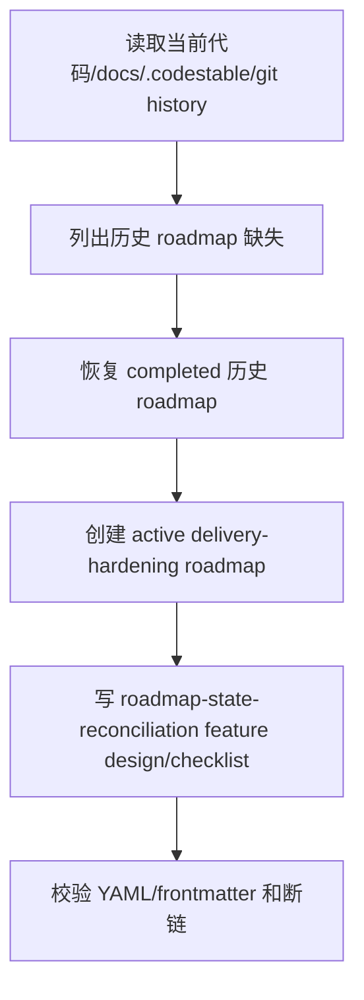

# roadmap-state-reconciliation design

## 0. 输入与成功标准

目标：恢复缺失的 `.codestable/roadmap/` 规划层，校准历史 roadmap 状态，并创建当前 2-4 周 PDF -> Word 交付硬化路线。

成功标准：

- architecture 中引用的 historical roadmap 不再断链。
- 4 组历史 roadmap 按当前事实恢复为 completed 档案。
- 新增 active roadmap `pdf-to-word-delivery-hardening`，并把下一步 feature 种子写入 items.yaml。
- 不修改业务代码，不扩新后台功能。

## 1. 决策与约束

现状：

- `.codestable/roadmap/` 当前只剩 `.gitkeep`。
- `ARCHITECTURE.md` 和 `backend-fastapi-service.md` 仍引用 `fastapi-backend` roadmap / acceptance。
- 代码事实显示 `document_jobs`、DocumentIR v2、frontend 工作台和 Golden Sample 框架均已存在。
- Golden Sample 报告仍处于 blocked，但样本目录已有一个 manifest 外 PDF。

变化：

- 历史 roadmap 不用 `git checkout` 原样恢复，而是恢复为当前事实校准版，避免把旧 planned 状态重新带入。
- `fastapi-backend`、`backend-productization-implementation`、`backend-worker-storage-evolution`、`mineru-online-ingestion` 全部作为 completed 历史规划保留。
- 新建 `pdf-to-word-delivery-hardening` 作为唯一 active roadmap。

明确不做：

- 不改 backend / frontend 业务代码。
- 不修改 requirements / architecture 现状文档。
- 不把 Golden Sample blocked 状态伪装成通过。
- 不继续规划新后台功能。

复杂度档位：默认档位。此 feature 只改规划文档，不涉及跨层运行时合同变更。

## 2. 名词层与编排层

### 2.1 名词层

现状：

- CodeStable roadmap 目录约定见 `.codestable/reference/shared-conventions.md`。
- roadmap 与 feature 的接口是 `{slug}-items.yaml`。
- 旧 roadmap 在 git 历史中存在，但当前工作树缺失。

变化：

- 历史 roadmap 只保留 `done/completed` 状态，不再作为 active backlog。
- 当前 active roadmap 的 item 状态使用 `planned -> in-progress -> done` 协议。
- `roadmap-state-reconciliation` feature 目录绑定 `roadmap: pdf-to-word-delivery-hardening` 和 `roadmap_item: roadmap-state-reconciliation`。

### 2.2 编排层

流程级约束：

- 恢复历史 roadmap 时以当前代码事实为准。
- 旧 `mineru-online-ingestion` planned 条目必须校准，不能照搬为未来 backlog。
- 当前 active roadmap 的下一个最小闭环必须指向 Golden Sample 质量基线。

### 2.3 挂载点

删掉本 feature 后会消失的挂载点：

- `.codestable/roadmap/fastapi-backend/`
- `.codestable/roadmap/backend-productization-implementation/`
- `.codestable/roadmap/backend-worker-storage-evolution/`
- `.codestable/roadmap/mineru-online-ingestion/`
- `.codestable/roadmap/pdf-to-word-delivery-hardening/`
- `.codestable/features/2026-06-02-roadmap-state-reconciliation/`

### 2.4 推进策略

1. 规划断链恢复：恢复 4 组历史 roadmap 的主文档和 items。
2. 状态校准：把历史路线全部标为 completed，并记录漂移原因。
3. 当前路线创建：新增 `pdf-to-word-delivery-hardening`，写 2-4 周子 feature 清单。
4. feature design 输入：为 `roadmap-state-reconciliation` 写 design 和 checklist。
5. 验证：跑 YAML/frontmatter 校验、断链 grep、git status 复核。

### 2.5 结构健康度与微重构

文件级：本次只新增文档和 YAML，不向既有大代码文件追加逻辑，不需要微重构。

目录级：`.codestable/roadmap/` 符合 shared conventions；一个大需求一个子目录。`.codestable/features/` 此前为空，新增一个 feature 目录符合约定。

compound convention：当前 `.codestable/compound/` 不存在，未发现可复用的长期目录组织沉淀。

结论：本次不做微重构。

## 3. 验收契约

- 触发：打开 `.codestable/roadmap/fastapi-backend/fastapi-backend-roadmap.md`  
  期望：文件存在，状态为 completed，且说明这是历史恢复版。
- 触发：读取 `pdf-to-word-delivery-hardening-items.yaml`  
  期望：`roadmap-state-reconciliation` 在验收前为 `in-progress`、验收后为 `done`；`golden-sample-quality-baseline` 是下一条 `minimal_loop: true`，启动 design 后可进入 `in-progress`。
- 触发：运行 YAML/frontmatter 校验  
  期望：新增 md frontmatter 和 yaml 文件语法通过。
- 触发：搜索 `.codestable/architecture` 中 roadmap 引用  
  期望：`fastapi-backend` 相关链接不再指向缺失文件。
- 反向核对：业务代码、requirements、architecture 不因本 feature 被修改。

## 4. 后续衔接

下一条 feature 应从 `golden-sample-quality-baseline` 开始。它的输入包括：

- 本 active roadmap 第 4.2 节 Golden Sample 契约。
- `tests/fixtures/golden_samples/manifest.yaml`。
- `docs/testing/pdf-to-word-golden-sample-acceptance-report.md`。
- 当前 manifest 外 PDF `tests/fixtures/golden_samples/pdfs/OPA228_P1.pdf`。
