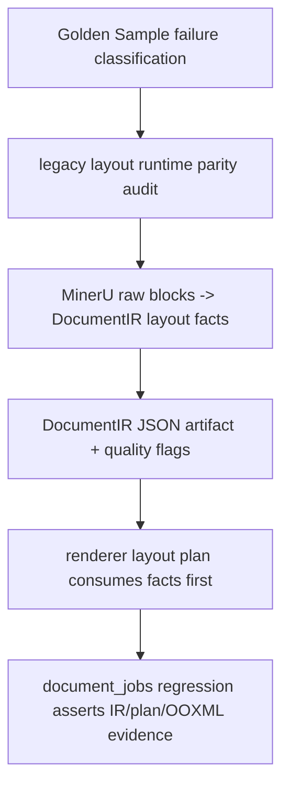

# document-ir-layout-risk-pass design

## 0. 术语与成功标准

术语：

- DocumentIR layout facts：`DocumentIRPage`、`DocumentIRBlockLayout`、`captions`、`footnotes` 和 `quality_flags` 中持久化的布局事实，只描述来源 PDF / MinerU 事实，不描述 Word 样式选择。
- renderer layout plan：`app/services/renderer/layout_plan.py` 从 DocumentIR v2 构造的运行时页面与区域计划，不持久化。
- legacy layout runtime：`app/conversion/runtime/input_adapter_runtime.py`、`page_repair_runtime.py`、`page_layout_runtime.py`、`table_long_renderer.py` 中已经在 `md2word_main` / sandbox 链路验证过的布局策略。
- parity 判断：先确认 legacy runtime 中哪些布局事实或策略能迁移到 `document_jobs -> DocumentIR -> app/services/renderer`，哪些事实在 MinerU -> DocumentIR 转换阶段已经丢失。
- layout risk pass：只收敛 block 顺序、双栏、宽表/横版、caption/figure/table 绑定、long table continuation 等布局事实风险，不处理 heading/list/formula 的 Word 语义输出。

目标：让后续 `word-renderer-editable-output-pass` 拿到更稳定的 DocumentIR layout 输入，避免它在 renderer 里用猜测弥补 MinerU -> DocumentIR 阶段丢失的布局事实。

成功标准：

- 对 4 个 live regression 样本暴露的 layout 风险给出逐项结论：已有 IR 可表达 / 需补 IR fact / 留给 renderer 样式策略。
- 至少迁移或补齐一组 P0 layout facts，使 `gs-003`、`gs-006`、`gs-008` 的双栏、caption/table/figure、宽表/continuation 风险可由 DocumentIR 或 layout plan 稳定观察。
- DocumentIR v2 合同保持向后兼容；v1 fallback 不受影响。
- document_jobs 回归能检查 DocumentIR JSON / renderer metadata / OOXML 版面结构，不只测 `app/conversion/runtime` sandbox。
- 不把 heading、Word numbering、公式 TeX 清理或 table style 质量塞进本 feature；这些进入 `word-renderer-editable-output-pass`。

## 1. 决策与约束

现状：

- `golden-sample-live-regression-scale-up` 已完成 acceptance：`gs-003/004/006/008` 主链路 4/4 succeeded，DOCX 4/4 openable，但人工质量 0/4 P0 pass。
- 主要分类为 `pipeline-parity-gap`：legacy runtime 已有部分 layout / caption / table 策略，但 API DocumentIR renderer 链路未接入。
- `DocumentIRBlockLayout` 已有 `page_index`、`bbox`、`role`、`source_index`、`continuation_heights`、`column_hint`；但 `column_hint` 当前没有在 MinerU converter 中实际设置。
- `layout_signals.py` 当前能保存页尺寸、bbox、页眉页脚 role 和 raw block 上已有的 `continuation_heights`，但没有复用 legacy 的 table placeholder continuation 收集，也没有持久化 page orientation / wide table / two-column region 这类诊断事实。
- `layout_plan.py` 当前会用 bbox 推断 two-column band，并拆 page header/footer，但没有稳定 band 诊断、没有消费 `column_hint`，也没有用 page orientation / table width 风险影响后续渲染。
- `table_renderer.py` 当前 caption/footnote 在表格之后渲染；本 feature只负责让 caption/table 关系在 IR/plan 中可观察，caption-before-table 的最终 Word 输出由下一项 renderer feature 处理。

变化：

- 先做 parity audit：把 live DocumentIR / Golden Sample 人工问题和 legacy runtime 策略对齐，产出“可迁移策略 / 必须补 IR fact / 留给 renderer”的分类。
- 在 DocumentIR v2 中补齐最小 layout facts 或 metadata，使双栏、wide table / landscape、caption/figure/table binding、long table continuation 可稳定追踪。
- 在 renderer layout plan 中优先消费 DocumentIR facts；不能表达时再用 bbox 推断，并通过 metadata / quality flags 暴露风险。
- 增加 document_jobs 链路回归，验证保存的 `document_ir_v2.json` 和 renderer metadata 能反映 layout facts。

明确不做：

- 不重写整套 layout algorithm，不把 `app/conversion/runtime/page_layout_runtime.py` 直接搬成第二套大渲染器。
- 不处理 heading 样式、真实 Word numbering、formula/rich text TeX 清理。
- 不在本 feature 完成 caption-before-table、TableContent/TableNote/Caption 等 Word 样式质量；只保证 IR/plan 有可消费事实。
- 不改前端、不改 API 合同、不新增后台管理功能。
- 不改变 Golden Sample manifest，不把 4 个样本声明为 P0 通过。

复杂度档位：默认偏中等。改动横跨 DocumentIR model / converter / renderer layout plan / document_jobs tests，但不改 HTTP API 或部署配置。

## 2. 名词层与编排层

### 2.1 名词层

现状：

- `DocumentIRPage`：保存 `index`、`width`、`height`、`metadata`。页方向目前只能由 width/height 推断，没有标准 metadata key。
- `DocumentIRBlockLayout`：保存 bbox、role、source_index、continuation_heights 和未被实际写入的 `column_hint`。
- `DocumentIRBlock`：保存 type、text/html/latex/list_items、layout、captions、footnotes、metadata。
- `DocumentIR.quality_flags`：当前记录 `middle_json_missing`、`layout_bbox_missing:*`、`table_continuation:*`、`unsupported_block_type:*` 等。
- `LayoutPlan`：运行时对象，包含 `LayoutPage` 和 `LayoutRegion(kind="one_col"|"two_col")`，不持久化。

变化：

- 新增或标准化 DocumentIR layout metadata key，不引入 HTTP API 字段：
  - page-level：`orientation`，值为 `portrait` / `landscape`，来源于 page size 或 bbox extent。
  - block-level：`layout.column_hint` 写入 `left` / `right` / `wide`，用于描述 block 在页面上的横向角色。
  - block metadata：`layout_role_reason` 或等价诊断文本，记录 column_hint / wide table 判断来源；只用于排障，不驱动业务语义。
  - quality flags：`layout_two_column:*`、`layout_wide_table:*`、`layout_caption_binding_risk:*`、`table_continuation:*` 等可检索标记。
- 若实现时发现 `metadata` 已能承载某个事实，则优先用 metadata，不扩大 Pydantic 模型；只有需要 renderer 稳定消费时才使用 typed field。

接口示例：

```json
{
  "schema_version": "document-ir/v2",
  "pages": [
    {
      "index": 0,
      "width": 612.0,
      "height": 792.0,
      "metadata": {"orientation": "portrait", "page_size_source": "layout.json"}
    }
  ],
  "blocks": [
    {
      "id": "block_0004",
      "type": "table",
      "layout": {
        "page_index": 0,
        "bbox": [72.0, 340.0, 540.0, 430.0],
        "role": "body",
        "source_index": 3,
        "continuation_heights": [120.0],
        "column_hint": "wide"
      },
      "captions": ["Device Information"],
      "metadata": {"layout_role_reason": "bbox_width>=0.6*page_width"}
    }
  ],
  "quality_flags": ["layout_wide_table:block_0004", "table_continuation:block_0004"]
}
```

### 2.2 编排层



现状：

- `DocumentJobExecutionService._convert_and_save_document_ir()` 调用 `MinerUToDocumentIRService.convert_zip()`，保存 `document_ir_v2.json` 和 layout metadata。
- `MinerUToDocumentIRService` 顺序遍历 raw blocks，调用 `build_block_layout()` 保存 bbox / role / continuation_heights。
- `build_layout_plan()` 按 page/bbox 组织 header/footer/body，再用 bbox 推断 two-column regions。
- `DocumentIRWordRenderer` 消费 layout plan，two-column region 用 1x2 Word table 近似承载。

变化：

- parity audit 作为第一步 evidence：对照 `failure-classification.md` 与 legacy runtime，确认哪些策略可迁移：
  - page orientation / section 切换：来自 `is_landscape_page()`、`configure_section()`。
  - two-column grouping：来自 `detect_two_col_bands()`、`detect_stable_two_col_band()`、`classify_body_block()`。
  - visual caption / footnote binding：来自 `input_adapter_runtime` caption fields 和 `backfill_middle_visual_metadata()`。
  - long table continuation：来自 `attach_table_continuations()` / table placeholder heights。
- MinerU -> DocumentIR 转换阶段补 facts：让后续 renderer 不需要从裸 bbox 重猜所有布局。
- renderer layout plan 改成优先消费 `column_hint` / orientation metadata，再 fallback 到 bbox 推断。
- document_jobs 回归使用 fake MinerU zip 构造近似 `gs-003/006/008` 的布局事实，断言保存的 IR 与 renderer metadata。

流程级约束：

- 先查证事实是否已经在 live DocumentIR 中；缺事实才改 converter 或 IR 模型。
- IR 字段只表达来源布局事实，不表达 Word 样式或“应该怎么排”的最终决策。
- v1 / 缺 layout 字段必须继续走 `legacy_v1_fallback`。
- quality flags 不应包含客户正文；只记录 block id、风险类型和非敏感诊断。
- 本 feature 的修复必须能被 document_jobs 回归捕捉，不以 `md2word_main/out` sandbox 作为唯一证据。

### 2.3 挂载点

删掉本 feature 后应消失或回退的挂载点：

- `.codestable/features/2026-06-03-document-ir-layout-risk-pass/`
- DocumentIR v2 layout fact / metadata / quality flag 的新增合同和相关 tests。
- MinerU -> DocumentIR converter 中的 layout fact 提取或 legacy parity adapter。
- renderer `layout_plan` 中对 DocumentIR facts 的消费与相关 tests。
- `.codestable/roadmap/pdf-to-word-delivery-hardening/` 中该 roadmap item 的状态与 notes。

不作为挂载点：

- `app/conversion/runtime` 已有 legacy runtime 本体；本 feature只读取和迁移策略，不把整个 runtime 复制进 DocumentIR 服务。
- Golden Sample PDF / manifest；本 feature 不扩样本。

### 2.4 推进策略

1. parity audit：对照 live run、failure classification、manual records 和 legacy runtime，落一份“可迁移 / 需补 IR / 留给 renderer”的 layout risk 表。
   - 退出信号：每个 `gs-003/006/008` layout 风险都有分类，不再把所有问题笼统归 renderer。
2. IR contract update：补最小 DocumentIR v2 facts 或 metadata，并更新合同测试。
   - 退出信号：v2 payload round-trip 覆盖 orientation、column_hint、wide table / continuation / caption binding 风险；v1 fallback 不变。
3. MinerU -> DocumentIR fact extraction：让 converter 从 raw blocks / layout JSON / middle JSON / placeholder signals 生成上述 facts。
   - 退出信号：converter layout tests 覆盖 page orientation、left/right/wide column_hint、caption/footnote、continuation 和风险 flags。
4. renderer layout plan consumption：layout plan 优先消费 IR facts，并在缺失时保持 bbox fallback。
   - 退出信号：layout_plan tests 证明 column_hint 能稳定决定 one_col/two_col，缺字段仍按旧逻辑运行。
5. document_jobs 回归：通过 API Worker eager 测试或 execution service 测试，保存 IR 后检查 metadata / flags / renderer mode。
   - 退出信号：至少覆盖 `gs-003` 双栏/figure/table binding、`gs-006` caption + continuation、`gs-008` wide table / landscape risk 的近似 fixture。
6. 文档与 roadmap 回写：更新 architecture / requirement / Golden Sample 报告中本 feature 的 layout facts 结论。
   - 退出信号：下一项 `word-renderer-editable-output-pass` 可直接读取哪些 facts 可消费、哪些仍是 renderer 样式问题。

### 2.5 结构健康度与微重构

文件级：

- `app/services/document_ir/models.py` 较小，适合承载少量 typed layout fact；不需要预先拆分。
- `app/services/document_ir/layout_signals.py` 当前专职 layout facts 提取，适合增加 orientation / column classification helper；不需要新建平行模块，除非实现时 audit 逻辑明显膨胀。
- `app/services/document_ir/mineru_converter.py` 已承担 raw block -> IR block 映射，新增 layout fact 注入会增加复杂度；实现时应把计算留在 `layout_signals.py`，converter 只调用 helper。
- `app/services/renderer/layout_plan.py` 已是 layout plan 专职模块，适合增加消费 `column_hint` 的逻辑；不应把 Word 渲染细节放进这里。
- `tests/test_fastapi_jobs_backend.py` 已很大，但已有 document_jobs eager worker 覆盖。若新增场景过长，优先新增独立 `tests/test_document_jobs_layout_regression.py`，而不是继续堆在大文件尾部。

目录级：

- `app/services/document_ir/` 与 `app/services/renderer/` 目录边界清晰，本次不做目录重组。
- `.codestable/compound/` 当前不存在，未发现可复用的长期目录组织 convention。

结论：本次不做微重构。实现阶段只在现有专职模块内补 layout facts；测试如超过现有文件承载范围，新增独立 test file。

超出范围的观察：

- `DocumentIRWordRenderer` 的 table caption 当前在表格之后渲染，属于下一项 renderer 输出质量，不在本 feature 修。
- `DocumentIRWordRenderer` 的 list/formula/heading 输出策略属于 `word-renderer-editable-output-pass`，不在本 feature 修。

## 3. 验收契约

- 触发：读取 `failure-classification.md` 和人工质量记录  
  期望：`gs-003`、`gs-006`、`gs-008` 的 layout 风险被分类为 IR fact / renderer style / sample gap，且有 parity audit 记录。
- 触发：构造 v2 DocumentIR payload round-trip  
  期望：orientation、column_hint、continuation、caption/footnote 和 quality flags 可序列化；v1 payload 默认行为不变。
- 触发：MinerU converter 处理含 bbox/page_size/caption/continuation 的 fake zip  
  期望：DocumentIR 输出包含 page orientation、left/right/wide column_hint、caption/footnote、continuation 和非敏感 quality flags。
- 触发：renderer layout plan 处理带 `column_hint` 的 DocumentIR  
  期望：优先按 `column_hint` 形成 one_col/two_col regions；缺 `column_hint` 时仍可 fallback 到 bbox 推断。
- 触发：document_jobs eager worker 回归  
  期望：保存的 `document_ir_v2.json` 和 generated Word metadata 能暴露 layout_page_count、layout_block_count、renderer_mode、layout flags；DOCX 包可打开。
- 反向核对：不改前端，不扩 API，不改 Golden Sample manifest，不修 heading/list/formula，不把 caption-before-table 的 Word 输出质量算进本 feature。

## 4. 与项目级架构文档的关系

本 feature 会改变 DocumentIR v2 的 layout facts 现状，但不改变 HTTP API 表面。acceptance 阶段应更新：

- `.codestable/architecture/ARCHITECTURE.md`
  - 补充 DocumentIR v2 layout facts 已能表达哪些风险。
- `.codestable/architecture/backend-fastapi-service.md`
  - 若 `document_jobs` artifact metadata / renderer metadata 增加 layout flag 统计，需要同步。
- `.codestable/architecture/app-conversion-internal.md`
  - 只在实际复用 legacy runtime 策略形成稳定约束时补充；否则不改。
- `.codestable/requirements/fastapi-backend-productization.md`
  - 更新 Golden Sample blocked 边界：layout facts 是否已收敛，剩余是否转入 renderer editable output。

后续衔接：

- 若本 feature 证明 IR 已足以表达 layout facts，下一项 `word-renderer-editable-output-pass` 应直接消费这些 facts 修 Word 输出。
- 若仍有事实在 MinerU raw result 中不存在，应保留为 known limitation，不让 renderer 通过猜测补假事实。
