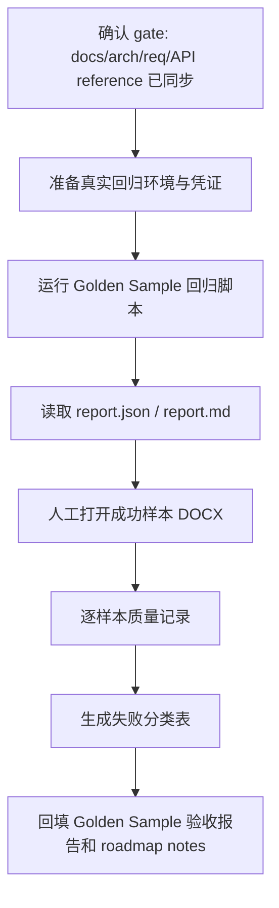

# golden-sample-live-regression-scale-up design

## 0. 术语与成功标准

术语：

- 真实回归：使用真实 API、Worker、MinerU 配置和正式 manifest PDF 运行 `scripts/ops/run_golden_sample_regression.py`，不是 dummy token inventory smoke。
- 失败分类：按报告中的 `status`、`failed_stage`、`error_code`、`error_message` 和人工质量项归类下一步进入 IR layout 还是 renderer 修复。
- 人工质量记录：对成功样本生成的 DOCX 打开并记录结构、表格、图片、可编辑性和明显版式/语义缺陷。
- 样本扩容缺口：当前 manifest 里仍缺的 8 个 PDF，以及为了达到 10-20 份目标还需要补哪些业务样本。

目标：把当前 4 个正式 OPA228 PDF 从“manifest-matched”推进到“真实链路已执行并可分类”，为后续 `document-ir-layout-risk-pass` 和 `word-renderer-editable-output-pass` 提供排序依据。

成功标准：

- 当前 4 个正式 PDF（`gs-003/004/006/008`）均被真实回归尝试执行，或每个未执行样本都有明确环境/凭证/服务阻塞原因。
- 回归报告回填 `docs/testing/pdf-to-word-golden-sample-acceptance-report.md`，区分主链路成功、失败 stage、DOCX 可打开和 P0 是否达标。
- 每个成功样本都有人工质量记录；至少覆盖 Word 可打开、可编辑性、标题/列表、表格、图片/figure、双栏或宽表顺序。
- 形成下一步分类表：哪些问题归 `document-ir-layout-risk-pass`，哪些归 `word-renderer-editable-output-pass`，哪些只是样本不足或环境问题。
- 不修改 DocumentIR / renderer / 前端 / 后端业务逻辑，不把质量修复塞进本 feature。

## 1. 决策与约束

现状：

- `tests/fixtures/golden_samples/manifest.yaml` 当前有 12 个样本，4 个 `source_status=available`：`gs-003`、`gs-004`、`gs-006`、`gs-008`。
- `docs/testing/pdf-to-word-golden-sample-acceptance-report.md` 显示 4 个正式匹配 PDF，但只有 `gs-003 / OPA228_P1.pdf` 跑过真实 hostdzire 主链路。
- `docs/testing/pdf-to-word-gs-003-quality-triage.md` 已证明 `gs-003` 主链路通过，但 P0 版面与语义质量未通过。
- `scripts/ops/run_golden_sample_regression.py` 已能登录、上传 PDF、创建 document job、轮询、下载 DOCX，并输出 `report.json` / `report.md`。
- 线上复跑不能假设部署容器内已有 `tests/fixtures/golden_samples/`；`.codestable/attention.md` 已记录这个运行注意事项。

变化：

- 把真实回归范围从 1 个样本扩到当前 4 个正式样本。
- 将“脚本报告”与“人工质量记录”组合为正式分类输入，不再只看 `succeeded/failed`。
- 对 10-20 样本目标做缺口清单：缺 PDF、缺真实链路执行、缺人工验收分别列清。
- 只产出报告、分类和后续 feature 输入，不做质量修复。

明确不做：

- 不修改 `scripts/ops/run_golden_sample_regression.py`，除非发现报告无法表达当前已存在字段；若需要改脚本，先回到 design review。
- 不修 DocumentIR layout、renderer、数学符号、表格 caption、双栏或列表语义。
- 不扩前端工作台、不改 API、不改部署配置。
- 不把 4 个样本成功声明为 P0 正式达标；正式目标仍是 10-20 份样本成功率 `>= 90%` 且人工质量通过。
- 不把凭证、token、客户文件正文或完整解析文本写入仓库。

复杂度档位：默认档位。本 feature 是回归执行与验收分类，不改变运行时合同。

## 2. 名词层与编排层

### 2.1 名词层

现状：

- `RegressionConfig`：读取 `GOLDEN_SAMPLE_BASE_URL`、账号/Token、manifest、runs_dir、timeout 等运行参数。
- `SampleResult`：记录单样本 status、job/file/result file、失败 stage/error、DOCX 路径和 `docx_openable`。
- `SampleInventory`：记录 manifest-matched、missing、orphan PDF。
- `docs/testing/pdf-to-word-gs-003-quality-triage.md`：当前唯一人工质量 triage 样例。

变化：

- 新增“分类表”作为本 feature 的验收产物概念，不新增代码类型：
  - `sample_id`
  - `chain_result`：真实链路成功 / 失败 / 未执行
  - `failure_bucket`：environment / upload / mineru / document_ir / renderer / download / manual_quality
  - `next_feature`：`document-ir-layout-risk-pass` / `word-renderer-editable-output-pass` / sample-sourcing / deploy-gate
  - `evidence`：run_dir、job_id、report、人工记录路径
- 人工质量记录可先沿用 `acceptance-record-template.md` 或现有 triage 文档格式；本 feature 不强制引入新 schema。

接口示例：

```text
gs-006 / OPA228_P6.pdf
  chain_result: succeeded
  docx_openable: true
  failure_bucket: manual_quality
  next_feature: word-renderer-editable-output-pass
  evidence: tests/tmp/golden_sample_runs/{timestamp}/report.md + docs/testing/{sample}-quality-triage.md
```

### 2.2 编排层



流程级约束：

- 真实回归失败也算有效结果，只要失败 stage 和原因可定位。
- 未执行样本不能静默跳过，必须在报告里写明阻塞条件。
- 人工质量结论不能由脚本自动推断；脚本只证明链路和 DOCX 包可打开。
- 后续 feature 选择以分类表为准，不凭单个 gs-003 的已知问题泛化全部修复。
- 所有凭证只通过环境变量或会话注入使用，不写进仓库文档。

### 2.3 挂载点

删掉本 feature 后应消失或回退的挂载点：

- `.codestable/features/2026-06-03-golden-sample-live-regression-scale-up/`
- `docs/testing/pdf-to-word-golden-sample-acceptance-report.md` 中本轮真实回归结果和分类结论。
- 每个新增样本质量 triage 文档或人工验收记录。
- `.codestable/roadmap/pdf-to-word-delivery-hardening/` 中该 roadmap item 的状态和 notes。

### 2.4 推进策略

1. 环境 gate 复核：确认 API/Worker/MinerU/账号条件，确认当前 4 个 PDF 与 manifest 对齐。
   - 退出信号：能说明每个样本将在哪个环境执行，或明确缺少哪个前置。
2. 真实回归执行：运行 Golden Sample 脚本，保留 `run_dir`、`report.json`、`report.md` 和下载的 DOCX。
   - 退出信号：4 个正式样本均有 succeeded/failed/未执行原因。
3. 人工质量记录：打开成功样本 DOCX，按样本 acceptance_focus 记录结构质量。
   - 退出信号：每个成功样本都有人工结论，且不把主链路通过等同于 P0 质量通过。
4. 失败分类与后续路由：汇总 chain failure、IR/layout 风险、renderer/editable 风险和样本缺口。
   - 退出信号：能明确下一步先做 IR layout 还是 renderer，或说明样本/环境仍阻塞。
5. 文档与 roadmap 回写：更新 Golden Sample 验收报告、roadmap notes 和 feature acceptance。
   - 退出信号：报告能被下一条 design 直接作为输入读取。

### 2.5 结构健康度与微重构

文件级：

- `scripts/ops/run_golden_sample_regression.py` 已承担配置、登录、上传、任务轮询、下载和报告生成。当前 feature 默认只运行脚本和回写报告，不改脚本。
- 若执行时发现分类字段缺失，优先通过人工分类表在文档中表达；只有脚本已有报告字段无法表达真实失败阶段时，才单独提出脚本改动并回到 design review。

目录级：

- `docs/testing/` 已有 Golden Sample report、gs-003 triage 和 P0 integration guide，继续放人工质量记录，不新建目录。
- `.codestable/features/` 按单 feature 目录落本轮 design / acceptance。

compound convention：`.codestable/compound/` 当前不存在，未发现可复用 convention。

结论：本次不做微重构。

## 3. 验收契约

- 触发：读取 `tests/fixtures/golden_samples/manifest.yaml`
  期望：`gs-003/004/006/008` 仍为当前正式 runnable 样本，缺失样本数量明确。
- 触发：运行真实 Golden Sample 回归
  期望：4 个正式样本均有执行结果，或逐样本记录未执行阻塞；报告不泄露凭证。
- 触发：打开每个成功样本 DOCX
  期望：人工记录 Word 可打开、可编辑性、标题/列表、表格、图片/figure、双栏/宽表顺序。
- 触发：生成分类表
  期望：每个失败或质量不通过项都能路由到 environment / sample-sourcing / document-ir-layout-risk-pass / word-renderer-editable-output-pass 之一。
- 触发：打开 Golden Sample 验收报告
  期望：当前状态不再只写 1/1 smoke，而是反映 4 个正式样本的最新执行和人工质量状态。
- 反向核对：不修改 DocumentIR、renderer、前端、后端 API 或部署配置。

## 4. 与项目级架构文档的关系

本 feature 不改变系统架构。它只验证并分类当前 `files -> document_jobs -> MinerU -> DocumentIR v2 -> Word renderer -> download-url` 主链路质量。

已完成的 design 前 gate：

- `.codestable/architecture/` 已补入 P0 document_jobs 主链路现状。
- `.codestable/requirements/` 已补入内部工作台和 Golden Sample 质量基线能力边界。
- `docs/api/files.md` 与 `docs/api/document-jobs.md` 已补齐 API 参考入口。
- `.codestable/attention.md` 已记录线上 Golden Sample 复跑和部署入口核对注意事项。

后续衔接：

- 若主要失败在 MinerU / 上传 / 下载 / 环境，先开 issue 或 deploy gate，不进入 layout/renderer 修复。
- 若失败集中在块顺序、双栏、bbox、quality flags，进入 `document-ir-layout-risk-pass`。
- 若 IR 输入可解释但 Word 结构差，进入 `word-renderer-editable-output-pass`。
