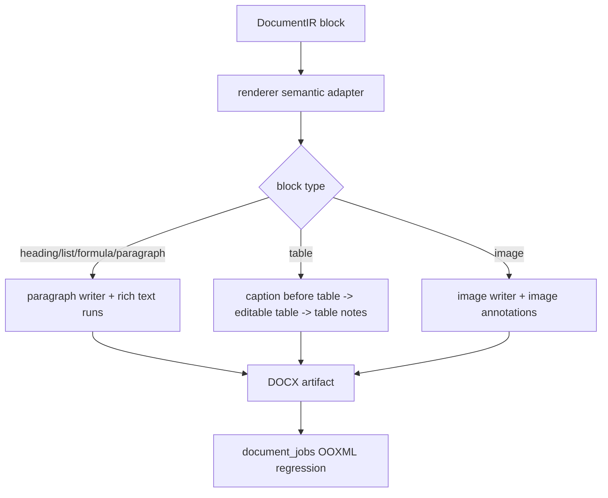

# word-renderer-editable-output-pass design

## 0. 术语与成功标准

术语：

- Editable output pass：只修 `DocumentIRWordRenderer` 生成 DOCX 的可编辑 Word 语义质量，包括命名样式、真实列表编号、公式/特殊符号 rich text、caption/table 顺序和表格文字样式；不等同于完整视觉还原。
- pipeline-parity-gap：`md2word_main` / `app/conversion/runtime` 已有部分策略，但线上 `document_jobs -> DocumentIR -> app/services/renderer` 链路没有接入。
- Word 语义证据：OOXML 中可观察的 `w:pStyle`、`w:numPr`、`w:vertAlign`、caption/table 顺序、table style / paragraph style，而不是只看 DOCX 可打开。
- legacy renderer strategy：`app/conversion/runtime/text_rendering.py`、`table_render_runtime.py`、`table_long_renderer.py` 中已经存在的 heading、list、formula、caption、TableContent / TableNote 等策略。

目标：把前一轮已经稳定下来的 DocumentIR layout facts 消费到 renderer 输出层，并优先补齐 4 个 Golden Sample 暴露的 heading/list/formula/caption/table 可编辑语义缺口。

成功标准：

- DocumentIR heading 渲染为真实 Word heading 或 configured named style，不再全部落成 `Normal`。
- DocumentIR list 渲染为真实 Word numbering，OOXML 有 `w:numPr`；手写 `• ` prefix 不能作为最终语义。
- formula / rich text 渲染会清理常见 TeX 残留，并保留下标、上标和 `√Hz`、`θ/ψ/µ/±/°C` 等符号语义。
- table captions 在表格前，table notes / footnotes 在表格后；caption `keep_with_next`，表格正文走 TableContent，表注走 TableNote 或等价配置。
- 新增或更新 document_jobs / DocumentIR renderer 回归，检查 OOXML 语义，不只测 legacy runtime sandbox。
- 不把本 feature 扩成完整视觉版面修复，也不声明 Golden Sample P0 正式通过。

## 1. 决策与约束

现状：

- `golden-sample-live-regression-scale-up` 已证明 `gs-003/004/006/008` 主链路 4/4 succeeded、DOCX 4/4 openable，但人工质量 0/4 P0 pass。
- `document-ir-layout-risk-pass` 已完成：DocumentIR v2 可以记录 page orientation、`column_hint`、wide table、caption/footnote binding、continuation 和 renderer layout flags。
- 当前主要缺口已经从 layout facts 转到 renderer 可编辑语义：heading 全为 `Normal`、Word numbering 为 0、LaTeX 残留、caption 在表格后、TableNote / TableContent 语义不足。
- `DocumentIRWordRenderer` 当前按 block type 分发，但 heading 只套直接格式，list 用 `prefix="• "`，formula 写原始 `latex/text`，table annotation 统一在表格后且 footnote 复用 caption style。
- `WordTextRendererMixin` 已支持基础 inline HTML、上标、下标、粗斜体和换行；这是迁移公式 rich text 的可用基础。
- `resources/template_configs/datasheet_template.yaml` 已有 `table_note` / `long_table_caption` 配置，但当前 `TemplateConfigPackage` 未承载 `table_note`，段落样式也没有 named style 字段。

变化：

- 先做 renderer parity mapping：只迁移 legacy runtime 中成熟、可被 DocumentIR 当前字段驱动的策略，不复制整套 `app/conversion/runtime`。
- 按 `.codestable/compound/2026-06-03-decision-md2word-main-layout-lab-to-document-ir-renderer-parity.md` 执行接入标准：`md2word_main` 是本地 layout lab，`md2word` 只接入稳定策略到 `DocumentIRWordRenderer` 生产链路。
- 在 renderer 侧补“语义写入”层：同一个 block type 先归一化文本和样式语义，再交给现有 paragraph/table/image writer。
- 模板配置保持向后兼容：允许 renderer 使用内建 Word style fallback，也允许配置显式提供 named style / table note 语义；旧 YAML 缺字段时仍可运行。
- document_jobs 回归必须通过生成的 Word artifact 取证，覆盖 heading style、`w:numPr`、LaTeX 残留、caption/table 顺序。

明确不做：

- 不改前端、不扩 HTTP API、不新增后台管理功能。
- 不改 Golden Sample manifest，不把 4 个样本声明为 P0 通过。
- 不重写整套版面算法；宽表/长表只消费已有 layout facts 做最小 renderer 输出质量改进。
- 不把 `app/conversion/runtime` 作为线上 API 的第二套大渲染入口；迁移策略应保持 renderer 边界清晰。
- 不处理扫描件 OCR、样本扩容或真实服务器部署动作。

复杂度档位：中等偏高。范围横跨 renderer text/table/template config 与 document_jobs 回归，但不改变对外 API 和持久化 job 合同。

## 2. 名词层与编排层

### 2.1 名词层

现状：

- `DocumentIRBlock` 已有 `type`、`text`、`level`、`latex`、`list_items`、`html`、`captions`、`footnotes` 和 v2 layout facts；本 feature 不需要新增内容块类型。
- `TemplateParagraphStyleConfig` 只有直接样式字段，例如 font、alignment、spacing、indent；没有 named Word paragraph style 字段。
- `TemplateConfigPackage` 有 `heading1/2/3`、`normal`、`table_content`、`caption`；没有 `table_note`，因此表注无法和 caption 区分。
- Word 输出语义当前隐含在 renderer 分支里，没有独立的“heading/list/formula/caption/table semantics”概念。

变化：

- 引入 renderer 语义配置概念：
  - heading semantic style：level 1-3 映射到 `Heading 1/2/3` 或配置指定的 named style，并继续保留直接格式覆盖。
  - list semantic style：list item 先去除 MinerU marker，再写入共享 bullet numbering definition。
  - formula semantic text：`latex/text` 先经过 TeX / symbol normalization，再通过现有 inline rich text 写 run。
  - table annotation semantic：caption 与 footnote/table note 分开渲染，caption 可 `keep_with_next`。
  - table content semantic：表格单元格使用 TableContent 配置；header 可继续走 table style header fill / bold 语义。
- 模板配置扩展必须是可选字段；旧配置缺失时 fallback 到现有 `normal/caption/table_content` 与内建 Word style。

示例输入与期望输出：

```text
DocumentIRBlock(type="heading", level=2, text="6.5 Thermal Information")
-> paragraph text = "6.5 Thermal Information"
-> OOXML w:pStyle = "Heading2" 或配置指定的 Heading 2 样式

DocumentIRBlock(type="list", list_items=["• Low noise", "- Stable supply"])
-> 两个 paragraph 均带 w:numPr
-> paragraph visible text 不包含手写项目符号前缀

DocumentIRBlock(type="formula", latex="$R_{\\theta JA}$, $-40^{\\circ}C$")
-> visible text 包含 RθJA / -40°C 等归一化结果
-> 下标/上标能用 w:vertAlign 表达时使用 rich text run
```

### 2.2 编排层



现状：

- `render_to_bytes()` 构造 document、加载 template config、建立 layout plan，再逐 block 调 `_render_block()`。
- `_render_block()` 直接按 block type 写 Word，没有统一的语义归一化节点。
- `_fill_paragraph()` 能写 rich text，但调用方没有在 formula/list/heading 前做 legacy parity normalization。
- `_render_table()` 先写 table，再统一调用 `_render_block_annotations()`，导致 caption 在表格后。

变化：

- `_render_block()` 的职责收敛为分发；具体语义由 text/table mixin 或小型 semantic helper 承担。
- heading 流程：block level -> named heading style -> direct style -> rich text。
- list 流程：list item marker normalization -> paragraph numbering definition -> rich text。
- formula 流程：raw latex/text -> formula normalization -> inline HTML/rich text -> paragraph。
- table 流程：dedupe captions -> caption paragraphs before table with `keep_with_next` -> editable table -> dedupe footnotes as TableNote after table。
- document_jobs 回归流程：fake MinerU / DocumentIR 生成 Word artifact -> 读取 `word/document.xml` 和 `word/numbering.xml` -> 断言语义。

流程级约束：

- 缺少配置时 fallback 必须稳定：不能因为模板没有 named style 或 table_note 字段导致任务失败。
- v1 fallback 仍按顺序渲染；只是渲染语义变好，不改变 `DocumentIR` 合同。
- semantic helper 不保存客户正文诊断到 artifact metadata；验收取证只在测试里读取 DOCX 包。
- 若某个 legacy 策略依赖 `app/conversion/runtime` 的 page/block 私有结构，不能硬搬；只能迁移与 DocumentIR 字段匹配的稳定策略。
- 宽表/长表只处理与可编辑输出直接相关的表格样式、caption/note 和已有 continuation/header 语义，不在 renderer 中凭空猜新 layout facts。

### 2.3 挂载点

删掉本 feature 后应消失或回退的挂载点：

- `.codestable/features/2026-06-03-word-renderer-editable-output-pass/`
- renderer heading/list/formula/table annotation semantic 写入逻辑。
- 模板配置中可选的 named style / table note 语义承载。
- DocumentIR renderer / document_jobs OOXML 语义回归。
- roadmap / architecture / requirement 中关于 renderer editable output 已接入的状态回写。

不作为挂载点：

- `app/conversion/runtime` legacy 本体；它是策略来源，不是本 feature 的新运行入口。
- Golden Sample PDF 与 manifest；本 feature 不扩样本。
- 前端工作台和 HTTP API；本 feature 不改变用户创建 job 的方式。

### 2.4 推进策略

1. renderer parity mapping：对照 failure classification、manual records 和 legacy runtime，落一份策略映射证据。
   - 退出信号：heading/list/formula/caption/table 每类都标明“layout lab 证据 / 直接迁移 / 局部迁移 / 暂不迁移”的理由。
2. text semantic pass：补 heading named style、真实 list numbering、formula normalization 和 rich text 输出。
   - 退出信号：DocumentIR renderer 单元回归能检查 `w:pStyle`、`w:numPr`、`w:vertAlign` 与常见 LaTeX 残留清理。
3. table annotation / table content pass：补 caption-before-table、TableNote、TableContent 与 header/cell editable style 语义。
   - 退出信号：表格回归能检查 caption 在 table 前、note 在 table 后、caption `keep_with_next`、表格仍保留 rowspan/colspan。
4. document_jobs regression pass：用主链路测试生成 Word artifact 并检查 OOXML。
   - 退出信号：至少覆盖 `gs-004` heading + numbering、`gs-006` caption-before-table + formula clean、`gs-008` wide table/table style + formula clean 的近似 fixture。
5. 文档与 roadmap 回写：acceptance 后同步 architecture / requirement / roadmap。
   - 退出信号：当前实现边界写清楚，剩余 Golden Sample blocked 项不被误标为通过。

### 2.5 结构健康度与微重构

文件级：

- `app/services/renderer/word_renderer.py` 当前是门面 + block 分发。它不应继续承载大段公式归一化或 numbering OOXML 细节；实现时应把新增计算放到 text/table helper 或小型 semantic helper。
- `app/services/renderer/text_renderer.py` 已专职 paragraph/run 样式与 inline HTML，可承载 heading/list/formula 的调用级 helper；若公式 normalization 代码量接近 legacy 规模，应拆到独立 helper，避免 text renderer 变成混合工具箱。
- `app/services/renderer/table_renderer.py` 已专职 HTML table 与 annotation，适合调整 caption/note 顺序和表格文字样式；不应引入 page layout 推断。
- `app/services/renderer/template_config.py` 较小，适合承载少量可选样式字段；扩展必须保持 `extra="ignore"` 的向后兼容。
- `tests/test_fastapi_jobs_backend.py` 已很大；document_jobs OOXML 语义回归如不依赖大型 fixture，优先新建聚焦测试文件。

目录级：

- `app/services/renderer/` 目录边界清晰，本次不做目录重组。
- `.codestable/compound/` 当前没有可用的目录组织 convention；本次不新增长期 convention。

结论：本次不做前置微重构。实现阶段可以新增小型 renderer semantic helper，但必须围绕 heading/list/formula/table annotation 的稳定语义，不做行为无关拆分。

超出范围的观察：

- TOC leader、页码对齐和完整目录域不是本 feature 的 P0 验收点；`gs-004` 只要求 heading/list 语义先正确。
- 宽表完整 landscape section 和跨页视觉还原可能仍需后续版面 feature；本 feature 只消费已有 layout facts 做可编辑输出改进。

## 3. 验收契约

- 触发：DocumentIR renderer 渲染 heading block  
  期望：生成段落带 `Heading 1/2/3` 或配置指定 named style；人工质量记录中的“所有样式均为 Normal”不再适用于覆盖 fixture。
- 触发：DocumentIR renderer 渲染 list block  
  期望：生成段落带 `w:numPr`；可见文本不依赖手写 `• ` prefix。
- 触发：DocumentIR renderer 渲染 formula block 或含 TeX 的 table cell  
  期望：常见 `$...$`、`\sqrt`、`\mu`、`^{\circ}`、`R_{\theta JA}` 这类残留被归一化；能表达上下标时 OOXML 有 `w:vertAlign`。
- 触发：DocumentIR renderer 渲染含 captions / footnotes 的 table block  
  期望：caption 段落在 table XML 前，table note / footnote 段落在 table XML 后；caption 设置 `keep_with_next`；table 仍是可编辑 Word table。
- 触发：document_jobs eager worker 处理含 heading/list/formula/table 的 fake MinerU / DocumentIR fixture  
  期望：任务 succeeded，generated Word artifact 可打开，OOXML 语义断言通过。
- 反向核对：不改前端，不扩 API，不改 Golden Sample manifest，不把 TOC leader、完整 landscape 版面或 10-20 样本扩容算入本 feature 通过条件。

## 4. 与项目级架构文档的关系

本 feature 改变 `DocumentIRWordRenderer` 的输出质量现状，但不改变 HTTP API 表面或 DocumentIR block 类型。acceptance 阶段应更新：

- `.codestable/architecture/ARCHITECTURE.md`
  - 把 renderer editable output 从 blocked 缺口更新为当前已接入范围，并保留未解决的 Golden Sample 质量边界。
- `.codestable/architecture/backend-fastapi-service.md`
  - 更新 `document_jobs -> DocumentIR -> generated Word` 主链路的 renderer 语义能力描述。
- `.codestable/requirements/fastapi-backend-productization.md`
  - 更新 Golden Sample blocked 边界：主链路仍可交付，renderer 可编辑语义已推进，但正式 P0 仍受样本规模和人工质量约束。
- `.codestable/roadmap/pdf-to-word-delivery-hardening/`
  - acceptance 通过后再把 `word-renderer-editable-output-pass` 从 `in-progress` 回写为 `done`。

后续衔接：

- 若本 feature 通过，下一轮应回到 Golden Sample live regression，复跑 4 个样本观察人工质量是否从 0/4 P0 pass 提升。
- 若仍有视觉版面问题，应按真实复跑证据拆分为 table layout / TOC layout / sample expansion，而不是继续笼统归 renderer parity。
