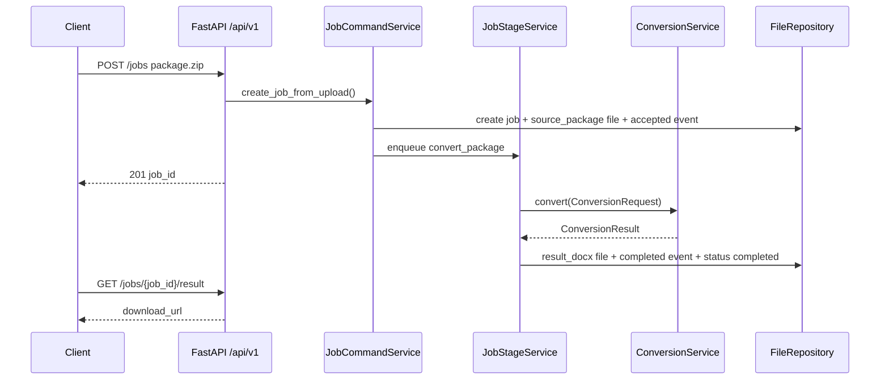

# md2word_file FastAPI 后端架构设计说明

## 1. 项目背景

当前 `md2word_file` 是一个本地转换工具：输入 MinerU 结构化输出目录或 zip，读取 `content_list_v2.json` / `content_list.json` 和可选 `middle.json`，经过页面修补、可选 LLM 英译中、模板/YAML 渲染配置和 Word 版式编排，输出单个 `.docx`。现状已经从单脚本拆成多个 runtime 模块，但入口仍以 CLI / PyCharm 配置为主，缺少稳定 HTTP API、任务状态、产物下载、后台执行和运行时观测。

参考项目 `/Users/sc/PycharmProjects/create_pdf` 已经把类似文档转换链路产品化为 `FastAPI + BackgroundTasks + Repository + Conversion Library` 的后端服务。它的文档中最值得复用的后端口径包括：

- API 层固定挂载 `/api/v1`，路由只做 HTTP adapter、参数校验和依赖注入。
- 长耗时任务通过 jobs 模型承载，响应返回后交给 `BackgroundTasks` 推进。
- 任务、事件、文件产物通过 repository 边界持久化；对外只暴露 `download_url/public_url/storage_backend/object_key` 这类交付字段，不暴露本地绝对路径。
- `/health/live` 和 `/health/ready` 分开，readiness 返回依赖和初始化状态。
- 运行时日志分 `access/business/system`，业务日志必须带 `trace_id/job_id/stage/status` 这类上下文。
- 初始化和运行态文件显式化：版本化资产留在 `template/`、`template_configs/`、`prompt/`，运行态产物落到 `data/`。

本设计不是把 `create_pdf` 整体搬进本项目，而是按当前 `md2word_file` 的真实输入协议重新设计后端。第一阶段不默认接入“PDF 上传 -> 在线 MinerU 解析”能力；本项目的最小闭环是“上传 MinerU 结果 zip -> 后台转换 -> 下载 DOCX”。

## 2. 项目目标

### 2.1 总目标

把当前 CLI 工具改造为可本地部署、可前端联调、可被后续 AI 稳定扩展的 FastAPI 后端项目，同时保留现有转换核心行为。

### 2.2 具体目标

1. 提供 `/api/v1/jobs` 任务 API，支持上传 MinerU 结果 zip、查询状态、查看事件、列出产物和下载 DOCX。
2. 把当前转换链路封装为服务内 conversion library，避免 API 层直接调用 CLI/PyCharm 配置。
3. 建立 file repository 作为第一阶段持久化后端，记录 job、job_files、job_events 和 stage spool。
4. 支持 `translation_mode=direct/en2zh`，沿用当前 `translation_runtime.py` 和 `llm_client.py` 的能力。
5. 暴露 health readiness，直接检查数据目录、模板文件、样式 YAML、术语 YAML、LLM 配置等依赖状态。
6. 建立日志、错误码、目录结构、测试和文档口径，给后续 AI 开发提供稳定边界。

### 2.3 非目标

- 第一阶段不实现 PDF 直接上传到 MinerU 云端解析；如果后续需要，应单开 `pdf-mineru-ingestion` roadmap 或 feature。
- 第一阶段不强制引入 MySQL、Redis、Celery、OSS 或多 worker 部署。
- 第一阶段不做前端页面，只提供可供前端使用的 API 合同。
- 第一阶段不把术语规则和模板管理做成完整后台 CRUD；先保留版本化文件真源，后续再扩展管理 API。
- 不重写转换算法；FastAPI 化的首要目标是服务边界和任务编排，不是改变 DOCX 版式策略。

## 3. 需求概述

### 3.1 用户侧能力

- 用户上传一个 MinerU 输出 zip，选择模板和转换模式，拿到 `job_id`。
- 用户轮询任务状态，看到转换进度、错误信息和事件。
- 用户在任务完成后下载最终 DOCX。
- 用户可查看中间产物描述，例如原始输入包、可选翻译请求 JSON、输出 DOCX。
- 运维或开发者可通过 health 和事件判断失败发生在输入解析、翻译、渲染还是文件写出阶段。

### 3.2 管理侧能力

- 管理员可重试失败任务、取消任务、清理已完成任务的本地运行态文件。
- 管理员可查看模板和渲染配置当前是否存在、是否可读。
- 管理员可通过日志和 job events 定位具体 `job_id` 的处理过程。

### 3.3 系统侧约束

- 上传 zip 必须做大小限制、扩展名校验、安全解压，禁止路径穿越。
- 本地绝对路径不作为 API 稳定合同返回；对外使用 job 内逻辑路径和下载接口。
- 长耗时转换不在请求线程内同步完成；创建任务接口只负责接收和入队。
- 任务执行必须幂等到“重复 stage 不破坏已完成产物”的程度。
- `direct` 和 `en2zh` 必须复用同一套渲染链路；翻译只改变内存中的页面块文本。

## 4. 设计原则

- **先最小闭环，再扩展管理面**：第一条闭环必须能从 zip 上传走到 DOCX 下载，模板 CRUD、术语规则 CRUD、PDF 直传 MinerU 都后置。
- **API 层薄，业务编排下沉**：router 不直接解析 MinerU JSON，不直接写 Word，不直接拼本地路径。
- **转换核心库化**：现有 `run_conversion()` 要拆出服务可调用的 conversion entrypoint，CLI 只是调用方之一。
- **运行态和版本化资产分离**：`template/`、`template_configs/`、`prompt/` 是版本化资产；`data/jobs/`、`data/stage_messages/`、`logs/` 是运行态产物。
- **file backend 先行，repository 边界预留**：第一阶段只实现 file repository，但接口按 repository protocol 设计，后续可加 SQLite/MySQL。
- **产物合同稳定**：API 返回 `file_type/path/storage_backend/download_url`，不返回可被误用的本地绝对路径。
- **显式配置和健康检查**：缺模板、缺 YAML、缺 LLM key、数据目录不可写都应在 `/health/ready` 中可见。
- **错误可定位**：每次状态推进写 job event；异常要归一成 `error_code/error_message`。

## 5. 技术栈

| 类别 | 选择 | 说明 |
|---|---|---|
| Web 框架 | FastAPI | 复用 `create_pdf` 的成熟后端口径，适合 Pydantic schema 和 OpenAPI |
| ASGI 服务器 | Uvicorn | 本地和单进程部署足够，后续再评估 gunicorn |
| 配置 | pydantic-settings | 替代散落的 `.env` 读取，保留当前 `OPENAI_*` 兼容 |
| 后台执行 | FastAPI BackgroundTasks + file stage spool | 第一阶段不引入 Redis/Celery；进程重启可 replay 未完成 stage |
| 持久化 | file repository | `data/jobs/{job_id}/job.json`、`events.jsonl`、`files.json` |
| 转换核心 | 现有 python-docx / PyYAML / BeautifulSoup / OpenAI SDK | 不重写核心算法 |
| 日志 | Python logging 或 loguru 包装后的三通道 | 推荐尽早固定 `access/business/system` 语义 |
| 测试 | pytest + FastAPI TestClient + 对象级 characterization | 先覆盖 API contract、repository、stage、conversion adapter |
| 部署 | 本地 uvicorn，后续 Docker | 第一阶段先不强制容器化 |

## 6. 模块拆分（概设）

```
fastapi-backend
├── app/main.py：FastAPI app、lifespan、中间件、router 挂载
├── app/api/v1/：HTTP adapter 层
├── app/schemas/：请求/响应合同
├── app/core/：配置、日志、路径、job/template 模型
├── app/repositories/：file repository 与协议
├── app/services/jobs/：任务命令、查询、stage、artifact、lifecycle
├── app/conversion/：服务内转换库入口，包住现有 runtime 模块
├── app/services/templates/：模板和渲染配置只读服务
├── app/services/health.py：依赖探针和 readiness
└── data/：运行态 jobs、stage spool、日志和临时解压目录
```

### 6.1 API 层

- **职责**：解析 HTTP 请求、调用 service、返回 schema、处理鉴权依赖。
- **不承担**：不读写 MinerU JSON，不拼输出 DOCX，不直接操作 `data/jobs` 文件。
- **承载的子 feature**：`backend-minimal-direct-conversion`、`template-config-read-api`、`admin-ops-and-events`。

### 6.2 Jobs 服务层

- **职责**：创建任务、调度 stage、推进状态、记录事件、处理重试/取消/清理。
- **不承担**：不关心 HTTP multipart 细节，不实现底层 Word 渲染算法。
- **承载的子 feature**：`backend-minimal-direct-conversion`、`job-artifact-contract`、`admin-ops-and-events`。

### 6.3 Conversion Library

- **职责**：提供服务可调用的稳定入口，把 MinerU package 转为 DOCX 和可选翻译产物。
- **不承担**：不读取 FastAPI Request，不写 job 状态，不决定 HTTP 响应。
- **承载的子 feature**：`conversion-library-boundary`、`translation-en2zh-api`。

### 6.4 Repository

- **职责**：持久化 job、event、file、stage message，提供查询和更新接口。
- **不承担**：不做业务决策，不调用 conversion。
- **承载的子 feature**：`backend-minimal-direct-conversion`、`job-artifact-contract`。

### 6.5 Runtime / Ops

- **职责**：配置、health、日志、初始化、目录检查、可观测性。
- **不承担**：不隐式创建业务数据，不在 app startup 里偷偷跑转换。
- **承载的子 feature**：`runtime-observability-and-docs`。

## 7. 模块间接口契约 / 共享协议

### 7.1 HTTP API 合同

#### Health

```
GET /api/v1/health/live
Response: { status: "ok", app_name: "md2word_file" }

GET /api/v1/health/ready
Response:
{
  status: "ok",
  app_name: "md2word_file",
  jobs_dir: "data/jobs",
  dependency_checks: {
    jobs_dir_exists: bool,
    jobs_dir_writable: bool,
    stage_spool_dir_exists: bool,
    template_docx_exists: bool,
    layout_config_exists: bool,
    subscript_config_exists: bool,
    openai_api_key_configured: bool,
    translation_available: bool,
    deployment_init_ready: bool,
    deployment_init_missing_steps: list[str]
  }
}

GET /api/v1/health
兼容入口，语义等同 /ready。
```

#### Jobs

```
POST /api/v1/jobs
Content-Type: multipart/form-data
Form:
  package: file              # MinerU 输出 zip，必填
  template_id: str | null
  translation_mode: "direct" | "en2zh" = "direct"
  document_language: "auto" | "zh" | "en" = "auto"
  use_mineru_header_footer: bool = false

201 Response:
{
  job_id: str,
  trace_id: str,
  status: "uploaded",
  translation_mode: "direct" | "en2zh"
}
```

```
GET /api/v1/jobs?page=1&page_size=20&status=&q=&sort=created_at_desc
Response:
{
  items: JobSummary[],
  page: int,
  page_size: int,
  total: int,
  summary: { uploaded: int, queued: int, converting: int, completed: int, failed: int, canceled: int }
}
```

```
GET /api/v1/jobs/{job_id}
Response: JobDetail

GET /api/v1/jobs/{job_id}/files
Response: { job_id: str, files: JobFile[] }

GET /api/v1/jobs/{job_id}/result
Response: JobFile for result docx
错误：404 job_not_found / 409 result_not_ready

GET /api/v1/jobs/{job_id}/events
Response: { job_id: str, items: JobEvent[] }

GET /api/v1/jobs/{job_id}/download/{artifact_alias}
artifact_alias: source-package | translation-request | result
```

#### Admin Jobs

```
POST /api/v1/jobs/{job_id}/retry
Header: X-Admin-Token
Body: { reason: str }
Response: { job_id: str, operation: "retry", accepted: true, status: str }

POST /api/v1/jobs/{job_id}/cancel
Body: { reason: str }
Response: JobDetail

POST /api/v1/jobs/{job_id}/cleanup-local-files
Header: X-Admin-Token
Body: { reason: str }
Response: { job_id: str, deleted_paths: list[str], skipped_paths: list[dict], status: str }
```

### 7.2 内部服务接口

```python
class JobCommandService:
    def create_job_from_upload(
        self,
        upload: UploadedPackage,
        options: ConversionOptions,
        trace_id: str,
    ) -> JobCreated

    def retry_job(self, job_id: str, reason: str, trace_id: str) -> JobOperationAccepted
    def cancel_job(self, job_id: str, reason: str, trace_id: str) -> JobDetail


class JobStageService:
    def enqueue(self, message: JobStageMessage) -> None
    def dispatch(self, message: JobStageMessage) -> None
    def replay_pending(self) -> ReplayResult


class ConversionService:
    def convert(self, request: ConversionRequest) -> ConversionResult
```

```python
@dataclass
class ConversionRequest:
    job_id: str
    package_path: Path
    output_path: Path
    template_path: Path | None
    subscript_config_path: Path | None
    translation_mode: Literal["direct", "en2zh"]
    document_language: Literal["auto", "zh", "en"]
    use_mineru_header_footer: bool
    translation_request_output: Path | None = None


@dataclass
class ConversionResult:
    source_path: Path
    output_docx_path: Path
    pages: int
    document_language: Literal["zh", "en"]
    artifacts: list[ArtifactDescriptor]
```

### 7.3 Repository 协议

```python
class JobRepository(Protocol):
    def create_job(self, job: JobRecord) -> None: ...
    def get_job(self, job_id: str) -> JobRecord | None: ...
    def list_jobs(self, query: JobListQuery) -> Page[JobRecord]: ...
    def update_job(self, job_id: str, patch: JobPatch) -> JobRecord: ...
    def append_event(self, job_id: str, event: JobEvent) -> None: ...
    def list_events(self, job_id: str) -> list[JobEvent]: ...
    def upsert_file(self, job_id: str, file: JobFile) -> None: ...
    def list_files(self, job_id: str) -> list[JobFile]: ...


class StageMessageRepository(Protocol):
    def put(self, message: JobStageMessage) -> None: ...
    def mark_done(self, message_id: str) -> None: ...
    def list_pending(self) -> list[JobStageMessage]: ...
```

### 7.4 共享数据结构

```python
JobStatus = Literal["uploaded", "queued", "converting", "completed", "failed", "canceled"]
JobStage = Literal["convert_package", "retry_convert", "cleanup_local_files"]

class JobRecord(BaseModel):
    id: str
    source_filename: str
    status: JobStatus
    progress: int
    translation_mode: Literal["direct", "en2zh"]
    document_language: Literal["auto", "zh", "en"]
    resolved_document_language: Literal["zh", "en"] | None
    template_id: str | None
    error_code: str | None
    error_message: str | None
    created_at: datetime
    updated_at: datetime
    started_at: datetime | None
    completed_at: datetime | None

class JobFile(BaseModel):
    file_type: Literal["source_package", "translation_request", "result_docx", "log"]
    path: str                       # job 内逻辑路径，不是绝对路径
    storage_backend: Literal["local"]
    object_key: str | None = None
    public_url: str | None = None
    download_url: str | None = None # query 层派生
    created_at: datetime

class JobEvent(BaseModel):
    stage: str
    message: str
    status: Literal["accepted", "running", "succeeded", "failed", "skipped"]
    error_code: str | None
    details: dict[str, Any]
    trace_id: str
    created_at: datetime
```

## 8. 业务流程

### 8.1 最小闭环流程



### 8.2 `en2zh` 翻译流程

1. stage 进入 `converting`。
2. conversion 读取 MinerU pages。
3. `translation_mode=en2zh` 时构造翻译 payload。
4. 如果启用直接 LLM 调用，调用 OpenAI 兼容接口并回填译文。
5. 若后续需要“只导出请求不调用 LLM”，应把现有 `translation_request_output` 行为先修正为真正可配置的离线模式。
6. 使用译后 pages 进入同一套 DOCX 渲染链。

### 8.3 失败流程

| 失败点 | Job 状态 | error_code | 恢复方式 |
|---|---|---|---|
| zip 非法或路径穿越 | 创建失败 | invalid_package | 用户重新上传 |
| 缺 content list | failed | missing_content_list | 用户重新上传正确 MinerU 包 |
| 模板不存在 | failed | template_not_found | 修复配置后 retry |
| LLM 配置缺失 | failed | translation_unavailable | 补 `.env` 后 retry，或改 direct |
| DOCX 写出失败 | failed | docx_save_failed | 检查 data 目录权限后 retry |

## 9. 数据与目录设计

### 9.1 运行态目录

```
data/
├── jobs/
│   └── {job_id}/
│       ├── job.json
│       ├── events.jsonl
│       ├── files.json
│       ├── input/source.zip
│       ├── work/                 # 解压和转换工作目录
│       ├── output/result.docx
│       └── translation/request.json
├── stage_messages/
│   └── {message_id}.json
└── tmp/
```

### 9.2 版本化资产

```
template/datasheet_template.docx
template_configs/datasheet_template.yaml
template_configs/subscripts_dictionary.yaml
prompt/translation_en2zh.md
```

这些文件仍作为第一阶段真源，不在 startup 时复制到 `data/`。如后续要做后台管理，再单开 feature 定义 seed、真源和 runtime 投影。

## 10. 安全与权限

| 风险面 | 设计要求 |
|---|---|
| 上传文件 | 限制扩展名 `.zip`，限制大小，保存到 job 专属目录 |
| zip 解压 | 必须使用 safe extraction，禁止绝对路径和 `..` 路径穿越 |
| 下载接口 | 只能下载已登记的 `JobFile`，不能按任意 path 读取 |
| 本地路径 | API 不返回本地绝对路径 |
| 管理接口 | `X-Admin-Token`，未配置时管理接口返回 `503` |
| CORS | 通过 `APP_CORS_ORIGINS` 明确配置，不默认 `*` |
| 日志 | 不记录 API key、完整上传 body、LLM 密钥 |

## 11. 配置与环境变量

| 变量 | 默认值 | 说明 |
|---|---|---|
| `APP_NAME` | `md2word_file` | health 和日志使用 |
| `APP_ENV` | `dev` | 控制日志细节 |
| `APP_CORS_ORIGINS` | `http://127.0.0.1:3000,http://localhost:3000` | CORS 白名单 |
| `DATA_DIR` | `data` | 运行态根目录 |
| `JOBS_UPLOAD_MAX_BYTES` | `52428800` | 上传 zip 最大字节数 |
| `JOBS_ACCESS_MODE` | `open` | `open/token/admin` |
| `JOBS_ACCESS_TOKEN` | 空 | token 模式使用 |
| `ADMIN_TOKEN` | 空 | 管理接口使用 |
| `DEFAULT_TRANSLATION_MODE` | `direct` | 默认转换模式 |
| `OPENAI_BASE_URL` | 空 | 兼容当前 LLM 配置 |
| `OPENAI_API_KEY` | 空 | 兼容当前 LLM 配置 |
| `OPENAI_MODEL` | `deepseek-v4-flash` | 兼容当前 LLM 配置 |
| `TRANSLATION_MAX_PAGES` | `20` | 沿用当前配置 |
| `TRANSLATION_MAX_CHARS` | `60000` | 沿用当前配置 |

## 12. 可观测性

### 12.1 日志通道

- `access`：请求方法、路径、状态码、耗时、trace id。
- `business`：job 状态推进、stage 开始/结束、转换结果、错误码；必须绑定 `trace_id/job_id/stage/status`。
- `system`：第三方库、无 job 上下文的内部日志、启动信息。

### 12.2 Job Events

每个 stage 至少写入：

- `job_created`
- `stage_enqueued`
- `conversion_started`
- `translation_started` / `translation_skipped`
- `docx_rendered`
- `job_completed`
- `job_failed`

## 13. 测试与验收

### 13.1 自动化测试

| 测试 | 覆盖点 |
|---|---|
| `tests/object/test_health_contract.py` | live/ready 字段、缺依赖提示 |
| `tests/object/test_file_job_repository.py` | job/event/file/stage 持久化 |
| `tests/object/test_jobs_api_contract.py` | 创建、查询、文件、result、下载错误 |
| `tests/object/test_conversion_service.py` | ConversionRequest 到现有转换链的适配 |
| `tests/object/test_safe_zip_extraction.py` | zip 路径穿越防护 |
| `tests/object/test_translation_mode_contract.py` | direct/en2zh 分支和缺配置错误 |

### 13.2 手动验证

```bash
/Users/sc/miniconda3/envs/md2word/bin/python -m uvicorn app.main:app --host 127.0.0.1 --port 8000
curl http://127.0.0.1:8000/api/v1/health/ready
curl -X POST "http://127.0.0.1:8000/api/v1/jobs" -F "package=@/path/to/mineru-output.zip" -F "translation_mode=direct"
curl "http://127.0.0.1:8000/api/v1/jobs/{job_id}"
curl -L "http://127.0.0.1:8000/api/v1/jobs/{job_id}/download/result" -o result.docx
```

### 13.3 验收标准

- 不启用 LLM 时，`direct` 模式可从合法 MinerU zip 生成 DOCX。
- `GET /jobs/{job_id}` 能看到状态和错误；失败任务有明确 `error_code`。
- 下载接口只能访问已登记产物，不能读取任意本地路径。
- `/health/ready` 能显示模板、YAML、data 目录和 LLM 配置状态。
- 现有 CLI 转换能力不被破坏。

## 14. 子 feature 清单

1. **backend-minimal-direct-conversion** — 建立 FastAPI app、file job repository、上传 MinerU zip 后台直出 DOCX 的最小闭环。
   - 所属模块：API / Jobs / Repository / Conversion
   - 依赖：无
   - 状态：done
   - 对应 feature：未启动（直接在当前仓库落地）

2. **conversion-library-boundary** — 把当前 `run_conversion()` 拆成服务可调用的 conversion entrypoint，同时保留 CLI。
   - 所属模块：Conversion Library
   - 依赖：backend-minimal-direct-conversion
   - 状态：done
   - 对应 feature：未启动（直接在当前仓库落地）

3. **job-artifact-contract** — 固定 `JobFile`、下载接口、逻辑路径和本地路径隔离合同。
   - 所属模块：Jobs / Artifacts / Repository
   - 依赖：backend-minimal-direct-conversion
   - 状态：done
   - 对应 feature：未启动（直接在当前仓库落地）

4. **translation-en2zh-api** — 接入 `translation_mode=en2zh`，处理 LLM 配置、翻译请求产物和翻译失败事件。
   - 所属模块：Translation / Jobs / Conversion
   - 依赖：conversion-library-boundary, job-artifact-contract
   - 状态：done
   - 对应 feature：未启动（直接在当前仓库落地）

5. **template-config-read-api** — 提供模板和渲染配置只读 API，暴露默认模板、样式 YAML、术语 YAML 的存在性和版本信息。
   - 所属模块：Templates / Health
   - 依赖：backend-minimal-direct-conversion
   - 状态：done
   - 对应 feature：未启动（直接在当前仓库落地）

6. **admin-ops-and-events** — 补齐 retry、cancel、cleanup-local-files、events 查询和 admin token 保护。
   - 所属模块：Jobs / Admin / Observability
   - 依赖：job-artifact-contract
   - 状态：done
   - 对应 feature：未启动（直接在当前仓库落地）

7. **runtime-observability-and-docs** — 固定三层日志、health readiness、运行文档、API manifest 和本地启动说明。
   - 所属模块：Runtime / Docs
   - 依赖：backend-minimal-direct-conversion
   - 状态：done
   - 对应 feature：未启动（直接在当前仓库落地）

8. **pdf-mineru-ingestion-spike** — 调研是否把 PDF 上传和在线 MinerU 解析纳入本项目后端。
   - 所属模块：Future / MinerU Client
   - 依赖：backend-minimal-direct-conversion
   - 状态：done
   - 对应 feature：未启动
   - 备注：结论见 `.codestable/roadmap/fastapi-backend/drafts/pdf-mineru-ingestion-spike.md`；建议另开新 roadmap / feature，而不是继续叠加到当前 roadmap。

**最小闭环**：第 1 条 `backend-minimal-direct-conversion` 完成后，用户可以上传一个 MinerU 输出 zip，后台转换并下载 DOCX。

## 15. 排期思路

本 roadmap 已按既定顺序完成：先跑通 `backend-minimal-direct-conversion`，再固化 conversion 与 artifact 边界，随后补翻译、模板只读、运维动作和 observability。`pdf-mineru-ingestion-spike` 的结论是：PDF 直传 MinerU 应拆成独立新 roadmap / feature，不继续叠加在这一期产品化工作上。

## 16. 观察项

- 当前 `translation_request_output` 帮助文案和行为不一致：文案说只导出请求并退出，代码实际会继续调用 LLM。进入后端前建议先作为 issue 修正。
- 当前项目没有 `pyproject.toml` / `requirements.txt`；FastAPI 化时需要补依赖声明。
- 当前 runtime 模块通过 `bind_runtime()` 反查主模块对象，服务化后应逐步收敛为显式参数和 dataclass 合同。
- 如果后续决定支持 PDF 直传 MinerU，需要重新引入 MinerU client、callback、安全验签、结果 zip 白名单和恢复链路；这应作为新 roadmap 独立推进。

## 17. 变更日志

- 2026-05-18：基于 `create_pdf/docs` 和当前 `md2word_file` 架构现状起草 FastAPI 后端 roadmap 初版。
- 2026-05-18：完成最小后端产品化链路、conversion 边界、artifact 合同、`en2zh`、模板只读、运维动作和 observability 文档。
- 2026-05-18：完成 `pdf-mineru-ingestion-spike`，结论是如需推进 PDF 直传 MinerU，应单独开启新 roadmap / feature。
