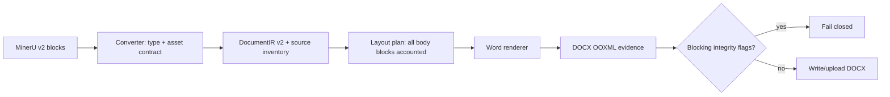

# 技术设计：正式 Word 链路结构性回退

## 1. 设计目标与约束

本任务只修改当前正式 `MinerU content_list → DocumentIR v2 → layout plan → DOCX → evidence → document job` 链路。设计必须满足：

- 内容语义在最早拥有充分证据的边界确定一次；
- 每个边界都能证明输入数量与输出数量一致；
- 确定性内容丢失失败关闭，视觉风险继续人工复核；
- 复用现有 image、caption、native columns、paired image tabs 和 OOXML analyzer；
- 不恢复 legacy runtime、不新增 PDF 型号特例、不引入第三方版式引擎。

本任务各项问题共享同一不变量：**正式链路不得把已声明的可见结构或已绑定的样式配置静默降级、遗漏或重新解释成另一种语义。**

## 2. 数据流与责任边界

### 2.1 MinerU → DocumentIR owner

- `app/services/document_ir/mineru_converter.py` 继续拥有 source type 映射、资产绑定和 block 构造。
- 新增一个窄的 `app/services/document_ir/integrity.py`，只拥有 DocumentIR 内容完整性 evidence、稳定阻断 flag 和 `DocumentIntegrityError`；不解析 MinerU JSON、不渲染 Word。
- `DocumentIRMetadata` 增加带默认值的源 inventory 字段：过滤/续表归一化后的 source block 总数和按 source type 计数。旧 v1/v2 payload 缺少该字段时保持可读取，并明确跳过无法证明的 source inventory 对账。

新增 metadata 是必要的数据合同变化：仅凭已经生成的 IR block 无法发现“某个 raw block 在构造 IR 前被完全漏掉”。inventory 是单向只读证据，不成为第二套内容源。

### 2.2 DocumentIR → layout/DOCX owner

- `layout_plan.py` 继续拥有 body block 是否进入页面/区域以及区域合并；不在 renderer 重猜 bbox。
- `word_renderer.py` 继续拥有 native columns 和 paired-image tab-stop 输出；不新增另一种双栏 writer。
- `renderer/evidence.py` 继续作为 IR/layout/DOCX 的汇总边界，增加 expected/actual 对账与 `blocking_quality_flags`，复用 `DocumentIntegrityError` 失败关闭。
- `docx_quality.py` 只负责读取 DOCX OOXML 实际计数；不读取 MinerU 或决定 job 状态。

### 2.3 发布边界

- 本地 `formal_mineru_conversion.run_conversion()` 在 evidence 与 blocking gate 通过后才写最终 DOCX；允许在失败前保留已生成的内存 bytes/错误证据，但不得留下可误认成功的目标 DOCX。
- 在线 `_convert_and_save_document_ir()` 由 converter 内部 gate 保证只接收完整 IR；失败时当前 stage 已是 `ir_converting`，沿用现有 `document_ir_failed` 分类。
- 在线 `_render_and_save_word()` 在切换 `uploading` 前执行 renderer gate；失败时沿用现有 `render_failed` 分类。
- 不新增公开 API error code，不改 job schema；稳定 blocking flag 和错误消息进入现有失败事件/错误字段。

## 3. R1：chart 类型契约

### 3.1 映射

`_map_block_type()` 将 `chart` 加入 `image/figure` 集合。后续完全复用：

- `extract_first_asset_path()` 递归读取 `content.image_source.path`；
- `_resolve_image_path()` 限定包根目录并读取 bytes；
- `_captions()` / `_footnotes()` 读取 `chart_caption` / `chart_footnote`；
- `_reassociate_numbered_image_captions()` 的现有 chart 分组规则；
- image renderer 与 COL-003 严格配对路径。

不新增 DocumentIR `chart` block type，因为 Word 输出对 chart 与普通嵌入图片的编辑/排版合同相同。

### 3.2 source inventory 与映射验证

converter 在允许的末页过滤和续表归一化后记录 source inventory。完整性检查按声明类型验证：

| Source type | 允许的 IR 结果 | 必需内容 |
|---|---|---|
| `chart/image/figure` | `image` | `asset_ref` 指向现有 IR asset |
| `table` | `table` | 非空 table HTML |
| 公式类型集合 | `formula` | 非空 latex/math source |
| `title/heading` | `heading` | 可见 text |
| `list/index` | `list` | 至少一个 item |
| 页面装饰 | `paragraph` + 对应 role | 装饰文本可为空时不阻断 |
| `text/paragraph/para` | `paragraph` 或可靠显式列表 | 可见文本按现有合同处理 |

主 block 通过 source index/metadata 与合成的 table context paragraph 区分。source 总数、类型数、主 IR block 数或必要 payload 不一致产生稳定 `source_ir_integrity:*` blocking flag，并抛出 `DocumentIntegrityError`。

## 4. R2：段落语义

### 4.1 显式语义优先

`_RenderContext` 增加单次渲染布尔值 `allow_heading_inference`：

- `document-ir/v2`：`False`，paragraph 仍可走现有 TOC/list/bullet 识别，但不能升级为 heading；
- `document-ir/v1` 顺序兼容：`True`，保留当前 heading-like 行为。

该值从 `render_to_bytes()` 的 DocumentIR schema 产生，随现有 render context 向 paragraph 文本入口传递；不使用全局状态或 renderer 实例字段。

### 4.2 caption/reference 排除

共享 `text_semantics` 中将 `图/表/Figure/Table + 编号` 从 heading 规则移除或先显式排除。这样同时保护：

- v1 自动推断不能把题注/引用句升级为标题；
- v2 即使未来某条兼容路径调用 heading heuristic，也不会重现本次误判；
- DOCX quality analyzer 在完成 formula/list/TOC 排除后复用共享 heading 结论，不再维护冲突的中文/英文 caption 判断。

不按“图 13 显示了”完整句子建立黑名单，也不硬编码“工作原理”；后者由显式 IR heading 保证。

## 5. R3：双栏与 continuous section 收敛

### 5.1 保留的输出机制

- 普通文字双栏：一次 `CONTINUOUS` two-column section、一次 column break、一次 `CONTINUOUS` one-column restore；
- 严格成对图片：现有单栏 tab-stop rows，不产生 section；
- wide 内容：保持 one-column；
- 真实单栏间隙：保持独立 one-column region。

### 5.2 planner 后处理

在 `_build_regions()` 完成真实 band 初分组后，增加一个局部、确定性的区域归并：

1. 候选必须紧随一个普通 `two_col` region；
2. 候选 `one_col` region 的所有 block 都是非 wide、同一 column hint 的正文尾部；
3. 页面后续不得再出现普通左右文字双栏流；页面结束或后续仅有图片区时可归并；
4. 任一 wide block、左右混合、缺 bbox/column hint，或后续存在新的左右文字 band，均不归并。

这会把 CM4112 首页“应用/管脚配置”保留在左栏尾部，同时让最后的严格图片对继续单独走 tab-stop；已有“两个文字双栏 band 中间的真实单栏 gap”测试继续保持 one-column。

不在 renderer 中扫描前后 region 猜布局，也不合并所有 one-col/two-col，以免重现先前吞并局部单栏的回退。

## 6. R4：完整性 evidence 与失败关闭

### 6.1 Evidence 形状

沿用现有 renderer metadata，增加下列稳定字段：

- `source_integrity`：source type counts、IR main block/type counts、source→IR flags；
- `expected_layout_block_count` / `layout_block_count`；
- `expected_inline_shape_count` / `docx_quality.inline_shape_count`；
- `expected_table_count` / `docx_quality.table_count`；
- `expected_heading_count` / `docx_quality.heading_paragraphs`（仅 v2 严格相等）；
- `blocking_quality_flags`：只包含确定性内容丢失；
- 现有 `quality_flags`：继续表示非阻断 DOCX 风险。

### 6.2 对账规则

1. Layout：DocumentIR 中 role=body 的所有可见 block id 必须且只能在 layout plan region 中出现一次；缺 page index 导致遗漏直接阻断。
2. Image：所有 body image block 均应有合法 asset；每个 image block 应产生一个 `wp:inline`。资产复用不影响 drawing 数，因此不用 media file 数做严格对账。
3. Table：每个 body table block 应产生一个 DOCX table；解析失败/降级文本造成数量不足时阻断。
4. Heading：v2 不允许 paragraph 自动升级，因此显式 heading block 数必须等于 DOCX heading paragraph 数；v1 仅记录实际值，不做相等阻断。
5. 现有 LaTeX residue、manual list、TOC、visual pagination 等 flag 不进入 blocking 集合。

### 6.3 稳定失败行为

- `DocumentIntegrityError` 消息包含边界、blocking flags 和 expected/actual 摘要，供本地终端和线上 job error_message 使用。
- 不捕获后伪装成功，不删除可见内容来消除 flag。
- converter gate 在返回结果前执行；renderer gate 在写/上传 DOCX 前执行。

## 7. 兼容与迁移

- 新 DocumentIR metadata inventory 字段均有默认值；既有 v1/v2 JSON 可继续读取。
- 没有 inventory 的旧 IR 不执行无法证明的 source→IR 总量对账，但仍执行 IR→layout/DOCX 对账。
- v1 保留 heading-like 推断；v2 收紧为显式 heading。
- 现有非阻断 quality flags、Golden 人工签字流程和外部样本分层不改变。
- legacy runtime 的 visual type/分页实现不迁移，只可作为历史比较。

### 7.1 R6：caption 逻辑分组在 converter 确定一次

`MinerUToDocumentIRService._captions()` 是唯一同时知道 caption 字段语义和原始数组层级的边界，因此在这里把输入归一化为现有 `list[str]` 合同：

- flat rich-node list 是一条逻辑 caption，复用现有文本/公式归一化和片段拼接规则合成一个字符串；
- string list 或外层包含多个 rich-node group 时，每个 string/group 保持一条独立 caption；
- footnote 继续走现有 marker/连续性合并，不与 caption 规则混用。

不修改 `DocumentIRBlock.captions` 类型，也不在 image/table renderer 根据标点或文本长度重新合并。这样现有“一条 caption = 一个 Word 段落”、SEQ/bookmark、fallback、table context 和 COL-003 多 annotation 防线继续成立，只修复边界信息被拍平的根因。

### 7.2 R7：配置默认选择属于正式入口

配置解析分工保持两层：

- 本地正式 adapter 在构造 request 时解析有效来源：显式 `template_path/layout_config_path` 优先；模板未显式传入且 `no_template=False` 时使用 `Settings.default_template_path`，配置未显式传入时使用 `Settings.layout_config_path`；找不到或校验失败继续显式报错。
- `DocumentIRWordRenderer` 继续只消费传入的 `template_path/config_path`；`None` 仍表示低层无模板/空配置，不在 renderer 中读取全局 Settings。
- 在线 document job 继续使用 `TemplateReadService.resolve_template_version()` 返回的版本化配置，不接入本地 bundled fallback。

`no_template` 只把 `template_path` 设为 `None`，不清空 layout config。可见 Word 文本的字体槽写入继续完全复用 `apply_run_fonts()`；OMML 继续使用独立 `m:mathFont`，不增加第二套字体映射或系统字体探测。

## 8. 风险与回滚点

1. **误阻断旧/异常输入**：只对有明确 source inventory 和声明结构的 v2 执行 source gate；缺证据的旧 IR 不猜。
2. **表格数量误差**：先用现有标准/expanded table 路径验证“一 IR table→一 DOCX table”；若真实代码存在合法一对多，设计必须在实现前用代码证据修订，不可放宽为阈值。
3. **双栏归并过度**：保留现有真实单栏 gap 与 wide 回归，归并条件失败即维持当前区域，不做 fallback 猜测。
4. **客户端差异**：OOXML 负责确定性结构门禁，WPS 负责首页/栏平衡视觉验收，LibreOffice 只作辅助。
5. **回滚**：R1/R2/R3/R4 按提交前工作区 diff 可分别撤回；任何一项真样本回退时不得用关闭 blocking gate 掩盖，应回滚对应 owner 修改。
6. **题注过度合并**：用 legacy string list、两个 nested rich groups 和 table caption/context 负例限制；无可靠结构时保持多条，不按内容猜测。
7. **字体客户端替换**：OOXML 四槽位与入口配置 hash 可自动证明，实际字体可用性由 WPS/Word 环境决定；缺字体只记录客户端风险，不把配置值改写成机器本地字体。

## 9. 不采用的方案

- 不把 chart 新建为 DocumentIR 第七种 block type：会复制 image renderer 和 caption 逻辑。
- 不恢复 1×2 布局表格：违反现行 COL-002，并会损害正文流和可编辑性。
- 不以“每页最多 N 个 section”硬阈值修复：section 数是结果，不是语义证据。
- 不用 PDF/DOCX 页数严格相等作为自动门禁：客户端分页非确定；整页视觉由 WPS 验收。
- 不把所有 quality flag 设为 fatal：会把人工风险和确定性数据丢失混为一谈。
- 不在 renderer 合并相邻题注段落：此时原始分组已经丢失，会破坏真实多题注。
- 不让 renderer 自行读取 `Settings`：会使在线版本化配置与低层单测出现隐藏的第二默认来源。
- 不捆绑或自动安装字体：超出文档生成合同，且会把部署环境问题伪装成配置解析问题。
