# 业务架构

## 1. 业务目标

md2word 服务于公司内部技术文档交付流程。业务结果不是“完成一次文件格式转换”，而是产生一份：

- 内容尽可能完整；
- 结构可编辑；
- 技术信息未被改变；
- 翻译方向明确；
- 符合公司模板；
- 有质量证据；
- 可被人工复核；
- 能区分内部草稿与最终交付件的 DOCX。

## 2. 参与者

| 参与者 | 责任 | 主要输入 | 主要输出 |
|---|---|---|---|
| 文档操作员 `operator` | 创建任务、下载、初审、记录问题 | PDF、任务模式 | 内部草稿、QA 结论 |
| 技术翻译/审核人员 | 检查译文、术语、技术 Token | 源文、译文、术语证据 | 翻译 QA |
| 管理员 `admin` | 配置治理、批准、发布 | 模板、规则、QA 结果 | 已发布配置、最终交付件 |
| MinerU | 外部 PDF 解析 | PDF | JSON、图片和结果包 |
| 翻译 Provider | 跨语言文本翻译 | 受控文本单元 | 结构化译文 |
| Word Renderer | 生成 DOCX | DocumentIR、模板和规则 | DOCX、质量证据 |
| 文控/交付流程 | 系统外管理人工修改件 | 下载后的 DOCX | 对外或内部最终文件 |

## 3. 业务能力地图

```mermaid
flowchart TB
  A[文档任务管理] --> A1[上传与任务创建]
  A --> A2[进度/失败/重试]
  A --> A3[下载与归档]

  B[文档转换] --> B1[MinerU 产物接入]
  B --> B2[DocumentIR 规范化]
  B --> B3[DOCX 原生渲染]

  C[翻译治理] --> C1[语言方向 Prompt]
  C --> C2[翻译术语集]
  C --> C3[技术 Token 保护]
  C --> C4[翻译批次与审计]

  D[文档配置] --> D1[公司模板]
  D --> D2[页面样式]
  D --> D3[符号与排版规则]

  E[质量与交付] --> E1[自动质量检查]
  E --> E2[三栏审核]
  E --> E3[QA]
  E --> E4[批准与发布]

  F[平台治理] --> F1[用户与权限]
  F --> F2[审计]
  F --> F3[文件保留]
  F --> F4[系统状态与告警]
```



## 4. 核心业务对象

| 对象 | 说明 | 生命周期所有者 |
|---|---|---|
| Source PDF | 用户上传的原始文档 | Files |
| Document Job | 一次转换或翻译业务请求 | Document Jobs |
| MinerU Artifact Package | 外部解析结果 | MinerU/Document Jobs |
| Source DocumentIR | 原文结构化文档 | Document Processing |
| Target DocumentIR | 翻译后的目标语言文档 | Translation |
| Template Version | 公司 Word 模板和页面样式版本 | Templates |
| Symbol Rule Set | 符号与排版规则版本 | Term Rules/Terminology |
| Translation Profile | Prompt、模型和批次参数版本 | Translation |
| Translation Term Set | 指定语言方向的术语版本 | Translation |
| Generated DOCX | 每个任务唯一用户主结果 | Document Jobs/Files |
| Quality Evidence | 自动检查结果和质量标记 | Quality |
| Review Record | 人工 QA 状态和备注 | Review |
| Publication Record | 最终交付发布快照 | Delivery |

## 5. 业务价值流

### 5.1 文档转换价值流

```text
收到 PDF
→ 降低手工复制与排版成本
→ 形成可编辑 Word
→ 自动暴露结构风险
→ 人工集中处理少量风险
→ 形成可交付文件
```

### 5.2 翻译价值流

```text
收到外文/中文 PDF
→ 保留结构和技术内容
→ 模型执行受控翻译
→ 自动校验数字、单位、公式和术语
→ 人工复核语言质量
→ 形成目标语言交付文档
```

### 5.3 配置复用价值流

```text
一次模板/术语/符号规则治理
→ 发布版本
→ 后续任务固化快照并复用
→ 历史任务可追溯
```

## 6. 业务流程边界

### 系统内

- 上传、任务执行、配置快照；
- MinerU 接入；
- DocumentIR 和 DOCX 生成；
- 翻译、术语和技术 Token 校验；
- 自动质量证据；
- QA、批准和发布；
- 系统生成文件下载。

### 系统外

- 在 Word/WPS 中人工修改；
- 人工修改件的版本控制；
- 对外发送、签章、归档；
- 厂商技术内容正确性确认。

系统不得把系统外人工修改件的存在推断为系统生成件已经通过 QA。

## 7. 服务级业务规则

1. 每个任务必须有且只有一个主结果 DOCX。
2. `direct` 任务不可产生翻译调用。
3. 翻译任务必须绑定确定的语言方向。
4. HTML 表格正常存在时不得以截图替代。
5. 质量 blocked 不影响内部下载，但永久阻止当前结果发布。
6. 未复核结果不是最终交付件。
7. 发布需要 Admin 明确动作和审计记录。
8. 配置默认值变化不得影响已创建任务。
9. 历史发布文件不可覆盖。
10. 外部人工修改不进入系统版本链。

## 8. 业务指标

| 指标 | 目的 |
|---|---|
| 上传到可下载 DOCX 的完成率 | 衡量主链路可靠性 |
| 直接转换中 AI 调用数 | 必须为 0 |
| 原生表格比例 | 衡量可编辑性 |
| blocked 任务比例及原因分布 | 定位 MinerU/表格质量瓶颈 |
| 翻译 Token 完整率 | 防止技术事实变化 |
| 人工 QA 通过率 | 衡量输出可用性 |
| 首次 QA 通过率 | 衡量自动质量水平 |
| 每种语言方向通过率 | 防止以英译中代表全部语言 |
| 发布件追溯完整率 | 衡量治理能力 |
