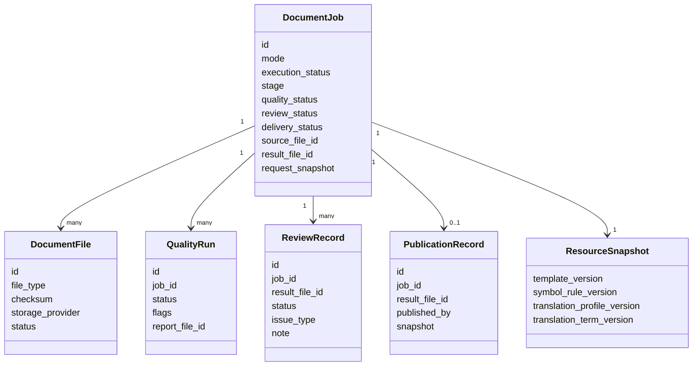

# 领域模型

## 1. 聚合与所有权



## 2. DocumentJob 聚合

### 2.1 核心字段

| 字段 | 类型 | 说明 |
|---|---|---|
| `id` | string | 稳定任务 ID |
| `mode` | enum | direct/en2zh/ru2zh/zh2en/zh2ru 对应 job mode |
| `source_file_id` | string | 源 PDF |
| `result_file_id` | nullable string | 当前系统生成 DOCX |
| `source_document_ir_file_id` | nullable string | 源 DocumentIR |
| `document_ir_file_id` | nullable string | 最终 DocumentIR；翻译模式为目标语言 IR |
| `execution_status` | enum | pending/queued/running/succeeded/failed/canceled |
| `stage` | enum | 当前流水线阶段 |
| `quality_status` | enum | pending/passed/warning/blocked |
| `review_status` | enum | unreviewed/approved/needs_fix/blocked |
| `delivery_status` | enum | internal_draft/ready_to_publish/published |
| `request_snapshot` | JSON | 输入、配置和资源快照 |
| `quality_summary` | JSON | 任务级质量摘要 |
| `retry_count` | integer | 执行 generation |
| `created_by` | string | 创建人 |
| timestamps | datetime | 创建、开始、完成、复核、发布等 |

### 2.2 聚合不变量

1. 一个任务只能有一个当前 `result_file_id`。
2. `mode=direct_pdf_to_word` 时不得存在 translation batch。
3. 翻译模式必须有 language pair、Translation Profile 和 Translation Term Set 快照。
4. `delivery_status=published` 时必须有 PublicationRecord。
5. `quality_status=blocked` 时不得进入 `ready_to_publish` 或 `published`。
6. `review_status!=approved` 时不得进入 `ready_to_publish`。
7. `execution_status!=succeeded` 时不得下载生成 DOCX 或发布。
8. 发布后当前结果文件不可被重试覆盖；重试必须创建新 generation 或克隆任务。

## 3. 文件模型

### 3.1 文件类型

```text
source_pdf
mineru_raw_result
document_ir_source
document_ir_target
image_assets_archive
generated_word
word_preview_pdf
word_preview_pages
quality_report
ai_call_log
ai_debug_archive
```

为兼容现有字段，可保留 `document_ir`，通过 metadata 表示 source/target；新实现优先明确区分。

### 3.2 文件状态

```text
pending | available | missing | expired | deleted
```

文件记录只保存 metadata 和对象标识；二进制由 Artifact Storage 保存。

## 4. 资源版本模型

### 4.1 Template Version

包含：

- DOCX 模板；
- 页面样式 YAML/JSON；
- render policy；
- snapshot hash；
- 验证任务；
- draft/published/disabled 状态。

### 4.2 Symbol Rule Set

用于：

- 上下标；
- 变量分段；
- 单位、符号和字体规则；
- 非语义文本渲染。

### 4.3 Translation Profile

包含：

- language pair；
- Prompt 内容和哈希；
- 模型；
- 最大页数/字符数；
- Provider 参数；
- profile snapshot hash。

### 4.4 Translation Term Set

包含语言方向和术语条目；任务只使用 published 版本。

## 5. DocumentIR 模型

DocumentIR 不属于数据库聚合，作为版本化 Artifact 保存。

核心内容：

```text
DocumentIR
├── metadata
├── pages[]
├── blocks[]
│   ├── id/type/order
│   ├── text/list_items/html/latex
│   ├── asset_ref
│   ├── captions[]/footnotes[]
│   ├── layout
│   └── metadata
├── assets[]
└── quality_flags[]
```

目标扩展包括：

- 稳定 source reference；
- 表格逻辑组和 fragment metadata；
- 表格 reference image；
- block/cell 质量标记；
- 翻译来源和内容 hash；
- Word anchor（作为渲染 evidence，不建议污染核心语义字段）。

## 6. 表格模型

建议引入内部 `CanonicalTableGrid`，可序列化在 table block metadata 或独立 Artifact 中。

```text
CanonicalTableGrid
├── table_id
├── source_fragments[]
├── row_count / column_count
├── cells[]
│   ├── cell_id
│   ├── row / column
│   ├── rowspan / colspan
│   ├── source_runs[]
│   ├── target_runs[]
│   ├── header_role
│   └── quality_flags[]
├── captions[] / footnotes[]
├── reference_images[]
└── quality_summary
```

不变量：

- 每个逻辑坐标最多被一个起始 cell 占用；
- span 不越界；
- 所有翻译单元可回到唯一 cell/run；
- raw HTML 永久保留；
- 规范化和人工/自动修复不得覆盖 raw HTML。

## 7. QualityRun

| 字段 | 说明 |
|---|---|
| `id` | 质量运行 ID |
| `job_id` | 所属任务 |
| `generation` | 任务 retry generation |
| `status` | passed/warning/blocked |
| `flags` | 结构化标记 |
| `page_results` | 页级摘要 |
| `block_results` | 块级摘要 |
| `table_results` | 表格级摘要 |
| `report_file_id` | 详细报告 Artifact |
| `created_at` | 创建时间 |

质量运行是证据，不直接修改内容。

## 8. ReviewRecord

ReviewRecord 是 append-only 记录；任务上的 `review_status` 是最新投影。

保存：

- 被复核的 `result_file_id` 和哈希；
- 状态；
- 问题类型；
- 备注；
- 审核人和时间；
- 当时的质量摘要。

当任务重试生成新 DOCX 时，旧 ReviewRecord 保留，新结果恢复 `unreviewed`。

## 9. PublicationRecord

发布记录不可变，至少包含：

- job/result/source file ID 与哈希；
- template/symbol rule/translation profile/term snapshot；
- renderer version；
- quality run ID；
- approved ReviewRecord ID；
- published by/at；
- publication note。

## 10. 状态派生规则

```text
ready_to_publish =
  execution_status == succeeded
  AND quality_status IN (passed, warning)
  AND review_status == approved
  AND result_file_id IS NOT NULL
  AND preview available
```

`delivery_status` 不应由前端计算，后端负责返回权威值和操作可用性。
