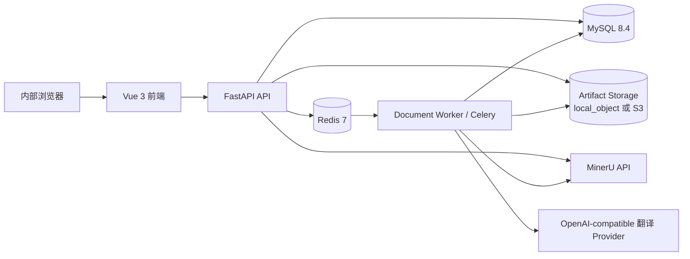
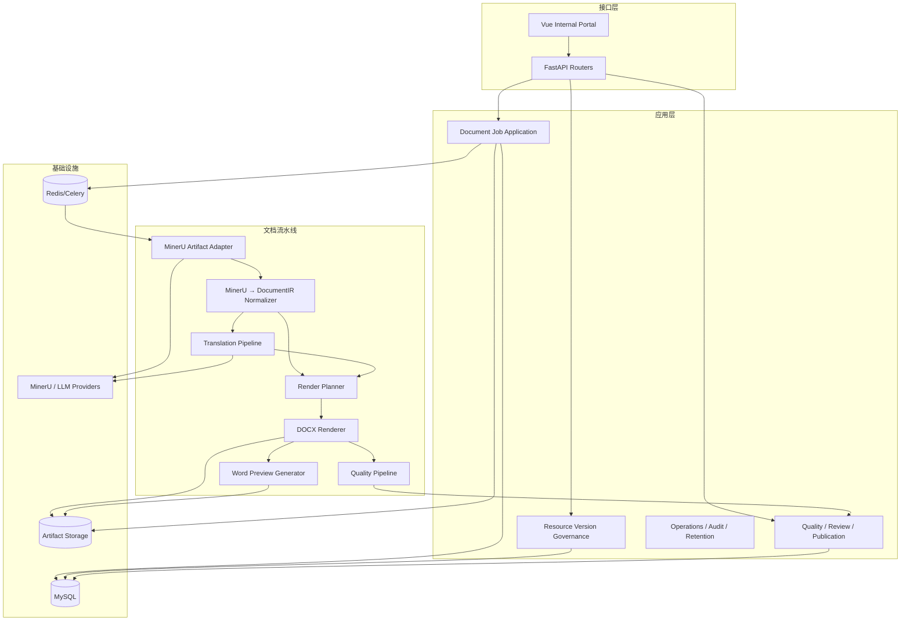

# 系统架构

## 1. 架构风格

系统保持为**模块化单体 + 异步 Worker**，不拆分微服务。

原因：

- 公司内部单租户；
- 业务核心是一条强关联文档流水线；
- 当前 FastAPI 组合根、Celery Worker、MySQL、Redis 和 Artifact Storage 已形成可运行边界；
- 质量、任务、配置和审计需要强一致的业务快照；
- 当前问题主要是模块职责和合同收口，不是独立扩缩容压力。

## 2. 当前运行拓扑



生产 Docker Compose 当前包括 API、Worker、Redis 和 MySQL；API 与 Worker共用 Python 镜像，产物卷挂载到 `/app/var`。

## 3. 目标逻辑组件



## 4. 模块职责

### `app/domains/document_jobs`

负责：

- 业务任务聚合；
- 状态机和事件；
- 配置快照；
- Worker 投递、恢复、重试和取消；
- 文件关系；
- 质量、复核和发布状态的任务级投影。

不负责：

- MinerU JSON 语义解析；
- HTML 表格网格算法；
- Word OOXML 细节；
- 翻译 Provider 协议细节。

### `app/services/document_ir`

负责：

- MinerU 产物读取；
- 源块到 DocumentIR 的确定性映射；
- 页眉页脚、caption、跨页和列表等规范化；
- 源到 IR 完整性证据；
- 稳定 block/cell ID。

### `app/domains/translation`

负责：

- 语言模式；
- Prompt/模型/术语快照；
- 翻译单元抽取；
- Provider 批次；
- 技术 Token 保护和完整性校验；
- 调用审计；
- 翻译质量证据。

### `app/services/renderer`

负责：

- 渲染计划；
- Word 原生段落、列表、表格、公式和图片；
- 模板和页面样式应用；
- DOCX OOXML 质量证据。

不得负责翻译或修改技术事实。

### `app/domains/templates` / `resources`

负责：

- 模板文件；
- 页面样式；
- 草稿、发布、默认和禁用；
- 验证任务；
- 任务快照解析。

### `app/domains/term_rules` / `terminology`

负责符号与排版规则，不与翻译术语集混用。

### `app/domains/files`

负责文件元数据、上传、下载授权、配额、保留和清理；二进制由 Artifact Storage 管理。

### 新增目标边界：Quality / Review / Publication

初期可仍位于 `document_jobs` 域内，但内部应拆成清晰服务：

```text
quality_service.py
review_service.py
publication_service.py
preview_service.py
```

只有在出现独立扩展或复用压力时才考虑独立 domain package。

## 5. 数据存储

| 数据 | 权威存储 | 说明 |
|---|---|---|
| 用户、任务、事件、状态 | MySQL | 业务元数据 |
| 配置版本和默认指针 | MySQL + 版本目录 | 内容快照与发布元数据 |
| PDF、MinerU 包、DocumentIR、DOCX、预览 | Artifact Storage | local_object 或 S3 |
| 异步任务投递 | Redis/Celery | 不是业务真源 |
| 调试全文 | Artifact Storage | 默认关闭、短保留期 |
| 质量证据摘要 | MySQL | 详细报告可存 Artifact |

## 6. 依赖方向

允许：

```text
API → Application/Domain → Service contracts → Infrastructure adapters
Document Jobs → DocumentIR / Translation / Renderer public ports
Renderer → DocumentIR models + Template config
Translation → DocumentIR models + Provider port
```

禁止：

- Renderer 直接访问数据库；
- DocumentIR converter 直接调用翻译 Provider；
- 前端推断后端状态迁移；
- API router 实现表格、翻译或 OOXML 算法；
- Redis/Celery 状态作为任务业务真源；
- `jobs` legacy 链路与 `document_jobs` 新链路重复增加新能力。

## 7. 运行时交互

### 7.1 MinerU Callback

1. API 接收回调并执行安全验证；
2. 只登记消息和事件；
3. Worker 幂等消费；
4. 下载 MinerU 结果包；
5. 登记 raw artifact；
6. 进入 DocumentIR 转换；
7. 继续翻译或直接渲染。

### 7.2 翻译批次

1. 主任务创建确定性批次计划；
2. 每个批次独立 lease、重试和拆分；
3. 结果通过结构与技术完整性检查后保存；
4. 所有叶子批次成功后组装目标 DocumentIR；
5. 任一最终失败不得静默交付部分译文。

### 7.3 渲染与质量

1. 根据 DocumentIR 生成 RenderPlan；
2. 生成 DOCX；
3. 分析 OOXML；
4. 生成 Word 预览；
5. 执行逐页检查；
6. 聚合质量状态；
7. 登记结果文件和质量报告。

## 8. 当前实现的保留与收口

必须复用：

- `MinerUToDocumentIRService`；
- `DocumentIRWordRenderer`；
- `DocumentIRTranslationService`；
- Template/Translation resource version services；
- MySQL persistence adapters；
- Celery task queues；
- 现有文件、审计、运维和验收中心。

需要收口：

- `document_jobs/execution.py` 与 `service.py` 的超大职责；
- 表格解析与渲染之间缺少 CanonicalTableGrid；
- 大表展开合并关系的回退策略；
- 翻译缺少技术 Token codec 和确定性校验；
- QA 仍偏翻译专用；
- 缺少明确文档发布记录和 Word 页面预览合同。
