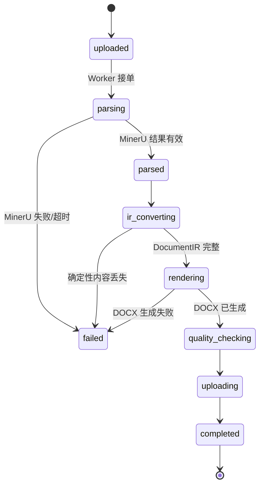
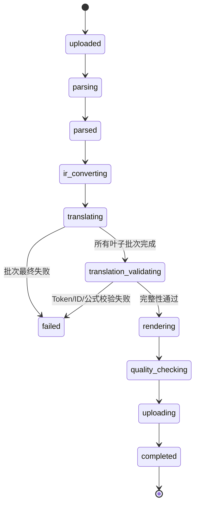
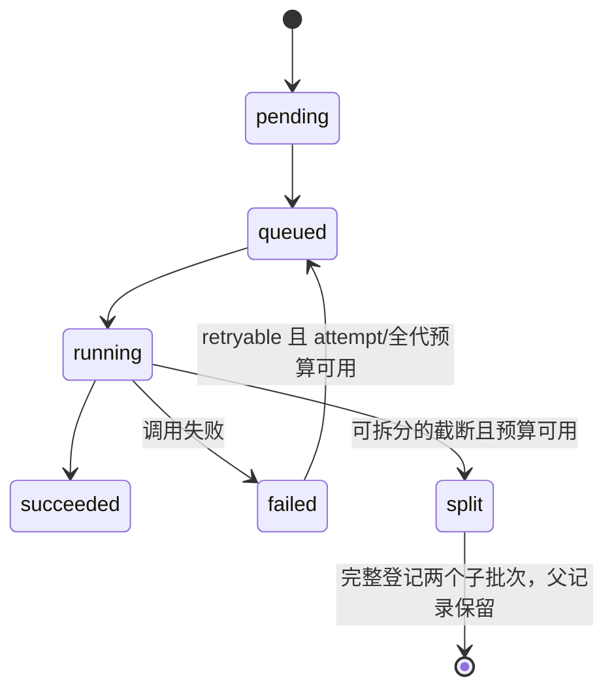
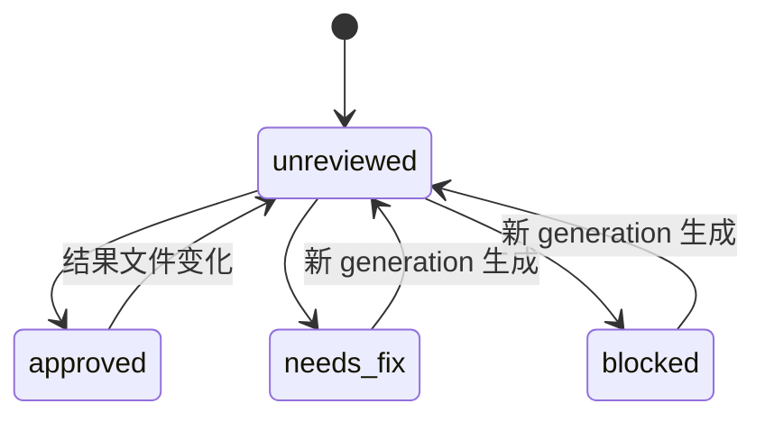
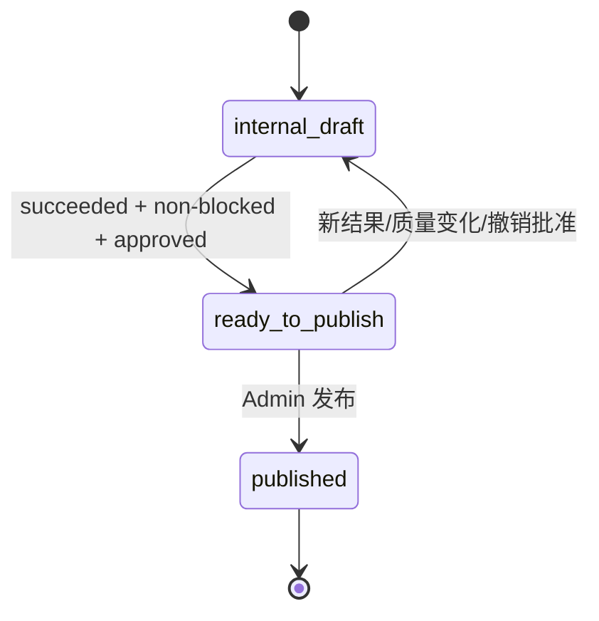

# 工作流与状态机

## 1. 状态维度

系统不得使用单一状态同时表达执行、质量和交付。

| 维度 | 状态 |
|---|---|
| 执行 | `pending/queued/running/succeeded/failed/canceled` |
| 阶段 | `uploaded/.../completed/failed/canceled` |
| 质量 | `pending/passed/warning/blocked` |
| 复核 | `unreviewed/approved/needs_fix/blocked` |
| 交付 | `internal_draft/ready_to_publish/published` |

## 2. 直接转换状态机



直接任务必须跳过翻译相关阶段和资源。

## 3. 翻译任务状态机



## 4. 翻译批次状态机



主任务只有在所有有效叶子批次 `succeeded` 且树和证据完整时才能进入 `translation_validating`。split 父记录为被替代的计划节点，不计为失败或有效叶子；残缺根集合、残缺 split 和非法叶子均明确失败。

任一叶子不可再试时，主任务立即失败，不等待活动兄弟。持久化终态结论即停止本代 enqueue/claim/结果晋升，不等待主任务 failed 写入；若两步之间中断，终态自身或排队兄弟的下一次消费均须幂等收口。终态前合法领取的在途请求允许结束并保留真实审计，其结果不得成为主件。

完整根计划安装、领取、提交和 split 均沿同 job 序列化边界进行；条件写同时核对 generation、attempt 和唯一 lease。根集合从不可变 source/config 确定，已有根不能被迟到初始化覆盖。file 不承诺多文件事务，中断后的残缺计划保留诊断并失败关闭。

## 5. 质量状态聚合

### `passed`

- 无 blocking flag；
- 无 warning flag，或只有被配置为非阻断的信息性标记。

### `warning`

- 有人工必须查看的问题；
- 文档仍具备交付可能；
- QA 批准后可发布。

### `blocked`

任一条件满足：

- 关键表格 HTML 缺失；
- 关键图片缺失；
- DocumentIR 完整性失败；
- 翻译技术 Token 变化；
- 翻译项目缺失；
- DOCX 无法打开；
- Word 内容被裁切或表格覆盖；
- 使用了非编辑表格占位；
- 规则配置的严重表格结构错误。

blocked 任务可以 `execution_status=succeeded`，因为系统已经成功生成内部诊断草稿。

## 6. 复核状态迁移



约束：

- `quality_status=blocked` 时后端必须拒绝 `approved`；
- ReviewRecord 绑定具体 result file/hash；
- 新结果不能继承旧批准。

## 7. 发布状态机



发布后的文件不允许原地替换。需要新结果时创建克隆任务或新 publication generation。

## 8. 下载策略

后端返回操作可用性，不由前端推断：

```json
{
  "download": {
    "enabled": true,
    "classification": "internal_only",
    "warning_code": "quality_blocked_not_deliverable"
  },
  "publish": {
    "enabled": false,
    "disabled_reason": "quality_status_blocked"
  }
}
```

## 9. 重试策略

### MinerU/转换阶段重试

- 使用同一任务 `retry_count/generation`；
- 保留旧事件和 Artifact；
- 新生成结果使 Review 状态回到 `unreviewed`；
- 已发布任务不得原地重试覆盖。

### 翻译批次重试

- 同一 generation 的自动恢复只重试失败叶子，不重复成功兄弟；`retryable`、attempt 上限、唯一 lease 和全代调用预算共同决定是否能再次领取。
- 完整性错误沿现有有限尝试策略处理，只有真实可拆分截断才 split；不将 Token/ID 错误伪装为截断，不用源文补齐。
- 用户通过原子 retry 入口换代后，从权威 source IR 重新建全部本代批次，默认使用原配置快照；旧译文不得改代次或重新包装复用，旧 worker 回流不能覆盖新代。
- 部分成功证据不生成 partial DOCX，也不成为目标 IR 或用户下载结果。已完成/已发布历史件和审计保持不可变。

## 10. 取消

- pending/queued/running 可请求取消；
- 已发送给 MinerU 或 Provider 的请求可能无法物理取消，但结果回流时必须根据 generation/status 幂等忽略；
- 取消不删除 Artifact 和事件；
- 取消后的任务可克隆。

## 11. 失败分类

```text
input_error
mineru_submission_error
mineru_callback_error
artifact_download_error
mineru_artifact_invalid
source_ir_integrity_error
translation_provider_error
translation_integrity_error
render_error
quality_pipeline_error
artifact_upload_error
```

错误码必须机器可读，用户文案可以中文。

## 12. 事件要求

每个阶段至少记录：

- started；
- succeeded 或 failed；
- duration；
- generation；
- trace ID；
- 非敏感摘要。

翻译批次、QA、批准和发布有独立事件类型。
