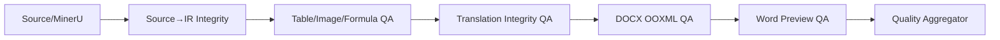

# 质量、审核与发布设计

## 1. 目标

质量系统负责回答四个不同问题：

1. 流水线是否成功执行？
2. 生成结果是否存在结构或技术风险？
3. 人工是否已经复核并接受？
4. 该结果是否已经成为最终交付件？

这四个问题不得压缩成一个 `status`。

## 2. 质量流水线



直接任务跳过 Translation Integrity。

## 3. 质量层级

### Blocker

- 确定性内容丢失；
- 关键表格无 HTML；
- 表格 span 冲突导致覆盖；
- 关键图片缺失；
- 翻译 ID/Token/数字/单位/公式变化；
- DOCX 无法打开；
- Word 预览失败且发布要求预览；
- 使用非编辑表格占位。

### Warning

- 表格疑似粘连；
- caption 归属不确定；
- 标题级别不确定；
- 表格宽度/分页可读但不理想；
- 术语/源语言残留需要人工判断；
- 视觉差异较大但内容完整。

### Info

- 自动合并跨页段落；
- 自动归并续表；
- 选择横向 section；
- 降低表格字号但未低于下限。

## 4. 质量状态聚合

```text
blocked: 存在 blocker
warning: 无 blocker，但存在 warning
passed: 无 blocker/warning
```

任务可以 `execution_status=succeeded + quality_status=blocked`，表示诊断草稿已成功生成。

## 5. 页级与元素级结果

### PageQualityResult

```json
{
  "page_index": 9,
  "status": "blocked",
  "flags": ["table_value_concatenation"],
  "block_ids": ["block_0123"],
  "preview_page": 11
}
```

源 PDF 页和 Word 预览页可能不相同，必须分别记录。

### BlockQualityResult

```json
{
  "block_id": "block_0123",
  "status": "blocked",
  "source_spans": [{"page_index":9,"bbox":[68,488,929,868]}],
  "flags": ["table_unit_concatenation"],
  "evidence": {"reference_asset_id":"..."}
}
```

## 6. 统一复核模型

现有 translation QA 扩展为 document review，不建立互不兼容的第二套状态。

```text
review_status:
  unreviewed
  approved
  needs_fix
  blocked
```

```text
issue_type:
  conversion
  translation
  terminology
  table_structure
  layout
  source_quality
  artifact_missing
  other
```

兼容策略：

- 旧 `translation_qa_*` 字段继续读写一段过渡期；
- 新 API 返回统一 `review` 对象；
- 迁移后旧字段成为投影或废弃；
- 前端队列从“翻译 QA”演进为“文档 QA”，可按 mode 过滤。

## 7. 三栏审核 UI

### 左栏：原 PDF

- 页面导航；
- `bbox` 高亮；
- 放大缩小；
- 表格/图片区域定位。

### 中栏：内容与证据

直接模式：

- DocumentIR 原文；
- block type/source type；
- caption/footnote；
- 表格 HTML/CanonicalGrid 摘要；
- 质量 flags。

翻译模式：

- 源文；
- 目标译文；
- Translation Unit ID；
- 术语命中；
- Protected Token；
- batch/provider 摘要；
- 质量 flags。

### 右栏：Word 预览

- preview PDF/page image；
- Word 页码；
- block anchor 高亮（能映射时）；
- 表格和图片布局。

### 操作

- 选择 QA 状态；
- 选择问题类型；
- 填写备注；
- 保存；
- 保存并下一项；
- 下载 Word。

不提供正文、译文或表格编辑。

## 8. 下载提示

### 未复核

```text
该文档尚未完成内部复核，仅供内部检查和修改，不得作为最终交付件。
```

### 质量阻塞

```text
该文档存在严重质量问题，可下载用于内部排查或人工修复，但不可交付或发布。
```

后端同时返回机器可读 warning code，避免前端只依赖中文文本。

## 9. 批准

批准动作：

- Operator 可提交 `approved` 建议，最终是否允许由权限策略决定；
- 推荐只有 Admin 可以形成发布前有效批准；
- 质量 blocked 时 API 必须拒绝批准；
- 批准绑定具体 result file/hash；
- 任务重试或结果变化后批准失效。

## 10. 发布

发布 API 前置：

- task succeeded；
- quality passed/warning；
- review approved；
- preview available；
- result file available；
- Admin；
- publish note/reason。

创建不可变 PublicationRecord，并将任务投影为 `published`。

## 11. 发布后行为

- 结果文件不允许覆盖；
- 任务不允许原地重试覆盖发布件；
- 需要新版本时 clone/rerun；
- 旧 PublicationRecord 永久保留；
- 下载页可以同时展示内部最新结果和已发布结果，但默认最终交付下载指向 PublicationRecord。

## 12. API 目标

```text
GET  /api/v1/document-jobs/{id}/quality
GET  /api/v1/document-jobs/{id}/review
PATCH /api/v1/document-jobs/{id}/review
GET  /api/v1/document-jobs/{id}/preview
POST /api/v1/document-jobs/{id}/publish
GET  /api/v1/document-jobs/{id}/publications
```

API 字段必须进入 OpenAPI 快照。

## 13. 审计

必须记录：

- 复核状态变更；
- 问题类型和备注摘要；
- 批准；
- 发布；
- 下载 blocked/unreviewed 文件；
- 预览生成失败；
- 发布拒绝原因。

日志不得保存全文文档。

## 14. 验收

1. blocked 文档能下载但 publish 操作不可用；
2. unreviewed 翻译能下载但不可发布；
3. result hash 变化后旧批准自动失效；
4. 发布记录不可变；
5. 三栏点击 block 可同步定位；
6. 审核页不可编辑正文；
7. 直接任务和翻译任务使用同一 review 状态模型。
