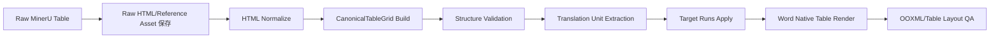

# 表格处理设计

## 1. 目标

表格处理必须同时满足：

- HTML 是可编辑主输入；
- MinerU 参考图用于质量核对；
- `rowspan/colspan` 尽量完整保留；
- 表格文本可翻译、做术语和技术 Token 检查；
- 结构失真时仍生成可编辑表格；
- 严重错误通过质量状态阻止发布，而不是自动改成图片。

## 2. 当前实现基线

当前代码已有：

- `app/conversion/runtime/table_html_parser.py`：将 HTML 解析为 `HtmlTable/HtmlCell`；
- `app/services/renderer/table_renderer.py`：创建 Word Table、处理 `rowspan/colspan`、caption 和 footnote；
- 大表超过行数或 HTML 长度阈值时，会展开跨行跨列合并；
- `docx_quality.py`：提取表格数、形状、表头行、不可拆行等 OOXML 证据。

主要差距：

1. parser 只有行和 cell，没有确定性的二维占位网格；
2. 大表展开会丢失合并语义，不符合目标；
3. 没有系统化的结构质量检查和表格级状态；
4. 没有逻辑跨页表格模型；
5. table reference image 没有成为明确的一等 QA Artifact；
6. HTML 为空时的占位和 blocked 状态需要统一合同。

## 3. 目标流水线



## 4. 模块建议

```text
app/services/tables/
├── models.py                # CanonicalTableGrid/Cell/Run
├── html_normalizer.py       # 非破坏性规范化
├── grid_builder.py          # rowspan/colspan 占位算法
├── validator.py             # 结构、内容和连续性检查
├── continuation.py          # 跨页 logical table grouping
├── translation_units.py     # cell/run 翻译单元
└── evidence.py              # 参考图和质量报告
```

初期也可放在 `app/services/document_ir/` 和 `renderer/`，但必须暴露稳定模型，避免 parser/renderer 各自重复解释 HTML。

## 5. HTML 规范化

### 允许修复

- 标签大小写；
- 缺失的闭合标签（解析器可确定时）；
- `rowspan/colspan` 非法值归一为 1，并记录 flag；
- `<br>` 转逻辑换行；
- HTML entity 解码；
- 去除纯样式或危险标签；
- 保留 `<sup>/<sub>/<i>/<b>` 语义；
- 单元格内 `$...$` 识别为 formula run。

### 禁止自动修复

- 猜测新增/删除行列；
- 根据文本语义拆分粘连单元格；
- 修改数值；
- 自动把一行拆成多行；
- 根据截图推断合并关系。

原始 HTML 和规范化 HTML 都保存；原始内容不可覆盖。

## 6. CanonicalTableGrid 算法

### 6.1 占位规则

按行顺序处理 HTML cell：

1. 找到当前行第一个未被先前 rowspan 占用的列；
2. 验证目标矩形未与已有 cell 冲突；
3. 记录 cell 起始坐标及跨度；
4. 将跨度覆盖区域标记为同一 owner；
5. 计算最大逻辑列数；
6. 行结束后记录缺口，但不自动补内容。

### 6.2 冲突

出现冲突时：

- 不静默覆盖；
- 记录 `table_span_collision`；
- 尽可能保留已解析 cell；
- `quality_status=blocked`；
- Renderer 可以生成诊断表格，但不得发布。

### 6.3 CellRun

```text
text
protected_token
formula
superscript
subscript
line_break
```

翻译只处理 `text` run；其他 run 保持原值和顺序。

## 7. 结构质量检查

### 阻断

- HTML 为空；
- 无法解析出任何行；
- span 冲突或越界导致内容覆盖；
- 逻辑列数为 0；
- 关键续表 fragment 缺失；
- Word 渲染后 cell 数/文本显著丢失。

### 严重警告，默认 blocked

- 异常连续数字：例如 `1510030150`；
- 单位重复拼接：例如 `pspsMHz`；
- 同一 cell 同时包含多个不同参数名称且数据列不足；
- 表头 6 列、数据行大量只占 1–2 列且无 span 解释；
- 跨页 fragment 列数变化；
- 地址或编号序列出现大范围跳跃。

### 一般警告

- 空单元格比例高；
- caption 缺失；
- 参考图缺失但 HTML 正常；
- 宽表需要横向页；
- 字号降至配置下限。

## 8. 异常数字和单位检测

检测只产生标记，不修改内容。

建议规则：

- 连续数字长度超过阈值，且相邻列/单位存在多值迹象；
- 单元格命中多个单位 token 且没有分隔符；
- 重复单位正则：`(ps|ns|MHz|GHz|mA|V){2,}`；
- 同一 cell 中出现多组 Min/Typ/Max 数值但表格只有一个数值列；
- 参数文本出现多个已知行标签连续拼接。

规则必须可配置，避免对寄存器长数字或合法料号误报。

## 9. 跨页表格

### 9.1 LogicalTableGroup

归并证据：

- 当前 fragment 无 caption；
- 位于页面顶部；
- 上一 fragment 位于前页底部；
- 列数/表头相似；
- 行编号、引脚编号或地址连续；
- 没有新的表号。

不能确定时保留独立表格并标记 `table_continuation_uncertain`。

### 9.2 Word 输出

逻辑续表尽量输出为一个 Word Table：

- caption 只输出一次；
- 删除完全重复的续页表头；
- 第一行设置重复表头；
- Word 自然分页；
- 必要时设置 `cantSplit`；
- 保留 fragment source spans 用于 QA 定位。

## 10. 大表策略

取消“超过阈值就展开合并关系”的默认行为。

目标顺序：

1. 使用 CanonicalTableGrid 保留 span；
2. 流式创建 Word 行，降低内存峰值；
3. 使用低层 OOXML `gridSpan/vMerge`；
4. 固定布局和列宽；
5. 横向节；
6. 紧凑表格样式；
7. 仍失败时任务失败或生成 blocked 诊断表格。

不得因为表格大就变成截图或无合并平铺。

## 11. 列宽

列宽来源按优先级：

1. 模板/表格类型显式规则；
2. header 语义（参数、Min、Typ、Max、单位、说明）；
3. 内容长度和数字列识别；
4. 等宽兜底。

输出必须：

- 明确 `tblGrid`；
- `autofit=false`；
- 单位/数值列窄，说明列宽；
- 表格字体不得低于模板下限；
- 超宽后切横向，不用图片替代。

## 12. 翻译

- 不翻译 HTML 字符串；
- 按 cell/run 抽取稳定 ID；
- 提供表题、行头、列头和章节上下文；
- 结构修复若只改 span，不使翻译失效；
- cell 内容变化由 `content_sha256` 决定是否重新翻译。

## 13. 缺失 HTML

```text
html == empty
→ 查找有效 reference image
→ 无 reference 时从 source PDF+bbox 裁图
→ Word 插入“非编辑表格占位”与明显 QA 注释
→ quality_status=blocked
→ 允许内部下载
→ publish 禁止
```

不得伪造空 Word 表格让任务看起来成功。

## 14. Word 渲染

- 先创建完整行列网格；
- 设置 `tblGrid`；
- 再写入文本和 run；
- 使用 `gridSpan/vMerge` 应用合并；
- 表头、分组行、普通 cell 使用不同样式；
- caption 在表前，footnote 在表后；
- 公式转 OMML；
- 记录 table ID 到 bookmark 或自定义 evidence map。

## 15. 测试

### 单元测试

- 规则/不规则 rowspan/colspan；
- 重叠和越界；
- `<sup>/<sub>/<br>`；
- 公式 run；
- 空 HTML；
- 1000+ 行流式渲染；
- 跨页 fragment 归并；
- 数字/单位粘连标记。

### 回归样本

- OPA228 宽表/长表；
- ZK7044 表 2 多行合并；
- ZK7044 表 6 粘连；
- ZK7044 表 10 缺失续页；
- ZK7044 表 24 多页寄存器映射。

### 验收

- HTML 存在时 Word table count 对应；
- 合并关系不因大表阈值展开；
- 表格可编辑；
- blocked 文档可下载但不可发布。
