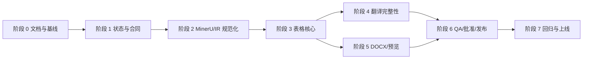

# 总实施计划

## 1. 执行原则

- 使用 Trellis 父任务管理整体计划，子任务独立实现和验收；
- 每次只执行一个可验证子任务；
- 先合同、后数据、再算法、再 UI；
- 不重写已有主链路；
- 每个阶段都保持 direct P0 Golden Sample 不回归；
- 表格和翻译改动必须使用真实最小化 MinerU 样本；
- API/DB/状态变更必须有迁移和兼容策略。

## 2. 阶段图

## 3. 阶段 0：文档和基线收口

### 目标

让 Codex 和人工开发者拥有同一产品、架构和验收真源。

### 工作

- 将本套文档合入仓库；
- 更新 README 文档索引；
- 记录 baseline commit；
- 执行现有 release check、targeted tests、前端 build；
- 保存当前 Golden/Translation/Component 样本基线；
- 确认现有代码是否已覆盖 gap analysis 中标记为“不确定”的能力。

### 出口

- 文档链接可用；
- 当前测试基线可复现；
- 未知项已形成 research note；
- 未修改业务行为。

### 回滚

仅文档变更，可直接回退文档提交。

## 4. 阶段 1：状态和数据合同

### 目标

建立后续表格、翻译、审核和发布共同依赖的稳定合同。

### 工作

1. 确认/扩展任务阶段：`translating/translation_validating/quality_checking`；
2. 增加 `quality_status/review_status/delivery_status`；
3. 定义 ReviewRecord、QualityRun、PublicationRecord；
4. 定义下载 warning 和 available action；
5. OpenAPI、前端类型和迁移；
6. direct 模式文案收口，移除产品层 zh2zh 表述。

### 出口

- 旧任务可读取；
- 新状态有后端权威迁移；
- 前端不自行推断 publish；
- blocked/unreviewed 下载策略有 API 合同；
- 现有转换主链路通过。

### 回滚

- 新字段可空/有默认值；
- 新 API additive；
- 旧 translation QA 字段保留兼容投影。

## 5. 阶段 2：MinerU 与 DocumentIR 规范化

### 目标

提高源结构可靠性，并为表格、审核定位提供稳定来源信息。

### 工作

- MinerUArtifactValidator；
- 跨页重复页眉页脚识别；
- CrossPageParagraphMerger；
- CaptionReconciler 增强；
- LogicalTableGroup/fragment metadata；
- table reference asset 登记；
- block/source spans；
- ZK7044 最小样本。

### 出口

- 源块和资产完整性可解释；
- 第 1、6、10、14–16、18、40–41、42–49 页风险有固定 fixture；
- 旧 v2 Artifact 仍可读取；
- direct Golden 不回归。

### 回滚

新规范化器按 feature flag/版本启用；旧 v2 路径保留一个发布周期。

## 6. 阶段 3：表格核心

### 目标

建立不依赖截图的可编辑表格主链路。

### 工作

- CanonicalTableGrid；
- HTML normalizer；
- span conflict validator；
- 内容粘连和单位异常检测；
- 大表保留 span，移除默认展开；
- 跨页逻辑表格；
- 空 HTML 内部占位和 blocked；
- 表格级 evidence；
- Word 原生网格/合并/列宽/横向页。

### 出口

- HTML 正常的表格全部为 Word Table；
- 大表不因阈值丢失合并关系；
- ZK7044 表 6 生成可编辑表格并 blocked；
- 表 10/表 24 缺失 fragment 可下载但不可发布；
- 表格单元测试和样本回归通过。

### 回滚

保留旧 parser/renderer feature flag；不能回退为截图默认策略。

## 7. 阶段 4：翻译完整性

### 目标

把 Prompt 约束升级为“Prompt + 代码保护 + 确定性校验”。

### 工作

- captions/footnotes 翻译；
- ProtectedTokenCodec；
- TranslationIntegrityValidator；
- TableContextBuilder；
- TranslationTextItem context；
- term output validator；
- source language residue；
- 四种语言方向独立 fixtures/gates。

### 出口

- direct Provider 调用为 0；
- 技术 Token 保持率 100%；
- annotation 全覆盖；
- 表格结构不变；
- 每种语言方向有独立通过记录；
- 部分批次失败不能产生可交付 DOCX。

### 回滚

ProtectedTokenCodec 可按 profile feature flag 启用；新任务默认开启，历史任务不重跑。

## 8. 阶段 5：DOCX、模板和预览

### 目标

完成 Word 原生渲染质量和三栏审核所需预览证据。

### 工作

- RenderPlan debug/evidence；
- OMML 和公式降级规则；
- 图片并排和 caption；
- 复杂表格 section/宽度；
- WordPreviewProvider；
- preview PDF/page Artifact；
- block→Word page/anchor map；
- 扩展 DOCX/Page QA。

### 出口

- 预览生成可重试；
- 发布前 preview required；
- 关键块可映射到 Word 页；
- Microsoft Word 人工验收通过；
- 模板版本治理不回归。

### 回滚

预览为独立 adapter；预览失败不破坏 DOCX 生成，但使质量 blocked/禁止发布。

## 9. 阶段 6：统一审核、批准和发布

### 目标

形成从内部草稿到最终交付件的受控闭环。

### 工作

- translation QA → unified document review；
- direct QA；
- QualityRun API；
- 三栏审核页面；
- blocked/unreviewed 下载提示；
- Approval；
- PublicationRecord；
- 发布下载；
- 审计和权限。

### 出口

- direct/translation 同一 review 模型；
- blocked 永远不能批准/发布；
- unreviewed 可下载不可发布；
- result hash 变化使批准失效；
- 发布文件不可覆盖；
- UI/API/审计 E2E 通过。

### 回滚

保留旧 translation QA 路由兼容；publish 功能可以 feature flag 关闭，不影响下载。

## 10. 阶段 7：回归、运营和正式启用

### 目标

把新增能力纳入日常发布门禁。

### 工作

- ZK7044 和四方向样本 matrix；
- release check 扩展；
- P0/P1 gate 更新；
- metrics/alerts；
- retention；
- 线上部署和 admin signoff；
- 更新 runbooks 和 acceptance center。

### 出口

- P0 direct 100% 通过；
- 已启用语言方向分别通过；
- blocked/unreviewed/published 状态线上证据可查；
- 回滚路径演练；
- 文档和 OpenAPI current。

## 11. 阶段依赖

- 阶段 3 依赖阶段 2 的 source spans/fragment metadata；
- 阶段 4 的表格 context 依赖阶段 3 CanonicalTableGrid；
- 阶段 6 依赖阶段 1 状态合同和阶段 5 preview；
- 阶段 7 依赖所有功能阶段。

可并行：

- 阶段 4 的普通段落 ProtectedTokenCodec 可与阶段 3 后半段并行；
- 阶段 5 的非表格图片/公式可与阶段 4 并行。

## 12. 每个子任务的 Definition of Done

- 需求和非目标明确；
- 设计不重复现有实现；
- 数据/API 兼容；
- targeted tests；
- 相关样本回归；
- 文档更新；
- OpenAPI 更新（如适用）；
- Trellis check；
- spec update；
- 未运行的重型检查和剩余风险明确记录。
